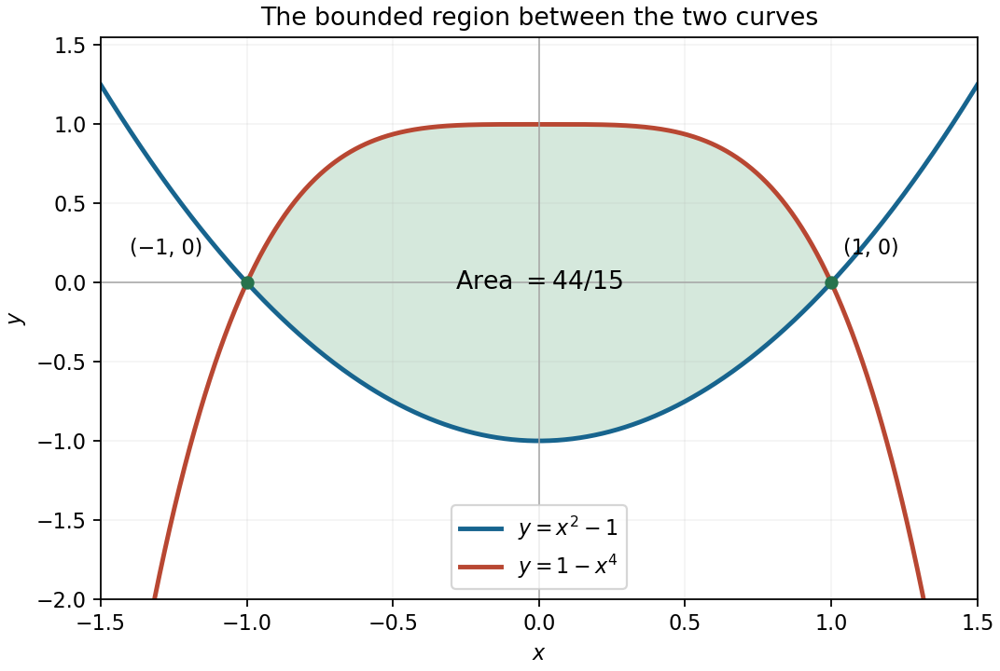

<h1 id="10/a/solution">Solution</h1>

↑ **Parent:** [A](../a.md)

The [parabola](../../../../../parabola.md) opens upward, with its minimum at $(0,-1)$ and zeros at $x=\pm1$. The quartic graph is symmetric about the vertical axis, has its flat maximum at $(0,1)$, and also has zeros at $\pm1$.

Their intersections solve $x^4+x^2-2=(x^2-1)(x^2+2)=0$, so the only real intersections are $(-1,0)$ and $(1,0)$. Between them, $1-x^4$ is the upper curve and $x^2-1$ the lower curve.

**[Figure 2](#10/a/image-the-parabola-the-inverted-quartic-and-the-finite-region-between-their-intersections). The parabola, the inverted quartic, and the finite region between their intersections**.

## ↑ Ancestors (13)

1. [A](../a.md)
2. [10](../../10.md)
3. [Paper 1](../../../paper-1-split.md)
4. [2013](../../../split.md)
5. [Past exam of the mathematics course of the year 1 of the natural sciences course of the University of Cambridge](../../../../split.md)
6. [Mathematics course of the year 1 of the natural sciences course of the University of Cambridge](../../../../../mathematics-course-of-the-year-1-of-the-natural-sciences-course-of-the-university-of-cambridge.md)
7. [Year 1 of the natural sciences course of the University of Cambridge](../../../../../year-1-of-the-natural-sciences-course-of-the-university-of-cambridge.md)
8. [Year of the natural sciences course of the University of Cambridge](../../../../../year-of-the-natural-sciences-course-of-the-university-of-cambridge.md)
9. [Natural sciences course of the University of Cambridge](../../../../../natural-sciences-course-of-the-university-of-cambridge.md)
10. [Course of the University of Cambridge](../../../../../course-of-the-university-of-cambridge.md)
11. [University of Cambridge](../../../../../university-of-cambridge-split.md)
12. [List of universities](../../../../../list-of-universities.md)
13. [Codex Wiki](../../../../../split.md)
