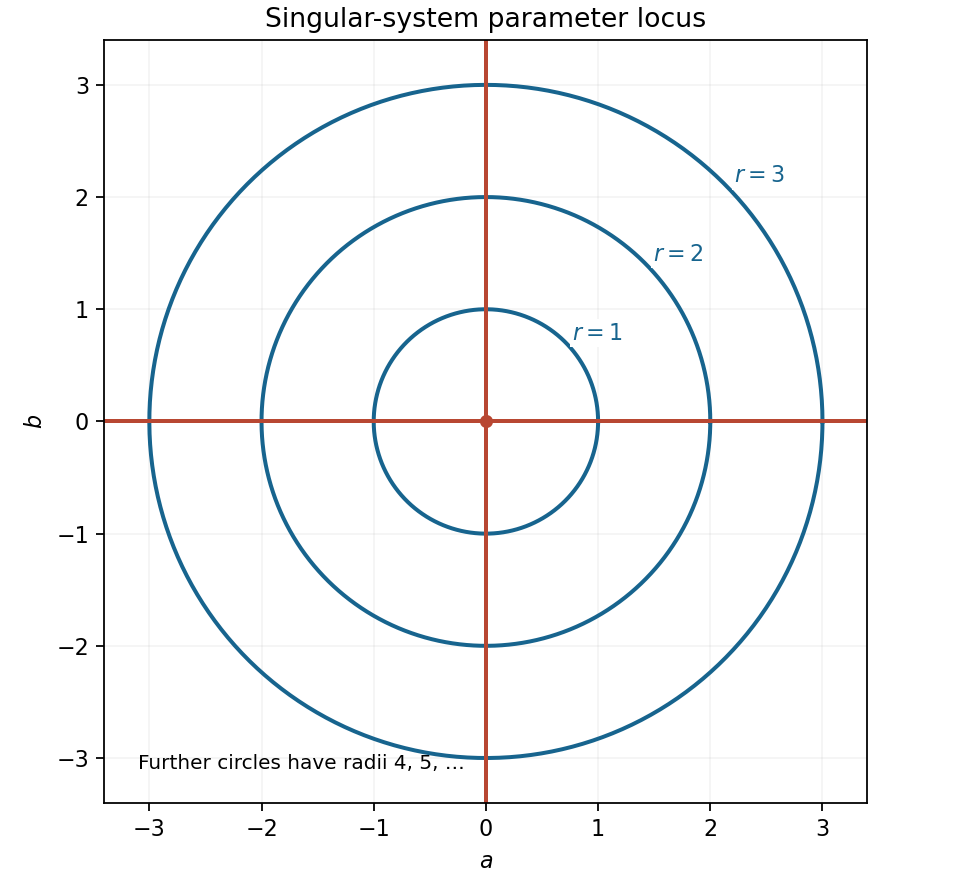

<h1 id="11/b/solution">Solution</h1>

↑ **Parent:** [B](../b.md)

The square roots simplify to the [absolute values](../../../../../absolute-value.md) $|a-b|$ and $|a+b|$. Put $s=\sin(\pi\sqrt{a^2+b^2})$. A nontrivial solution of the homogeneous [linear system](../../../../../system-of-linear-equations.md) exists exactly when its [coefficient matrix](../../../../../coefficient-matrix.md) is singular:

$$
0=\det\begin{pmatrix}|a-b|&s\\|a+b|&s\end{pmatrix}
=s(|a-b|-|a+b|).
$$

The second factor vanishes precisely when $(a-b)^2=(a+b)^2$, or $ab=0$, giving both coordinate axes. The first factor vanishes when $\sqrt{a^2+b^2}$ is a nonnegative integer. Hence the complete [locus](../../../../../locus-mathematics.md) is

$$
\boxed{\{a=0\}\ \cup\ \{b=0\}\ \cup\
\bigcup_{n=1}^{\infty}\{a^2+b^2=n^2\}.}
$$

These are the two axes together with concentric [circles](../../../../../circle.md) of positive integer radii. The zero-radius case is the origin, already included on the axes; at that point both equations vanish and any nonzero pair $(x,y)$ works.

**[Figure 3](#11/b/image-the-parameter-locus-consists-of-both-axes-and-circles-with-integer-radii). The parameter locus consists of both axes and circles with integer radii**.

## ↑ Ancestors (13)

1. [B](../b.md)
2. [11](../../11.md)
3. [Paper 1](../../../paper-1-split.md)
4. [2013](../../../split.md)
5. [Past exam of the mathematics course of the year 1 of the natural sciences course of the University of Cambridge](../../../../split.md)
6. [Mathematics course of the year 1 of the natural sciences course of the University of Cambridge](../../../../../mathematics-course-of-the-year-1-of-the-natural-sciences-course-of-the-university-of-cambridge.md)
7. [Year 1 of the natural sciences course of the University of Cambridge](../../../../../year-1-of-the-natural-sciences-course-of-the-university-of-cambridge.md)
8. [Year of the natural sciences course of the University of Cambridge](../../../../../year-of-the-natural-sciences-course-of-the-university-of-cambridge.md)
9. [Natural sciences course of the University of Cambridge](../../../../../natural-sciences-course-of-the-university-of-cambridge.md)
10. [Course of the University of Cambridge](../../../../../course-of-the-university-of-cambridge.md)
11. [University of Cambridge](../../../../../university-of-cambridge-split.md)
12. [List of universities](../../../../../list-of-universities.md)
13. [Codex Wiki](../../../../../split.md)
