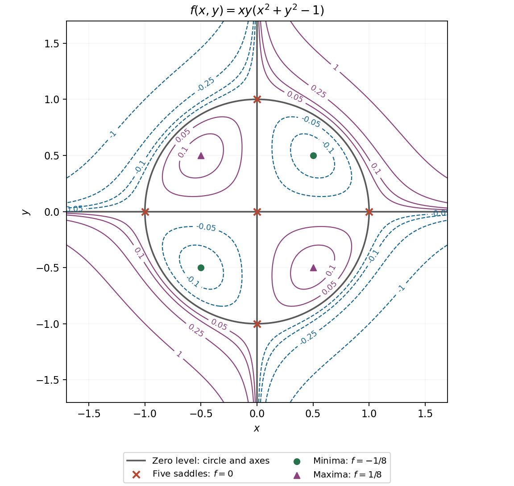

<h1 id="16/a/solution">Solution</h1>

↑ **Parent:** [A](../a.md)

The [gradient](../../../../../gradient.md) factors as

$$
f_x=y(3x^2+y^2-1),\qquad f_y=x(x^2+3y^2-1).
$$

If a coordinate is zero, the solutions are $(0,0)$, $(\pm1,0)$ and $(0,\pm1)$. With both coordinates nonzero, subtracting the two bracket equations gives $x^2=y^2$, hence $x^2=y^2=1/4$. These give four more [stationary points](../../../../../stationary-point.md).

The [Hessian matrix](../../../../../hessian-matrix.md) has equal diagonal entries $6xy$ and off-diagonal entry $3(x^2+y^2)-1$. At the origin its [eigenvalues](../../../../../eigenvalue.md) are $\pm1$, and at the four nonzero axis points they are $\pm2$, so all five are saddles. At the two same-sign interior points the [eigenvalues](../../../../../eigenvalue.md) are $1,2$, while at the opposite-sign points they are $-1,-2$. Therefore

$$
\boxed{\begin{array}{c|c|c}
\text{points}&\text{type}&f\\\hline
(0,0),(\pm1,0),(0,\pm1)&\text{saddles}&0\\
(1/2,1/2),(-1/2,-1/2)&\text{local minima}&-1/8\\
(1/2,-1/2),(-1/2,1/2)&\text{local maxima}&1/8.
\end{array}}
$$

The extrema are not global, since the quartic takes arbitrarily large positive and negative values along suitable rays.

For the contour sketch, the zero level is exactly the two axes together with the unit [circle](../../../../../circle.md). Inside the [circle](../../../../../circle.md), $f$ is negative in the first and third quadrants and positive in the other two; outside, those signs reverse. Small negative levels contain closed loops around the two minima as well as unbounded branches in the second and fourth quadrants. Small positive levels similarly contain two loops around the maxima and unbounded branches in the first and third quadrants. The closed loops shrink to the extrema at levels $\mp1/8$, and disappear beyond those levels. This is the unit-scale [quartic surface with axes and a circle as its zero set](../../../../../quartic-surface-with-axes-and-a-circle-as-its-zero-set.md).

**[Figure 4](#16/a/image-the-quartic-s-nine-stationary-points-and-its-zero-set-of-axes-and-a-unit-circle). The quartic's nine stationary points and its zero set of axes and a unit circle**.

## ↑ Ancestors (13)

1. [A](../a.md)
2. [16](../../16.md)
3. [Paper 1](../../../paper-1-split.md)
4. [2013](../../../split.md)
5. [Past exam of the mathematics course of the year 1 of the natural sciences course of the University of Cambridge](../../../../split.md)
6. [Mathematics course of the year 1 of the natural sciences course of the University of Cambridge](../../../../../mathematics-course-of-the-year-1-of-the-natural-sciences-course-of-the-university-of-cambridge.md)
7. [Year 1 of the natural sciences course of the University of Cambridge](../../../../../year-1-of-the-natural-sciences-course-of-the-university-of-cambridge.md)
8. [Year of the natural sciences course of the University of Cambridge](../../../../../year-of-the-natural-sciences-course-of-the-university-of-cambridge.md)
9. [Natural sciences course of the University of Cambridge](../../../../../natural-sciences-course-of-the-university-of-cambridge.md)
10. [Course of the University of Cambridge](../../../../../course-of-the-university-of-cambridge.md)
11. [University of Cambridge](../../../../../university-of-cambridge-split.md)
12. [List of universities](../../../../../list-of-universities.md)
13. [Codex Wiki](../../../../../split.md)
