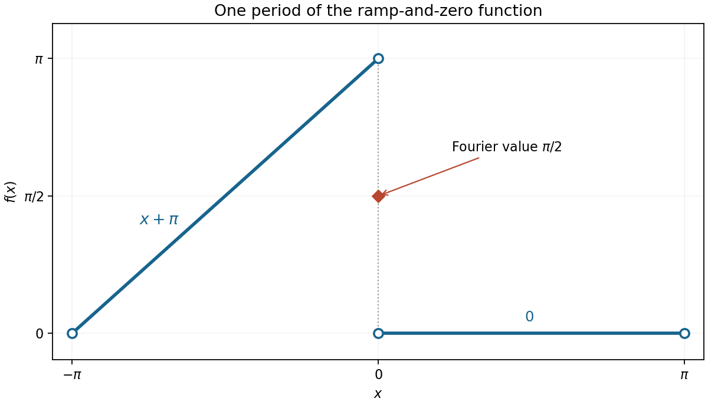

<h1 id="17/b/solution">Solution</h1>

↑ **Parent:** [B](../b.md)

Over one period, the graph rises linearly from the limiting point $(-\pi,0)$ to $(0,\pi)$, then drops to zero and stays there up to $\pi$. Repeat this pattern every $2\pi$. The given open endpoints do not fix values at the jumps, but changing individual point values does not change any [Fourier coefficient](../../../../../fourier-coefficient.md).

Only the negative half-interval contributes. The constant coefficient is

$$
a_0=\frac1\pi\int_{-\pi}^0(x+\pi)dx=\frac\pi2.
$$

For $n\geq1$, [integration by parts](../../../../../integration-by-parts.md) gives

$$
a_n=\frac1\pi\left[\frac{(x+\pi)\sin nx}{n}+\frac{\cos nx}{n^2}\right]_{-\pi}^0
=\frac{1-(-1)^n}{\pi n^2},
$$

and

$$
b_n=\frac1\pi\left[-\frac{(x+\pi)\cos nx}{n}+\frac{\sin nx}{n^2}\right]_{-\pi}^0
=-\frac1n.
$$

Consequently the requested [Fourier series](../../../../../fourier-series-split.md) is

$$
\boxed{\frac\pi4+\sum_{n=1}^{\infty}
\left[\frac{1-(-1)^n}{\pi n^2}\cos nx-\frac1n\sin nx\right].}
$$

It equals the given [function](../../../../../function-split.md) on each open [continuity](../../../../../continuous-function.md) interval. By the [Dirichlet-Jordan convergence theorem](../../../../../dirichlet-jordan-convergence-theorem.md), at $x=2k\pi$ it takes the jump midpoint $\pi/2$, while at $x=(2k+1)\pi$ it takes zero because the periodic one-sided limits agree there.

**[Figure 5](#17/b/image-one-period-of-the-ramp-and-zero-function-with-the-fourier-series-value-at-its-jump). One period of the ramp-and-zero function, with the Fourier-series value at its jump**.

## ↑ Ancestors (13)

1. [B](../b.md)
2. [17](../../17.md)
3. [Paper 1](../../../paper-1-split.md)
4. [2013](../../../split.md)
5. [Past exam of the mathematics course of the year 1 of the natural sciences course of the University of Cambridge](../../../../split.md)
6. [Mathematics course of the year 1 of the natural sciences course of the University of Cambridge](../../../../../mathematics-course-of-the-year-1-of-the-natural-sciences-course-of-the-university-of-cambridge.md)
7. [Year 1 of the natural sciences course of the University of Cambridge](../../../../../year-1-of-the-natural-sciences-course-of-the-university-of-cambridge.md)
8. [Year of the natural sciences course of the University of Cambridge](../../../../../year-of-the-natural-sciences-course-of-the-university-of-cambridge.md)
9. [Natural sciences course of the University of Cambridge](../../../../../natural-sciences-course-of-the-university-of-cambridge.md)
10. [Course of the University of Cambridge](../../../../../course-of-the-university-of-cambridge.md)
11. [University of Cambridge](../../../../../university-of-cambridge-split.md)
12. [List of universities](../../../../../list-of-universities.md)
13. [Codex Wiki](../../../../../split.md)
