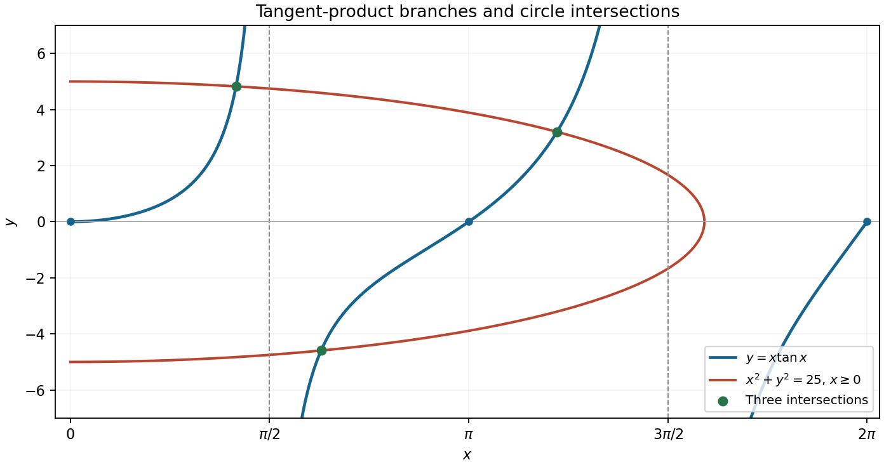

<h1 id="5/a/solution">Solution</h1>

↑ **Parent:** [A](../a.md)

The [tangent](../../../../../tangent.md) has poles at $\pi/2$ and $3\pi/2$, so these are vertical [asymptotes](../../../../../asymptote.md) of $x\tan x$. The zeros on the given interval are $0,\pi,2\pi$. Near zero, $x\tan x=x^2+O(x^4)$, so the graph starts with a horizontal [tangent line](../../../../../tangent-line.md).

Each of its three branches is increasing. Indeed

$$
f'(x)=\frac{x+\sin x\cos x}{\cos^2x},
$$

and the numerator starts at zero with [derivative](../../../../../derivative.md) $2\cos^2x\geq0$, so it is positive for $x>0$. The first branch rises from zero to $+\infty$, the middle branch rises from $-\infty$ through $(\pi,0)$ to $+\infty$, and the last rises from $-\infty$ to $(2\pi,0)$.

**[Figure 1](#5/a/image-the-three-increasing-tangent-product-branches-and-their-intersections-with-the-right-half-of-the-circle). The three increasing tangent-product branches and their intersections with the right half of the circle**.

## ↑ Ancestors (13)

1. [A](../a.md)
2. [5](../../5.md)
3. [Paper 1](../../../paper-1-split.md)
4. [2013](../../../split.md)
5. [Past exam of the mathematics course of the year 1 of the natural sciences course of the University of Cambridge](../../../../split.md)
6. [Mathematics course of the year 1 of the natural sciences course of the University of Cambridge](../../../../../mathematics-course-of-the-year-1-of-the-natural-sciences-course-of-the-university-of-cambridge.md)
7. [Year 1 of the natural sciences course of the University of Cambridge](../../../../../year-1-of-the-natural-sciences-course-of-the-university-of-cambridge.md)
8. [Year of the natural sciences course of the University of Cambridge](../../../../../year-of-the-natural-sciences-course-of-the-university-of-cambridge.md)
9. [Natural sciences course of the University of Cambridge](../../../../../natural-sciences-course-of-the-university-of-cambridge.md)
10. [Course of the University of Cambridge](../../../../../course-of-the-university-of-cambridge.md)
11. [University of Cambridge](../../../../../university-of-cambridge-split.md)
12. [List of universities](../../../../../list-of-universities.md)
13. [Codex Wiki](../../../../../split.md)
