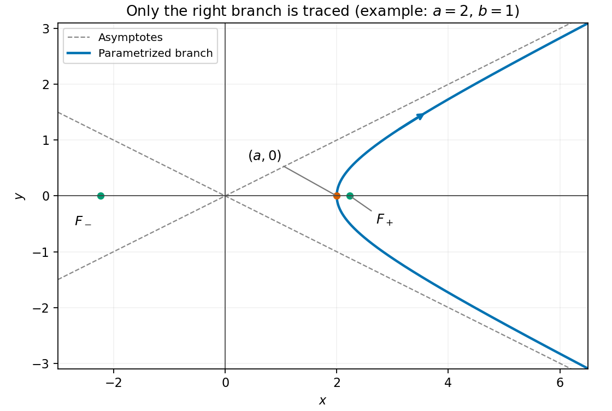

# Paper 2

↑ **Parent:** [2013](../2013.md)

[https://www.maths.cam.ac.uk/undergradnst/files/2013/PaperNST_IA_2.pdf](https://www.maths.cam.ac.uk/undergradnst/files/2013/PaperNST_IA_2.pdf)

**Table of contents**

- [1](#1)
  - [a](#1/a)
    - [Solution](#1/a/solution)
  - [b](#1/b)
    - [Solution](#1/b/solution)
- [2](#2)
  - [a](#2/a)
    - [Solution](#2/a/solution)
  - [b](#2/b)
    - [Solution](#2/b/solution)
- [3](#3)
  - [Solution](#3/solution)
- [4](#4)
  - [Solution](#4/solution)
- [5](#5)
  - [Solution](#5/solution)
- [6](#6)
  - [Solution](#6/solution)
- [7](#7)
  - [a](#7/a)
    - [Solution](#7/a/solution)
  - [b](#7/b)
    - [Solution](#7/b/solution)
- [8](#8)
  - [a](#8/a)
    - [Solution](#8/a/solution)
  - [b](#8/b)
    - [Solution](#8/b/solution)
- [9](#9)
  - [a](#9/a)
    - [Solution](#9/a/solution)
  - [b](#9/b)
    - [Solution](#9/b/solution)
- [10](#10)
  - [a](#10/a)
    - [Solution](#10/a/solution)
  - [b](#10/b)
    - [Solution](#10/b/solution)
- [11](#11)
  - [a](#11/a)
    - [Solution](#11/a/solution)
  - [b](#11/b)
    - [Solution](#11/b/solution)
  - [c](#11/c)
    - [Solution](#11/c/solution)
  - [d](#11/d)
    - [Solution](#11/d/solution)
  - [e](#11/e)
    - [Solution](#11/e/solution)
- [12](#12)
  - [a](#12/a)
    - [i](#12/a/i)
      - [Solution](#12/a/i/solution)
    - [ii](#12/a/ii)
      - [Solution](#12/a/ii/solution)
    - [iii](#12/a/iii)
      - [Solution](#12/a/iii/solution)
  - [b](#12/b)
    - [i](#12/b/i)
      - [Solution](#12/b/i/solution)
    - [ii](#12/b/ii)
      - [Solution](#12/b/ii/solution)
    - [iii](#12/b/iii)
      - [Solution](#12/b/iii/solution)
    - [iv](#12/b/iv)
      - [Solution](#12/b/iv/solution)
    - [v](#12/b/v)
      - [Solution](#12/b/v/solution)
    - [vi](#12/b/vi)
      - [Solution](#12/b/vi/solution)
- [13](#13)
  - [a](#13/a)
    - [Solution](#13/a/solution)
  - [b](#13/b)
    - [i](#13/b/i)
      - [Solution](#13/b/i/solution)
    - [ii](#13/b/ii)
      - [Solution](#13/b/ii/solution)
  - [c](#13/c)
    - [i](#13/c/i)
      - [Solution](#13/c/i/solution)
    - [ii](#13/c/ii)
      - [Solution](#13/c/ii/solution)
  - [d](#13/d)
    - [Solution](#13/d/solution)
- [14](#14)
  - [a](#14/a)
    - [Solution](#14/a/solution)
  - [b](#14/b)
    - [Solution](#14/b/solution)
  - [c](#14/c)
    - [Solution](#14/c/solution)
- [15](#15)
  - [a](#15/a)
    - [Solution](#15/a/solution)
  - [b](#15/b)
    - [Solution](#15/b/solution)
  - [c](#15/c)
    - [Solution](#15/c/solution)
  - [d](#15/d)
    - [Solution](#15/d/solution)
- [16](#16)
  - [a](#16/a)
    - [i](#16/a/i)
      - [Solution](#16/a/i/solution)
    - [ii](#16/a/ii)
      - [Solution](#16/a/ii/solution)
    - [iii](#16/a/iii)
      - [Solution](#16/a/iii/solution)
    - [iv](#16/a/iv)
      - [Solution](#16/a/iv/solution)
  - [b](#16/b)
    - [Solution](#16/b/solution)
- [17](#17)
  - [a](#17/a)
    - [Solution](#17/a/solution)
  - [b](#17/b)
    - [Solution](#17/b/solution)
- [18](#18)
  - [a](#18/a)
    - [Solution](#18/a/solution)
  - [b](#18/b)
    - [Solution](#18/b/solution)
  - [c](#18/c)
    - [Solution](#18/c/solution)
  - [d](#18/d)
    - [Solution](#18/d/solution)
  - [e](#18/e)
    - [Solution](#18/e/solution)
- [19](#19)
  - [a](#19/a)
    - [Solution](#19/a/solution)
  - [b](#19/b)
    - [Solution](#19/b/solution)
- [20](#20)
  - [a](#20/a)
    - [Solution](#20/a/solution)
  - [b](#20/b)
    - [Solution](#20/b/solution)
  - [c](#20/c)
    - [Solution](#20/c/solution)

## 1

↑ **Parent:** [Paper 2](paper-2.md)

<h3 id="1/a">a</h3>

↑ **Parent:** [1](#1)

<h4 id="1/a/solution">Solution</h4>

↑ **Parent:** [A](#1/a)

The two [dot products](../../inner-product.md#dot-product) are $\mathbf a\cdot\mathbf b=2-1-6=-5$ and $\mathbf b\cdot\mathbf c=-1-3=-4$. Therefore

$$
\boxed{(\mathbf a\cdot\mathbf b)\mathbf c+\mathbf a(\mathbf b\cdot\mathbf c)
=-5(0,1,-1)-4(1,1,-2)=(-4,-9,13)}.
$$

<h3 id="1/b">b</h3>

↑ **Parent:** [1](#1)

<h4 id="1/b/solution">Solution</h4>

↑ **Parent:** [B](#1/b)

The [cross product](../../vector-space.md#cross-product) is $\mathbf a\times\mathbf b=(1,-7,-3)$. Taking its [dot product](../../inner-product.md#dot-product) with $\mathbf c$ gives the [scalar triple product](../../multilinear-algebra.md#scalar-triple-product)

$$
\boxed{(\mathbf a\times\mathbf b)\cdot\mathbf c=-7+3=-4}.
$$

## 2

↑ **Parent:** [Paper 2](paper-2.md)

<h3 id="2/a">a</h3>

↑ **Parent:** [2](#2)

<h4 id="2/a/solution">Solution</h4>

↑ **Parent:** [A](#2/a)

The defining [exponential function](../../calculus.md#exponential-function) formulas for the [hyperbolic functions](../../calculus.md#hyperbolic-function) give

$$
\cosh^2x-\sinh^2x
=\frac{(e^x+e^{-x})^2-(e^x-e^{-x})^2}{4}
=\boxed{1}.
$$

<h3 id="2/b">b</h3>

↑ **Parent:** [2](#2)

<h4 id="2/b/solution">Solution</h4>

↑ **Parent:** [B](#2/b)

For a [real number](../../arithmetic.md#real-number) $x$, the [hyperbolic functions](../../calculus.md#hyperbolic-function) satisfy $\cosh x>0$ and $1-\tanh^2x=\operatorname{sech}^2x$. Hence $\cosh x=1/\sqrt{1-u^2}$, and multiplying it by $\tanh x=u$ gives

$$
\boxed{\sinh x=\frac{u}{\sqrt{1-u^2}},\qquad-1<u<1}.
$$

The sign of the numerator preserves the sign of $\sinh x$.

## 3

↑ **Parent:** [Paper 2](paper-2.md)

<h3 id="3/solution">Solution</h3>

↑ **Parent:** [3](#3)

Multiply numerator and denominator by the [complex conjugate](../../complex-analysis.md#complex-conjugate) of the denominator:

$$
\frac{2-3i}{2+3i}=\frac{(2-3i)^2}{2^2+3^2}
=-\frac5{13}-\frac{12}{13}i.
$$

Thus the [real part](../../complex-analysis.md#real-part) and [imaginary part](../../complex-analysis.md#imaginary-part) are $\boxed{\operatorname{Re}=-5/13,\qquad\operatorname{Im}=-12/13}$.

## 4

↑ **Parent:** [Paper 2](paper-2.md)

<h3 id="4/solution">Solution</h3>

↑ **Parent:** [4](#4)

The [gradient](../../multivariable-calculus.md#gradient) is $\nabla\phi=(2xy+z,x^2,x)$, with value $(3,1,1)$ at the point. Normalize the direction to a [unit vector](../../vector-space.md#unit-vector): $\hat{\mathbf s}=(2,0,1)/\sqrt5$. The [directional derivative](../../multivariable-calculus.md#directional-derivative) is therefore

$$
\boxed{D_{\hat{\mathbf s}}\phi=\nabla\phi\cdot\hat{\mathbf s}
=\frac{6+1}{\sqrt5}=\frac7{\sqrt5}}.
$$

## 5

↑ **Parent:** [Paper 2](paper-2.md)

<h3 id="5/solution">Solution</h3>

↑ **Parent:** [5](#5)

The [characteristic polynomial](../../linear-operator-theory.md#characteristic-polynomial) is $(1-\lambda)(4-\lambda)-4=\lambda(\lambda-5)$. Solving each [eigenvalue equation](../../linear-operator-theory.md#eigenvalue-equation) gives the [eigenvalues](../../linear-operator-theory.md#eigenvalue) and [eigenvectors](../../linear-operator-theory.md#eigenvector)

$$
\boxed{\lambda=0:\ \mathbf v=c(-2,1),\qquad
\lambda=5:\ \mathbf v=c(1,2),\qquad c\ne0}.
$$

For unit-length representatives divide each displayed direction by $\sqrt5$. The two eigendirections are [orthogonal](../../inner-product.md#orthogonal-vectors), consistently with the [matrix](../../vector-space.md#matrix) being a [symmetric matrix](../../linear-algebra.md#symmetric-matrix).

## 6

↑ **Parent:** [Paper 2](paper-2.md)

<h3 id="6/solution">Solution</h3>

↑ **Parent:** [6](#6)

Put $h=x-\pi/4$. The [trigonometric identities](../../geometry-and-topology.md#trigonometric-identity) give $\cos x\sin x=\tfrac12\sin2x=\tfrac12\cos2h$. Expanding [cosine](../../geometry-and-topology.md#cosine) at zero gives

$$
\boxed{f(x)=\frac12-\left(x-\frac\pi4\right)^2
+O\left((x-\pi/4)^4\right)}.
$$

The linear and cubic terms vanish, so these are the first two nonzero [Taylor series](../../calculus.md#taylor-series) terms.

## 7

↑ **Parent:** [Paper 2](paper-2.md)

<h3 id="7/a">a</h3>

↑ **Parent:** [7](#7)

<h4 id="7/a/solution">Solution</h4>

↑ **Parent:** [A](#7/a)

Use the convention that $\theta$ is the [polar angle](../../multivariable-calculus.md#polar-angle) from positive $z$, and $\phi$ the [azimuth](../../astrophysics.md#azimuth) from positive $x$. The radius is

$$
r=\sqrt{\frac3{16}+\frac9{16}+\frac94}=\sqrt3.
$$

Then $\cos\theta=z/r=\sqrt3/2$, while $\tan\phi=y/x=\sqrt3$ and both planar coordinates are positive. Thus the [spherical coordinates](../../multivariable-calculus.md#spherical-coordinate-system) are

$$
\boxed{(r,\theta,\phi)=\left(\sqrt3,\frac\pi6,\frac\pi3\right)}.
$$

<h3 id="7/b">b</h3>

↑ **Parent:** [7](#7)

<h4 id="7/b/solution">Solution</h4>

↑ **Parent:** [B](#7/b)

Project the radius [vector](../../vector-space.md#vector) onto the $x$-$y$ [plane](../../geometry-and-topology.md#plane). The [polar angle](../../multivariable-calculus.md#polar-angle) $\theta=\pi/6$ lies between the positive $z$ axis and $OP$. The [azimuth](../../astrophysics.md#azimuth) $\phi=\pi/3$ lies in the $x$-$y$ [plane](../../geometry-and-topology.md#plane) between the positive $x$ axis and the projection of $OP$, measured toward positive $y$.

**[Figure 1](#7/b/image-polar-and-azimuthal-angles-of-the-specified-point-in-spherical-coordinates). Polar and azimuthal angles of the specified point in spherical coordinates**.

## 8

↑ **Parent:** [Paper 2](paper-2.md)

<h3 id="8/a">a</h3>

↑ **Parent:** [8](#8)

<h4 id="8/a/solution">Solution</h4>

↑ **Parent:** [A](#8/a)

First take $F_y=xe^{\sin(xy)}\cos(xy)$, then differentiate with respect to $x$. The [product rule](../../calculus.md#product-rule) and [chain rule](../../calculus.md#chain-rule) give

$$
\boxed{F_{xy}=e^{\sin(xy)}\left[\cos(xy)+xy\bigl(\cos^2(xy)-\sin(xy)\bigr)\right]}.
$$

The [function](../../function.md) is smooth, so the two mixed [partial derivatives](../../multivariable-calculus.md#partial-derivative) agree.

<h3 id="8/b">b</h3>

↑ **Parent:** [8](#8)

<h4 id="8/b/solution">Solution</h4>

↑ **Parent:** [B](#8/b)

For the [divergence](../../multivariable-calculus.md#divergence) in [Cartesian coordinates](../../linear-algebra.md#cartesian-coordinate-system), differentiate each component with respect to its own coordinate:

$$
\boxed{\nabla\cdot\mathbf G=2xz+3y^2z+0=z(2x+3y^2)}.
$$

The third component contributes zero because it is independent of $z$.

## 9

↑ **Parent:** [Paper 2](paper-2.md)

<h3 id="9/a">a</h3>

↑ **Parent:** [9](#9)

<h4 id="9/a/solution">Solution</h4>

↑ **Parent:** [A](#9/a)

For $r>0$, use the [gradient of a radial function](../../multivariable-calculus.md#gradient-of-a-radial-function) with $g(r)=1/r$:

$$
\boxed{\nabla\frac1r=-\frac{\mathbf r}{r^3}}.
$$

Equivalently each component is $-x_j/r^3$ by differentiating $r^2=x^2+y^2+z^2$. The origin is excluded from the [function](../../function.md)'s domain.

<h3 id="9/b">b</h3>

↑ **Parent:** [9](#9)

<h4 id="9/b/solution">Solution</h4>

↑ **Parent:** [B](#9/b)

The [product rule for divergence](../../multivariable-calculus.md#product-rule-for-divergence), $\nabla\cdot\mathbf r=3$, and the result in (a) give, for $r>0$,

$$
\nabla\cdot\frac{\mathbf r}{r}
=\frac1r\nabla\cdot\mathbf r+\mathbf r\cdot\nabla\frac1r
=\frac3r-\frac{\mathbf r\cdot\mathbf r}{r^3}
=\boxed{\frac2r}.
$$

This is a pointwise identity away from the origin, where the radial [unit vector](../../vector-space.md#unit-vector) is undefined.

## 10

↑ **Parent:** [Paper 2](paper-2.md)

<h3 id="10/a">a</h3>

↑ **Parent:** [10](#10)

<h4 id="10/a/solution">Solution</h4>

↑ **Parent:** [A](#10/a)

For [independent events](../../probability-theory.md#independent-events) from fair dice, the [probability](../../probability-theory.md#probability) of a six on each roll is $1/6$. Multiplication gives

$$
\boxed{P(\text{all sixes})=(1/6)^3=\frac1{216}}.
$$

<h3 id="10/b">b</h3>

↑ **Parent:** [10](#10)

<h4 id="10/b/solution">Solution</h4>

↑ **Parent:** [B](#10/b)

The [complement of an event](../../probability-space.md#complement-of-an-event) here is that all three dice avoid six, with [probability](../../probability-theory.md#probability) $(5/6)^3$. Therefore

$$
\boxed{P(\text{at least one six})=1-(5/6)^3=\frac{91}{216}}.
$$

## 11

↑ **Parent:** [Paper 2](paper-2.md)

<h3 id="11/a">a</h3>

↑ **Parent:** [11](#11)

<h4 id="11/a/solution">Solution</h4>

↑ **Parent:** [A](#11/a)

The [probability density function](../../continuous-probability-distribution.md#probability-density-function) is nonnegative for $\alpha>0$. Its [integral](../../integral.md) over the support is

$$
\int_1^\infty\alpha x^{-\alpha-1}\,dx
=\left[-x^{-\alpha}\right]_1^\infty=1,
$$

so it is **normalized for every $\alpha>0$**. This is the unit-threshold [Pareto distribution](../../continuous-probability-distribution.md#pareto-distribution).

<h3 id="11/b">b</h3>

↑ **Parent:** [11](#11)

<h4 id="11/b/solution">Solution</h4>

↑ **Parent:** [B](#11/b)

The [expected value](../../expected-value.md) is the [improper integral](../../real-analysis.md#improper-integral) $\alpha\int_1^\infty x^{-\alpha}\,dx$. It converges exactly when $\alpha>1$, yielding

$$
\boxed{E[X]=\frac{\alpha}{\alpha-1},\qquad\alpha>1}.
$$

At $\alpha=1$ this [improper integral](../../real-analysis.md#improper-integral) diverges logarithmically, and for $0<\alpha<1$ it diverges as a [power](../../energy.md#power) of its upper endpoint. In both cases the nonnegative variable has infinite [mean](../../expected-value.md). This is the first [Pareto moment threshold](../../continuous-probability-distribution.md#pareto-moment-threshold).

<h3 id="11/c">c</h3>

↑ **Parent:** [11](#11)

<h4 id="11/c/solution">Solution</h4>

↑ **Parent:** [C](#11/c)

The second [moment](../../expected-value.md#moment) is $E[X^2]=\alpha\int_1^\infty x^{1-\alpha}\,dx$, finite exactly for $\alpha>2$, where it equals $\alpha/(\alpha-2)$. Subtracting the square of the [mean](../../expected-value.md) gives

$$
\boxed{\operatorname{Var}(X)=\frac{\alpha}{\alpha-2}
-\frac{\alpha^2}{(\alpha-1)^2}
=\frac{\alpha}{(\alpha-1)^2(\alpha-2)},\qquad\alpha>2}.
$$

For $1<\alpha\leq2$, the [mean](../../expected-value.md) exists but the [variance](../../variance.md) is infinite. For $0<\alpha\leq1$, the ordinary centered [variance](../../variance.md) is not defined because the [mean](../../expected-value.md) is not finite. Thus there is no finite [variance](../../variance.md) for any $\alpha\leq2$.

<h3 id="11/d">d</h3>

↑ **Parent:** [11](#11)

<h4 id="11/d/solution">Solution</h4>

↑ **Parent:** [D](#11/d)

Integrating the [probability density function](../../continuous-probability-distribution.md#probability-density-function) from its lower endpoint to $x$ gives the [cumulative distribution function](../../probability-distribution.md#cumulative-distribution-function)

$$
\boxed{F(x)=\begin{cases}0,&x\leq1,\\1-x^{-\alpha},&x>1.\end{cases}}
$$

It is continuous and strictly increasing on the support. Hence the unique [median](../../probability-distribution.md#median) $m$ satisfies $F(m)=1/2$, or $m^{-\alpha}=1/2$. Therefore

$$
\boxed{m=2^{1/\alpha}}.
$$

<h3 id="11/e">e</h3>

↑ **Parent:** [11](#11)

<h4 id="11/e/solution">Solution</h4>

↑ **Parent:** [E](#11/e)

The numerator event is contained in the conditioning event. The definition of [conditional probability](../../probability-theory.md#conditional-probability) therefore gives

$$
\boxed{P(1<X<3\mid1<X<6)
=\frac{P(1<X<3)}{P(1<X<6)}
=\frac{1-3^{-\alpha}}{1-6^{-\alpha}}}.
$$

The denominator is positive for all $\alpha>0$, and endpoint strictness is irrelevant for a [continuous probability distribution](../../continuous-probability-distribution.md).

## 12

↑ **Parent:** [Paper 2](paper-2.md)

<h3 id="12/a">a</h3>

↑ **Parent:** [12](#12)

<h4 id="12/a/i">i</h4>

↑ **Parent:** [A](#12/a)

<h5 id="12/a/i/solution">Solution</h5>

↑ **Parent:** [I](#12/a/i)

Using the [Einstein summation convention](../../multilinear-algebra.md#einstein-notation), reorder the scalar components and sum over the two dummy indices separately:

$$
a_i b_k b_i a_k=(a_i b_i)(a_k b_k)
=\boxed{(\mathbf a\cdot\mathbf b)^2}.
$$

The repeated suffixes each represent the three-dimensional component sum.

<h4 id="12/a/ii">ii</h4>

↑ **Parent:** [A](#12/a)

<h5 id="12/a/ii/solution">Solution</h5>

↑ **Parent:** [Ii](#12/a/ii)

Contract the [Kronecker deltas](../../multilinear-algebra.md#kronecker-delta) in the first term to obtain $a_i b_i$. In the second term, $\delta_{ij}$ identifies the two $a$ components, while the two $b_k$ components already contract. Therefore

$$
\boxed{a_i b_k\delta_{km}\delta_{im}+a_i b_k a_j b_k\delta_{ij}
=\mathbf a\cdot\mathbf b+(\mathbf a\cdot\mathbf a)(\mathbf b\cdot\mathbf b)}.
$$

<h4 id="12/a/iii">iii</h4>

↑ **Parent:** [A](#12/a)

<h5 id="12/a/iii/solution">Solution</h5>

↑ **Parent:** [Iii](#12/a/iii)

In three dimensions each contracted delta is the [trace](../../linear-algebra.md#matrix-trace) of the identity, $\delta_{jj}=\delta_{kk}=3$. Thus the exponent is six and the base is $\mathbf a\cdot\mathbf a$. Hence

$$
\boxed{(a_i a_i)^{\delta_{jj}+\delta_{kk}}
=(\mathbf a\cdot\mathbf a)^6=|\mathbf a|^{12}}.
$$

<h3 id="12/b">b</h3>

↑ **Parent:** [12](#12)

<h4 id="12/b/i">i</h4>

↑ **Parent:** [B](#12/b)

<h5 id="12/b/i/solution">Solution</h5>

↑ **Parent:** [I](#12/b/i)

An [antisymmetric matrix](../../linear-algebra.md#skew-symmetric-matrix) satisfies $A^T=-A$. Each diagonal entry is therefore its own negative, so both diagonal entries vanish. Consequently

$$
\boxed{\operatorname{tr}A=0}.
$$

<h4 id="12/b/ii">ii</h4>

↑ **Parent:** [B](#12/b)

<h5 id="12/b/ii/solution">Solution</h5>

↑ **Parent:** [Ii](#12/b/ii)

A real two-dimensional [antisymmetric matrix](../../linear-algebra.md#skew-symmetric-matrix) has the form $A=\begin{pmatrix}0&s\\-s&0\end{pmatrix}$. Its [determinant](../../multilinear-algebra.md#determinant) is $s^2=1/4$, and the specified positive upper-right entry selects $s=1/2$. Thus

$$
\boxed{A=\begin{pmatrix}0&1/2\\-1/2&0\end{pmatrix}}.
$$

<h4 id="12/b/iii">iii</h4>

↑ **Parent:** [B](#12/b)

<h5 id="12/b/iii/solution">Solution</h5>

↑ **Parent:** [Iii](#12/b/iii)

Direct multiplication gives $A^2=-I/4$. Therefore $A(-4A)=I=(-4A)A$, yielding

$$
\boxed{A^2=\begin{pmatrix}-1/4&0\\0&-1/4\end{pmatrix},\qquad
A^{-1}=-4A=\begin{pmatrix}0&-2\\2&0\end{pmatrix}}.
$$

The nonzero [determinant](../../multilinear-algebra.md#determinant) ensures that this two-sided inverse is unique as a [matrix inverse](../../matrix-inverse.md).

<h4 id="12/b/iv">iv</h4>

↑ **Parent:** [B](#12/b)

<h5 id="12/b/iv/solution">Solution</h5>

↑ **Parent:** [Iv](#12/b/iv)

Multiply $A^2=-I/4$ by $A$ once more:

$$
\boxed{A^3=-\frac14A=\begin{pmatrix}0&-1/8\\1/8&0\end{pmatrix}}.
$$

No additional [diagonalization](../../linear-operator-theory.md#diagonalization-of-a-matrix) is needed.

<h4 id="12/b/v">v</h4>

↑ **Parent:** [B](#12/b)

<h5 id="12/b/v/solution">Solution</h5>

↑ **Parent:** [V](#12/b/v)

Repeatedly using the quadratic identity gives

$$
\boxed{A^{2n}=\left(-\frac14\right)^nI,\qquad
A^{2n+1}=\left(-\frac14\right)^nA}.
$$

In entries these are $(-1)^n4^{-n}\begin{pmatrix}1&0\\0&1\end{pmatrix}$ and $(-1)^n2^{-(2n+1)}\begin{pmatrix}0&1\\-1&0\end{pmatrix}$, respectively. This is the basic reduction for [functions of a two-dimensional antisymmetric matrix](../../linear-algebra.md#functions-of-a-two-dimensional-antisymmetric-matrix).

<h4 id="12/b/vi">vi</h4>

↑ **Parent:** [B](#12/b)

<h5 id="12/b/vi/solution">Solution</h5>

↑ **Parent:** [Vi](#12/b/vi)

The even-power formula reduces every summand to a scalar multiple of $I$:

$$
\sum_{n=1}^\infty\frac{A^{4n}-2A^{2n}}n
=\left[\sum_{n=1}^\infty\frac{(1/16)^n}{n}
-2\sum_{n=1}^\infty\frac{(-1/4)^n}{n}\right]I.
$$

Both [series](../../sequence-and-series.md#series-mathematics) have [absolute convergence](../../sequence-and-series.md#absolute-convergence). Apply the [logarithm](../../calculus.md#logarithm) expansion $\sum_{n\geq1}z^n/n=-\log(1-z)$ for $|z|<1$ to obtain

$$
\left[-\log\frac{15}{16}+2\log\frac54\right]I
=\boxed{\log\frac53\,I}.
$$

Thus the off-diagonal entries vanish and both diagonal entries have the required value.

## 13

↑ **Parent:** [Paper 2](paper-2.md)

<h3 id="13/a">a</h3>

↑ **Parent:** [13](#13)

<h4 id="13/a/solution">Solution</h4>

↑ **Parent:** [A](#13/a)

Use [integration by substitution](../../integral.md#integration-by-substitution) with $x=2u$ and the Gaussian being an [even function](../../calculus.md#even-function):

$$
\boxed{\int_0^\infty e^{-x^2/4}\,dx
=2\int_0^\infty e^{-u^2}\,du=\sqrt\pi}.
$$

The factor two from the differential exactly cancels the half-line factor in the given full-line [Gaussian integral](../../integral.md#gaussian-integral).

<h3 id="13/b">b</h3>

↑ **Parent:** [13](#13)

<h4 id="13/b/i">i</h4>

↑ **Parent:** [B](#13/b)

<h5 id="13/b/i/solution">Solution</h5>

↑ **Parent:** [I](#13/b/i)

Retain the original PDF's full-line integration limits. For $n\geq2$, write $x^ne^{-x^2}\,dx=-x^{n-1}d(e^{-x^2})/2$. [Integration by parts](../../calculus.md#integration-by-parts) gives

$$
I_n=\left[-\frac12x^{n-1}e^{-x^2}\right]_{-\infty}^{\infty}
+\frac{n-1}{2}\int_{-\infty}^{\infty}x^{n-2}e^{-x^2}\,dx.
$$

[Gaussian decay dominates every power](../../calculus.md#gaussian-decay-dominates-every-power), so the endpoint term vanishes, so

$$
\boxed{I_n=\frac{n-1}{2}I_{n-2}}.
$$

This is the [full-line Gaussian moment recurrence](../../integral.md#full-line-gaussian-moment-recurrence); its initial values differ from the half-line version.

<h4 id="13/b/ii">ii</h4>

↑ **Parent:** [B](#13/b)

<h5 id="13/b/ii/solution">Solution</h5>

↑ **Parent:** [Ii](#13/b/ii)

The integrand for $I_1$ is an [odd function](../../calculus.md#odd-function) with [absolute convergence](../../sequence-and-series.md#absolute-convergence), so $I_1=0$. For $I_2$, the recurrence gives $I_2=I_0/2$, where the supplied [Gaussian integral](../../integral.md#gaussian-integral) is $I_0=\sqrt\pi$. Hence

$$
\boxed{I_1=0,\qquad I_2=\frac{\sqrt\pi}{2}}.
$$

The zero first moment is specific to the symmetric full-line domain.

<h3 id="13/c">c</h3>

↑ **Parent:** [13](#13)

<h4 id="13/c/i">i</h4>

↑ **Parent:** [C](#13/c)

<h5 id="13/c/i/solution">Solution</h5>

↑ **Parent:** [I](#13/c/i)

Use [integration by substitution](../../integral.md#integration-by-substitution) with the reciprocal variable $t=1/x$, so $dx=-dt/t^2$ and $\log x=-\log t$. The endpoints $x=1,\infty$ become $t=1,0$. Thus

$$
\int_1^\infty x^{-3}\log x\,dx
=\int_1^0t\log t\,dt
=\boxed{-\int_0^1t\log t\,dt}.
$$

Renaming the dummy integration variable proves the identity without evaluating either side.

<h4 id="13/c/ii">ii</h4>

↑ **Parent:** [C](#13/c)

<h5 id="13/c/ii/solution">Solution</h5>

↑ **Parent:** [Ii](#13/c/ii)

The [integral](../../integral.md) converges absolutely: near zero it behaves like $\log x$, and at infinity like $(\log x)/x^2$. Let its value be $J$. The [integration by substitution](../../integral.md#integration-by-substitution) $x=1/t$ gives

$$
J=\int_0^\infty\frac{-\log t}{1+t^2}\,dt=-J.
$$

Therefore

$$
\boxed{J=0}.
$$

[Absolute convergence](../../sequence-and-series.md#absolute-convergence) makes this cancellation between the two ends legitimate.

<h3 id="13/d">d</h3>

↑ **Parent:** [13](#13)

<h4 id="13/d/solution">Solution</h4>

↑ **Parent:** [D](#13/d)

The [tangent half-angle substitution](../../geometry-and-topology.md#tangent-half-angle-substitution) $t=\tan(x/2)$ gives $\sin x=2t/(1+t^2)$ and $dx=2\,dt/(1+t^2)$. The endpoints become zero and one, so

$$
\int_0^{\pi/2}\frac{dx}{2+\sin x}
=\int_0^1\frac{dt}{t^2+t+1}.
$$

Use [completing the square](../../polynomial.md#completing-the-square), $t^2+t+1=(t+1/2)^2+3/4$, and integrate:

$$
\frac2{\sqrt3}\left[\arctan\frac{2t+1}{\sqrt3}\right]_0^1
=\frac2{\sqrt3}\left(\frac\pi3-\frac\pi6\right).
$$

Thus both integrals equal $\boxed{\pi/(3\sqrt3)}$.

## 14

↑ **Parent:** [Paper 2](paper-2.md)

<h3 id="14/a">a</h3>

↑ **Parent:** [14](#14)

<h4 id="14/a/solution">Solution</h4>

↑ **Parent:** [A](#14/a)

The [characteristic equation](../../linear-ordinary-differential-equation.md#characteristic-equation-of-a-constant-coefficient-differential-equation) has roots zero and three, giving $y_h=C_1+C_2e^{3x}$. Since the forcing is quadratic and the [homogeneous solution](../../linear-ordinary-differential-equation.md#homogeneous-solution) contains a constant, use the [polynomial](../../polynomial.md) trial $y_p=Ax^3+Bx^2+Cx$. Substitution gives

$$
y_p''-3y_p'=-9Ax^2+(6A-6B)x+2B-3C.
$$

Matching coefficients gives $A=-1/3$, $B=-1/3$, and $C=-8/9$. Therefore

$$
\boxed{y=C_1+C_2e^{3x}-\frac{x^3}{3}-\frac{x^2}{3}-\frac{8x}{9}}.
$$

<h3 id="14/b">b</h3>

↑ **Parent:** [14](#14)

<h4 id="14/b/solution">Solution</h4>

↑ **Parent:** [B](#14/b)

The common [homogeneous solution](../../linear-ordinary-differential-equation.md#homogeneous-solution) is $C_1\cos2x+C_2\sin2x$. For forcing $\sin x$, a trial $a\sin x$ gives $3a\sin x=\sin x$, so the first [general solution](../../linear-ordinary-differential-equation.md#general-solution) is

$$
\boxed{y=C_1\cos2x+C_2\sin2x+\frac13\sin x}.
$$

For forcing $\sin2x$, the frequency produces [resonance in a differential equation](../../linear-ordinary-differential-equation.md#resonance-in-a-differential-equation). A trial $ax\cos2x$ gives $y_p''+4y_p=-4a\sin2x$, so $a=-1/4$ and the second solution is

$$
\boxed{y=C_1\cos2x+C_2\sin2x-\frac x4\cos2x}.
$$

The [superposition principle](../../vector-space.md#superposition-principle) permits adding the two particular solutions. The sum-forcing equation therefore has

$$
\boxed{y=C_1\cos2x+C_2\sin2x+\frac13\sin x-\frac x4\cos2x}.
$$

Only one pair of homogeneous constants is needed, because the two original homogeneous families coincide.

<h3 id="14/c">c</h3>

↑ **Parent:** [14](#14)

<h4 id="14/c/solution">Solution</h4>

↑ **Parent:** [C](#14/c)

Differentiate $y'=-y+3x$ and use the other equation:

$$
y''=-y'+3x'=-y'+12x-6y.
$$

Since $3x=y'+y$, this becomes $y''-3y'+2y=0$. Its roots are one and two, so $y=Ae^t+Be^{2t}$. The given data imply $y'(0)=-2+3=1$, hence $A+B=2$ and $A+2B=1$. Thus $A=3$, $B=-1$, giving

$$
\boxed{y(t)=3e^t-e^{2t}}.
$$

Recover the other dependent variable from $x=(y'+y)/3$:

$$
\boxed{x(t)=2e^t-e^{2t}}.
$$

These expressions satisfy both original equations and the two initial values.

## 15

↑ **Parent:** [Paper 2](paper-2.md)

<h3 id="15/a">a</h3>

↑ **Parent:** [15](#15)

<h4 id="15/a/solution">Solution</h4>

↑ **Parent:** [A](#15/a)

The [Euclidean distance](../../topological-analysis.md#euclidean-distance) is $D(x,y)=\sqrt{x^2+y^2}$. Along the [parametric curve](../../topology.md#parametric-curve),

$$
D^2=a^2\cosh^2t+b^2\sinh^2t
=a^2+(a^2+b^2)\sinh^2t.
$$

This is at least $a^2$, with equality exactly when $t=0$. Therefore

$$
\boxed{(x_m,y_m)=(a,0),\qquad D_{\min}=a}.
$$

<h3 id="15/b">b</h3>

↑ **Parent:** [15](#15)

<h4 id="15/b/solution">Solution</h4>

↑ **Parent:** [B](#15/b)

The [hyperbolic functions](../../calculus.md#hyperbolic-function) identity eliminates $t$ from the [parametric curve](../../topology.md#parametric-curve):

$$
\boxed{\frac{x^2}{a^2}-\frac{y^2}{b^2}=1,\qquad x\geq a}.
$$

The restriction is essential: $\cosh t\geq1$, so the parametrization traces only the right branch of the full [hyperbola](../../euclidean-geometry.md#hyperbola). Conversely, every point on that right branch is reached by taking $t=\operatorname{arsinh}(y/b)$.

<h3 id="15/c">c</h3>

↑ **Parent:** [15](#15)

<h4 id="15/c/solution">Solution</h4>

↑ **Parent:** [C](#15/c)

Solving for $y$ gives $y=\pm(b/a)\sqrt{x^2-a^2}$ with $x\geq a$. For large $x$, the [square root](../../algebra.md#square-root) is $x-a^2/(2x)+O(x^{-3})$, so the two [asymptotes](../../topology.md#asymptote) are

$$
\boxed{y=\frac ba x,\qquad y=-\frac ba x}.
$$

The curve lies between these lines on the right side and has its nearest point, with vertical tangent, at $(a,0)$. As $t$ increases it travels from the lower unbounded end through that vertex to the upper unbounded end. The left [hyperbola](../../euclidean-geometry.md#hyperbola) branch is not part of the given curve.

**[Figure 2](#15/c/image-the-parametrized-right-branch-of-a-hyperbola-its-foci-nearest-point-and-asymptotes). The parametrized right branch of a hyperbola, its foci, nearest point, and asymptotes**.

<h3 id="15/d">d</h3>

↑ **Parent:** [15](#15)

<h4 id="15/d/solution">Solution</h4>

↑ **Parent:** [D](#15/d)

Put $c=\sqrt{a^2+b^2}$ and denote the distances to $(-c,0)$ and $(c,0)$ by $d_-$ and $d_+$. Direct expansion using $c^2=a^2+b^2$ gives

$$
\begin{aligned}
d_-^2&=(a\cosh t+c)^2+b^2\sinh^2t=(c\cosh t+a)^2,\\
d_+^2&=(a\cosh t-c)^2+b^2\sinh^2t=(c\cosh t-a)^2.
\end{aligned}
$$

Since $c>a>0$ and $\cosh t\geq1$, both expressions inside the final square roots are positive. Hence

$$
\boxed{d_--d_+=2a}
$$

for every point of this right branch. This is the [focal-distance identity for a hyperbola](../../euclidean-geometry.md#focal-distance-identity-for-a-hyperbola); on the left branch the signed difference would reverse, while its absolute value would remain $2a$.

## 16

↑ **Parent:** [Paper 2](paper-2.md)

<h3 id="16/a">a</h3>

↑ **Parent:** [16](#16)

<h4 id="16/a/i">i</h4>

↑ **Parent:** [A](#16/a)

<h5 id="16/a/i/solution">Solution</h5>

↑ **Parent:** [I](#16/a/i)

Differentiate the [scalar field](../../classical-field-theory.md#scalar-field) with respect to each Cartesian coordinate:

$$
\boxed{\nabla V=(6x^2,2y-1,6z)}.
$$

In particular its value at the point used below is $(24,3,-6)$.

<h4 id="16/a/ii">ii</h4>

↑ **Parent:** [A](#16/a)

<h5 id="16/a/ii/solution">Solution</h5>

↑ **Parent:** [Ii](#16/a/ii)

The [cylinder](../../geometry-and-topology.md#cylinder-geometry) is a [level set](../../topology.md#level-set) of $h=x^2+y^2-8$, so its outward [normal vector](../../differential-geometry.md#normal-vector) is parallel to $\nabla h=(2x,2y,0)$. At the point this is $(4,4,0)$, with norm $4\sqrt2$. Choosing the outward [orientation](../../algebraic-topology.md#orientation-of-a-simplex) gives

$$
\boxed{\hat{\mathbf n}=\frac{(1,1,0)}{\sqrt2}}.
$$

Its negative is the equally valid inward [unit normal vector](../../differential-geometry.md#unit-normal); the next [directional derivative](../../multivariable-calculus.md#directional-derivative) then changes sign.

<h4 id="16/a/iii">iii</h4>

↑ **Parent:** [A](#16/a)

<h5 id="16/a/iii/solution">Solution</h5>

↑ **Parent:** [Iii](#16/a/iii)

Use the [gradient](../../multivariable-calculus.md#gradient) value from (i) and the outward [normal vector](../../differential-geometry.md#normal-vector) from (ii). The rate of change per unit distance is

$$
\boxed{D_{\hat{\mathbf n}}V=(24,3,-6)\cdot\frac{(1,1,0)}{\sqrt2}
=\frac{27}{\sqrt2}}.
$$

<h4 id="16/a/iv">iv</h4>

↑ **Parent:** [A](#16/a)

<h5 id="16/a/iv/solution">Solution</h5>

↑ **Parent:** [Iv](#16/a/iv)

Put $R=\sqrt8$ and parametrize the circle counterclockwise, as viewed from positive $z$, by $\mathbf r(\phi)=(R\cos\phi,R\sin\phi,3)$ for $0\leq\phi\leq2\pi$. The restricted field is

$$
V(\phi)=2R^3\cos^3\phi+R^2\sin^2\phi+27-R\sin\phi.
$$

**The PDF does not specify the differential in this [line integral](../../multivariable-calculus.md#line-integral).** An oriented [vector line integral weighted by a scalar field](../../multivariable-calculus.md#vector-line-integral-weighted-by-a-scalar-field) uses $d\mathbf r=(-R\sin\phi,R\cos\phi,0)\,d\phi$. Its two nonzero components are

$$
\begin{aligned}
\oint_\Gamma V\,dx&=-R\int_0^{2\pi}V(\phi)\sin\phi\,d\phi=\pi R^2,\\
\oint_\Gamma V\,dy&=R\int_0^{2\pi}V(\phi)\cos\phi\,d\phi
=2R^4\int_0^{2\pi}\cos^4\phi\,d\phi=\frac32\pi R^4.
\end{aligned}
$$

All other terms vanish by sine-cosine symmetry. Thus this interpretation gives

$$
\boxed{\oint_\Gamma V\,d\mathbf r=(8\pi,96\pi,0)}.
$$

If the intended convention is the scalar [arc length](../../riemannian-geometry.md#arc-length) [integral](../../integral.md), then $ds=R\,d\phi$ and

$$
\oint_\Gamma V\,ds=R\left(R^2\int_0^{2\pi}\sin^2\phi\,d\phi+54\pi\right)
=\boxed{124\sqrt2\,\pi}.
$$

That scalar [integral](../../integral.md) is independent of traversal direction. Giving both values retains the actual distinction left unspecified by the wording.

<h3 id="16/b">b</h3>

↑ **Parent:** [16](#16)

<h4 id="16/b/solution">Solution</h4>

↑ **Parent:** [B](#16/b)

Assume the components of $\mathbf F$ have continuous second [partial derivatives](../../multivariable-calculus.md#partial-derivative). Expanding the [divergence](../../multivariable-calculus.md#divergence) of its [curl](../../multivariable-calculus.md#curl) gives

$$
\begin{aligned}
\nabla\cdot(\nabla\times\mathbf F)
={}&\partial_x\partial_yF_z-\partial_x\partial_zF_y
+\partial_y\partial_zF_x-\partial_y\partial_xF_z\\
&+\partial_z\partial_xF_y-\partial_z\partial_yF_x.
\end{aligned}
$$

Each positive term cancels a negative term because the corresponding mixed [derivatives](../../calculus.md#derivative) commute. Consequently

$$
\boxed{\nabla\cdot\mathbf G=\nabla\cdot(\nabla\times\mathbf F)=0}.
$$

## 17

↑ **Parent:** [Paper 2](paper-2.md)

<h3 id="17/a">a</h3>

↑ **Parent:** [17](#17)

<h4 id="17/a/solution">Solution</h4>

↑ **Parent:** [A](#17/a)

For fixed amount of substance, take the [internal energy](../../internal-energy.md) $U=U(S,V)$. The [first law of thermodynamics](../../first-law-of-thermodynamics.md) identifies $T=U_S|_V$ and $-P=U_V|_S$. Equality of mixed second [derivatives](../../calculus.md#derivative) gives

$$
\boxed{\left(\frac{\partial T}{\partial V}\right)_S
=-\left(\frac{\partial P}{\partial S}\right)_V}.
$$

For the [Helmholtz free energy](../../thermodynamic-potential.md#helmholtz-free-energy), subtract the product differential $d(TS)$ from the [first law of thermodynamics](../../first-law-of-thermodynamics.md) to obtain $dF=-S\,dT-P\,dV$. Its natural variables are $(T,V)$, so $F_T=-S$ and $F_V=-P$. Exactness therefore gives

$$
\boxed{\left(\frac{\partial S}{\partial V}\right)_T
=\left(\frac{\partial P}{\partial T}\right)_V}.
$$

For the [Gibbs free energy](../../thermodynamic-potential.md#gibbs-free-energy), the [product rule](../../calculus.md#product-rule) gives $dG=-S\,dT+V\,dP$. Thus $G_T=-S$, $G_P=V$, and

$$
\boxed{\left(\frac{\partial S}{\partial P}\right)_T
=-\left(\frac{\partial V}{\partial T}\right)_P}.
$$

For the [enthalpy](../../enthalpy.md), $dH=T\,dS+V\,dP$, giving $H_S=T$, $H_P=V$ and

$$
\boxed{\left(\frac{\partial T}{\partial P}\right)_S
=\left(\frac{\partial V}{\partial S}\right)_P}.
$$

These are the four [Maxwell relations](../../thermodynamics.md#maxwell-relations), each following from exactness in the appropriate pair of natural variables.

<h3 id="17/b">b</h3>

↑ **Parent:** [17](#17)

<h4 id="17/b/solution">Solution</h4>

↑ **Parent:** [B](#17/b)

Along a change in [volume](../../geometry-and-topology.md#volume) at fixed [temperature](../../temperature.md), the [first law of thermodynamics](../../first-law-of-thermodynamics.md) gives

$$
\left(\frac{\partial U}{\partial V}\right)_T
=T\left(\frac{\partial S}{\partial V}\right)_T-P.
$$

Use the Helmholtz [Maxwell relation](../../thermodynamics.md#maxwell-relations) derived in (a) to replace the [entropy](../../entropy.md) [derivative](../../calculus.md#derivative). This proves

$$
\boxed{\left(\frac{\partial U}{\partial V}\right)_T
=T\left(\frac{\partial P}{\partial T}\right)_V-P}.
$$

For the stated [Van der Waals equation](../../pressure.md#van-der-waals-equation), temperature-independent $a,b$ give $P_T|_V=R/(V-b)$. Hence $U_V|_T=a/V^2$. Integrating with respect to $V$ yields

$$
U(V,T)=-\frac aV+h(T).
$$

The dilute-limit condition holds at every fixed $T$ and forces $h(T)=cT$, so

$$
\boxed{U(V,T)=cT-\frac aV}.
$$

The result is the [internal energy of a van der Waals gas](../../pressure.md#internal-energy-of-a-van-der-waals-gas) in the fixed-amount convention of the question. Its [volume](../../geometry-and-topology.md#volume) [derivative](../../calculus.md#derivative) is positive even though the attractive energy correction itself is negative.

## 18

↑ **Parent:** [Paper 2](paper-2.md)

<h3 id="18/a">a</h3>

↑ **Parent:** [18](#18)

<h4 id="18/a/solution">Solution</h4>

↑ **Parent:** [A](#18/a)

Along a differentiable graph satisfying the implicit equation, the [multivariable chain rule](../../calculus.md#multivariable-chain-rule) gives

$$
\frac{d}{dx}F(x,y(x))=F_x+F_y\frac{dy}{dx}=0.
$$

Thus, wherever $F_y\ne0$,

$$
\boxed{\frac{dy}{dx}=-\frac{F_x}{F_y}}.
$$

The [implicit function theorem](../../multivariable-calculus.md#implicit-function-theorem) supplies such a local graph under that nonvanishing condition. At a [singular point](../../algebraic-geometry.md#singular-point-of-an-algebraic-variety) both numerator and denominator vanish, so this division cannot determine its tangent.

<h3 id="18/b">b</h3>

↑ **Parent:** [18](#18)

<h4 id="18/b/solution">Solution</h4>

↑ **Parent:** [B](#18/b)

For the specified [polynomial](../../polynomial.md),

$$
F_y=2(y-x^2),\qquad F_x=-4x(y-x^2)-5x^4.
$$

The first equation $F_y=0$ forces $y=x^2$; substitution into $F_x=0$ then gives $x=0$, and hence $y=0$. It also satisfies the curve equation. Therefore the unique [singular point](../../algebraic-geometry.md#singular-point-of-an-algebraic-variety) is

$$
\boxed{(x,y)=(0,0)}.
$$

<h3 id="18/c">c</h3>

↑ **Parent:** [18](#18)

<h4 id="18/c/solution">Solution</h4>

↑ **Parent:** [C](#18/c)

A real square on the left requires $x^5\geq0$, so $x\geq0$. Taking the two square roots gives exactly the two real graph branches

$$
\boxed{y_+(x)=x^2+x^{5/2},\qquad y_-(x)=x^2-x^{5/2},\qquad x\geq0}.
$$

They meet only at the origin. The local coordinate change $Y=y-x^2$ turns the equation into $Y^2=x^5$, the [plane cusp of type (2,5)](../../algebraic-geometry.md#plane-cusp-of-type-2-5); both branches share the tangent $y=0$ there.

<h3 id="18/d">d</h3>

↑ **Parent:** [18](#18)

<h4 id="18/d/solution">Solution</h4>

↑ **Parent:** [D](#18/d)

For $x>0$, differentiate the two explicit branches:

$$
y_\pm'=x\left(2\pm\frac52\sqrt x\right),\qquad
 y_\pm''=2\pm\frac{15}{4}\sqrt x.
$$

The plus branch is strictly increasing and strictly [convex](../../real-analysis.md#convex-function) for $x>0$. Its only zero is $x=0$, also its one-sided [global minimum](../../analysis.md#global-minimum); it has no interior extremum or [inflection point](../../topology.md#inflection-point).

The minus branch rises initially, then has $y_-'=0$ at $\sqrt x=4/5$, changing from positive to negative. Its second [derivative](../../calculus.md#derivative) changes sign at $\sqrt x=8/15$. Its zeros follow from $y_-=x^2(1-\sqrt x)$. Consequently

$$
\boxed{\begin{array}{c|c|c}
&y_+&y_-\\\hline
\text{zeros}&0&0,\ 1\\
\text{interior maximum}&\text{none}&16/25\\
\text{interior minimum}&\text{none}&\text{none}\\
\text{inflection}&\text{none}&64/225
\end{array}}
$$

The origin is a one-sided [local minimum](../../analysis.md#local-minimum) of both graph branches, because their domain ends there; it is not an interior [critical point](../../analysis.md#critical-point). The minus branch has no [global minimum](../../analysis.md#global-minimum) since it tends to $-\infty$ as $x\to\infty$. Its maximum and inflection heights, useful for the sketch, are $256/3125$ and $28672/759375$, respectively.

<h3 id="18/e">e</h3>

↑ **Parent:** [18](#18)

<h4 id="18/e/solution">Solution</h4>

↑ **Parent:** [E](#18/e)

The upper branch leaves the origin horizontally and curves upward, growing like $x^{5/2}$. The lower branch shares the horizontal tangent, rises to its small maximum at $x=16/25$, then crosses the axis at $x=1$ and falls toward $-\infty$. Its [concavity](../../real-analysis.md#concave-function) changes at $x=64/225$, before the maximum. A separate zoom makes those nearby lower-branch features visible.

**[Figure 3](#18/e/image-real-branches-of-the-singular-curve-with-the-lower-branch-enlarged-to-mark-its-extrema-inflection-and-zeros). Real branches of the singular curve, with the lower branch enlarged to mark its extrema, inflection, and zeros**.

## 19

↑ **Parent:** [Paper 2](paper-2.md)

<h3 id="19/a">a</h3>

↑ **Parent:** [19](#19)

<h4 id="19/a/solution">Solution</h4>

↑ **Parent:** [A](#19/a)

For a smooth oriented [surface](../../topological-surface.md) $S$ with positively oriented [boundary](../../topology.md#boundary-of-a-set) $C=\partial S$, [Stokes theorem](../../multivariable-calculus.md#stokes-theorem) states

$$
\boxed{\iint_S(\nabla\times\mathbf F)\cdot d\mathbf S
=\oint_C\mathbf F\cdot d\mathbf r}.
$$

Here $d\mathbf S=\mathbf n\,dA$ uses the chosen [unit normal vector](../../differential-geometry.md#unit-normal), while $d\mathbf r$ is tangent to the directed [boundary](../../topology.md#boundary-of-a-set). The [boundary](../../topology.md#boundary-of-a-set) [orientation](../../algebraic-topology.md#orientation-of-a-simplex) follows the [right-hand rule](../../electromagnetism.md#right-hand-rule): curling the fingers along $C$ makes the thumb point in the normal direction. The field must be continuously differentiable on a neighbourhood of the [surface](../../topological-surface.md), with the usual piecewise-smooth allowance for its [boundary](../../topology.md#boundary-of-a-set).

**[Figure 4](#19/a/image-outward-hemisphere-orientation-its-counterclockwise-boundary-and-tangent-and-normal-elements). Outward hemisphere orientation, its counterclockwise boundary, and tangent and normal elements**.

For the upper [hemisphere](../../euclidean-geometry.md#hemisphere) with outward normal, the induced equatorial direction is counterclockwise as viewed from positive $z$.

<h3 id="19/b">b</h3>

↑ **Parent:** [19](#19)

<h4 id="19/b/solution">Solution</h4>

↑ **Parent:** [B](#19/b)

First calculate the [curl](../../multivariable-calculus.md#curl):

$$
\nabla\times\mathbf F=(0,-2z,3y-1).
$$

By [Stokes theorem](../../multivariable-calculus.md#stokes-theorem), use the positively oriented equator $\mathbf r(\phi)=(a\cos\phi,a\sin\phi,0)$, $0\leq\phi\leq2\pi$. Its tangent is $a(-\sin\phi,\cos\phi,0)$, while the restricted field is $(0,3a^2\cos\phi\sin\phi-a\cos\phi,0)$. Thus

$$
\iint_S(\nabla\times\mathbf F)\cdot d\mathbf S
=\int_0^{2\pi}\left(3a^3\cos^2\phi\sin\phi-a^2\cos^2\phi\right)d\phi
=\boxed{-\pi a^2}.
$$

The first term integrates to zero over a full period and the second uses $\int_0^{2\pi}\cos^2\phi\,d\phi=\pi$.

One can also calculate directly on the curved [surface](../../topological-surface.md). With [spherical coordinates](../../multivariable-calculus.md#spherical-coordinate-system) $0\leq\theta\leq\pi/2$, $0\leq\phi\leq2\pi$,

$$
d\mathbf S=a^2\sin\theta(\sin\theta\cos\phi,\sin\theta\sin\phi,\cos\theta)\,d\theta\,d\phi.
$$

Substitution gives the scalar integrand $a^3\sin^2\theta\cos\theta\sin\phi-a^2\sin\theta\cos\theta$. Its azimuthal [sine](../../geometry-and-topology.md#sine) term vanishes, and the rest gives $-2\pi a^2\int_0^{\pi/2}\sin\theta\cos\theta\,d\theta=-\pi a^2$, confirming the [orientation](../../algebraic-topology.md#orientation-of-a-simplex) and the same result.

## 20

↑ **Parent:** [Paper 2](paper-2.md)

<h3 id="20/a">a</h3>

↑ **Parent:** [20](#20)

<h4 id="20/a/solution">Solution</h4>

↑ **Parent:** [A](#20/a)

Under the regularity and integrability conditions for the [Leibniz integral rule](../../analysis.md#leibniz-integral-rule),

$$
\boxed{\frac{d}{d\theta}\int_{a(\theta)}^{b(\theta)}f(x,\theta)\,dx
=f(b(\theta),\theta)b'(\theta)-f(a(\theta),\theta)a'(\theta)
+\int_{a(\theta)}^{b(\theta)}\frac{\partial f}{\partial\theta}(x,\theta)\,dx}.
$$

The first two terms account for the moving endpoints; the last accounts for the integrand's own parameter dependence.

<h3 id="20/b">b</h3>

↑ **Parent:** [20](#20)

<h4 id="20/b/solution">Solution</h4>

↑ **Parent:** [B](#20/b)

For $m>-1$, integrate the base [power](../../energy.md#power) to obtain $J(m)=\int_0^1x^m\,dx=1/(m+1)$. Since $\partial_m^n x^m=x^m(\log x)^n$, differentiating $n$ times gives

$$
\boxed{\int_0^1x^m(\log x)^n\,dx
=\frac{d^n}{dm^n}\frac1{m+1}
=\frac{(-1)^nn!}{(m+1)^{n+1}}}.
$$

Here $n$ is a nonnegative integer. For justification, keep $m$ in a small closed interval bounded below by $m_0>-1$. The differentiated integrands are dominated by $x^{m_0}|\log x|^n$, whose [integral](../../integral.md) becomes $\int_0^\infty e^{-(m_0+1)t}t^n\,dt$ under $x=e^{-t}$ and is finite. The [dominated convergence theorem](../../measure-theory.md#dominated-convergence-theorem) establishes the needed [differentiation under the integral sign](../../analysis.md#differentiation-under-the-integral-sign) and the [logarithmic moments of a power on the unit interval](../../analysis.md#logarithmic-moments-of-a-power-on-the-unit-interval).

<h3 id="20/c">c</h3>

↑ **Parent:** [20](#20)

<h4 id="20/c/solution">Solution</h4>

↑ **Parent:** [C](#20/c)

Use [differentiation under the integral sign](../../analysis.md#differentiation-under-the-integral-sign), justified by the integrable bound $|x\sin(tx)e^{-x^2/2}|\leq xe^{-x^2/2}$. This gives

$$
F'(t)=-\int_0^\infty x\sin(tx)e^{-x^2/2}\,dx
=\int_0^\infty\sin(tx)\,d(e^{-x^2/2}).
$$

[Integration by parts](../../calculus.md#integration-by-parts) makes the [boundary](../../topology.md#boundary-of-a-set) term vanish: [sine](../../geometry-and-topology.md#sine) vanishes at zero and the Gaussian tends to zero at infinity. Therefore

$$
\boxed{F'(t)=-t\int_0^\infty\cos(tx)e^{-x^2/2}\,dx=-tF(t)}.
$$

The [integrating factor](../../linear-ordinary-differential-equation.md#integrating-factor) $e^{t^2/2}$ makes $(e^{t^2/2}F)'=0$, so $F(t)=Ce^{-t^2/2}$. At $t=0$, the given half-line [Gaussian integral](../../integral.md#gaussian-integral) fixes $C=\sqrt{\pi/2}$. Thus

$$
\boxed{F(t)=\sqrt{\frac\pi2}\,e^{-t^2/2}}.
$$

This is the even cosine-transform form of the [Fourier transform of a Gaussian](../../fourier-analysis.md#fourier-transform-of-a-gaussian).

## ↑ Ancestors (10)

1. [2013](../2013.md)
2. [Past exam of the mathematics course of the year 1 of the natural sciences course of the University of Cambridge](../../past-exam-of-the-mathematics-course-of-the-year-1-of-the-natural-sciences-course-of-the-university-of-cambridge.md)
3. [Mathematics course of the year 1 of the natural sciences course of the University of Cambridge](../../university-of-cambridge.md#mathematics-course-of-the-year-1-of-the-natural-sciences-course-of-the-university-of-cambridge)
4. [Year 1 of the natural sciences course of the University of Cambridge](../../university-of-cambridge.md#year-1-of-the-natural-sciences-course-of-the-university-of-cambridge)
5. [Year of the natural sciences course of the University of Cambridge](../../university-of-cambridge.md#year-of-the-natural-sciences-course-of-the-university-of-cambridge)
6. [Natural sciences course of the University of Cambridge](../../university-of-cambridge.md#natural-sciences-course-of-the-university-of-cambridge)
7. [Course of the University of Cambridge](../../university-of-cambridge.md#course-of-the-university-of-cambridge)
8. [University of Cambridge](../../university-of-cambridge.md)
9. [List of universities](../../README.md#list-of-universities)
10. [Codex Wiki](../../README.md)
