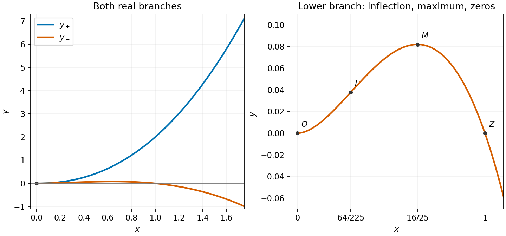

<h1 id="18/e/solution">Solution</h1>

↑ **Parent:** [E](../e.md)

The upper branch leaves the origin horizontally and curves upward, growing like $x^{5/2}$. The lower branch shares the horizontal tangent, rises to its small maximum at $x=16/25$, then crosses the axis at $x=1$ and falls toward $-\infty$. Its [concavity](../../../../../concave-function.md) changes at $x=64/225$, before the maximum. A separate zoom makes those nearby lower-branch features visible.

**[Figure 3](#18/e/image-real-branches-of-the-singular-curve-with-the-lower-branch-enlarged-to-mark-its-extrema-inflection-and-zeros). Real branches of the singular curve, with the lower branch enlarged to mark its extrema, inflection, and zeros**.

## ↑ Ancestors (13)

1. [E](../e.md)
2. [18](../../18.md)
3. [Paper 2](../../../paper-2-split.md)
4. [2013](../../../split.md)
5. [Past exam of the mathematics course of the year 1 of the natural sciences course of the University of Cambridge](../../../../split.md)
6. [Mathematics course of the year 1 of the natural sciences course of the University of Cambridge](../../../../../mathematics-course-of-the-year-1-of-the-natural-sciences-course-of-the-university-of-cambridge.md)
7. [Year 1 of the natural sciences course of the University of Cambridge](../../../../../year-1-of-the-natural-sciences-course-of-the-university-of-cambridge.md)
8. [Year of the natural sciences course of the University of Cambridge](../../../../../year-of-the-natural-sciences-course-of-the-university-of-cambridge.md)
9. [Natural sciences course of the University of Cambridge](../../../../../natural-sciences-course-of-the-university-of-cambridge.md)
10. [Course of the University of Cambridge](../../../../../course-of-the-university-of-cambridge.md)
11. [University of Cambridge](../../../../../university-of-cambridge-split.md)
12. [List of universities](../../../../../list-of-universities.md)
13. [Codex Wiki](../../../../../split.md)
