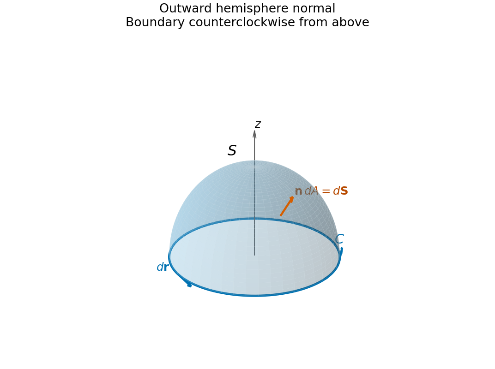

<h1 id="19/a/solution">Solution</h1>

↑ **Parent:** [A](../a.md)

For a smooth oriented [surface](../../../../../topological-surface-split.md) $S$ with positively oriented [boundary](../../../../../boundary-of-a-set.md) $C=\partial S$, [Stokes theorem](../../../../../stokes-theorem.md) states

$$
\boxed{\iint_S(\nabla\times\mathbf F)\cdot d\mathbf S
=\oint_C\mathbf F\cdot d\mathbf r}.
$$

Here $d\mathbf S=\mathbf n\,dA$ uses the chosen [unit normal vector](../../../../../unit-normal.md), while $d\mathbf r$ is tangent to the directed [boundary](../../../../../boundary-of-a-set.md). The [boundary](../../../../../boundary-of-a-set.md) [orientation](../../../../../orientation-of-a-simplex.md) follows the [right-hand rule](../../../../../right-hand-rule.md): curling the fingers along $C$ makes the thumb point in the normal direction. The field must be continuously differentiable on a neighbourhood of the [surface](../../../../../topological-surface-split.md), with the usual piecewise-smooth allowance for its [boundary](../../../../../boundary-of-a-set.md).

**[Figure 4](#19/a/image-outward-hemisphere-orientation-its-counterclockwise-boundary-and-tangent-and-normal-elements). Outward hemisphere orientation, its counterclockwise boundary, and tangent and normal elements**.

For the upper [hemisphere](../../../../../hemisphere.md) with outward normal, the induced equatorial direction is counterclockwise as viewed from positive $z$.

## ↑ Ancestors (13)

1. [A](../a.md)
2. [19](../../19.md)
3. [Paper 2](../../../paper-2-split.md)
4. [2013](../../../split.md)
5. [Past exam of the mathematics course of the year 1 of the natural sciences course of the University of Cambridge](../../../../split.md)
6. [Mathematics course of the year 1 of the natural sciences course of the University of Cambridge](../../../../../mathematics-course-of-the-year-1-of-the-natural-sciences-course-of-the-university-of-cambridge.md)
7. [Year 1 of the natural sciences course of the University of Cambridge](../../../../../year-1-of-the-natural-sciences-course-of-the-university-of-cambridge.md)
8. [Year of the natural sciences course of the University of Cambridge](../../../../../year-of-the-natural-sciences-course-of-the-university-of-cambridge.md)
9. [Natural sciences course of the University of Cambridge](../../../../../natural-sciences-course-of-the-university-of-cambridge.md)
10. [Course of the University of Cambridge](../../../../../course-of-the-university-of-cambridge.md)
11. [University of Cambridge](../../../../../university-of-cambridge-split.md)
12. [List of universities](../../../../../list-of-universities.md)
13. [Codex Wiki](../../../../../split.md)
