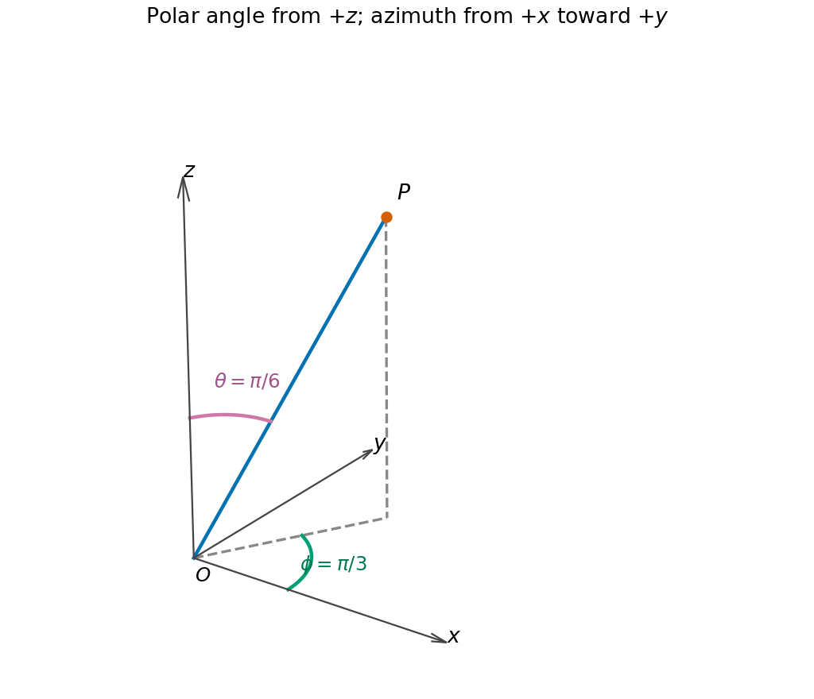

<h1 id="7/b/solution">Solution</h1>

↑ **Parent:** [B](../b.md)

Project the radius [vector](../../../../../vector.md) onto the $x$-$y$ [plane](../../../../../plane.md). The [polar angle](../../../../../polar-angle.md) $\theta=\pi/6$ lies between the positive $z$ axis and $OP$. The [azimuth](../../../../../azimuth.md) $\phi=\pi/3$ lies in the $x$-$y$ [plane](../../../../../plane.md) between the positive $x$ axis and the projection of $OP$, measured toward positive $y$.

**[Figure 1](#7/b/image-polar-and-azimuthal-angles-of-the-specified-point-in-spherical-coordinates). Polar and azimuthal angles of the specified point in spherical coordinates**.

## ↑ Ancestors (13)

1. [B](../b.md)
2. [7](../../7.md)
3. [Paper 2](../../../paper-2-split.md)
4. [2013](../../../split.md)
5. [Past exam of the mathematics course of the year 1 of the natural sciences course of the University of Cambridge](../../../../split.md)
6. [Mathematics course of the year 1 of the natural sciences course of the University of Cambridge](../../../../../mathematics-course-of-the-year-1-of-the-natural-sciences-course-of-the-university-of-cambridge.md)
7. [Year 1 of the natural sciences course of the University of Cambridge](../../../../../year-1-of-the-natural-sciences-course-of-the-university-of-cambridge.md)
8. [Year of the natural sciences course of the University of Cambridge](../../../../../year-of-the-natural-sciences-course-of-the-university-of-cambridge.md)
9. [Natural sciences course of the University of Cambridge](../../../../../natural-sciences-course-of-the-university-of-cambridge.md)
10. [Course of the University of Cambridge](../../../../../course-of-the-university-of-cambridge.md)
11. [University of Cambridge](../../../../../university-of-cambridge-split.md)
12. [List of universities](../../../../../list-of-universities.md)
13. [Codex Wiki](../../../../../split.md)
