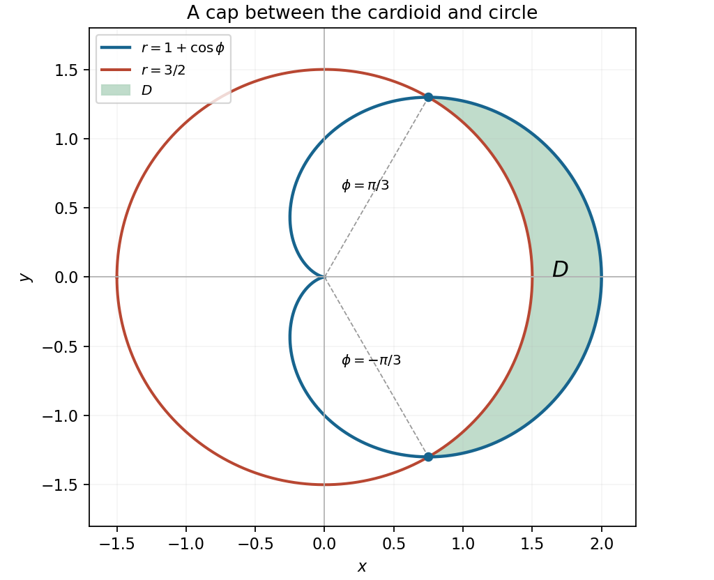

<h1 id="15/a/i/solution">Solution</h1>

↑ **Parent:** [I](../i.md)

The radial interval is nonempty exactly when $1+\cos\phi\geq3/2$, or $\cos\phi\geq1/2$. Choose the representative angular range $-\pi/3\leq\phi\leq\pi/3$. The [region of integration](../../../../../../domain-of-integration.md) is therefore

$$
\boxed{-\frac\pi3\leq\phi\leq\frac\pi3,\qquad
\frac32\leq r\leq1+\cos\phi.}
$$

It is the right-hand cap inside the [cardioid](../../../../../../cardioid.md) and outside the [circle](../../../../../../circle.md) of [radius](../../../../../../radius.md) $3/2$, symmetric about the horizontal axis. Its boundary intersections have coordinates $(3/4,\pm3\sqrt3/4)$, and the cap reaches $(2,0)$. The radial segment on the horizontal axis runs from $3/2$ to $2$.

**[Figure 5](#15/a/i/image-the-integration-cap-inside-a-cardioid-and-outside-the-concentric-circle). The integration cap inside a cardioid and outside the concentric circle**.

## ↑ Ancestors (14)

1. [I](../i.md)
2. [A](../../a.md)
3. [15](../../../15.md)
4. [Paper 1](../../../../paper-1-split.md)
5. [2014](../../../../split.md)
6. [Past exam of the mathematics course of the year 1 of the natural sciences course of the University of Cambridge](../../../../../split.md)
7. [Mathematics course of the year 1 of the natural sciences course of the University of Cambridge](../../../../../../mathematics-course-of-the-year-1-of-the-natural-sciences-course-of-the-university-of-cambridge.md)
8. [Year 1 of the natural sciences course of the University of Cambridge](../../../../../../year-1-of-the-natural-sciences-course-of-the-university-of-cambridge.md)
9. [Year of the natural sciences course of the University of Cambridge](../../../../../../year-of-the-natural-sciences-course-of-the-university-of-cambridge.md)
10. [Natural sciences course of the University of Cambridge](../../../../../../natural-sciences-course-of-the-university-of-cambridge.md)
11. [Course of the University of Cambridge](../../../../../../course-of-the-university-of-cambridge.md)
12. [University of Cambridge](../../../../../../university-of-cambridge-split.md)
13. [List of universities](../../../../../../list-of-universities.md)
14. [Codex Wiki](../../../../../../split.md)
