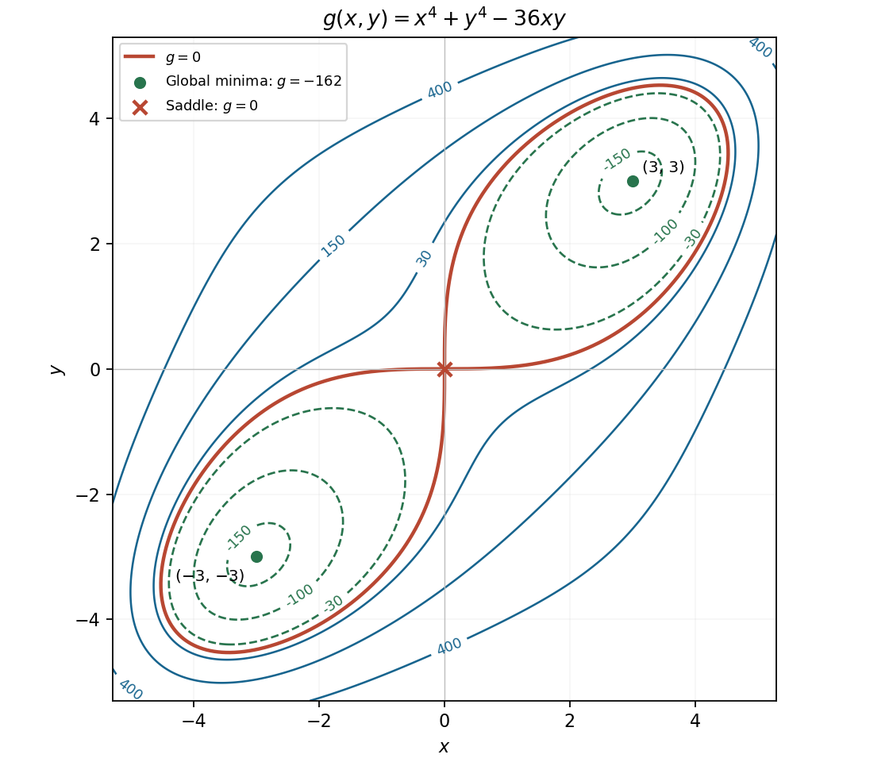

<h1 id="16/b/solution">Solution</h1>

↑ **Parent:** [B](../b.md)

The [partial derivatives](../../../../../partial-derivative.md) give $x^3=9y$ and $y^3=9x$. If either coordinate is zero, both vanish. Otherwise substitution gives $x^8=3^8$, so the real [stationary points](../../../../../stationary-point.md) are $(0,0)$, $(3,3)$ and $(-3,-3)$.

The [Hessian matrix](../../../../../hessian-matrix.md) is

$$
H_g=\begin{pmatrix}12x^2&-36\\-36&12y^2\end{pmatrix}.
$$

At the origin its [eigenvalues](../../../../../eigenvalue.md) are $36$ and $-36$, so it is a saddle at level zero. At either of the other points its [eigenvalues](../../../../../eigenvalue.md) are $72$ and $144$, so both are strict minima at level $-162$. In fact,

$$
g=(x^2-y^2)^2+2(xy-9)^2-162\geq-162,
$$

with equality only at those two points. Hence

$$
\boxed{(0,0):\text{ saddle, }g=0;\qquad
(3,3),(-3,-3):\text{ global minima, }g=-162.}
$$

For levels $-162<c<0$, two separate closed contours surround the two minima. At $c=0$ the contours form two lobes, in the first and third quadrants, meeting at the origin. Their limiting tangent directions there are the coordinate axes because the leading term is $-36xy$. On the diagonal the outer zero-level points are $(\pm3\sqrt2,\pm3\sqrt2)$. Positive levels form one closed outer contour enclosing both wells; there are no contours below $-162$. The graph is symmetric under exchanging $x,y$ and under reversing both signs, but not under a quarter-turn. These features are the $a=3$ case of the [quartic double well with bilinear coupling](../../../../../quartic-double-well-with-bilinear-coupling.md).

**[Figure 6](#16/b/image-the-quartic-function-s-two-minima-saddle-and-transition-from-two-contour-loops-to-one). The quartic function's two minima, saddle, and transition from two contour loops to one**.

## ↑ Ancestors (13)

1. [B](../b.md)
2. [16](../../16.md)
3. [Paper 1](../../../paper-1-split.md)
4. [2014](../../../split.md)
5. [Past exam of the mathematics course of the year 1 of the natural sciences course of the University of Cambridge](../../../../split.md)
6. [Mathematics course of the year 1 of the natural sciences course of the University of Cambridge](../../../../../mathematics-course-of-the-year-1-of-the-natural-sciences-course-of-the-university-of-cambridge.md)
7. [Year 1 of the natural sciences course of the University of Cambridge](../../../../../year-1-of-the-natural-sciences-course-of-the-university-of-cambridge.md)
8. [Year of the natural sciences course of the University of Cambridge](../../../../../year-of-the-natural-sciences-course-of-the-university-of-cambridge.md)
9. [Natural sciences course of the University of Cambridge](../../../../../natural-sciences-course-of-the-university-of-cambridge.md)
10. [Course of the University of Cambridge](../../../../../course-of-the-university-of-cambridge.md)
11. [University of Cambridge](../../../../../university-of-cambridge-split.md)
12. [List of universities](../../../../../list-of-universities.md)
13. [Codex Wiki](../../../../../split.md)
