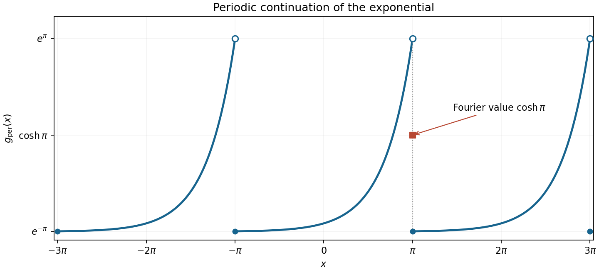

<h1 id="17/b/solution">Solution</h1>

↑ **Parent:** [B](../b.md)

The periodic continuation is $g_{\rm per}(x)=e^{x-2k\pi}$ on each interval $-\pi+2k\pi\leq x<\pi+2k\pi$. Thus the plot repeats an increasing exponential segment on each of the three requested periods, jumping down from $e^\pi$ to $e^{-\pi}$ at odd multiples of $\pi$.

At $x=\pi$, the left and right limits are $e^\pi$ and $e^{-\pi}$. The [Dirichlet-Jordan convergence theorem](../../../../../dirichlet-jordan-convergence-theorem.md) therefore makes the [Fourier series](../../../../../fourier-series-split.md) converge to

$$
\boxed{\frac{e^\pi+e^{-\pi}}2=\cosh\pi.}
$$

The actual half-open periodic definition has $g_{\rm per}(\pi)=e^{-\pi}$; the Fourier value at the jump need not equal that assigned endpoint value.

**[Figure 7](#17/b/image-three-periods-of-the-exponential-continuation-and-the-fourier-series-midpoint-at-a-jump). Three periods of the exponential continuation and the Fourier-series midpoint at a jump**.

## ↑ Ancestors (13)

1. [B](../b.md)
2. [17](../../17.md)
3. [Paper 1](../../../paper-1-split.md)
4. [2014](../../../split.md)
5. [Past exam of the mathematics course of the year 1 of the natural sciences course of the University of Cambridge](../../../../split.md)
6. [Mathematics course of the year 1 of the natural sciences course of the University of Cambridge](../../../../../mathematics-course-of-the-year-1-of-the-natural-sciences-course-of-the-university-of-cambridge.md)
7. [Year 1 of the natural sciences course of the University of Cambridge](../../../../../year-1-of-the-natural-sciences-course-of-the-university-of-cambridge.md)
8. [Year of the natural sciences course of the University of Cambridge](../../../../../year-of-the-natural-sciences-course-of-the-university-of-cambridge.md)
9. [Natural sciences course of the University of Cambridge](../../../../../natural-sciences-course-of-the-university-of-cambridge.md)
10. [Course of the University of Cambridge](../../../../../course-of-the-university-of-cambridge.md)
11. [University of Cambridge](../../../../../university-of-cambridge-split.md)
12. [List of universities](../../../../../list-of-universities.md)
13. [Codex Wiki](../../../../../split.md)
