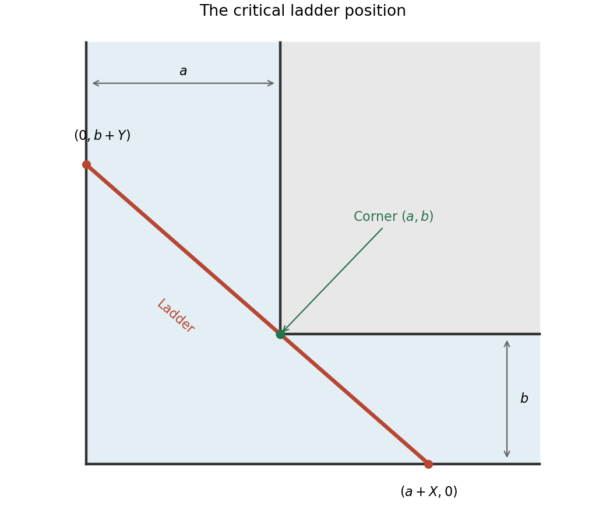

<h1 id="20/b/solution">Solution</h1>

↑ **Parent:** [B](../b.md)

Assume positive corridor widths $a,b$. Write the line through the two wall-contact endpoints in intercept form. Requiring it to pass through the inner corner gives

$$
\frac a{a+X}+\frac b{b+Y}=1
\quad\Longleftrightarrow\quad XY=ab,
\qquad X,Y>0.
$$

Its squared length is $F=(a+X)^2+(b+Y)^2$. Apply [Lagrange multipliers](../../../../../lagrange-multiplier.md) to this [function](../../../../../function-split.md) subject to $G=XY-ab=0$:

$$
2(a+X)=\lambda Y,\qquad2(b+Y)=\lambda X.
$$

Multiplying by $X$ and $Y$ respectively eliminates the multiplier, giving $X(a+X)=Y(b+Y)$. Substitute $Y=ab/X$ and multiply by $X^2$:

$$
X^3(a+X)=ab^2(a+X),\qquad
\boxed{(X^3-ab^2)(X+a)=0.}
$$

The branch $X=-a$ is geometrically inadmissible. Thus $X=a^{1/3}b^{2/3}$ and $Y=a^{2/3}b^{1/3}$. If $A=a^{1/3}$ and $B=b^{1/3}$, the two intercepts become $A(A^2+B^2)$ and $B(A^2+B^2)$, so

$$
F_{\min}=(A^2+B^2)^3,
\qquad\boxed{L=(a^{2/3}+b^{2/3})^{3/2}.}
$$

Along $XY=ab$ in the positive quadrant, $F\to\infty$ as $X\to0^+$ or $X\to\infty$, and this is its only [stationary point](../../../../../stationary-point.md). It is therefore the minimum of the longest sticks that fit at each orientation. A stick being turned must pass through every intermediate orientation, so this narrowest clearance is precisely the maximum carryable length, rather than a maximum of $F$. This is the [ladder around a right-angled corner](../../../../../ladder-around-a-right-angled-corner.md) problem, with a zero-width stick and wall contact allowed as in the ideal geometry.

**[Figure 8](#20/b/image-the-critical-ladder-position-touching-the-two-outer-walls-and-the-inner-corridor-corner). The critical ladder position touching the two outer walls and the inner corridor corner**.

## ↑ Ancestors (13)

1. [B](../b.md)
2. [20](../../20.md)
3. [Paper 1](../../../paper-1-split.md)
4. [2014](../../../split.md)
5. [Past exam of the mathematics course of the year 1 of the natural sciences course of the University of Cambridge](../../../../split.md)
6. [Mathematics course of the year 1 of the natural sciences course of the University of Cambridge](../../../../../mathematics-course-of-the-year-1-of-the-natural-sciences-course-of-the-university-of-cambridge.md)
7. [Year 1 of the natural sciences course of the University of Cambridge](../../../../../year-1-of-the-natural-sciences-course-of-the-university-of-cambridge.md)
8. [Year of the natural sciences course of the University of Cambridge](../../../../../year-of-the-natural-sciences-course-of-the-university-of-cambridge.md)
9. [Natural sciences course of the University of Cambridge](../../../../../natural-sciences-course-of-the-university-of-cambridge.md)
10. [Course of the University of Cambridge](../../../../../course-of-the-university-of-cambridge.md)
11. [University of Cambridge](../../../../../university-of-cambridge-split.md)
12. [List of universities](../../../../../list-of-universities.md)
13. [Codex Wiki](../../../../../split.md)
