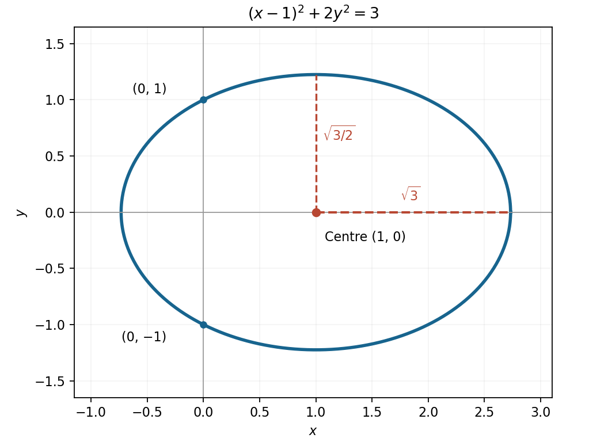

<h1 id="5/b/solution">Solution</h1>

↑ **Parent:** [B](../b.md)

Put the equation into standard [ellipse](../../../../../ellipse.md) form:

$$
\frac{(x-1)^2}{3}+\frac{y^2}{3/2}=1.
$$

The [centre](../../../../../center-geometry.md) is $(1,0)$, with horizontal semiaxis $\sqrt3$ and vertical semiaxis $\sqrt{3/2}$. Its four axis vertices are $(1\pm\sqrt3,0)$ and $(1,\pm\sqrt{3/2})$; the [ellipse](../../../../../ellipse.md) meets the vertical coordinate axis at $(0,\pm1)$.

**[Figure 1](#5/b/image-the-displaced-ellipse-with-its-centre-semiaxes-and-coordinate-axis-intersections). The displaced ellipse with its centre, semiaxes and coordinate-axis intersections**.

## ↑ Ancestors (13)

1. [B](../b.md)
2. [5](../../5.md)
3. [Paper 1](../../../paper-1-split.md)
4. [2014](../../../split.md)
5. [Past exam of the mathematics course of the year 1 of the natural sciences course of the University of Cambridge](../../../../split.md)
6. [Mathematics course of the year 1 of the natural sciences course of the University of Cambridge](../../../../../mathematics-course-of-the-year-1-of-the-natural-sciences-course-of-the-university-of-cambridge.md)
7. [Year 1 of the natural sciences course of the University of Cambridge](../../../../../year-1-of-the-natural-sciences-course-of-the-university-of-cambridge.md)
8. [Year of the natural sciences course of the University of Cambridge](../../../../../year-of-the-natural-sciences-course-of-the-university-of-cambridge.md)
9. [Natural sciences course of the University of Cambridge](../../../../../natural-sciences-course-of-the-university-of-cambridge.md)
10. [Course of the University of Cambridge](../../../../../course-of-the-university-of-cambridge.md)
11. [University of Cambridge](../../../../../university-of-cambridge-split.md)
12. [List of universities](../../../../../list-of-universities.md)
13. [Codex Wiki](../../../../../split.md)
