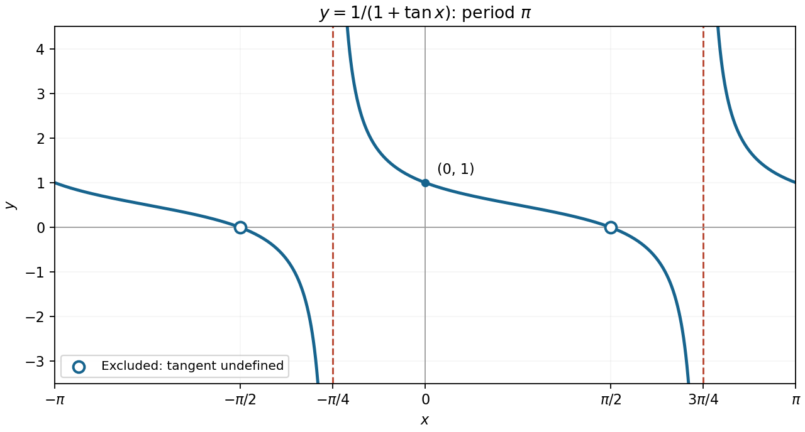

<h1 id="7/a/solution">Solution</h1>

↑ **Parent:** [A](../a.md)

Where the original expression is defined, multiplication by $\cos x$ gives

$$
y=\frac{\cos x}{\cos x+\sin x}
=\frac12\left[1+\cot\left(x+\frac\pi4\right)\right].
$$

Thus the graph repeats with period $\pi$ and has vertical [asymptotes](../../../../../asymptote.md)

$$
\boxed{x=-\frac\pi4+k\pi,\qquad k\in\mathbb Z.}
$$

Between consecutive [asymptotes](../../../../../asymptote.md) the extended [cotangent](../../../../../cotangent.md) branch decreases from $+\infty$ to $-\infty$, since $y'=-1/(\cos x+\sin x)^2<0$. It passes through $(k\pi,1)$ and $(\pi/4+k\pi,1/2)$.

It is essential to [preserve the domain when simplifying a function](../../../../../preserve-the-domain-when-simplifying-a-function.md). At $x=\pi/2+k\pi$, the original tangent is undefined. The finite limiting value is zero, so the graph has **holes at $(\pi/2+k\pi,0)$**, rather than actual zeros. The simplified expression extends across those points, but the original one does not.

**[Figure 2](#7/a/image-the-periodic-tangent-quotient-with-vertical-asymptotes-and-the-original-domain-s-holes-retained). The periodic tangent quotient, with vertical asymptotes and the original domain's holes retained**.

## ↑ Ancestors (13)

1. [A](../a.md)
2. [7](../../7.md)
3. [Paper 1](../../../paper-1-split.md)
4. [2014](../../../split.md)
5. [Past exam of the mathematics course of the year 1 of the natural sciences course of the University of Cambridge](../../../../split.md)
6. [Mathematics course of the year 1 of the natural sciences course of the University of Cambridge](../../../../../mathematics-course-of-the-year-1-of-the-natural-sciences-course-of-the-university-of-cambridge.md)
7. [Year 1 of the natural sciences course of the University of Cambridge](../../../../../year-1-of-the-natural-sciences-course-of-the-university-of-cambridge.md)
8. [Year of the natural sciences course of the University of Cambridge](../../../../../year-of-the-natural-sciences-course-of-the-university-of-cambridge.md)
9. [Natural sciences course of the University of Cambridge](../../../../../natural-sciences-course-of-the-university-of-cambridge.md)
10. [Course of the University of Cambridge](../../../../../course-of-the-university-of-cambridge.md)
11. [University of Cambridge](../../../../../university-of-cambridge-split.md)
12. [List of universities](../../../../../list-of-universities.md)
13. [Codex Wiki](../../../../../split.md)
