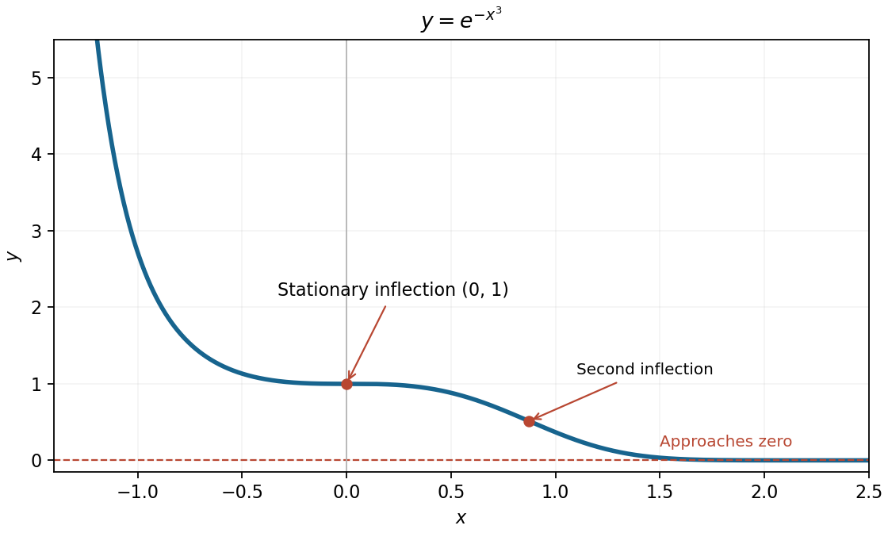

<h1 id="7/b/solution">Solution</h1>

↑ **Parent:** [B](../b.md)

This [exponential function](../../../../../exponential-function.md) is positive everywhere, with $y(0)=1$, $y\to\infty$ as $x\to-\infty$ and $y\to0$ as $x\to\infty$. Its [derivatives](../../../../../derivative.md) are

$$
y'=-3x^2e^{-x^3}\leq0,\qquad
y''=3x(3x^3-2)e^{-x^3}.
$$

It is strictly decreasing overall, with a horizontal stationary [inflection point](../../../../../inflection-point.md) at **$(0,1)$**. A second, nonstationary [inflection point](../../../../../inflection-point.md) occurs at $x=(2/3)^{1/3}$, where $y=e^{-2/3}$. The only horizontal [asymptote](../../../../../asymptote.md) is **$y=0$ toward positive infinity**; the graph is not symmetric about the vertical axis.

**[Figure 3](#7/b/image-the-decreasing-cubic-exponential-its-stationary-inflection-and-its-positive-horizontal-asymptote). The decreasing cubic exponential, its stationary inflection, and its positive horizontal asymptote**.

## ↑ Ancestors (13)

1. [B](../b.md)
2. [7](../../7.md)
3. [Paper 1](../../../paper-1-split.md)
4. [2014](../../../split.md)
5. [Past exam of the mathematics course of the year 1 of the natural sciences course of the University of Cambridge](../../../../split.md)
6. [Mathematics course of the year 1 of the natural sciences course of the University of Cambridge](../../../../../mathematics-course-of-the-year-1-of-the-natural-sciences-course-of-the-university-of-cambridge.md)
7. [Year 1 of the natural sciences course of the University of Cambridge](../../../../../year-1-of-the-natural-sciences-course-of-the-university-of-cambridge.md)
8. [Year of the natural sciences course of the University of Cambridge](../../../../../year-of-the-natural-sciences-course-of-the-university-of-cambridge.md)
9. [Natural sciences course of the University of Cambridge](../../../../../natural-sciences-course-of-the-university-of-cambridge.md)
10. [Course of the University of Cambridge](../../../../../course-of-the-university-of-cambridge.md)
11. [University of Cambridge](../../../../../university-of-cambridge-split.md)
12. [List of universities](../../../../../list-of-universities.md)
13. [Codex Wiki](../../../../../split.md)
