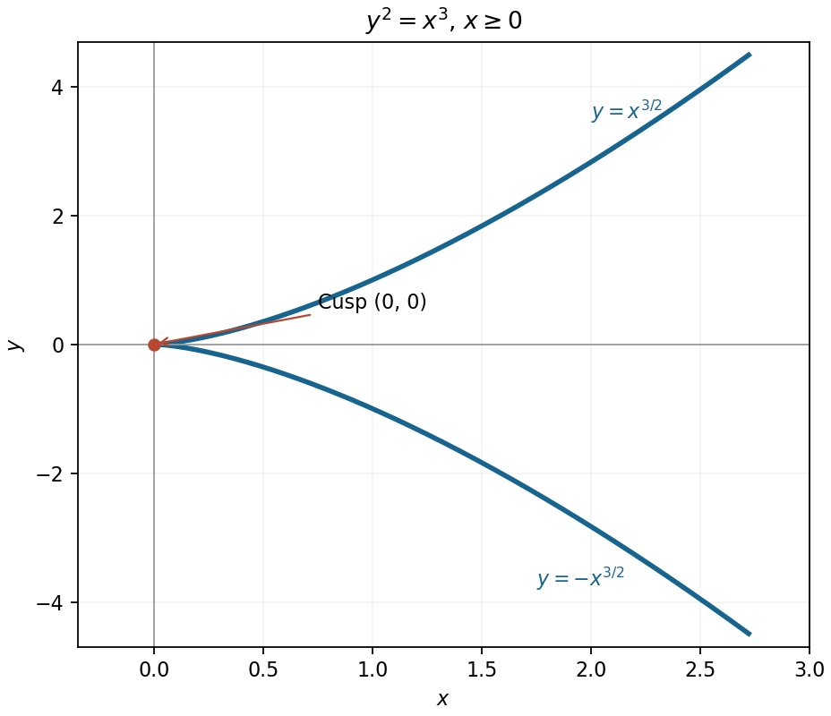

<h1 id="9/b/solution">Solution</h1>

↑ **Parent:** [B](../b.md)

Real points require $x\geq0$, and the two branches are

$$
\boxed{y=\pm x^{3/2},\qquad x\geq0.}
$$

This is a [semicubical parabola](../../../../../semicubical-parabola.md), symmetric about the horizontal axis and with a cusp at the origin. The parametrization $x=t^2$, $y=t^3$ traces both branches. Their limiting slopes at the origin are zero, so the common tangent direction is the positive horizontal axis, even though the curve has a cusp there.

**[Figure 4](#9/b/image-the-two-real-branches-of-the-semicubical-parabola-and-their-cusp-at-the-origin). The two real branches of the semicubical parabola and their cusp at the origin**.

## ↑ Ancestors (13)

1. [B](../b.md)
2. [9](../../9.md)
3. [Paper 1](../../../paper-1-split.md)
4. [2014](../../../split.md)
5. [Past exam of the mathematics course of the year 1 of the natural sciences course of the University of Cambridge](../../../../split.md)
6. [Mathematics course of the year 1 of the natural sciences course of the University of Cambridge](../../../../../mathematics-course-of-the-year-1-of-the-natural-sciences-course-of-the-university-of-cambridge.md)
7. [Year 1 of the natural sciences course of the University of Cambridge](../../../../../year-1-of-the-natural-sciences-course-of-the-university-of-cambridge.md)
8. [Year of the natural sciences course of the University of Cambridge](../../../../../year-of-the-natural-sciences-course-of-the-university-of-cambridge.md)
9. [Natural sciences course of the University of Cambridge](../../../../../natural-sciences-course-of-the-university-of-cambridge.md)
10. [Course of the University of Cambridge](../../../../../course-of-the-university-of-cambridge.md)
11. [University of Cambridge](../../../../../university-of-cambridge-split.md)
12. [List of universities](../../../../../list-of-universities.md)
13. [Codex Wiki](../../../../../split.md)
