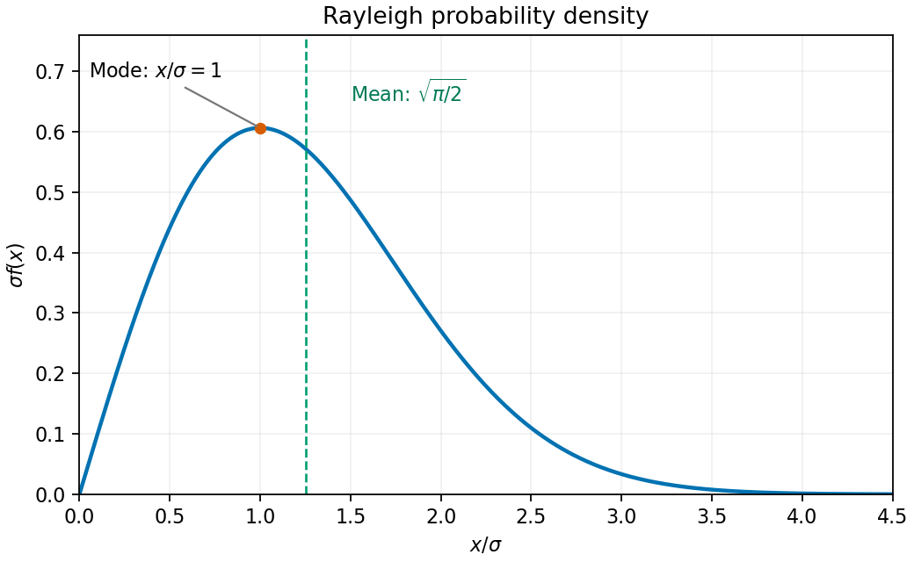

<h1 id="11/b/solution">Solution</h1>

↑ **Parent:** [B](../b.md)

Normalize the [Rayleigh distribution](../../../../../rayleigh-distribution.md) by substituting $s=x^2/(2\sigma^2)$:

$$
1=A\int_0^\infty xe^{-x^2/(2\sigma^2)}\,dx=A\sigma^2,
\qquad\boxed{A=\sigma^{-2}}.
$$

For its sketch, the density starts at zero, is positive for $x>0$, and tends to zero at infinity. [Differentiation](../../../../../differentiation.md) gives

$$
f'(x)=\frac{e^{-x^2/(2\sigma^2)}}{\sigma^2}
\left(1-\frac{x^2}{\sigma^2}\right).
$$

It therefore has a single maximum at $x=\sigma$, with height $e^{-1/2}/\sigma$.

**[Figure 1](#11/b/image-rayleigh-density-in-units-of-its-scale-parameter-with-its-mode-and-mean). Rayleigh density in units of its scale parameter, with its mode and mean**.

The [expected value](../../../../../expected-value-split.md) is

$$
E[X]=\frac1{\sigma^2}\int_0^\infty x^2e^{-x^2/(2\sigma^2)}\,dx.
$$

Integrating by parts with $x\,dx\,e^{-x^2/(2\sigma^2)}=-\sigma^2\,d(e^{-x^2/(2\sigma^2)})$ makes the boundary term vanish and leaves $\int_0^\infty e^{-x^2/(2\sigma^2)}\,dx$. The [Gaussian integral](../../../../../gaussian-integral.md) gives

$$
\boxed{E[X]=\sigma\sqrt{\frac\pi2}}.
$$

## ↑ Ancestors (13)

1. [B](../b.md)
2. [11](../../11.md)
3. [Paper 2](../../../paper-2-split.md)
4. [2014](../../../split.md)
5. [Past exam of the mathematics course of the year 1 of the natural sciences course of the University of Cambridge](../../../../split.md)
6. [Mathematics course of the year 1 of the natural sciences course of the University of Cambridge](../../../../../mathematics-course-of-the-year-1-of-the-natural-sciences-course-of-the-university-of-cambridge.md)
7. [Year 1 of the natural sciences course of the University of Cambridge](../../../../../year-1-of-the-natural-sciences-course-of-the-university-of-cambridge.md)
8. [Year of the natural sciences course of the University of Cambridge](../../../../../year-of-the-natural-sciences-course-of-the-university-of-cambridge.md)
9. [Natural sciences course of the University of Cambridge](../../../../../natural-sciences-course-of-the-university-of-cambridge.md)
10. [Course of the University of Cambridge](../../../../../course-of-the-university-of-cambridge.md)
11. [University of Cambridge](../../../../../university-of-cambridge-split.md)
12. [List of universities](../../../../../list-of-universities.md)
13. [Codex Wiki](../../../../../split.md)
