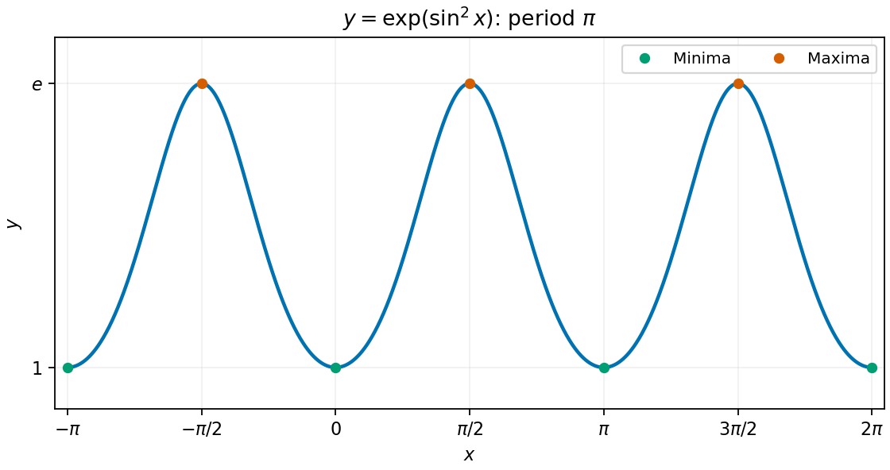

<h1 id="18/b/solution">Solution</h1>

↑ **Parent:** [B](../b.md)

The graph is even and periodic with period $\pi$, bounded between $1$ and $e$. It rises from each minimum at $k\pi$ to a maximum halfway to the next minimum, then falls back. It has horizontal tangents at all these extrema and repeats smoothly.

**[Figure 2](#18/b/image-the-periodic-graph-of-exp-sin-squared-x-with-all-types-of-stationary-point-marked). The periodic graph of exp(sin squared x), with all types of stationary point marked**.

## ↑ Ancestors (13)

1. [B](../b.md)
2. [18](../../18.md)
3. [Paper 2](../../../paper-2-split.md)
4. [2014](../../../split.md)
5. [Past exam of the mathematics course of the year 1 of the natural sciences course of the University of Cambridge](../../../../split.md)
6. [Mathematics course of the year 1 of the natural sciences course of the University of Cambridge](../../../../../mathematics-course-of-the-year-1-of-the-natural-sciences-course-of-the-university-of-cambridge.md)
7. [Year 1 of the natural sciences course of the University of Cambridge](../../../../../year-1-of-the-natural-sciences-course-of-the-university-of-cambridge.md)
8. [Year of the natural sciences course of the University of Cambridge](../../../../../year-of-the-natural-sciences-course-of-the-university-of-cambridge.md)
9. [Natural sciences course of the University of Cambridge](../../../../../natural-sciences-course-of-the-university-of-cambridge.md)
10. [Course of the University of Cambridge](../../../../../course-of-the-university-of-cambridge.md)
11. [University of Cambridge](../../../../../university-of-cambridge-split.md)
12. [List of universities](../../../../../list-of-universities.md)
13. [Codex Wiki](../../../../../split.md)
