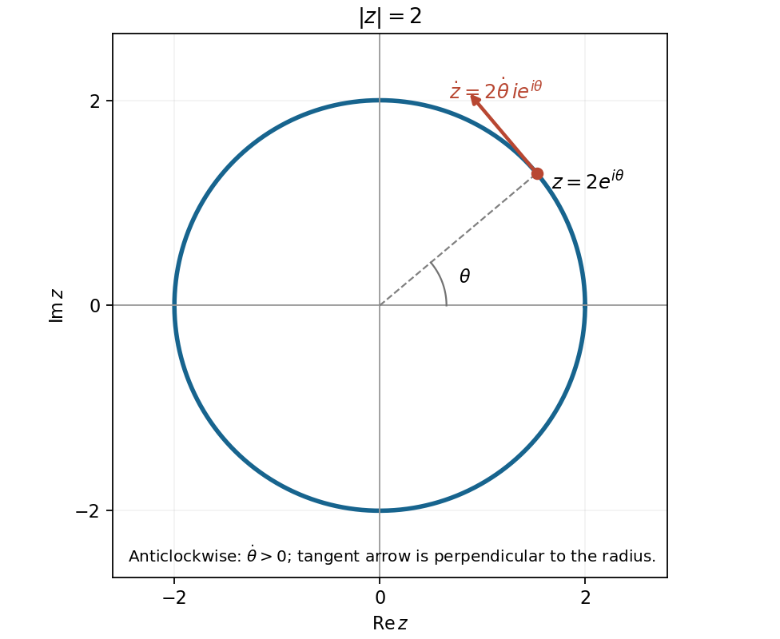

<h1 id="11/c/i/solution">Solution</h1>

↑ **Parent:** [I](../i.md)

Write $z=x+iy$. Squaring the nonnegative [complex modulus](../../../../../../complex-modulus.md) on each side gives

$$
(x-4)^2+y^2=4\big[(x-1)^2+y^2\big].
$$

The linear terms cancel, leaving $3(x^2+y^2)=12$. Therefore the [locus](../../../../../../locus-mathematics.md) is

$$
\boxed{|z|=2,\quad\text{the circle of radius }2\text{ centred at the origin}.}
$$

Its real and imaginary axis intersections are $\pm2$ and $\pm2i$.

**[Figure 3](#11/c/i/image-the-circular-complex-locus-and-an-anticlockwise-tangential-velocity-at-a-general-point). The circular complex locus and an anticlockwise tangential velocity at a general point**.

## ↑ Ancestors (14)

1. [I](../i.md)
2. [C](../../c.md)
3. [11](../../../11.md)
4. [Paper 1](../../../../paper-1-split.md)
5. [2015](../../../../split.md)
6. [Past exam of the mathematics course of the year 1 of the natural sciences course of the University of Cambridge](../../../../../split.md)
7. [Mathematics course of the year 1 of the natural sciences course of the University of Cambridge](../../../../../../mathematics-course-of-the-year-1-of-the-natural-sciences-course-of-the-university-of-cambridge.md)
8. [Year 1 of the natural sciences course of the University of Cambridge](../../../../../../year-1-of-the-natural-sciences-course-of-the-university-of-cambridge.md)
9. [Year of the natural sciences course of the University of Cambridge](../../../../../../year-of-the-natural-sciences-course-of-the-university-of-cambridge.md)
10. [Natural sciences course of the University of Cambridge](../../../../../../natural-sciences-course-of-the-university-of-cambridge.md)
11. [Course of the University of Cambridge](../../../../../../course-of-the-university-of-cambridge.md)
12. [University of Cambridge](../../../../../../university-of-cambridge-split.md)
13. [List of universities](../../../../../../list-of-universities.md)
14. [Codex Wiki](../../../../../../split.md)
