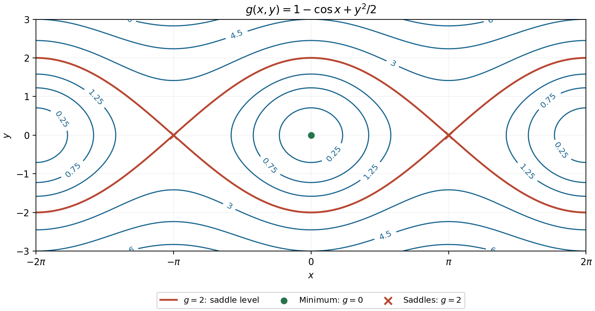

<h1 id="12/b/solution">Solution</h1>

↑ **Parent:** [B](../b.md)

The [partial derivatives](../../../../../partial-derivative.md) are $g_x=\sin x$ and $g_y=y$, so all [stationary points](../../../../../stationary-point.md) are $(n\pi,0)$ for integers $n$. Their [Hessian matrix](../../../../../hessian-matrix.md) is $\operatorname{diag}(\cos x,1)$. At even multiples of $\pi$ it is a [positive-definite matrix](../../../../../positive-definite-matrix.md), whereas at odd multiples it has one positive and one negative [eigenvalue](../../../../../eigenvalue.md). Consequently

$$
\boxed{(2n\pi,0):\text{ strict minima, }g=0;\qquad
((2n+1)\pi,0):\text{ saddle points, }g=2.}
$$

There are no [local maxima](../../../../../local-maximum.md). Since both $1-\cos x$ and $y^2/2$ are nonnegative, these are also [global minima](../../../../../global-minimum.md). In the requested open plotting window, the [stationary points](../../../../../stationary-point.md) are $(0,0)$ and $(\pm\pi,0)$; the [local minima](../../../../../local-minimum.md) at $(\pm2\pi,0)$ lie on excluded edges.

For a [level set](../../../../../level-set.md) $g=c$, solving for the vertical coordinate gives

$$
y=\pm\sqrt{2(c-1+\cos x)},\qquad c\geq1-\cos x.
$$

For $0<c<2$ these [level sets](../../../../../level-set.md) are closed ovals around each [local minimum](../../../../../local-minimum.md). At $c=0$ the [level sets](../../../../../level-set.md) shrink to the [local minima](../../../../../local-minimum.md). The [level set](../../../../../level-set.md) through the [saddle points](../../../../../saddle-point.md) is

$$
g=2:\qquad y=\pm2\cos(x/2),
$$

where the two signed branches together describe the same set as $y=\pm2|\cos(x/2)|$. They cross at $(\pm\pi,0)$ and reach $(0,\pm2)$. The crossing slopes at a [saddle point](../../../../../saddle-point.md) are $\pm1$, as also follows from the local [quadratic form](../../../../../quadratic-form-split.md) $(-\delta x^2+\delta y^2)/2$. For $c>2$, the upper and lower [level sets](../../../../../level-set.md) remain separate and extend across the plotting window without meeting the horizontal axis.

**[Figure 4](#12/b/image-contours-of-the-cosine-plus-quadratic-function-with-its-saddle-level-and-stationary-points-labelled). Contours of the cosine-plus-quadratic function, with its saddle level and stationary points labelled**.

## ↑ Ancestors (13)

1. [B](../b.md)
2. [12](../../12.md)
3. [Paper 1](../../../paper-1-split.md)
4. [2015](../../../split.md)
5. [Past exam of the mathematics course of the year 1 of the natural sciences course of the University of Cambridge](../../../../split.md)
6. [Mathematics course of the year 1 of the natural sciences course of the University of Cambridge](../../../../../mathematics-course-of-the-year-1-of-the-natural-sciences-course-of-the-university-of-cambridge.md)
7. [Year 1 of the natural sciences course of the University of Cambridge](../../../../../year-1-of-the-natural-sciences-course-of-the-university-of-cambridge.md)
8. [Year of the natural sciences course of the University of Cambridge](../../../../../year-of-the-natural-sciences-course-of-the-university-of-cambridge.md)
9. [Natural sciences course of the University of Cambridge](../../../../../natural-sciences-course-of-the-university-of-cambridge.md)
10. [Course of the University of Cambridge](../../../../../course-of-the-university-of-cambridge.md)
11. [University of Cambridge](../../../../../university-of-cambridge-split.md)
12. [List of universities](../../../../../list-of-universities.md)
13. [Codex Wiki](../../../../../split.md)
