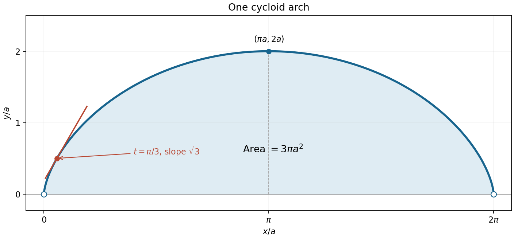

<h1 id="14/b/solution">Solution</h1>

↑ **Parent:** [B](../b.md)

The [cycloid](../../../../../cycloid.md) has limiting endpoints $(0,0)$ and $(2\pi a,0)$, with its highest point $(\pi a,2a)$ at $t=\pi$. The transformation $t\mapsto2\pi-t$ sends $x$ to $2\pi a-x$ and preserves $y$, so the arch is symmetric about $x=\pi a$. Its slope decreases from $+\infty$ through zero to $-\infty$, giving vertical limiting [tangent lines](../../../../../tangent-line.md) at the cusps and a horizontal [tangent line](../../../../../tangent-line.md) at the top. More explicitly,

$$
\frac{d^2y}{dx^2}=-\frac1{4a\sin^4(t/2)}<0,
$$

so the arch is a [concave function](../../../../../concave-function.md) throughout its interior. The endpoint cusps are limiting points, excluded by the open parameter interval.

**[Figure 5](#14/b/image-one-cycloid-arch-its-limiting-cusps-highest-point-and-the-point-with-slope-square-root-of-three). One cycloid arch, its limiting cusps, highest point, and the point with slope square root of three**.

## ↑ Ancestors (13)

1. [B](../b.md)
2. [14](../../14.md)
3. [Paper 1](../../../paper-1-split.md)
4. [2015](../../../split.md)
5. [Past exam of the mathematics course of the year 1 of the natural sciences course of the University of Cambridge](../../../../split.md)
6. [Mathematics course of the year 1 of the natural sciences course of the University of Cambridge](../../../../../mathematics-course-of-the-year-1-of-the-natural-sciences-course-of-the-university-of-cambridge.md)
7. [Year 1 of the natural sciences course of the University of Cambridge](../../../../../year-1-of-the-natural-sciences-course-of-the-university-of-cambridge.md)
8. [Year of the natural sciences course of the University of Cambridge](../../../../../year-of-the-natural-sciences-course-of-the-university-of-cambridge.md)
9. [Natural sciences course of the University of Cambridge](../../../../../natural-sciences-course-of-the-university-of-cambridge.md)
10. [Course of the University of Cambridge](../../../../../course-of-the-university-of-cambridge.md)
11. [University of Cambridge](../../../../../university-of-cambridge-split.md)
12. [List of universities](../../../../../list-of-universities.md)
13. [Codex Wiki](../../../../../split.md)
