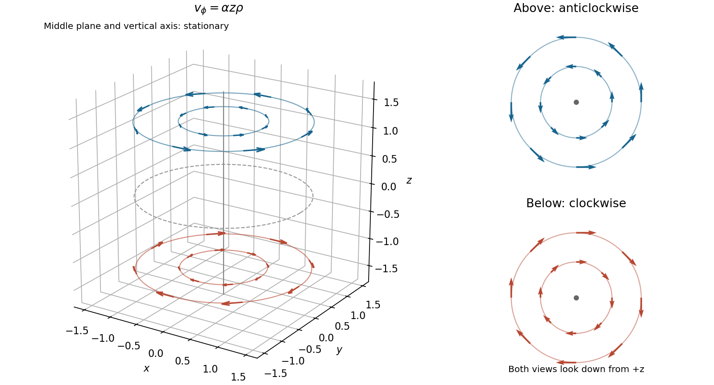

<h1 id="20/a/solution">Solution</h1>

↑ **Parent:** [A](../a.md)

Use [cylindrical coordinates](../../../../../cylindrical-coordinate-system.md) $x=\rho\cos\phi$, $y=\rho\sin\phi$. The [velocity field](../../../../../velocity-field.md) becomes

$$
\boxed{\mathbf v=\alpha z\rho\,\widehat{\boldsymbol\phi},\qquad
v_\rho=v_z=0.}
$$

For each fixed height, particles follow concentric circular [streamlines](../../../../../streamline.md) around the vertical axis. At $z>0$ the motion is anticlockwise viewed from above, while at $z<0$ it is clockwise. Within a horizontal plane the [angular velocity](../../../../../angular-velocity.md) is $\alpha z$, independent of [radius](../../../../../radius.md), and the [speed](../../../../../speed.md) is $\alpha|z|\rho$. Both the plane $z=0$ and the vertical axis are stationary. The rotation rate varies with height, so the entire liquid is not one rigidly rotating body.

**[Figure 6](#20/a/image-circular-flow-at-fixed-heights-reverses-direction-across-the-stationary-middle-plane). Circular flow at fixed heights reverses direction across the stationary middle plane**.

## ↑ Ancestors (13)

1. [A](../a.md)
2. [20](../../20.md)
3. [Paper 1](../../../paper-1-split.md)
4. [2015](../../../split.md)
5. [Past exam of the mathematics course of the year 1 of the natural sciences course of the University of Cambridge](../../../../split.md)
6. [Mathematics course of the year 1 of the natural sciences course of the University of Cambridge](../../../../../mathematics-course-of-the-year-1-of-the-natural-sciences-course-of-the-university-of-cambridge.md)
7. [Year 1 of the natural sciences course of the University of Cambridge](../../../../../year-1-of-the-natural-sciences-course-of-the-university-of-cambridge.md)
8. [Year of the natural sciences course of the University of Cambridge](../../../../../year-of-the-natural-sciences-course-of-the-university-of-cambridge.md)
9. [Natural sciences course of the University of Cambridge](../../../../../natural-sciences-course-of-the-university-of-cambridge.md)
10. [Course of the University of Cambridge](../../../../../course-of-the-university-of-cambridge.md)
11. [University of Cambridge](../../../../../university-of-cambridge-split.md)
12. [List of universities](../../../../../list-of-universities.md)
13. [Codex Wiki](../../../../../split.md)
