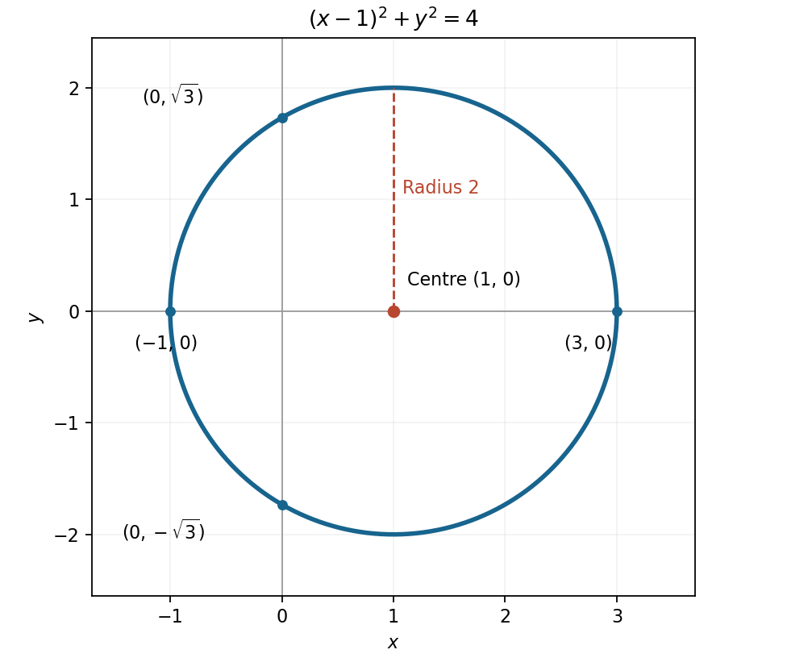

<h1 id="3/solution">Solution</h1>

↑ **Parent:** [3](../3.md)

Use [completing the square](../../../../completing-the-square.md) to obtain

$$
(x-1)^2+y^2=4.
$$

The [locus](../../../../locus-mathematics.md) is therefore a **[circle](../../../../circle.md) with [centre](../../../../center-geometry.md) $(1,0)$ and [radius](../../../../radius.md) $2$**. It meets the horizontal axis at $(-1,0)$ and $(3,0)$ and the vertical axis at $(0,\pm\sqrt3)$; its highest and lowest points are $(1,\pm2)$.

**[Figure 1](#3/image-the-circle-locus-its-centre-and-its-coordinate-axis-intersections). The circle locus, its centre, and its coordinate-axis intersections**.

## ↑ Ancestors (12)

1. [3](../3.md)
2. [Paper 1](../../paper-1-split.md)
3. [2015](../../split.md)
4. [Past exam of the mathematics course of the year 1 of the natural sciences course of the University of Cambridge](../../../split.md)
5. [Mathematics course of the year 1 of the natural sciences course of the University of Cambridge](../../../../mathematics-course-of-the-year-1-of-the-natural-sciences-course-of-the-university-of-cambridge.md)
6. [Year 1 of the natural sciences course of the University of Cambridge](../../../../year-1-of-the-natural-sciences-course-of-the-university-of-cambridge.md)
7. [Year of the natural sciences course of the University of Cambridge](../../../../year-of-the-natural-sciences-course-of-the-university-of-cambridge.md)
8. [Natural sciences course of the University of Cambridge](../../../../natural-sciences-course-of-the-university-of-cambridge.md)
9. [Course of the University of Cambridge](../../../../course-of-the-university-of-cambridge.md)
10. [University of Cambridge](../../../../university-of-cambridge-split.md)
11. [List of universities](../../../../list-of-universities.md)
12. [Codex Wiki](../../../../split.md)
