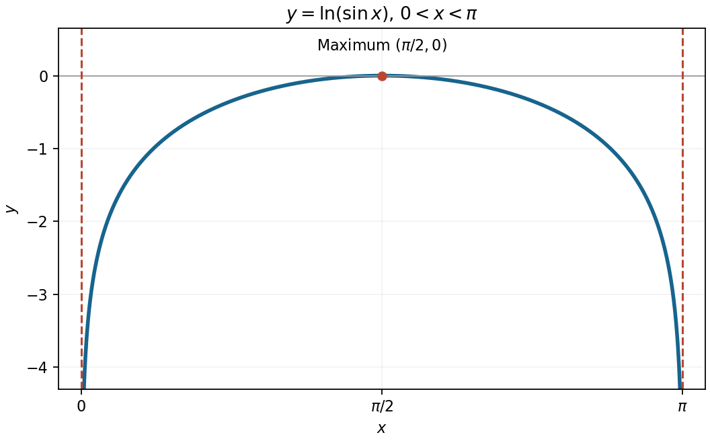

<h1 id="4/b/solution">Solution</h1>

↑ **Parent:** [B](../b.md)

Within the requested interval, the [function](../../../../../function-split.md) is symmetric about $x=\pi/2$ because $\sin(\pi-x)=\sin x$. Its [derivative](../../../../../derivative.md) $\cot x$ is positive before $\pi/2$, zero there, and negative afterwards. The negative second [derivative](../../../../../derivative.md) shows that this is a strictly [concave function](../../../../../concave-function.md). Consequently its **unique maximum is $(\pi/2,0)$**. It tends to $-\infty$ at both ends, giving vertical [asymptotes](../../../../../asymptote.md) **$x=0$ and $x=\pi$**.

**[Figure 2](#4/b/image-the-logarithm-of-sine-between-its-two-vertical-asymptotes). The logarithm of sine between its two vertical asymptotes**.

## ↑ Ancestors (13)

1. [B](../b.md)
2. [4](../../4.md)
3. [Paper 1](../../../paper-1-split.md)
4. [2015](../../../split.md)
5. [Past exam of the mathematics course of the year 1 of the natural sciences course of the University of Cambridge](../../../../split.md)
6. [Mathematics course of the year 1 of the natural sciences course of the University of Cambridge](../../../../../mathematics-course-of-the-year-1-of-the-natural-sciences-course-of-the-university-of-cambridge.md)
7. [Year 1 of the natural sciences course of the University of Cambridge](../../../../../year-1-of-the-natural-sciences-course-of-the-university-of-cambridge.md)
8. [Year of the natural sciences course of the University of Cambridge](../../../../../year-of-the-natural-sciences-course-of-the-university-of-cambridge.md)
9. [Natural sciences course of the University of Cambridge](../../../../../natural-sciences-course-of-the-university-of-cambridge.md)
10. [Course of the University of Cambridge](../../../../../course-of-the-university-of-cambridge.md)
11. [University of Cambridge](../../../../../university-of-cambridge-split.md)
12. [List of universities](../../../../../list-of-universities.md)
13. [Codex Wiki](../../../../../split.md)
