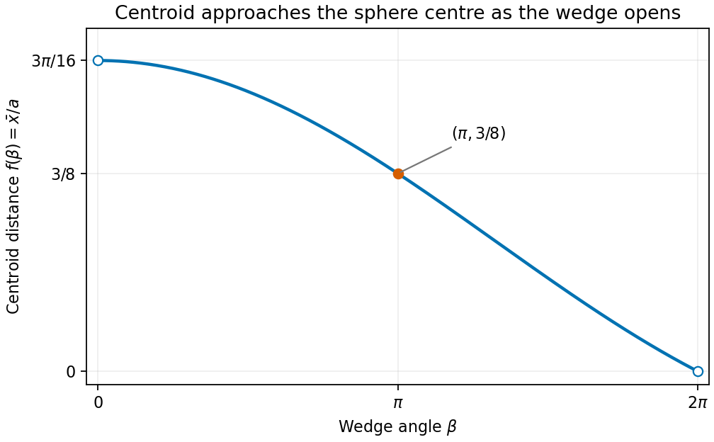
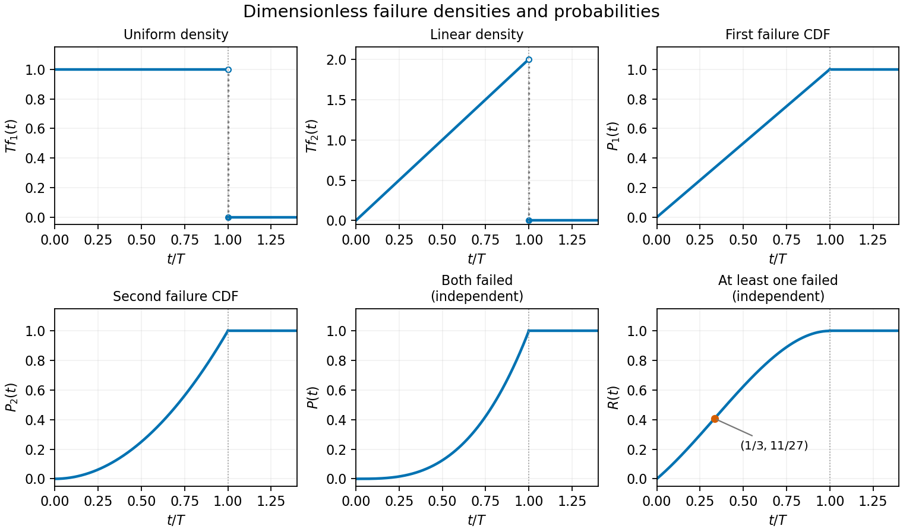
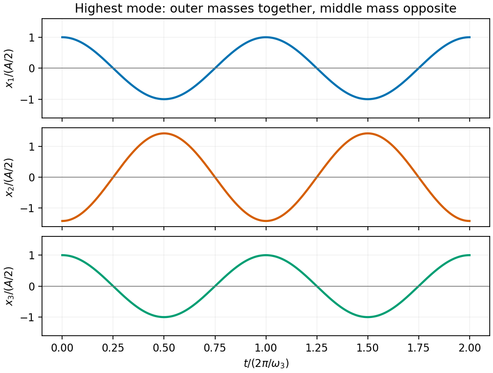

# Paper 2

↑ **Parent:** [2015](../2015.md)

[https://www.maths.cam.ac.uk/undergradnst/files/2015/PaperNST_IA_2.pdf](https://www.maths.cam.ac.uk/undergradnst/files/2015/PaperNST_IA_2.pdf)

**Table of contents**

- [1](#1)
  - [Solution](#1/solution)
- [2](#2)
  - [Solution](#2/solution)
- [3](#3)
  - [Solution](#3/solution)
- [4](#4)
  - [Solution](#4/solution)
- [5](#5)
  - [Solution](#5/solution)
- [6](#6)
  - [a](#6/a)
    - [Solution](#6/a/solution)
  - [b](#6/b)
    - [Solution](#6/b/solution)
- [7](#7)
  - [Solution](#7/solution)
- [8](#8)
  - [Solution](#8/solution)
- [9](#9)
  - [Solution](#9/solution)
- [10](#10)
  - [a](#10/a)
    - [Solution](#10/a/solution)
  - [b](#10/b)
    - [Solution](#10/b/solution)
- [11](#11)
  - [a](#11/a)
    - [Solution](#11/a/solution)
  - [b](#11/b)
    - [i](#11/b/i)
      - [Solution](#11/b/i/solution)
    - [ii](#11/b/ii)
      - [Solution](#11/b/ii/solution)
    - [iii](#11/b/iii)
      - [Solution](#11/b/iii/solution)
- [12](#12)
  - [a](#12/a)
    - [Solution](#12/a/solution)
  - [b](#12/b)
    - [Solution](#12/b/solution)
- [13](#13)
  - [a](#13/a)
    - [Solution](#13/a/solution)
  - [b](#13/b)
    - [Solution](#13/b/solution)
  - [c](#13/c)
    - [Solution](#13/c/solution)
- [14](#14)
  - [a](#14/a)
    - [Solution](#14/a/solution)
  - [b](#14/b)
    - [Solution](#14/b/solution)
  - [c](#14/c)
    - [Solution](#14/c/solution)
  - [d](#14/d)
    - [Solution](#14/d/solution)
  - [e](#14/e)
    - [Solution](#14/e/solution)
  - [f](#14/f)
    - [Solution](#14/f/solution)
- [15](#15)
  - [a](#15/a)
    - [i](#15/a/i)
      - [Solution](#15/a/i/solution)
    - [ii](#15/a/ii)
      - [Solution](#15/a/ii/solution)
  - [b](#15/b)
    - [Solution](#15/b/solution)
- [16](#16)
  - [a](#16/a)
    - [Solution](#16/a/solution)
    - [i](#16/a/i)
      - [Solution](#16/a/i/solution)
    - [ii](#16/a/ii)
      - [Solution](#16/a/ii/solution)
  - [b](#16/b)
    - [Solution](#16/b/solution)
- [17](#17)
  - [a](#17/a)
    - [Solution](#17/a/solution)
  - [b](#17/b)
    - [Solution](#17/b/solution)
  - [c](#17/c)
    - [Solution](#17/c/solution)
  - [d](#17/d)
    - [Solution](#17/d/solution)
  - [e](#17/e)
    - [Solution](#17/e/solution)
  - [f](#17/f)
    - [Solution](#17/f/solution)
- [18](#18)
  - [a](#18/a)
    - [Solution](#18/a/solution)
  - [b](#18/b)
    - [Solution](#18/b/solution)
  - [c](#18/c)
    - [Solution](#18/c/solution)
  - [d](#18/d)
    - [Solution](#18/d/solution)
- [19](#19)
  - [a](#19/a)
    - [Solution](#19/a/solution)
  - [b](#19/b)
    - [Solution](#19/b/solution)
  - [c](#19/c)
    - [Solution](#19/c/solution)
- [20](#20)
  - [a](#20/a)
    - [Solution](#20/a/solution)
  - [b](#20/b)
    - [Solution](#20/b/solution)
  - [c](#20/c)
    - [Solution](#20/c/solution)
  - [d](#20/d)
    - [Solution](#20/d/solution)

## 1

↑ **Parent:** [Paper 2](paper-2.md)

<h3 id="1/solution">Solution</h3>

↑ **Parent:** [1](#1)

The [cross product](../../vector-space.md#cross-product) of the two in-plane directions is $\mathbf u\times\mathbf v=(-5,1,2)$, with [Euclidean norm](../../normed-vector-space.md#euclidean-norm) $\sqrt{30}$. Either sign gives a [unit normal vector](../../differential-geometry.md#unit-normal):

$$
\boxed{\hat{\mathbf n}=\pm\frac{(-5,1,2)}{\sqrt{30}}}.
$$

The [plane](../../geometry-and-topology.md#plane) equation is $\hat{\mathbf n}\cdot(\mathbf r-\mathbf A)=0$, so the [distance from a point to a plane](../../geometry-and-topology.md#distance-from-a-point-to-a-plane) gives

$$
\boxed{p=|\hat{\mathbf n}\cdot\mathbf A|=\frac2{\sqrt{30}}}.
$$

## 2

↑ **Parent:** [Paper 2](paper-2.md)

<h3 id="2/solution">Solution</h3>

↑ **Parent:** [2](#2)

Write $-8=8e^{i(\pi+2\pi k)}$. Its three roots have modulus $2$ and arguments $(\pi+2\pi k)/3$, with $k=0,1,2$. Thus all three [complex roots](../../polynomial.md#complex-root) are

$$
\boxed{z=1+i\sqrt3,\quad-2,\quad1-i\sqrt3}.
$$

Further integer values of $k$ repeat these roots.

## 3

↑ **Parent:** [Paper 2](paper-2.md)

<h3 id="3/solution">Solution</h3>

↑ **Parent:** [3](#3)

The [Taylor series](../../calculus.md#taylor-series) of the logarithm gives

$$
\log(1+x^2)=x^2-\frac{x^4}{2}+O(x^6).
$$

The first nonzero term is therefore $\boxed{x^2}$. It is positive on either side of the origin, so the [stationary point](../../calculus-of-variations.md#stationary-point) is a **[strict local minimum](../../analysis.md#strict-local-minimum)**. In fact $\log(1+x^2)\geq0$, with equality only at zero, making it the [global minimum](../../analysis.md#global-minimum) as well.

## 4

↑ **Parent:** [Paper 2](paper-2.md)

<h3 id="4/solution">Solution</h3>

↑ **Parent:** [4](#4)

The [characteristic polynomial](../../linear-operator-theory.md#characteristic-polynomial) is $(1-\lambda)^2-4=(\lambda-3)(\lambda+1)$. For $\lambda=3$ the components are equal; for $\lambda=-1$ they are opposite. After normalization, the [eigenvalues](../../linear-operator-theory.md#eigenvalue) and associated [eigenvectors](../../linear-operator-theory.md#eigenvector) are

$$
\boxed{\lambda_1=3,\quad\mathbf v_1=\frac{(1,1)}{\sqrt2};\qquad
\lambda_2=-1,\quad\mathbf v_2=\frac{(1,-1)}{\sqrt2}}.
$$

An overall sign change of either normalized [eigenvector](../../linear-operator-theory.md#eigenvector) is equivalent.

## 5

↑ **Parent:** [Paper 2](paper-2.md)

<h3 id="5/solution">Solution</h3>

↑ **Parent:** [5](#5)

Taking each [partial derivative](../../multivariable-calculus.md#partial-derivative) of the [scalar potential](../../classical-field-theory.md#scalar-potential) gives

$$
\boxed{\mathbf F=\left(\cos(y^5)\sinh z,
-5xy^4\sin(y^5)\sinh z,
x\cos(y^5)\cosh z\right)}.
$$

The factor $5y^4$ in the middle component comes from the [chain rule](../../calculus.md#chain-rule). The potential is smooth, so the [curl of a gradient](../../multivariable-calculus.md#curl-of-a-gradient) identity gives $\boxed{\nabla\times\mathbf F=\mathbf0}$.

## 6

↑ **Parent:** [Paper 2](paper-2.md)

<h3 id="6/a">a</h3>

↑ **Parent:** [6](#6)

<h4 id="6/a/solution">Solution</h4>

↑ **Parent:** [A](#6/a)

Since $\mathbf r\cdot\mathbf r=x^2+y^2+z^2$, its [gradient](../../multivariable-calculus.md#gradient) is

$$
\boxed{\nabla(\mathbf r\cdot\mathbf r)=(2x,2y,2z)=2\mathbf r}.
$$

<h3 id="6/b">b</h3>

↑ **Parent:** [6](#6)

<h4 id="6/b/solution">Solution</h4>

↑ **Parent:** [B](#6/b)

Each Cartesian component of $a\mathbf r$ contributes $a$ to the [divergence](../../multivariable-calculus.md#divergence), while the constant vector contributes zero. Hence

$$
\boxed{\nabla\cdot(a\mathbf r-\mathbf b)=3a}.
$$

## 7

↑ **Parent:** [Paper 2](paper-2.md)

<h3 id="7/solution">Solution</h3>

↑ **Parent:** [7](#7)

On $x\geq1$, an [integrating factor](../../linear-ordinary-differential-equation.md#integrating-factor) is $1/x$. Multiplication gives $(y/x)'=1$, so the [general solution](../../linear-ordinary-differential-equation.md#general-solution) is $y=x^2+Cx$. The initial value $y(1)=1$ forces $C=0$. Therefore

$$
\boxed{y=x^2,\qquad x\geq1}.
$$

## 8

↑ **Parent:** [Paper 2](paper-2.md)

<h3 id="8/solution">Solution</h3>

↑ **Parent:** [8](#8)

The [divergence](../../multivariable-calculus.md#divergence) is $y^2+x^2+z^2=r^2$. In [spherical coordinates](../../multivariable-calculus.md#spherical-coordinate-system), the angular integral is $4\pi$ and the [volume element](../../integral.md#volume-element) contributes $r^2\,dr$. Thus

$$
\boxed{\iiint_{r\leq R}\nabla\cdot\mathbf F\,dV
=4\pi\int_0^R r^4\,dr=\frac{4\pi R^5}{5}}.
$$

## 9

↑ **Parent:** [Paper 2](paper-2.md)

<h3 id="9/solution">Solution</h3>

↑ **Parent:** [9](#9)

The original PDF contains the product $\sin x(1+4\cos x)$; the transcription drops the $x$ after the first [sine](../../geometry-and-topology.md#sine). Using $2\sin x\cos x=\sin2x$ gives the finite [Fourier sine series](../../fourier-series.md#fourier-sine-series)

$$
\boxed{f(x)=\sin x+2\sin2x}.
$$

Thus $b_1=1$, $b_2=2$, and all other [sine](../../geometry-and-topology.md#sine) coefficients vanish. No [cosine](../../geometry-and-topology.md#cosine) or constant terms are present.

## 10

↑ **Parent:** [Paper 2](paper-2.md)

<h3 id="10/a">a</h3>

↑ **Parent:** [10](#10)

<h4 id="10/a/solution">Solution</h4>

↑ **Parent:** [A](#10/a)

Treat the fair coin tosses as independent. Multiplying the ten head [probabilities](../../probability-theory.md#probability) gives

$$
\boxed{P(10\text{ heads})=\left(\frac12\right)^{10}}.
$$

<h3 id="10/b">b</h3>

↑ **Parent:** [10](#10)

<h4 id="10/b/solution">Solution</h4>

↑ **Parent:** [B](#10/b)

The number of tails has a [binomial distribution](../../discrete-probability-distribution.md#binomial-distribution). The complement of at least two tails consists of zero tails or exactly one tail. Therefore

$$
\boxed{P(\text{at least two tails})
=1-\frac{\binom{10}{0}+\binom{10}{1}}{2^{10}}
=1-\frac{11}{1024}}.
$$

## 11

↑ **Parent:** [Paper 2](paper-2.md)

<h3 id="11/a">a</h3>

↑ **Parent:** [11](#11)

<h4 id="11/a/solution">Solution</h4>

↑ **Parent:** [A](#11/a)

Equating the three Cartesian components gives

$$
2+\lambda=-\mu,\qquad -1+\lambda=6+2\mu,\qquad
\lambda=4+\mu.
$$

The first and third equations yield $\lambda+\mu=-2$ and $\lambda-\mu=4$, hence $\lambda=1$, $\mu=-3$. They also satisfy the middle equation, so the intersection is

$$
\boxed{\lambda=1,\quad\mu=-3,\quad\mathbf p=(3,0,1)}.
$$

<h3 id="11/b">b</h3>

↑ **Parent:** [11](#11)

<h4 id="11/b/i">i</h4>

↑ **Parent:** [B](#11/b)

<h5 id="11/b/i/solution">Solution</h5>

↑ **Parent:** [I](#11/b/i)

Set $s=\mathbf a\cdot\mathbf r$. Taking the [dot product](../../inner-product.md#dot-product) of the vector equation with $\mathbf a$ gives

$$
(1+\mathbf a\cdot\mathbf b)s=\mathbf a\cdot\mathbf c.
$$

Here $\mathbf a\cdot\mathbf b=5$ and $\mathbf a\cdot\mathbf c=6$, so $s=1$. Substitution then gives

$$
\boxed{\mathbf r=\mathbf c-\mathbf b=(1,0,0)}.
$$

Geometrically the possible vector must lie on the line $\mathbf c-s\mathbf b$, and the scalar [constraint](../../classical-mechanics.md#constraint-mechanics) picks one point. Equivalently the [rank-one matrix update](../../linear-algebra.md#rank-one-matrix-update) $I+\mathbf b\mathbf a^T$ is invertible because $1+\mathbf a\cdot\mathbf b=6\ne0$. This is the nonsingular case of [solvability of an affine rank-one vector equation](../../matrix-inverse.md#solvability-of-an-affine-rank-one-vector-equation).

<h4 id="11/b/ii">ii</h4>

↑ **Parent:** [B](#11/b)

<h5 id="11/b/ii/solution">Solution</h5>

↑ **Parent:** [Ii](#11/b/ii)

The original PDF has $\mathbf c=(-2,1,1)$ here; the transcription loses its minus sign. Now $\mathbf a\cdot\mathbf b=-1$ and $\mathbf a\cdot\mathbf c=0$, so the scalar condition becomes $0=0$ and leaves $s$ arbitrary. Consequently

$$
\boxed{\mathbf r=\mathbf c-s\mathbf b=(-2-s,1+s,1+s),\qquad s\in\mathbb R}.
$$

The [solution set](../../set.md#solution-set) is a straight line parallel to $\mathbf b$, equivalently the intersection of $y=z$ and $x+y=-1$.

For the geometric mechanism, let $L=I+\mathbf b\mathbf a^T$. Since $\mathbf a\cdot\mathbf b=-1$, $L^2=L$, $L\mathbf b=0$, and $\mathbf a\cdot L\mathbf r=0$. Thus $L$ is an [oblique projection](../../vector-space.md#oblique-projection) onto the [plane](../../geometry-and-topology.md#plane) $\mathbf a^\perp$ along $\mathbf b$. The specified $\mathbf c$ lies in this image [plane](../../geometry-and-topology.md#plane), and adding any multiple of the [kernel](../../kernel-of-a-linear-map.md) direction $\mathbf b$ leaves its image unchanged.

<h4 id="11/b/iii">iii</h4>

↑ **Parent:** [B](#11/b)

<h5 id="11/b/iii/solution">Solution</h5>

↑ **Parent:** [Iii](#11/b/iii)

The same scalar consistency condition now has $\mathbf a\cdot\mathbf c=1$, so it reads $0=1$. Hence **there is no solution**.

Geometrically the image of $I+\mathbf b\mathbf a^T$ is still the [plane](../../geometry-and-topology.md#plane) $\mathbf a^\perp$, while this $\mathbf c$ is outside it. Thus the failure is inconsistency, rather than a unique solution with a singular denominator.

## 12

↑ **Parent:** [Paper 2](paper-2.md)

<h3 id="12/a">a</h3>

↑ **Parent:** [12](#12)

<h4 id="12/a/solution">Solution</h4>

↑ **Parent:** [A](#12/a)

Orient the common axis of the wedge faces along $z$ and its azimuthal bisector along positive $x$. Reflection symmetries give $\bar y=\bar z=0$. In [spherical coordinates](../../multivariable-calculus.md#spherical-coordinate-system), use $0\leq r\leq a$, $0\leq\theta\leq\pi$, and $-\beta/2\leq\varphi\leq\beta/2$. The [volume](../../geometry-and-topology.md#volume) is

$$
V=\int_0^a r^2\,dr\int_0^\pi\sin\theta\,d\theta\int_{-\beta/2}^{\beta/2}d\varphi
=\frac{2\beta a^3}{3}.
$$

Since $x=r\sin\theta\cos\varphi$, the first moment is

$$
\int_Vx\,dV=\left(\frac{a^4}{4}\right)
\left(\int_0^\pi\sin^2\theta\,d\theta\right)
\left(\int_{-\beta/2}^{\beta/2}\cos\varphi\,d\varphi\right)
=\frac{\pi a^4}{4}\sin\frac\beta2.
$$

Dividing by the [volume](../../geometry-and-topology.md#volume) locates the [centre of mass](../../classical-mechanics.md#center-of-mass):

$$
\boxed{\bar{\mathbf x}=\frac{3\pi a}{8\beta}\sin\frac\beta2\,\mathbf e_x},\qquad
\boxed{f(\beta)=\frac{3\pi}{8\beta}\sin\frac\beta2}.
$$

This is the centroid formula for a [spherical wedge](../../euclidean-geometry.md#spherical-wedge).

For the sketch, $f$ is positive and decreases from $\lim_{\beta\to0^+}f=3\pi/16$ to $\lim_{\beta\to2\pi^-}f=0$, with $f(\pi)=3/8$. Indeed, on putting $q=\beta/2$, the sign of $f'$ is the sign of $q\cos q-\sin q$. The negative of this expression has [derivative](../../calculus.md#derivative) $q\sin q>0$ for $0<q<\pi$ and starts at zero, proving strict decrease.

**[Figure 1](#12/a/image-distance-of-the-centre-of-mass-of-a-spherical-wedge-from-its-sphere-centre). Distance of the centre of mass of a spherical wedge from its sphere centre**.

<h3 id="12/b">b</h3>

↑ **Parent:** [12](#12)

<h4 id="12/b/solution">Solution</h4>

↑ **Parent:** [B](#12/b)

Use the same axes as in (a) and choose the outward orientation. On the curved [spherical lune](../../geometry-and-topology.md#spherical-lune), $\mathbf n=\mathbf e_r$ and $dA=a^2\sin\theta\,d\theta\,d\varphi$. Its [vector area](../../differential-geometry.md#vector-area) is

$$
\mathbf S=a^2\int_{-\beta/2}^{\beta/2}\int_0^\pi
(\sin\theta\cos\varphi,\sin\theta\sin\varphi,\cos\theta)
\sin\theta\,d\theta\,d\varphi.
$$

The $y$ and $z$ components cancel. The $x$ component is $a^2(\pi/2)\,2\sin(\beta/2)$, hence

$$
\boxed{\mathbf S=\pi a^2\sin\frac\beta2\,\mathbf e_x}.
$$

Here $\mathbf e_x$ points along the azimuthal bisector; another coordinate choice rotates this vector accordingly. Its magnitude is the signed projected [area](../../differential-geometry.md#surface-area), not the scalar curved [area](../../differential-geometry.md#surface-area) $2\beta a^2$. Reversing the orientation reverses its sign.

## 13

↑ **Parent:** [Paper 2](paper-2.md)

<h3 id="13/a">a</h3>

↑ **Parent:** [13](#13)

<h4 id="13/a/solution">Solution</h4>

↑ **Parent:** [A](#13/a)

The [curl](../../multivariable-calculus.md#curl) of the first [vector field](../../multivariable-calculus.md#vector-field) is

$$
\nabla\times\mathbf F=(0,-xy\sinh z,x\cosh z),
$$

which is not identically zero. Thus **$\mathbf F$ is not conservative** on $\mathbb R^3$ and cannot equal a negative [gradient](../../multivariable-calculus.md#gradient) there.

For the second field, direct differentiation shows

$$
\mathbf G=\nabla(x^2y\cosh z).
$$

Therefore **$\mathbf G$ is conservative**, and the requested negative-gradient potential is

$$
\boxed{\Phi=-x^2y\cosh z+C},\qquad\mathbf G=-\nabla\Phi.
$$

Its [curl](../../multivariable-calculus.md#curl) vanishes, consistently with the [curl of a gradient](../../multivariable-calculus.md#curl-of-a-gradient) identity.

<h3 id="13/b">b</h3>

↑ **Parent:** [13](#13)

<h4 id="13/b/solution">Solution</h4>

↑ **Parent:** [B](#13/b)

On the first straight segment, $y=z=0$ and only $dx$ is nonzero, so both integrals vanish. On the second segment, $x=1,z=0$ and only $dy$ is nonzero; each integrand is one, contributing $1$. On the last segment, $x=y=1$ and only $dz$ is nonzero; each integrand is $\sinh z$, contributing $\cosh1-1$. Thus

$$
\boxed{\int_C\mathbf F\cdot d\mathbf x=\cosh1,\qquad
\int_C\mathbf G\cdot d\mathbf x=\cosh1}.
$$

The second result also follows from the [fundamental theorem for line integrals](../../multivariable-calculus.md#fundamental-theorem-for-line-integrals), using the potential found in (a). Agreement on this one path does not make $\mathbf F$ conservative.

<h3 id="13/c">c</h3>

↑ **Parent:** [13](#13)

<h4 id="13/c/solution">Solution</h4>

↑ **Parent:** [C](#13/c)

Parametrize the diagonal by $\mathbf x(t)=(t,t,t)$ for $0\leq t\leq1$. Then

$$
\mathbf F\cdot\mathbf x'=2t^2\cosh t+t^3\sinh t,
\qquad \mathbf G\cdot\mathbf x'=3t^2\cosh t+t^3\sinh t.
$$

The second expression is $(t^3\cosh t)'$, immediately giving $\int\mathbf G\cdot d\mathbf x=\cosh1$. The first differs from it by $t^2\cosh t$. Two applications of [integration by parts](../../calculus.md#integration-by-parts) give

$$
\int_0^1t^2\cosh t\,dt
=\left[t^2\sinh t-2t\cosh t+2\sinh t\right]_0^1
=3\sinh1-2\cosh1.
$$

Hence

$$
\boxed{\int_C\mathbf F\cdot d\mathbf x=3(\cosh1-\sinh1)=\frac3e},\qquad
\boxed{\int_C\mathbf G\cdot d\mathbf x=\cosh1}.
$$

The changed value for $\mathbf F$ explicitly demonstrates path dependence, while $\mathbf G$ gives the same endpoint-dependent result.

## 14

↑ **Parent:** [Paper 2](paper-2.md)

<h3 id="14/a">a</h3>

↑ **Parent:** [14](#14)

<h4 id="14/a/solution">Solution</h4>

↑ **Parent:** [A](#14/a)

A [uniform distribution](../../continuous-probability-distribution.md#continuous-uniform-distribution) has constant density on its support, fixed by normalization. Thus

$$
\boxed{f_1(t)=\begin{cases}1/T_1,&0<t<T_1,\\0,&\text{otherwise}.\end{cases}}
$$

The density's assigned values at the endpoints do not affect [probabilities](../../probability-theory.md#probability).

<h3 id="14/b">b</h3>

↑ **Parent:** [14](#14)

<h4 id="14/b/solution">Solution</h4>

↑ **Parent:** [B](#14/b)

Normalization requires $1=\int_0^{T_2}At\,dt=AT_2^2/2$. Therefore

$$
\boxed{A=\frac2{T_2^2},\qquad f_2(t)=\begin{cases}2t/T_2^2,&0<t<T_2,\\0,&\text{otherwise}.\end{cases}}
$$

The graph rises linearly from zero to the left-hand limit $2/T_2$, then drops to zero beyond $T_2$. Its enclosed triangular [area](../../differential-geometry.md#surface-area) is one. The combined sketch in (f) uses dimensionless time and shows this density together with the cumulative [probabilities](../../probability-theory.md#probability).

<h3 id="14/c">c</h3>

↑ **Parent:** [14](#14)

<h4 id="14/c/solution">Solution</h4>

↑ **Parent:** [C](#14/c)

Integrating the first [probability density function](../../continuous-probability-distribution.md#probability-density-function) gives the [cumulative distribution function](../../probability-distribution.md#cumulative-distribution-function)

$$
\boxed{P_1(t)=\begin{cases}
0,&t\leq0,\\t/T_1,&0<t<T_1,\\1,&t\geq T_1.
\end{cases}}
$$

Its graph is a straight ramp from $(0,0)$ to $(T_1,1)$, followed by a horizontal plateau.

<h3 id="14/d">d</h3>

↑ **Parent:** [14](#14)

<h4 id="14/d/solution">Solution</h4>

↑ **Parent:** [D](#14/d)

The second [cumulative distribution function](../../probability-distribution.md#cumulative-distribution-function) is the integral of its density:

$$
\boxed{P_2(t)=\begin{cases}
0,&t\leq0,\\t^2/T_2^2,&0<t<T_2,\\1,&t\geq T_2.
\end{cases}}
$$

Its graph is an upward-curving parabolic arc from $(0,0)$ to $(T_2,1)$, followed by a horizontal plateau. Both cumulative functions are continuous at their upper support endpoints.

<h3 id="14/e">e</h3>

↑ **Parent:** [14](#14)

<h4 id="14/e/solution">Solution</h4>

↑ **Parent:** [E](#14/e)

**The product formula requires independent failure times.** This assumption is not stated in the original PDF. Under that intended assumption, put $s=t/T$ and use the [failure probabilities for two independent lifetimes](../../probability-theory.md#failure-probabilities-for-two-independent-lifetimes):

$$
\boxed{P(t)=P_1(t)P_2(t)=\begin{cases}
0,&t\leq0,\\s^3,&0<t<T,\\1,&t\geq T.
\end{cases}}
$$

Its graph is a cubic increasing from $(0,0)$ to $(T,1)$, convex before reaching its plateau.

Without independence, the marginal distributions do not determine $P(t)$. The [Fréchet inequalities](../../probability-theory.md#frechet-inequalities) give the sharp pointwise bounds

$$
\boxed{\max(0,s+s^2-1)\leq P(t)\leq s^2,\qquad0<s<1}.
$$

For example, taking $t_1=TU$ and $t_2=T\sqrt U$ with the same uniform random variable $U$ preserves both prescribed marginals but gives $P(t)=s^2$, rather than $s^3$.

<h3 id="14/f">f</h3>

↑ **Parent:** [14](#14)

<h4 id="14/f/solution">Solution</h4>

↑ **Parent:** [F](#14/f)

Under the same independence assumption, [inclusion-exclusion](../../combinatorics.md#inclusion-exclusion-principle) gives

$$
\boxed{R(t)=P_1(t)+P_2(t)-P(t)=\begin{cases}
0,&t\leq0,\\s+s^2-s^3,&0<t<T,\\1,&t\geq T.
\end{cases}}
$$

On $0<t<T$,

$$
R'(t)=\frac{1+2s-3s^2}{T}=\frac{(1-s)(3s+1)}T>0,
\qquad R''(t)=\frac{2-6s}{T^2}.
$$

There is one interior [inflection point](../../topology.md#inflection-point), where the [curvature](../../differential-geometry.md#curvature) changes from positive to negative:

$$
\boxed{\left(t,R(t)\right)=\left(\frac T3,\frac{11}{27}\right)}.
$$

At $t=T$ the graph reaches one with zero slope and then stays constant. There is no further change from one sign of [curvature](../../differential-geometry.md#curvature) to the opposite sign there.

**[Figure 2](#14/f/image-failure-densities-and-cumulative-probabilities-with-independent-lifetimes-for-the-joint-curves). Failure densities and cumulative probabilities, with independent lifetimes for the joint curves**.

Without independence, $R=P_1+P_2-P$ still holds, but only $\boxed{s\leq R(t)\leq\min(1,s+s^2)}$ is forced by the marginals. Its inflection behaviour is then not determined. The shared-$U$ construction in (e), for example, gives $R=s$ before the plateau.

## 15

↑ **Parent:** [Paper 2](paper-2.md)

<h3 id="15/a">a</h3>

↑ **Parent:** [15](#15)

<h4 id="15/a/i">i</h4>

↑ **Parent:** [A](#15/a)

<h5 id="15/a/i/solution">Solution</h5>

↑ **Parent:** [I](#15/a/i)

The [characteristic equation](../../linear-ordinary-differential-equation.md#characteristic-equation-of-a-constant-coefficient-differential-equation) has roots $-2,-6$, and a trial multiple of $e^{-4t}$ gives the [particular solution](../../linear-ordinary-differential-equation.md#particular-solution) $-3e^{-4t}$. Thus

$$
f(t)=Ae^{-2t}+Be^{-6t}-3e^{-4t}.
$$

The first two conditions give $A+B=3$ and $-2A-6B+12=0$, hence $A=B=3/2$. At $t_*=\log\sqrt2$, the exponentials $e^{-2t_*},e^{-4t_*},e^{-6t_*}$ equal $1/2,1/4,1/8$. Therefore

$$
f(t_*)=\frac34+\frac3{16}-\frac34=\frac3{16}\ne0.
$$

**No solution satisfies all three conditions.** The first two initial data already determine a unique solution of the [second-order linear differential equation](../../linear-ordinary-differential-equation.md#second-order-linear-differential-equation); the extra condition is inconsistent with it.

<h4 id="15/a/ii">ii</h4>

↑ **Parent:** [A](#15/a)

<h5 id="15/a/ii/solution">Solution</h5>

↑ **Parent:** [Ii](#15/a/ii)

Use the same [general solution](../../linear-ordinary-differential-equation.md#general-solution). The first two conditions now give $A+B=3$ and $-2A-6B+12=-2$, so $A=1$, $B=2$. Hence

$$
\boxed{f(t)=e^{-2t}-3e^{-4t}+2e^{-6t}}.
$$

At $t=\log\sqrt2$, its value is $1/2-3/4+2/8=0$, so the third condition is also satisfied. This is the unique consistent solution.

<h3 id="15/b">b</h3>

↑ **Parent:** [15](#15)

<h4 id="15/b/solution">Solution</h4>

↑ **Parent:** [B](#15/b)

The repeated factor in the [differential operator](../../analysis.md#differential-operator) suggests $y=e^{-x}u(x)$. Direct differentiation gives $y''+2y'+y=e^{-x}u''$, so $u''=4$ and

$$
u=2x^2+Bx+C.
$$

The first value gives $C=1$. The second gives $u(1)=ey(1)=1$, hence $2+B+1=1$ and $B=-2$. Therefore

$$
y(x)=e^{-x}(2x^2-2x+1),\qquad \boxed{y(2)=5e^{-2}}.
$$

## 16

↑ **Parent:** [Paper 2](paper-2.md)

<h3 id="16/a">a</h3>

↑ **Parent:** [16](#16)

<h4 id="16/a/solution">Solution</h4>

↑ **Parent:** [A](#16/a)

For a continuously differentiable [differential one-form](../../differential-form.md#one-form), exactness requires $\boxed{P_y=Q_x}$. It is locally sufficient, and globally sufficient on a [simply connected domain](../../complex-analysis.md#simply-connected-domain); on a domain with holes, closedness alone need not imply exactness.

An [integrating factor for a differential one-form](../../linear-ordinary-differential-equation.md#integrating-factor-for-a-differential-one-form) depending only on $x$ must satisfy

$$
\partial_y(\mu P)=\partial_x(\mu Q),\qquad
\mu P_y=\mu'Q+\mu Q_x.
$$

Thus, where $Q\ne0$,

$$
\boxed{\frac{\mu'}\mu=\frac{P_y-Q_x}{Q},\qquad
\mu(x)=\exp\int\frac{P_y-Q_x}{Q}\,dx}.
$$

If the ratio depends only on $x$, this defines a nonzero factor and makes it a [closed differential form](../../differential-form.md#closed-differential-form), hence locally exact. For a factor depending only on $y$, the analogous calculation gives

$$
\boxed{\frac{\mu'}\mu=\frac{Q_x-P_y}{P},\qquad
\mu(y)=\exp\int\frac{Q_x-P_y}{P}\,dy},
$$

provided the ratio is a [function](../../function.md) only of $y$ on the region where $P\ne0$. A nonzero constant multiple of either factor works equally well.

<h4 id="16/a/i">i</h4>

↑ **Parent:** [A](#16/a)

<h5 id="16/a/i/solution">Solution</h5>

↑ **Parent:** [I](#16/a/i)

Write the equation as $P\,dx+Q\,dy=0$, with $P=3x+y$ and $Q=2x$. Then

$$
\frac{P_y-Q_x}{Q}=\frac{1-2}{2x}=-\frac1{2x},
$$

so a suitable [integrating factor](../../linear-ordinary-differential-equation.md#integrating-factor) is $\mu=|x|^{-1/2}$ on either half-line. For example, on $x>0$ the resulting exact form is

$$
\left(3\sqrt x+\frac y{\sqrt x}\right)dx+2\sqrt x\,dy
=d\left[2\sqrt x(x+y)\right].
$$

Hence the solution, written to cover either sign of $x$, is

$$
\boxed{y=-x+\frac{C}{\sqrt{|x|}},\qquad x\ne0}.
$$

The original equation remains meaningful at $x=0$, where it requires $y=0$. Only $C=0$ gives a finite differentiable extension across zero, namely $y=-x$.

<h4 id="16/a/ii">ii</h4>

↑ **Parent:** [A](#16/a)

<h5 id="16/a/ii/solution">Solution</h5>

↑ **Parent:** [Ii](#16/a/ii)

Here $P=y^2$ and $Q=\cos^2x+y\sin2x$. Their [derivatives](../../calculus.md#derivative) give

$$
P_y-Q_x=2y+\sin2x-2y\cos2x=2\tan x\,Q.
$$

Thus on intervals with $\cos x\ne0$, choose the [integrating factor](../../linear-ordinary-differential-equation.md#integrating-factor) $\mu=e^{\int2\tan x\,dx}=\sec^2x$. The multiplied form is

$$
y^2\sec^2x\,dx+(1+2y\tan x)\,dy
=d(y+y^2\tan x).
$$

Consequently

$$
\boxed{y+y^2\tan x=C},\qquad\cos x\ne0.
$$

This implicit family includes $y=0$ and the branch $y=-\cot x$ when $C=0$. Where the coefficient of $y'$ is nonzero, its differentiated form directly recovers the original equation. A useful equivalent relation is $y\cos x+y^2\sin x=C\cos x$. At $\cos x=0$, the original equation requires $y=0$; continuation there must be checked in that original equation rather than justified by the singular [integrating factor](../../linear-ordinary-differential-equation.md#integrating-factor). In particular the zero solution extends everywhere, and $y=-\cot x$ extends smoothly across the [cosine](../../geometry-and-topology.md#cosine) zeros where it is defined.

<h3 id="16/b">b</h3>

↑ **Parent:** [16](#16)

<h4 id="16/b/solution">Solution</h4>

↑ **Parent:** [B](#16/b)

Put $y=ux$, so $y'=u+xu'$. On an interval with $x\ne0$, substitution and cancellation give

$$
x(u-1)\frac{du}{dx}=-(u^2+2u+2).
$$

Since $u^2+2u+2=(u+1)^2+1>0$, no constant-$u$ solution is lost when separating. Integrate

$$
\int\frac{u-1}{(u+1)^2+1}\,du=-\int\frac{dx}{x}
$$

to obtain

$$
\frac12\log((u+1)^2+1)-2\arctan(u+1)=-\log|x|+C.
$$

After restoring $u=y/x$, a local implicit [general solution](../../linear-ordinary-differential-equation.md#general-solution) is

$$
\boxed{\frac12\log\left(x^2+(x+y)^2\right)
-2\arctan\left(\frac{x+y}{x}\right)=C}.
$$

The inverse tangent is chosen continuously on a solution branch. Using the continuous polar angle of $(x,x+y)$ extends the expression to charts through $x=0$ when the original equation permits it. A differentiable graph cannot pass through $y=x\ne0$, because there the original equation would require $5x=0$.

## 17

↑ **Parent:** [Paper 2](paper-2.md)

<h3 id="17/a">a</h3>

↑ **Parent:** [17](#17)

<h4 id="17/a/solution">Solution</h4>

↑ **Parent:** [A](#17/a)

An [eigenvalue equation](../../linear-operator-theory.md#eigenvalue-equation) has the form $A\mathbf a=\lambda\mathbf a$, where $\mathbf a\ne0$ is an [eigenvector](../../linear-operator-theory.md#eigenvector) and $\lambda$ its [eigenvalue](../../linear-operator-theory.md#eigenvalue). It means that the [linear map](../../vector-space.md#linear-map) preserves the vector's line and acts there by multiplication by $\lambda$. Nonzero solutions occur precisely when $\det(A-\lambda I)=0$; the zero vector is excluded because it would satisfy the equation for every $\lambda$.

<h3 id="17/b">b</h3>

↑ **Parent:** [17](#17)

<h4 id="17/b/solution">Solution</h4>

↑ **Parent:** [B](#17/b)

Each proposed displacement has second [derivative](../../calculus.md#derivative) $\ddot x_i=-\omega^2a_i\cos\omega t$. Matching the coefficients of the common time factor in the three equations gives

$$
\boxed{\begin{aligned}
m\omega^2a_1&=k(2a_1-a_2),\\
m\omega^2a_2&=k(-a_1+2a_2-a_3),\\
m\omega^2a_3&=k(-a_2+2a_3).
\end{aligned}}
$$

These algebraic relations hold for the entire oscillation, including the isolated times when the common [cosine](../../geometry-and-topology.md#cosine) vanishes.

<h3 id="17/c">c</h3>

↑ **Parent:** [17](#17)

<h4 id="17/c/solution">Solution</h4>

↑ **Parent:** [C](#17/c)

With $\mathbf a=(a_1,a_2,a_3)^T$, the [eigenvalue equation](../../linear-operator-theory.md#eigenvalue-equation) is

$$
\boxed{D\mathbf a=\lambda\mathbf a,\qquad
D=\begin{pmatrix}2&-1&0\\-1&2&-1\\0&-1&2\end{pmatrix},\qquad
\lambda=\frac{m\omega^2}{k}}.
$$

The dimensionless matrix $D$ is the [stiffness matrix](../../finite-element-method.md#stiffness-matrix) divided by $k$; its [eigenvalues](../../linear-operator-theory.md#eigenvalue) determine squared angular frequencies.

<h3 id="17/d">d</h3>

↑ **Parent:** [17](#17)

<h4 id="17/d/solution">Solution</h4>

↑ **Parent:** [D](#17/d)

Expanding the [determinant](../../multilinear-algebra.md#determinant) along the first row gives

$$
\det(D-\lambda I)=(2-\lambda)\bigl[(2-\lambda)^2-2\bigr].
$$

The [eigenvalues](../../linear-operator-theory.md#eigenvalue) and normalized spatial [eigenvectors](../../linear-operator-theory.md#eigenvector), in increasing frequency order, are

$$
\boxed{\begin{array}{c|c|c}
\lambda_j&\mathbf a^{(j)}&\omega_j^2\\\hline
2-\sqrt2&\tfrac12(1,\sqrt2,1)&(k/m)(2-\sqrt2)\\
2&\tfrac1{\sqrt2}(1,0,-1)&2k/m\\
2+\sqrt2&\tfrac12(1,-\sqrt2,1)&(k/m)(2+\sqrt2)
\end{array}}.
$$

For each mode both signs of $\omega_j$ give the same [cosine](../../geometry-and-topology.md#cosine) displacement. An arbitrary overall mode amplitude remains free. These vectors are the $N=3$ instances of the [sine eigenvectors of the fixed-end spring chain](../../multilinear-algebra.md#sine-eigenvectors-of-the-fixed-end-spring-chain).

<h3 id="17/e">e</h3>

↑ **Parent:** [17](#17)

<h4 id="17/e/solution">Solution</h4>

↑ **Parent:** [E](#17/e)

The pairwise [dot products](../../inner-product.md#dot-product) of the normalized vectors are

$$
\frac{1-1}{2\sqrt2}=0,\qquad
\frac{1-2+1}{4}=0,\qquad
\frac{1-1}{2\sqrt2}=0.
$$

Their squared norms are respectively $(1+2+1)/4$, $(1+1)/2$, and $(1+2+1)/4$, all one. Hence they form an **[orthonormal basis](../../inner-product.md#orthonormal-basis)**. This also follows from the [spectral theorem for real symmetric matrices](../../linear-algebra.md#spectral-theorem-for-real-symmetric-matrices), because $D$ is symmetric and its three [eigenvalues](../../linear-operator-theory.md#eigenvalue) are distinct.

<h3 id="17/f">f</h3>

↑ **Parent:** [17](#17)

<h4 id="17/f/solution">Solution</h4>

↑ **Parent:** [F](#17/f)

The largest angular-frequency magnitude is $\omega_3=\sqrt{(2+\sqrt2)k/m}$. With overall amplitude $A$, the corresponding displacements are

$$
\boxed{x_1=x_3=\frac A2\cos(\omega_3t),\qquad
x_2=-\frac A{\sqrt2}\cos(\omega_3t)}.
$$

Thus the two outer masses move together, while the middle [mass](../../classical-mechanics.md#mass) moves oppositely with $\sqrt2$ times their amplitude. All three have the same period $2\pi/\omega_3$.

**[Figure 3](#17/f/image-highest-frequency-mode-of-three-equal-masses-between-fixed-supports). Highest-frequency mode of three equal masses between fixed supports**.

## 18

↑ **Parent:** [Paper 2](paper-2.md)

<h3 id="18/a">a</h3>

↑ **Parent:** [18](#18)

<h4 id="18/a/solution">Solution</h4>

↑ **Parent:** [A](#18/a)

One period advances the fundamental phase by $2\pi$, so the [angular frequency](../../lagrangian-mechanics.md#angular-frequency) is

$$
\boxed{\omega=\frac{2\pi}{T}}.
$$

<h3 id="18/b">b</h3>

↑ **Parent:** [18](#18)

<h4 id="18/b/solution">Solution</h4>

↑ **Parent:** [B](#18/b)

The [sine](../../geometry-and-topology.md#sine) and [cosine](../../geometry-and-topology.md#cosine) functions are orthogonal over a complete period. For positive integers $m,n$,

$$
\int_0^T\cos(m\omega t)\cos(n\omega t)\,dt
=\int_0^T\sin(m\omega t)\sin(n\omega t)\,dt
=\frac T2\delta_{mn},
$$

while every mixed sine-cosine integral and every integral of a nonconstant single harmonic is zero. These identities follow from the product-to-sum formulas and the integer-period endpoint values.

Multiply the [Fourier series](../../fourier-series.md) by $\cos(m\omega t)$ and integrate. All terms except $a_m\cos^2(m\omega t)$ vanish, giving $Ta_m/2$. Repeating with [sine](../../geometry-and-topology.md#sine) isolates $b_m$. Thus

$$
\boxed{a_n=\frac2T\int_0^T V_1(t)\cos(n\omega t)\,dt,\qquad
b_n=\frac2T\int_0^T V_1(t)\sin(n\omega t)\,dt},\quad n\geq1.
$$

Integrating without a harmonic also gives $a_0=(2/T)\int_0^T V_1(t)\,dt$. The factor $1/2$ on the constant term in the chosen convention is essential.

<h3 id="18/c">c</h3>

↑ **Parent:** [18](#18)

<h4 id="18/c/solution">Solution</h4>

↑ **Parent:** [C](#18/c)

Put $s=\omega t$, so the nonzero half-cycle is $0\leq s\leq\pi$. The constant coefficient is

$$
a_0=\frac{V_0}{\pi}\int_0^\pi\sin s\,ds=\frac{2V_0}{\pi}.
$$

The [sine](../../geometry-and-topology.md#sine) coefficients satisfy

$$
b_n=\frac{V_0}{\pi}\int_0^\pi\sin s\sin ns\,ds
=\begin{cases}V_0/2,&n=1,\\0,&n\ne1,\end{cases}
$$

by [sine](../../geometry-and-topology.md#sine) [orthogonality](../../inner-product.md#orthogonal-vectors). For the [cosine](../../geometry-and-topology.md#cosine) coefficients, the product-to-sum identity gives, when $n\ne1$,

$$
\int_0^\pi\sin s\cos ns\,ds
=\frac12\int_0^\pi[\sin((1+n)s)+\sin((1-n)s)]\,ds
=\frac{1+(-1)^n}{1-n^2}.
$$

The case $n=1$ is zero directly. Hence

$$
\boxed{a_{2m}=-\frac{2V_0}{\pi(4m^2-1)},\quad a_{2m-1}=0,\quad
b_1=\frac{V_0}{2},\quad b_n=0\ (n\ne1)}.
$$

The first five nonzero terms, counting the constant as the zero-frequency term, are

$$
\boxed{V_1(t)=\frac{V_0}{\pi}+\frac{V_0}{2}\sin\omega t
-\frac{2V_0}{3\pi}\cos2\omega t
-\frac{2V_0}{15\pi}\cos4\omega t
-\frac{2V_0}{35\pi}\cos6\omega t+\cdots}.
$$

The general coefficient formula specifies every remaining term. This is the [Fourier series of a half-wave rectified sinusoid](../../fourier-series.md#fourier-series-of-a-half-wave-rectified-sinusoid); the waveform is continuous at the joins, so the series gives its actual value there.

<h3 id="18/d">d</h3>

↑ **Parent:** [18](#18)

<h4 id="18/d/solution">Solution</h4>

↑ **Parent:** [D](#18/d)

The given identity immediately yields $V_2=V_1-V_0\sin\omega t$. Thus only the fundamental [sine](../../geometry-and-topology.md#sine) coefficient changes: $V_0/2$ becomes $-V_0/2$. No new integral is needed. The first five nonzero terms are

$$
\boxed{V_2(t)=\frac{V_0}{\pi}-\frac{V_0}{2}\sin\omega t
-\frac{2V_0}{3\pi}\cos2\omega t
-\frac{2V_0}{15\pi}\cos4\omega t
-\frac{2V_0}{35\pi}\cos6\omega t+\cdots}.
$$

This also follows from [translation of a Fourier series](../../fourier-series.md#translation-of-a-fourier-series): a half-period delay multiplies the $n$th harmonic by $(-1)^n$, leaving the constant and even harmonics unchanged and reversing the only odd harmonic present.

## 19

↑ **Parent:** [Paper 2](paper-2.md)

<h3 id="19/a">a</h3>

↑ **Parent:** [19](#19)

<h4 id="19/a/solution">Solution</h4>

↑ **Parent:** [A](#19/a)

At a regular constrained [stationary point](../../calculus-of-variations.md#stationary-point), the change in $f$ along every allowed tangent direction must vanish. Thus its [gradient](../../multivariable-calculus.md#gradient) is normal to the [constraint](../../classical-mechanics.md#constraint-mechanics) curve, giving the [Lagrange multiplier](../../mathematical-optimization.md#lagrange-multiplier) equations

$$
\boxed{\nabla f=\lambda\nabla g,\qquad g=c},
$$

provided $\nabla g\ne0$. Solve these equations for $x,y,\lambda$, then classify the candidates using the [constraint](../../classical-mechanics.md#constraint-mechanics) or a constrained second-derivative test. Points where the [constraint](../../classical-mechanics.md#constraint-mechanics) [gradient](../../multivariable-calculus.md#gradient) vanishes require separate analysis.

For $n$ variables and $r$ regular independent constraints $g_j=c_j$, use one multiplier per [constraint](../../classical-mechanics.md#constraint-mechanics):

$$
\boxed{\nabla f=\sum_{j=1}^r\lambda_j\nabla g_j,\qquad g_j=c_j}.
$$

There are $n+r$ scalar equations in the $n+r$ unknowns. Independence of the [constraint](../../classical-mechanics.md#constraint-mechanics) gradients is the regularity condition; boundary points must be treated separately when present.

<h3 id="19/b">b</h3>

↑ **Parent:** [19](#19)

<h4 id="19/b/solution">Solution</h4>

↑ **Parent:** [B](#19/b)

Use $\mathcal L=-\sum_i x_i\log x_i-\lambda(\sum_i x_i-1)$. Differentiating with respect to each positive $x_i$ gives

$$
-\log x_i-1-\lambda=0.
$$

Every $x_i$ is therefore equal; normalization forces

$$
\boxed{x_i=\frac1n\quad\text{for all }i},\qquad
\boxed{f_{\rm stationary}=\log n}.
$$

The [Hessian matrix](../../multivariable-calculus.md#hessian-matrix) of $f$ is diagonal with entries $-1/x_i$, so its quadratic form is strictly negative for every nonzero perturbation. In particular it is negative along the tangent space $\sum_i\delta x_i=0$, making this the unique global maximum on the positive [probability simplex](../../algebraic-topology.md#probability-simplex). This is the [maximum entropy distribution on a finite set](../../information-entropy.md#maximum-entropy-distribution-on-a-finite-set), using natural logarithms.

<h3 id="19/c">c</h3>

↑ **Parent:** [19](#19)

<h4 id="19/c/solution">Solution</h4>

↑ **Parent:** [C](#19/c)

Introduce a second multiplier $b$ and use

$$
\mathcal L=-\sum_i x_i\log x_i-\lambda\left(\sum_i x_i-1\right)
-b\left(\sum_i x_i y_i-Y\right).
$$

The stationary equations become $-\log x_i-1-\lambda-by_i=0$. Writing $a=e^{-1-\lambda}>0$ gives

$$
\boxed{x_i=ae^{-by_i}}.
$$

The two constraints determine the constants through

$$
\boxed{a\sum_{i=1}^n e^{-by_i}=1,\qquad
a\sum_{i=1}^n y_i e^{-by_i}=Y}.
$$

Equivalently, $a=1/Z(b)$ with $Z(b)=\sum_i e^{-by_i}$, and $-d\log Z/db=Y$. This is the [maximum entropy distribution with a prescribed finite mean](../../information-entropy.md#maximum-entropy-distribution-with-a-prescribed-finite-mean).

For nonconstant $y_i$, a strictly positive solution exists exactly when $\min_i y_i<Y<\max_i y_i$. The mean's [derivative](../../calculus.md#derivative) with respect to $b$ is $-\operatorname{Var}_b(y)<0$, so $b$ is unique in that case. At either extreme mean no strictly positive solution exists. If all $y_i=y_0$, feasibility requires $Y=y_0$ and the extra [constraint](../../classical-mechanics.md#constraint-mechanics) is redundant: $x_i=1/n$, while $a,b$ are not separately identifiable. The negative entropy Hessian ensures that any feasible interior [stationary point](../../calculus-of-variations.md#stationary-point) is the unique constrained maximum.

## 20

↑ **Parent:** [Paper 2](paper-2.md)

<h3 id="20/a">a</h3>

↑ **Parent:** [20](#20)

<h4 id="20/a/solution">Solution</h4>

↑ **Parent:** [A](#20/a)

In a steady state, $\nu u_s''=-G\sin(n\pi x)$. Since the second [derivative](../../calculus.md#derivative) of the [sine](../../geometry-and-topology.md#sine) is $-(n\pi)^2$ times itself,

$$
u_s(x)=\frac{G}{\nu n^2\pi^2}\sin(n\pi x)+Ax+B.
$$

The zero boundary values at $x=0,1$ force $A=B=0$. Therefore

$$
\boxed{u_s(x)=\frac{G}{\nu n^2\pi^2}\sin(n\pi x)}.
$$

<h3 id="20/b">b</h3>

↑ **Parent:** [20](#20)

<h4 id="20/b/solution">Solution</h4>

↑ **Parent:** [B](#20/b)

The steady profile has no time [derivative](../../calculus.md#derivative). Substituting $u=\widetilde u+u_s$ and using its steady equation cancels the forcing, giving

$$
\boxed{\widetilde u_t=\nu\widetilde u_{xx},\qquad
\widetilde u(0,t)=\widetilde u(1,t)=0}.
$$

The initial condition is

$$
\boxed{\widetilde u(x,0)=-u_s(x)=-\frac{G}{\nu n^2\pi^2}\sin(n\pi x)}.
$$

The resulting [heat equation](../../diffusion-equation.md#heat-equation) is independent of $G$, as are its [boundary conditions](../../differential-equation.md#boundary-condition). Its initial amplitude still depends on $G$; removing a source from the evolution equation does not remove it from the whole problem.

<h3 id="20/c">c</h3>

↑ **Parent:** [20](#20)

<h4 id="20/c/solution">Solution</h4>

↑ **Parent:** [C](#20/c)

Separate $\widetilde u=f(t)g(x)$. On a nonzero product region,

$$
\frac{f'}{\nu f}=\frac{g''}{g}=-\lambda.
$$

A decaying temporal factor requires $\lambda>0$, with $f=Ce^{-\nu\lambda t}$. The zero spatial boundary values give $g=A\sin(\sqrt\lambda x)$ and $\sin\sqrt\lambda=0$, hence $\lambda=j^2\pi^2$ with $j=1,2,\ldots$. Zero or negative separation parameters give no nonzero spatial mode with both boundary values zero.

The initial profile is already exactly the $j=n$ [sine](../../geometry-and-topology.md#sine) [eigenfunction](../../linear-operator-theory.md#eigenfunction). Its coefficient therefore determines a single separated solution:

$$
\boxed{\widetilde u(x,t)=-\frac{G}{\nu n^2\pi^2}
e^{-\nu n^2\pi^2t}\sin(n\pi x)}.
$$

The exponential tends to zero because $\nu>0$. More generally [sine](../../geometry-and-topology.md#sine) [orthogonality](../../inner-product.md#orthogonal-vectors) would determine a sum of such modes, but all other coefficients vanish here. This is the transient of the [heat equation with a single stationary sine forcing](../../diffusion-equation.md#heat-equation-with-a-single-stationary-sine-forcing).

<h3 id="20/d">d</h3>

↑ **Parent:** [20](#20)

<h4 id="20/d/solution">Solution</h4>

↑ **Parent:** [D](#20/d)

Adding the steady and transient parts gives

$$
\boxed{u(x,t)=\frac{G}{\nu n^2\pi^2}
\left(1-e^{-\nu n^2\pi^2t}\right)\sin(n\pi x)}.
$$

Integrating the [sine](../../geometry-and-topology.md#sine) across the channel gives $\int_0^1\sin(n\pi x)\,dx=[1-(-1)^n]/(n\pi)$. Thus

$$
\boxed{Q(t)=\frac{G[1-(-1)^n]}{\nu n^3\pi^3}
\left(1-e^{-\nu n^2\pi^2t}\right)}.
$$

For even $n$ the signed flow rate is zero, because positive and negative velocity lobes cancel. For odd $n$ the bracket is two. Both expressions vanish initially and approach their steady values exponentially; $G=0$ gives the trivial zero solution throughout.

## ↑ Ancestors (10)

1. [2015](../2015.md)
2. [Past exam of the mathematics course of the year 1 of the natural sciences course of the University of Cambridge](../../past-exam-of-the-mathematics-course-of-the-year-1-of-the-natural-sciences-course-of-the-university-of-cambridge.md)
3. [Mathematics course of the year 1 of the natural sciences course of the University of Cambridge](../../university-of-cambridge.md#mathematics-course-of-the-year-1-of-the-natural-sciences-course-of-the-university-of-cambridge)
4. [Year 1 of the natural sciences course of the University of Cambridge](../../university-of-cambridge.md#year-1-of-the-natural-sciences-course-of-the-university-of-cambridge)
5. [Year of the natural sciences course of the University of Cambridge](../../university-of-cambridge.md#year-of-the-natural-sciences-course-of-the-university-of-cambridge)
6. [Natural sciences course of the University of Cambridge](../../university-of-cambridge.md#natural-sciences-course-of-the-university-of-cambridge)
7. [Course of the University of Cambridge](../../university-of-cambridge.md#course-of-the-university-of-cambridge)
8. [University of Cambridge](../../university-of-cambridge.md)
9. [List of universities](../../README.md#list-of-universities)
10. [Codex Wiki](../../README.md)
