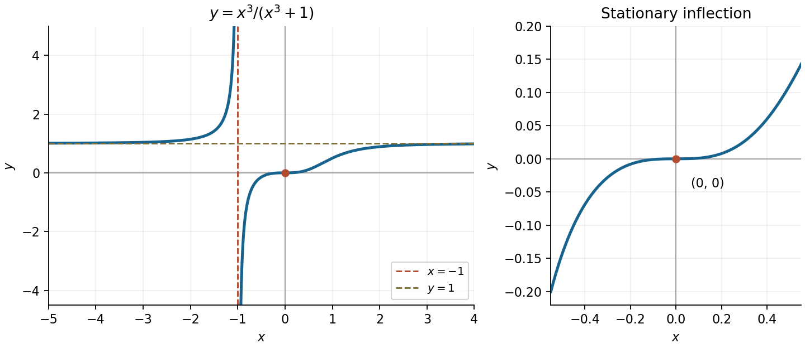
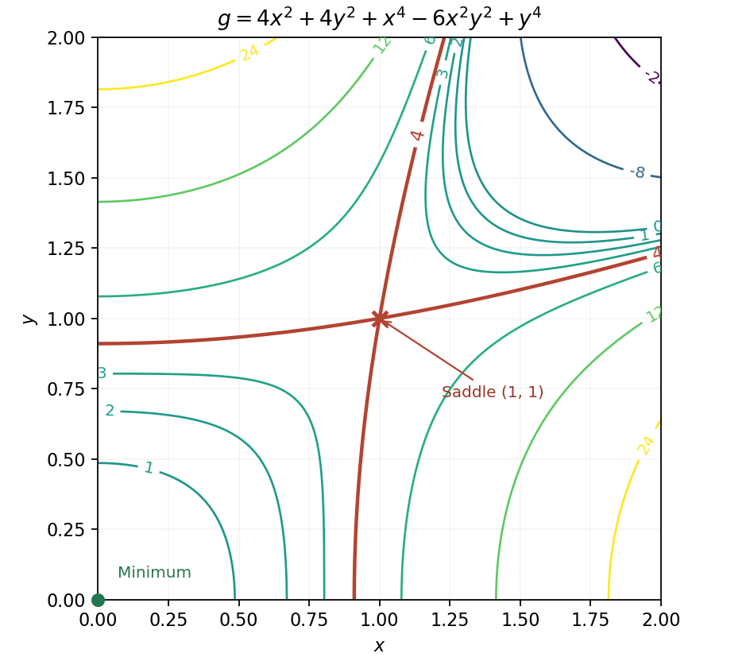
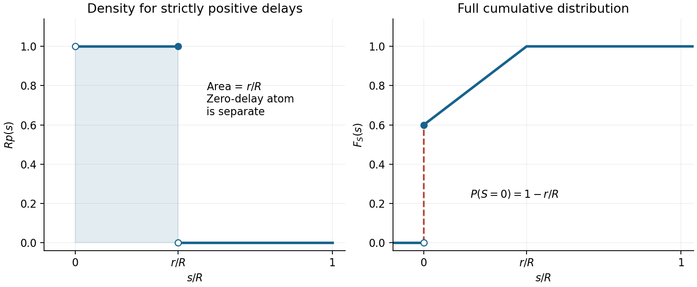
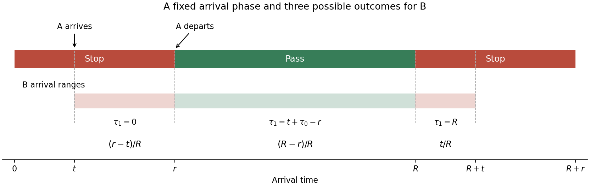
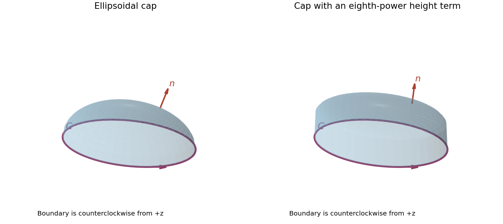

# Paper 1

↑ **Parent:** [2016](../2016.md)

[https://www.maths.cam.ac.uk/undergradnst/files/2016/papernst_ia_1.pdf](https://www.maths.cam.ac.uk/undergradnst/files/2016/papernst_ia_1.pdf)

**Table of contents**

- [1](#1)
  - [a](#1/a)
    - [Solution](#1/a/solution)
  - [b](#1/b)
    - [Solution](#1/b/solution)
- [2](#2)
  - [a](#2/a)
    - [Solution](#2/a/solution)
  - [b](#2/b)
    - [Solution](#2/b/solution)
- [3](#3)
  - [a](#3/a)
    - [Solution](#3/a/solution)
  - [b](#3/b)
    - [Solution](#3/b/solution)
- [4](#4)
  - [Solution](#4/solution)
- [5](#5)
  - [a](#5/a)
    - [Solution](#5/a/solution)
  - [b](#5/b)
    - [Solution](#5/b/solution)
- [6](#6)
  - [Solution](#6/solution)
- [7](#7)
  - [a](#7/a)
    - [Solution](#7/a/solution)
  - [b](#7/b)
    - [Solution](#7/b/solution)
- [8](#8)
  - [Solution](#8/solution)
- [9](#9)
  - [Solution](#9/solution)
- [10](#10)
  - [Solution](#10/solution)
- [11](#11)
  - [a](#11/a)
    - [Solution](#11/a/solution)
  - [b](#11/b)
    - [Solution](#11/b/solution)
  - [c](#11/c)
    - [Solution](#11/c/solution)
  - [d](#11/d)
    - [i](#11/d/i)
      - [Solution](#11/d/i/solution)
    - [ii](#11/d/ii)
      - [Solution](#11/d/ii/solution)
    - [iii](#11/d/iii)
      - [Solution](#11/d/iii/solution)
- [12](#12)
  - [a](#12/a)
    - [Solution](#12/a/solution)
  - [b](#12/b)
    - [i](#12/b/i)
      - [Solution](#12/b/i/solution)
    - [ii](#12/b/ii)
      - [Solution](#12/b/ii/solution)
- [13](#13)
  - [a](#13/a)
    - [Solution](#13/a/solution)
  - [b](#13/b)
    - [Solution](#13/b/solution)
  - [c](#13/c)
    - [Solution](#13/c/solution)
  - [d](#13/d)
    - [Solution](#13/d/solution)
- [14](#14)
  - [a](#14/a)
    - [i](#14/a/i)
      - [Solution](#14/a/i/solution)
    - [ii](#14/a/ii)
      - [Solution](#14/a/ii/solution)
    - [iii](#14/a/iii)
      - [Solution](#14/a/iii/solution)
    - [iv](#14/a/iv)
      - [Solution](#14/a/iv/solution)
  - [b](#14/b)
    - [i](#14/b/i)
      - [Solution](#14/b/i/solution)
    - [ii](#14/b/ii)
      - [Solution](#14/b/ii/solution)
    - [iii](#14/b/iii)
      - [Solution](#14/b/iii/solution)
- [15](#15)
  - [a](#15/a)
    - [i](#15/a/i)
      - [Solution](#15/a/i/solution)
    - [ii](#15/a/ii)
      - [Solution](#15/a/ii/solution)
    - [iii](#15/a/iii)
      - [Solution](#15/a/iii/solution)
  - [b](#15/b)
    - [i](#15/b/i)
      - [Solution](#15/b/i/solution)
    - [ii](#15/b/ii)
      - [Solution](#15/b/ii/solution)
- [16](#16)
  - [a](#16/a)
    - [i](#16/a/i)
      - [Solution](#16/a/i/solution)
    - [ii](#16/a/ii)
      - [Solution](#16/a/ii/solution)
    - [iii](#16/a/iii)
      - [Solution](#16/a/iii/solution)
    - [iv](#16/a/iv)
      - [Solution](#16/a/iv/solution)
    - [v](#16/a/v)
      - [Solution](#16/a/v/solution)
    - [vi](#16/a/vi)
      - [Solution](#16/a/vi/solution)
  - [b](#16/b)
    - [i](#16/b/i)
      - [Solution](#16/b/i/solution)
    - [ii](#16/b/ii)
      - [Solution](#16/b/ii/solution)
    - [iii](#16/b/iii)
      - [Solution](#16/b/iii/solution)
- [17](#17)
  - [a](#17/a)
    - [i](#17/a/i)
      - [Solution](#17/a/i/solution)
    - [ii](#17/a/ii)
      - [Solution](#17/a/ii/solution)
  - [b](#17/b)
    - [i](#17/b/i)
      - [Solution](#17/b/i/solution)
    - [ii](#17/b/ii)
      - [Solution](#17/b/ii/solution)
    - [iii](#17/b/iii)
      - [Solution](#17/b/iii/solution)
    - [iv](#17/b/iv)
      - [Solution](#17/b/iv/solution)
- [18](#18)
  - [a](#18/a)
    - [i](#18/a/i)
      - [Solution](#18/a/i/solution)
    - [ii](#18/a/ii)
      - [Solution](#18/a/ii/solution)
    - [iii](#18/a/iii)
      - [Solution](#18/a/iii/solution)
  - [b](#18/b)
    - [i](#18/b/i)
      - [Solution](#18/b/i/solution)
    - [ii](#18/b/ii)
      - [Solution](#18/b/ii/solution)
- [19](#19)
  - [a](#19/a)
    - [Solution](#19/a/solution)
  - [b](#19/b)
    - [Solution](#19/b/solution)
  - [c](#19/c)
    - [Solution](#19/c/solution)
- [20](#20)
  - [a](#20/a)
    - [i](#20/a/i)
      - [Solution](#20/a/i/solution)
    - [ii](#20/a/ii)
      - [Solution](#20/a/ii/solution)
    - [iii](#20/a/iii)
      - [Solution](#20/a/iii/solution)
  - [b](#20/b)
    - [i](#20/b/i)
      - [Solution](#20/b/i/solution)
    - [ii](#20/b/ii)
      - [Solution](#20/b/ii/solution)
  - [c](#20/c)
    - [Solution](#20/c/solution)

## 1

↑ **Parent:** [Paper 1](paper-1.md)

<h3 id="1/a">a</h3>

↑ **Parent:** [1](#1)

<h4 id="1/a/solution">Solution</h4>

↑ **Parent:** [A](#1/a)

The sum-of-cubes [polynomial factorization](../../polynomial.md#factorization-of-polynomials) is

$$
\boxed{a^3+b^3=(a+b)(a^2-ab+b^2).}
$$

Multiplication cancels the two mixed cubic terms and leaves precisely the two cubes.

<h3 id="1/b">b</h3>

↑ **Parent:** [1](#1)

<h4 id="1/b/solution">Solution</h4>

↑ **Parent:** [B](#1/b)

The [polynomial](../../polynomial.md) factors as

$$
x^3+x^2-16x+20=(x-2)^2(x+5).
$$

Thus the repeated [polynomial root](../../polynomial.md#root-of-a-polynomial) is **$x=2$**, of multiplicity two. Its repetition can also be checked from $p(2)=p'(2)=0$ and $p''(2)=14\ne0$.

## 2

↑ **Parent:** [Paper 1](paper-1.md)

<h3 id="2/a">a</h3>

↑ **Parent:** [2](#2)

<h4 id="2/a/solution">Solution</h4>

↑ **Parent:** [A](#2/a)

Factor out $-1/2$ and use the method of [completing the square](../../polynomial.md#completing-the-square) inside the bracket:

$$
-\frac{x^2}{2}+x=-\frac12(x^2-2x)
=\boxed{\frac12-\frac12(x-1)^2}.
$$

<h3 id="2/b">b</h3>

↑ **Parent:** [2](#2)

<h4 id="2/b/solution">Solution</h4>

↑ **Parent:** [B](#2/b)

Since $x^2-1=(x-1)(x+1)$, write the [partial fraction decomposition](../../isolated-singularity.md#partial-fraction-decomposition) as $A/(x-1)+B/(x+1)$. Matching the numerator gives $A+B=1$ and $A-B=2$, hence

$$
\boxed{\frac{x+2}{x^2-1}=\frac{3}{2(x-1)}-\frac{1}{2(x+1)},\qquad x\ne\pm1.}
$$

## 3

↑ **Parent:** [Paper 1](paper-1.md)

<h3 id="3/a">a</h3>

↑ **Parent:** [3](#3)

<h4 id="3/a/solution">Solution</h4>

↑ **Parent:** [A](#3/a)

Use the [difference of two squares](../../number-theory.md#difference-of-two-squares) about $10000$:

$$
10002\cdot9998=(10000+2)(10000-2)=10000^2-2^2=\boxed{99\,999\,996}.
$$

<h3 id="3/b">b</h3>

↑ **Parent:** [3](#3)

<h4 id="3/b/solution">Solution</h4>

↑ **Parent:** [B](#3/b)

For $u>0$, the principal [inverse tangent](../../geometry-and-topology.md#inverse-tangent) satisfies $\arctan u+\arctan(1/u)=\pi/2$: the two positive acute angles are complementary. Taking $u=\pi/4$ therefore makes the argument of the [natural logarithm](../../calculus.md#natural-logarithm) equal to $(2/\pi)(\pi/2)=1$. The requested value is **$\ln1=0$**.

## 4

↑ **Parent:** [Paper 1](paper-1.md)

<h3 id="4/solution">Solution</h3>

↑ **Parent:** [4](#4)

In one period, [sine](../../geometry-and-topology.md#sine) equals $-\sqrt3/2$ at $4\pi/3$ and $5\pi/3$, and lies below that value between them. Since [sine](../../geometry-and-topology.md#sine) is a [periodic function](../../function.md#periodic-function) with period $2\pi$, all solutions are:

$$
\boxed{x\in\bigcup_{k\in\mathbb Z}\left[\frac{4\pi}{3}+2\pi k,\ \frac{5\pi}{3}+2\pi k\right].}
$$

The endpoints are included because the inequality is non-strict.

## 5

↑ **Parent:** [Paper 1](paper-1.md)

<h3 id="5/a">a</h3>

↑ **Parent:** [5](#5)

<h4 id="5/a/solution">Solution</h4>

↑ **Parent:** [A](#5/a)

The [absolute value](../../real-analysis.md#absolute-value) is nonnegative, so a real point must satisfy $1-x^2\geq0$, or $-1\leq x\leq1$. On that interval the two branches are

$$
\boxed{y=1-x^2\quad\text{or}\quad y=x^2-1,\qquad -1\leq x\leq1.}
$$

They form a closed lens symmetric about both coordinate axes, meeting at $(\pm1,0)$ and reaching $(0,\pm1)$. The [parabolas](../../euclidean-geometry.md#parabola) outside the stated interval do not belong to the original [locus](../../euclidean-geometry.md#locus-mathematics).

**[Figure 1](#5/a/image-the-absolute-value-locus-and-its-intersections-with-the-horizontal-line-y-1-2). The absolute-value locus and its intersections with the horizontal line y = 1/2**.

<h3 id="5/b">b</h3>

↑ **Parent:** [5](#5)

<h4 id="5/b/solution">Solution</h4>

↑ **Parent:** [B](#5/b)

Substituting $y=1/2$ into the [absolute value](../../real-analysis.md#absolute-value) relation gives $1/2=1-x^2$, so $x^2=1/2$. All real intersections are

$$
\boxed{(x,y)=\left(\frac1{\sqrt2},\frac12\right),\quad
\left(-\frac1{\sqrt2},\frac12\right).}
$$

## 6

↑ **Parent:** [Paper 1](paper-1.md)

<h3 id="6/solution">Solution</h3>

↑ **Parent:** [6](#6)

Separate variables near the nonzero [initial condition](../../differential-equation.md#initial-condition): $y^{-2}dy=dx$. [Integration](../../integral.md) gives $-1/y=x+C$, and $y(1)=1$ fixes $C=-2$. Therefore

$$
\boxed{y(x)=\frac1{2-x},\qquad -\infty<x<2.}
$$

This is the maximal connected interval containing the initial point. Direct [differentiation](../../calculus.md#differentiation) gives $y'=1/(2-x)^2=y^2$; the pole at $x=2$ prevents continuation as a finite classical [solution of a differential equation](../../differential-equation.md#solution-of-a-differential-equation) through that point.

## 7

↑ **Parent:** [Paper 1](paper-1.md)

<h3 id="7/a">a</h3>

↑ **Parent:** [7](#7)

<h4 id="7/a/solution">Solution</h4>

↑ **Parent:** [A](#7/a)

The [derivative](../../calculus.md#derivative) of $\cot u$ is $-\csc^2u$. The [chain rule](../../calculus.md#chain-rule) therefore gives

$$
\boxed{\int\frac{dx}{\sin^2(3x+1)}=-\frac13\cot(3x+1)+C.}
$$

The [antiderivative](../../integral.md#antiderivative) applies on any interval containing no zero of $\sin(3x+1)$.

<h3 id="7/b">b</h3>

↑ **Parent:** [7](#7)

<h4 id="7/b/solution">Solution</h4>

↑ **Parent:** [B](#7/b)

Additivity of the [definite integral](../../integral.md#definite-integral) combines the adjacent intervals into $[0,n]$. For an integer $n\geq1$, the [power rule](../../calculus.md#power-rule) gives

$$
\sum_{j=0}^{n-1}\int_j^{j+1}(x-2)^n\,dx
=\int_0^n(x-2)^n\,dx
=\boxed{\frac{(n-2)^{n+1}-(-2)^{n+1}}{n+1}}.
$$

For $n=0$, interpret the indexed sum as an [empty sum](../../arithmetic.md#empty-sum), equal to zero; the displayed expression also gives zero. This convention resolves the otherwise degenerate endpoint of the stated nonnegative-integer range.

## 8

↑ **Parent:** [Paper 1](paper-1.md)

<h3 id="8/solution">Solution</h3>

↑ **Parent:** [8](#8)

The base $2e$ is constant. Write the [exponential function](../../calculus.md#exponential-function) as $\exp[\cos x\ln(2e)]$ and apply the [chain rule](../../calculus.md#chain-rule):

$$
\boxed{\frac d{dx}(2e)^{\cos x}
=-(1+\ln2)\sin x\,(2e)^{\cos x}.}
$$

## 9

↑ **Parent:** [Paper 1](paper-1.md)

<h3 id="9/solution">Solution</h3>

↑ **Parent:** [9](#9)

Rewrite the [rational function](../../isolated-singularity.md#rational-function) as $y=1-1/(x^3+1)$. It is undefined at $x=-1$, with the vertical [asymptote](../../topology.md#asymptote) $x=-1$, and tends to the horizontal [asymptote](../../topology.md#asymptote) $y=1$ as $x\to\pm\infty$. At the pole, $y\to+\infty$ from the left and $y\to-\infty$ from the right.

Its [derivative](../../calculus.md#derivative) is

$$
y'=\frac{3x^2}{(x^3+1)^2}\geq0,
$$

vanishing only at $x=0$. Since $y(0)=0$ and $y=x^3+O(x^6)$ near zero, this is a stationary [inflection point](../../topology.md#inflection-point), not an extremum. Thus

$$
\boxed{\text{stationary point }(0,0);\qquad\text{asymptotes }x=-1,\ y=1.}
$$

The graph increases on each side of the vertical [asymptote](../../topology.md#asymptote). The left branch lies above $y=1$, while the right branch lies below it and crosses the origin horizontally.

**[Figure 2](#9/image-the-rational-function-graph-its-two-asymptotes-and-its-stationary-inflection-at-the-origin). The rational-function graph, its two asymptotes, and its stationary inflection at the origin**.

## 10

↑ **Parent:** [Paper 1](paper-1.md)

<h3 id="10/solution">Solution</h3>

↑ **Parent:** [10](#10)

The first curve is a [circle](../../topology.md#circle) of [radius](../../topology.md#radius) $1$ centred at $(2,1)$. A line through the origin with equation $kx-y=0$ intersects it precisely when the perpendicular distance from that [centre](../../euclidean-geometry.md#center-geometry) is at most the [radius](../../topology.md#radius). The [distance from a point to a line](../../topological-analysis.md#distance-from-a-point-to-a-line) gives

$$
\frac{|2k-1|}{\sqrt{k^2+1}}\leq1
\quad\Longleftrightarrow\quad
(2k-1)^2\leq k^2+1
\quad\Longleftrightarrow\quad k(3k-4)\leq0.
$$

Hence the full parameter range is

$$
\boxed{0\leq k\leq\frac43.}
$$

The two endpoint lines are tangent, at $(2,0)$ and $(6/5,8/5)$ respectively; interior values give two real intersections. Both endpoints are therefore included.

## 11

↑ **Parent:** [Paper 1](paper-1.md)

<h3 id="11/a">a</h3>

↑ **Parent:** [11](#11)

<h4 id="11/a/solution">Solution</h4>

↑ **Parent:** [A](#11/a)

The original PDF places a [complex modulus](../../complex-analysis.md#complex-modulus) around the quotient; those bars are essential. Its denominator excludes $z=-i$. Using $|z^*-i|=|z+i|$, the case $\lambda=1$ becomes $|z-i|=|z+i|$. In Cartesian coordinates,

$$
x^2+(y-1)^2=x^2+(y+1)^2\quad\Longrightarrow\quad\boxed{y=0.}
$$

This [locus](../../euclidean-geometry.md#locus-mathematics) is the real axis, the perpendicular bisector of the points $i$ and $-i$ in the [complex plane](../../complex-analysis.md#complex-plane). The excluded denominator point does not lie on it.

<h3 id="11/b">b</h3>

↑ **Parent:** [11](#11)

<h4 id="11/b/solution">Solution</h4>

↑ **Parent:** [B](#11/b)

A quotient with nonzero denominator has zero [complex modulus](../../complex-analysis.md#complex-modulus) exactly when its numerator is zero. Thus

$$
\boxed{z=i,\quad\text{a single point}.}
$$

At that point $z^*-i=-2i\ne0$, so the solution is admissible.

<h3 id="11/c">c</h3>

↑ **Parent:** [11](#11)

<h4 id="11/c/solution">Solution</h4>

↑ **Parent:** [C](#11/c)

For real $\lambda>0$, squaring the two nonnegative moduli gives $|z-i|^2=\lambda^2|z+i|^2$. In Cartesian coordinates this is

$$
(1-\lambda^2)(x^2+y^2+1)-2(1+\lambda^2)y=0.
$$

Assume $\lambda\ne1$ and put $h=(1+\lambda^2)/(1-\lambda^2)$. Dividing by $1-\lambda^2$ yields $x^2+y^2-2hy+1=0$. Since $zz^*=x^2+y^2$ and $bz^*+b^*z=2\operatorname{Re}(bz^*)$, the requested complex equation has

$$
\boxed{b=-i\frac{1+\lambda^2}{1-\lambda^2},\qquad c=1.}
$$

Indeed these choices make the mixed term $-2hy$. Completing the square gives

$$
x^2+(y-h)^2=h^2-1=\frac{4\lambda^2}{(1-\lambda^2)^2}.
$$

The [Circles of Apollonius](../../euclidean-geometry.md#circles-of-apollonius) therefore have

$$
\boxed{\text{centre }z_c=i\frac{1+\lambda^2}{1-\lambda^2},\qquad
\text{radius }\frac{2\lambda}{|1-\lambda^2|}.}
$$

The [radius](../../topology.md#radius) is positive for the stated range. No spurious point at $z=-i$ has been introduced: at that point the undivided equation would require $4=0$. Positive $\lambda<1$ gives a [circle](../../topology.md#circle) above the real axis, while $\lambda>1$ gives one below it.

<h3 id="11/d">d</h3>

↑ **Parent:** [11](#11)

<h4 id="11/d/i">i</h4>

↑ **Parent:** [D](#11/d)

<h5 id="11/d/i/solution">Solution</h5>

↑ **Parent:** [I](#11/d/i)

For arbitrary complex $b$ and real $c$, complete the [complex modulus](../../complex-analysis.md#complex-modulus) square:

$$
zz^*+bz^*+b^*z+c=|z+b|^2+c-|b|^2.
$$

The [locus](../../euclidean-geometry.md#locus-mathematics) is a single point exactly when

$$
\boxed{c=|b|^2,\qquad z=-b.}
$$

<h4 id="11/d/ii">ii</h4>

↑ **Parent:** [D](#11/d)

<h5 id="11/d/ii/solution">Solution</h5>

↑ **Parent:** [Ii](#11/d/ii)

The same completed square gives $|z+b|^2=|b|^2-c$. A nondegenerate [circle](../../topology.md#circle) therefore occurs exactly when

$$
\boxed{c<|b|^2,\qquad\text{centre }-b,\quad\text{radius }\sqrt{|b|^2-c}.}
$$

For completeness, $c>|b|^2$ gives an empty [locus](../../euclidean-geometry.md#locus-mathematics) because a squared [complex modulus](../../complex-analysis.md#complex-modulus) cannot be negative.

<h4 id="11/d/iii">iii</h4>

↑ **Parent:** [D](#11/d)

<h5 id="11/d/iii/solution">Solution</h5>

↑ **Parent:** [Iii](#11/d/iii)

**No finite choice of $b$ and $c$ gives a line.** The coefficient of $zz^*=x^2+y^2$ is fixed at one, so completing the square always gives a [circle](../../topology.md#circle), a point, or the empty set. A general equation $Azz^*+bz^*+b^*z+c=0$ could describe a line when $A=0$ and $b\ne0$, but changing the fixed quadratic coefficient is not permitted here. A limiting sequence of increasingly large [circles](../../topology.md#circle) does not make any one of these finite equations a line.

## 12

↑ **Parent:** [Paper 1](paper-1.md)

<h3 id="12/a">a</h3>

↑ **Parent:** [12](#12)

<h4 id="12/a/solution">Solution</h4>

↑ **Parent:** [A](#12/a)

Write $f(x,y)=F(u,v)$ in the proposed local coordinates. The [multivariable chain rule](../../calculus.md#multivariable-chain-rule) gives

$$
f_x=2xF_u+2yF_v,\qquad f_y=-2yF_u+2xF_v.
$$

Consequently

$$
yf_x+xf_y=2(x^2+y^2)F_v=0.
$$

Away from the origin the [Jacobian determinant](../../multivariable-calculus.md#jacobian-determinant) is $u_xv_y-u_yv_x=4(x^2+y^2)>0$, so the [inverse function theorem](../../multivariable-calculus.md#inverse-function-theorem) justifies these local coordinates. Therefore $F_v=0$ and the local [general solution](../../linear-ordinary-differential-equation.md#general-solution) is

$$
\boxed{f(x,y)=\Phi(x^2-y^2).}
$$

Substitution verifies the result: $f_x=2x\Phi'$ and $f_y=-2y\Phi'$, whose weighted sum vanishes.

There is a global qualification. The coordinate map is two-to-one, and a [level set](../../topology.md#level-set) of $x^2-y^2$ has separate [characteristic curve](../../transport-equation.md#characteristic-curve) branches. A single profile on the entire plane does not follow without a branch-identification assumption. For example, take $f=\exp[-1/(x^2-y^2)^2]$ on the wedge $x>0$, $x^2>y^2$, and zero elsewhere. This is smooth, satisfies the equation, and has different values at $(1,0)$ and $(-1,0)$ despite equal $u$. The [characteristic components of a hyperbolic first-order equation](../../transport-equation.md#characteristic-components-of-a-hyperbolic-first-order-equation) explain this obstruction. At the origin the coordinate map is singular and the original equation reads $0=0$; the boxed answer is the intended local form on a regular branch, or a global form under an additional identification of branches.

<h3 id="12/b">b</h3>

↑ **Parent:** [12](#12)

<h4 id="12/b/i">i</h4>

↑ **Parent:** [B](#12/b)

<h5 id="12/b/i/solution">Solution</h5>

↑ **Parent:** [I](#12/b/i)

The first [partial derivatives](../../multivariable-calculus.md#partial-derivative) factor as

$$
g_x=4x(2+x^2-3y^2),\qquad g_y=4y(2+y^2-3x^2).
$$

If either coordinate vanishes, the other equation forces the other coordinate to vanish as well. If both are nonzero, subtracting the two bracket equations gives $x^2=y^2$, and then $x^2=y^2=1$. Thus the complete list of [stationary points](../../calculus-of-variations.md#stationary-point) is $(0,0)$ and the four points $(\pm1,\pm1)$.

The [Hessian matrix](../../multivariable-calculus.md#hessian-matrix) is

$$
H_g=\begin{pmatrix}8+12x^2-12y^2&-24xy\\-24xy&8+12y^2-12x^2\end{pmatrix}.
$$

At the origin it is $8I$, which is a [positive-definite matrix](../../quadratic-form.md#positive-definite-matrix). At the four other points its [eigenvalues](../../linear-operator-theory.md#eigenvalue) are $32$ and $-16$, independently of the signs. The [second-derivative test](../../multivariable-calculus.md#second-derivative-test) therefore gives

$$
\boxed{(0,0):\text{ strict local minimum, }g=0;\qquad
(\pm1,\pm1):\text{ saddle points, }g=4.}
$$

There are no [local maxima](../../analysis.md#local-maximum). The minimum at the origin is not global, since $g(t,t)=8t^2-4t^4\to-\infty$ as $|t|\to\infty$.

<h4 id="12/b/ii">ii</h4>

↑ **Parent:** [B](#12/b)

<h5 id="12/b/ii/solution">Solution</h5>

↑ **Parent:** [Ii](#12/b/ii)

Within the requested first-quadrant square, the [stationary points](../../calculus-of-variations.md#stationary-point) visible in the [contour plot](../../topology.md#contour-plot) are the corner minimum $(0,0)$ and the saddle $(1,1)$. Near the origin, $g\simeq4(x^2+y^2)$, so the low positive contours look like quarter-circles. Along either coordinate axis, $g=4t^2+t^4$ rises monotonically. Along the diagonal, $g(t,t)=8t^2-4t^4$ rises to $4$ at $t=1$, returns to zero at $t=\sqrt2$, then becomes negative.

The saddle contour $g=4$ crosses at $(1,1)$ and separates the central positive contours from the outer diagonal region. Negative contours occur toward $(2,2)$, where $g=-32$, while the axis corners $(2,0)$ and $(0,2)$ have $g=32$. These checks determine both the contour ordering and the change of connectivity at the saddle; the figure shows these level sets.

**[Figure 3](#12/b/ii/image-contours-of-the-quartic-function-in-the-first-quadrant-square-with-the-saddle-level-highlighted). Contours of the quartic function in the first-quadrant square, with the saddle level highlighted**.

## 13

↑ **Parent:** [Paper 1](paper-1.md)

<h3 id="13/a">a</h3>

↑ **Parent:** [13](#13)

<h4 id="13/a/solution">Solution</h4>

↑ **Parent:** [A](#13/a)

Write $\mathbf a=(a_x,a_y,a_z)$. The [cross product](../../vector-space.md#cross-product) gives $\mathbf v_1=(a_yz-a_zy,a_zx-a_xz,a_xy-a_yx)$, whose three diagonal [partial derivatives](../../multivariable-calculus.md#partial-derivative) vanish. For the second [vector field](../../multivariable-calculus.md#vector-field), direct [differentiation](../../calculus.md#differentiation) gives $\partial_x(2xy)=2y$, $\partial_y(x^2+3y^2+z^2)=6y$, and $\partial_z(2yz)=2y$. Thus

$$
\boxed{\boldsymbol\nabla\cdot\mathbf v_1=0,\qquad
\boldsymbol\nabla\cdot\mathbf v_2=10y.}
$$

<h3 id="13/b">b</h3>

↑ **Parent:** [13](#13)

<h4 id="13/b/solution">Solution</h4>

↑ **Parent:** [B](#13/b)

Put $L=5\pi/2$. The curve tangent is $\mathbf r'=(-b\sin\theta,b\cos\theta,c)$. For the first [line integral](../../multivariable-calculus.md#line-integral), the [scalar triple product](../../multilinear-algebra.md#scalar-triple-product) identity gives $(\mathbf a\times\mathbf r)\cdot\mathbf r'=\mathbf a\cdot(\mathbf r\times\mathbf r')$. Its [cross product](../../vector-space.md#cross-product) is

$$
\mathbf r\times\mathbf r'=\bigl(bc(\sin\theta-\theta\cos\theta),\ -bc(\theta\sin\theta+\cos\theta),\ b^2\bigr).
$$

The needed [definite integrals](../../integral.md#definite-integral) are

$$
\int_0^L(\sin\theta-\theta\cos\theta)d\theta
=\big[-\theta\sin\theta-2\cos\theta\big]_0^L=2-L,
$$

and $\int_0^L(-\theta\sin\theta-\cos\theta)d\theta=[\theta\cos\theta-2\sin\theta]_0^L=-2$. Hence

$$
\boxed{I_1=bc\left(2-\frac{5\pi}{2}\right)a_x-2bc\,a_y+\frac{5\pi b^2}{2}a_z.}
$$

For the second [line integral](../../multivariable-calculus.md#line-integral), substitute the curve into $\mathbf v_2\cdot\mathbf r'$. The cubic terms combine to $b^3\cos\theta$, leaving

$$
\begin{aligned}
\mathbf v_2\cdot\mathbf r'
&=b^3\cos\theta+bc^2\theta^2\cos\theta+2bc^2\theta\sin\theta\\
&=\frac d{d\theta}\left[b\sin\theta\,(b^2+c^2\theta^2)\right].
\end{aligned}
$$

The [fundamental theorem of calculus](../../calculus.md#fundamental-theorem-of-calculus) therefore gives

$$
\boxed{I_2=b\left(b^2+\frac{25\pi^2c^2}{4}\right).}
$$

Both calculations retain the full path from $\theta=0$ to $5\pi/2$, rather than inadvertently closing the [helix](../../topology.md#helix) after one turn.

<h3 id="13/c">c</h3>

↑ **Parent:** [13](#13)

<h4 id="13/c/solution">Solution</h4>

↑ **Parent:** [C](#13/c)

Direct calculation of the [curl](../../multivariable-calculus.md#curl) gives

$$
\boldsymbol\nabla\times\mathbf v_1=2\mathbf a,\qquad
\boldsymbol\nabla\times\mathbf v_2=\mathbf0.
$$

Since $\mathbf a\ne0$, the first [vector field](../../multivariable-calculus.md#vector-field) cannot be a [gradient field](../../multivariable-calculus.md#gradient-field): the [curl of a gradient](../../multivariable-calculus.md#curl-of-a-gradient) is zero. The second is a smooth [polynomial](../../polynomial.md) field on all of the [simply connected](../../algebraic-topology.md#simply-connected-space) space $\mathbb R^3$, so its vanishing [curl](../../multivariable-calculus.md#curl) makes it a [conservative vector field](../../multivariable-calculus.md#conservative-vector-field). A potential is also constructed explicitly in the next part. Thus **$\mathbf v_2$ is a [conservative vector field](../../multivariable-calculus.md#conservative-vector-field) and $\mathbf v_1$ is not**. A vanishing [divergence](../../multivariable-calculus.md#divergence) alone, as for $\mathbf v_1$, is a different property and does not establish conservativity.

<h3 id="13/d">d</h3>

↑ **Parent:** [13](#13)

<h4 id="13/d/solution">Solution</h4>

↑ **Parent:** [D](#13/d)

Integrating $\phi_x=2xy$ gives $\phi=x^2y+h(y,z)$. Matching $\phi_y=x^2+3y^2+z^2$ then gives $h=y^3+yz^2+k(z)$. Finally $\phi_z=2yz$ forces $k$ to be constant. A [scalar potential](../../classical-field-theory.md#scalar-potential) is

$$
\boxed{\phi(x,y,z)=x^2y+y^3+yz^2+C.}
$$

The initial and final points of the [helix](../../topology.md#helix) are $(b,0,0)$ and $(0,b,cL)$, where $L=5\pi/2$. The [fundamental theorem for line integrals](../../multivariable-calculus.md#fundamental-theorem-for-line-integrals) gives

$$
\phi(0,b,cL)-\phi(b,0,0)=b^3+bc^2L^2
=\boxed{b\left(b^2+\frac{25\pi^2c^2}{4}\right)},
$$

agreeing with the directly evaluated $I_2$.

## 14

↑ **Parent:** [Paper 1](paper-1.md)

<h3 id="14/a">a</h3>

↑ **Parent:** [14](#14)

<h4 id="14/a/i">i</h4>

↑ **Parent:** [A](#14/a)

<h5 id="14/a/i/solution">Solution</h5>

↑ **Parent:** [I](#14/a/i)

By the [spectral theorem for real symmetric matrices](../../linear-algebra.md#spectral-theorem-for-real-symmetric-matrices), choose the normalized [eigenvectors](../../linear-operator-theory.md#eigenvector) to form an **[orthonormal basis](../../inner-product.md#orthonormal-basis)**. With $P_n=\mathbf e_n\mathbf e_n^{\mathsf T}$, orthonormality gives $P_nP_m=\delta_{nm}P_n$ and $\sum_nP_n=I$. For every vector $\mathbf x$, expand $\mathbf x=\sum_n(\mathbf e_n^{\mathsf T}\mathbf x)\mathbf e_n$ and apply $A$:

$$
A\mathbf x=\sum_n\lambda_n\mathbf e_n(\mathbf e_n^{\mathsf T}\mathbf x).
$$

Since this equality holds for every $\mathbf x$, the [spectral decomposition](../../linear-operator-theory.md#spectral-decomposition) is

$$
\boxed{A=\sum_{n=1}^N\lambda_n\mathbf e_n\mathbf e_n^{\mathsf T}.}
$$

Each $P_n$ is the rank-one [orthogonal projection](../../hilbert-space.md#orthogonal-projection) onto its [eigenvector](../../linear-operator-theory.md#eigenvector) direction. In a degenerate [eigenspace](../../linear-operator-theory.md#eigenspace), normalized [eigenvectors](../../linear-operator-theory.md#eigenvector) must be chosen mutually orthogonal; normalization alone does not guarantee this resolution of the identity.

<h4 id="14/a/ii">ii</h4>

↑ **Parent:** [A](#14/a)

<h5 id="14/a/ii/solution">Solution</h5>

↑ **Parent:** [Ii](#14/a/ii)

The [matrix trace](../../linear-algebra.md#matrix-trace) is linear, and

$$
\operatorname{tr}(\mathbf e_n\mathbf e_n^{\mathsf T})
=\sum_j(e_n)_j^2=\|\mathbf e_n\|^2=1.
$$

Taking the [trace](../../linear-algebra.md#matrix-trace) of the [spectral decomposition](../../linear-operator-theory.md#spectral-decomposition) therefore proves

$$
\boxed{\operatorname{tr}A=\sum_{n=1}^N\lambda_n.}
$$

<h4 id="14/a/iii">iii</h4>

↑ **Parent:** [A](#14/a)

<h5 id="14/a/iii/solution">Solution</h5>

↑ **Parent:** [Iii](#14/a/iii)

If every [eigenvalue](../../linear-operator-theory.md#eigenvalue) is nonzero, define $B=\sum_n\lambda_n^{-1}P_n$, where $P_n=\mathbf e_n\mathbf e_n^{\mathsf T}$. Using the mutually [orthogonal projection](../../hilbert-space.md#orthogonal-projection) identity $P_nP_m=\delta_{nm}P_n$,

$$
AB=\sum_{n,m}\frac{\lambda_n}{\lambda_m}P_nP_m=\sum_nP_n=I.
$$

The same calculation gives $BA=I$. Thus the [matrix inverse](../../matrix-inverse.md) is

$$
\boxed{A^{-1}=\sum_{n=1}^N\frac1{\lambda_n}\mathbf e_n\mathbf e_n^{\mathsf T}.}
$$

<h4 id="14/a/iv">iv</h4>

↑ **Parent:** [A](#14/a)

<h5 id="14/a/iv/solution">Solution</h5>

↑ **Parent:** [Iv](#14/a/iv)

The inverse fails to exist exactly when **at least one [eigenvalue](../../linear-operator-theory.md#eigenvalue) is zero**. In that case a nonzero [eigenvector](../../linear-operator-theory.md#eigenvector) lies in the [kernel of a linear map](../../kernel-of-a-linear-map.md), so $A$ is not one-to-one. Equivalently, its [determinant](../../multilinear-algebra.md#determinant) $\prod_n\lambda_n$ is zero. Conversely, if every [eigenvalue](../../linear-operator-theory.md#eigenvalue) is nonzero, the preceding construction gives an inverse.

<h3 id="14/b">b</h3>

↑ **Parent:** [14](#14)

<h4 id="14/b/i">i</h4>

↑ **Parent:** [B](#14/b)

<h5 id="14/b/i/solution">Solution</h5>

↑ **Parent:** [I](#14/b/i)

The third coordinate is decoupled, giving the unit [eigenvector](../../linear-operator-theory.md#eigenvector) $(0,0,1)^{\mathsf T}$ with [eigenvalue](../../linear-operator-theory.md#eigenvalue) $1$. In the first two coordinates, the symmetric direction $(1,1)$ has [eigenvalue](../../linear-operator-theory.md#eigenvalue) $3-1=2$, and the antisymmetric direction $(1,-1)$ has [eigenvalue](../../linear-operator-theory.md#eigenvalue) $3+1=4$. Their normalized forms are

$$
\boxed{\begin{array}{c|c}
\lambda_1=2&\mathbf e_1=\dfrac1{\sqrt2}(1,1,0)^{\mathsf T}\\[3pt]
\lambda_2=4&\mathbf e_2=\dfrac1{\sqrt2}(1,-1,0)^{\mathsf T}\\[3pt]
\lambda_3=1&\mathbf e_3=(0,0,1)^{\mathsf T}.
\end{array}}
$$

They are an [orthonormal basis](../../inner-product.md#orthonormal-basis) of $\mathbb R^3$; independent sign reversals are equally valid choices.

<h4 id="14/b/ii">ii</h4>

↑ **Parent:** [B](#14/b)

<h5 id="14/b/ii/solution">Solution</h5>

↑ **Parent:** [Ii](#14/b/ii)

Insert the [eigenvalues](../../linear-operator-theory.md#eigenvalue) and [eigenvectors](../../linear-operator-theory.md#eigenvector) into the inverse [spectral decomposition](../../linear-operator-theory.md#spectral-decomposition). The first two projections contribute

$$
\frac12\mathbf e_1\mathbf e_1^{\mathsf T}+\frac14\mathbf e_2\mathbf e_2^{\mathsf T}
=\begin{pmatrix}3/8&1/8&0\\1/8&3/8&0\\0&0&0\end{pmatrix}.
$$

Adding the third projection gives

$$
\boxed{A^{-1}=\begin{pmatrix}3/8&1/8&0\\1/8&3/8&0\\0&0&1\end{pmatrix}.}
$$

Multiplication by $A$ gives the identity; in particular the upper block satisfies $\begin{pmatrix}3&-1\\-1&3\end{pmatrix}\begin{pmatrix}3&1\\1&3\end{pmatrix}=8I$.

<h4 id="14/b/iii">iii</h4>

↑ **Parent:** [B](#14/b)

<h5 id="14/b/iii/solution">Solution</h5>

↑ **Parent:** [Iii](#14/b/iii)

Summing the diagonal entries gives

$$
\boxed{\operatorname{tr}(A^{-1})=\frac38+\frac38+1=\frac74.}
$$

The [eigenvalues](../../linear-operator-theory.md#eigenvalue) of the inverse are the reciprocals $1/2,1/4,1$ of those of $A$, whose sum is also $7/4$. This is precisely what the [trace](../../linear-algebra.md#matrix-trace) identity predicts.

## 15

↑ **Parent:** [Paper 1](paper-1.md)

<h3 id="15/a">a</h3>

↑ **Parent:** [15](#15)

<h4 id="15/a/i">i</h4>

↑ **Parent:** [A](#15/a)

<h5 id="15/a/i/solution">Solution</h5>

↑ **Parent:** [I](#15/a/i)

Expand the [natural logarithm](../../calculus.md#natural-logarithm) and reciprocal separately:

$$
\ln(2+x)=\ln2+\frac x2-\frac{x^2}{8}+O(x^3),\qquad
\frac1{2-x}=\frac12\left(1+\frac x2+\frac{x^2}{4}+O(x^3)\right).
$$

Multiplication gives the first three nonzero terms of the [Maclaurin series](../../calculus.md#maclaurin-series):

$$
\boxed{\frac{\ln(2+x)}{2-x}=\frac{\ln2}{2}
+\frac{1+\ln2}{4}x+\frac{1+2\ln2}{16}x^2+O(x^3).}
$$

The local expansions converge for $|x|<2$.

<h4 id="15/a/ii">ii</h4>

↑ **Parent:** [A](#15/a)

<h5 id="15/a/ii/solution">Solution</h5>

↑ **Parent:** [Ii](#15/a/ii)

The [derivative](../../calculus.md#derivative) of the [inverse tangent](../../geometry-and-topology.md#inverse-tangent) is $(1+x^2)^{-1}$. Expand it as a [geometric series](../../sequence-and-series.md#geometric-series) and integrate term by term near zero, using $\arctan0=0$:

$$
\arctan x=\int_0^x(1-t^2+t^4+O(t^6))dt
=\boxed{x-\frac{x^3}{3}+\frac{x^5}{5}+O(x^7).}
$$

<h4 id="15/a/iii">iii</h4>

↑ **Parent:** [A](#15/a)

<h5 id="15/a/iii/solution">Solution</h5>

↑ **Parent:** [Iii](#15/a/iii)

Use $\cosh x=1+x^2/2+x^4/24+x^6/720+O(x^8)$. The [Maclaurin series](../../calculus.md#maclaurin-series) $\ln(1+u)=u-u^2/2+u^3/3+O(u^4)$ gives

$$
\begin{aligned}
\ln(\cosh x)
&=\frac{x^2}{2}+\left(\frac1{24}-\frac18\right)x^4
+\left(\frac1{720}-\frac1{48}+\frac1{24}\right)x^6+O(x^8)\\
&=\boxed{\frac{x^2}{2}-\frac{x^4}{12}+\frac{x^6}{45}+O(x^8).}
\end{aligned}
$$

All three nonzero terms are needed; stopping at fourth order would supply only two.

<h3 id="15/b">b</h3>

↑ **Parent:** [15](#15)

<h4 id="15/b/i">i</h4>

↑ **Parent:** [B](#15/b)

<h5 id="15/b/i/solution">Solution</h5>

↑ **Parent:** [I](#15/b/i)

Assume the needed [derivatives](../../calculus.md#derivative) exist continuously and $df/dg\ne0$ on a neighborhood, so the [inverse function theorem](../../multivariable-calculus.md#inverse-function-theorem) provides a local inverse. Put $p=df/dg$, $q=d^2f/dg^2$, and $r=d^3f/dg^3$. The [chain rule](../../calculus.md#chain-rule) gives $d/df=p^{-1}d/dg$, so

$$
\frac{dg}{df}=\frac1p,\qquad
\frac{d^2g}{df^2}=\frac1p\frac d{dg}\frac1p=-\frac q{p^3}.
$$

Differentiate once more:

$$
\frac{d^3g}{df^3}=\frac1p\frac d{dg}(-qp^{-3})
=-\frac r{p^4}+\frac{3q^2}{p^5}.
$$

Thus the [first three derivatives of an inverse function](../../multivariable-calculus.md#first-three-derivatives-of-an-inverse-function) are

$$
\boxed{\frac{dg}{df}=\frac1{df/dg},\qquad
\frac{d^2g}{df^2}=-\frac{d^2f/dg^2}{(df/dg)^3},\qquad
\frac{d^3g}{df^3}=
\frac{3(d^2f/dg^2)^2-(df/dg)(d^3f/dg^3)}{(df/dg)^5}.}
$$

All forward [derivatives](../../calculus.md#derivative) on the right are evaluated at the corresponding value $g(f)$.

<h4 id="15/b/ii">ii</h4>

↑ **Parent:** [B](#15/b)

<h5 id="15/b/ii/solution">Solution</h5>

↑ **Parent:** [Ii](#15/b/ii)

Since $a_1=f'(0)\ne0$, substitute the proposed inverse series into the forward one. Comparing coefficients of $f,f^2,f^3$ gives

$$
a_1b_1=1,\qquad a_1b_2+a_2b_1^2=0,\qquad
a_1b_3+2a_2b_1b_2+a_3b_1^3=0.
$$

Solving successively yields the [cubic series reversion](../../asymptotic-expansion.md#cubic-series-reversion) coefficients

$$
\boxed{b_1=\frac1{a_1},\qquad b_2=-\frac{a_2}{a_1^3},\qquad
b_3=\frac{2a_2^2-a_1a_3}{a_1^5}.}
$$

The conditions $f(0)=0$ and $a_1\ne0$ ensure that both local series are centred at zero and that the inverse has a linear leading term.

## 16

↑ **Parent:** [Paper 1](paper-1.md)

<h3 id="16/a">a</h3>

↑ **Parent:** [16](#16)

<h4 id="16/a/i">i</h4>

↑ **Parent:** [A](#16/a)

<h5 id="16/a/i/solution">Solution</h5>

↑ **Parent:** [I](#16/a/i)

The arrival phase has a [uniform distribution](../../continuous-probability-distribution.md#continuous-uniform-distribution) over a cycle of length $R$. The no-delay phases occupy length $R-r$, so

$$
\boxed{\mathbb P(S=0)=\frac{R-r}{R}=1-\frac rR.}
$$

Individual phase endpoints have [probability](../../probability-theory.md#probability) zero. The model neglects clearance time and releases waiting vehicles together when the stop interval ends; the degenerate case $r=R$ is interpreted as release at successive cycle boundaries.

<h4 id="16/a/ii">ii</h4>

↑ **Parent:** [A](#16/a)

<h5 id="16/a/ii/solution">Solution</h5>

↑ **Parent:** [Ii](#16/a/ii)

For a stop-phase arrival at time $t$, the delay is $s=r-t$. An interval of delays of width $ds$ therefore corresponds to an interval of arrival phases of the same width, because $|dt/ds|=1$. Its unconditional [probability](../../probability-theory.md#probability) is $ds/R$. Hence the positive-delay part has density

$$
\boxed{p(s)=\begin{cases}1/R,&0<s\leq r,\\0,&r<s\leq R.\end{cases}}
$$

This ordinary density integrates to $r/R$, not to one: the remaining [probability mass](../../probability-distribution.md#probability-mass) is at $s=0$. Thus $S$ has a [uniform distribution with an atom at zero](../../probability-distribution.md#uniform-distribution-with-an-atom-at-zero), with mixing weight $q=r/R$. Conditional on a positive delay, the density would instead be $1/r$ on $(0,r)$.

<h4 id="16/a/iii">iii</h4>

↑ **Parent:** [A](#16/a)

<h5 id="16/a/iii/solution">Solution</h5>

↑ **Parent:** [Iii](#16/a/iii)

The graph of the positive-delay [probability density function](../../continuous-probability-distribution.md#probability-density-function) is a horizontal segment at height $1/R$ from $s=0$ to $r$, followed by zero from $r$ to $R$. Values at individual endpoints do not affect [probabilities](../../probability-theory.md#probability). The separate atom $1-r/R$ at zero is not a finite-height part of this density graph.

**[Figure 4](#16/a/iii/image-positive-delay-density-and-the-full-cumulative-distribution-whose-jump-records-the-no-delay-atom). Positive-delay density and the full cumulative distribution, whose jump records the no-delay atom**.

The companion [cumulative distribution function](../../probability-distribution.md#cumulative-distribution-function) in the figure is $F_S(s)=0$ for $s<0$, $F_S(s)=1-r/R+s/R$ for $0\leq s<r$, and $F_S(s)=1$ for $s\geq r$. Its jump at zero displays the discrete part without confusing density height with [probability mass](../../probability-distribution.md#probability-mass).

<h4 id="16/a/iv">iv</h4>

↑ **Parent:** [A](#16/a)

<h5 id="16/a/iv/solution">Solution</h5>

↑ **Parent:** [Iv](#16/a/iv)

The [probability](../../probability-theory.md#probability) of a positive delay is the integral of its density:

$$
\mathbb P(S>0)=\int_0^r\frac{ds}{R}=\frac rR.
$$

Adding the separate no-delay event gives

$$
\boxed{\mathbb P(S=0)+\mathbb P(S>0)=\left(1-\frac rR\right)+\frac rR=1.}
$$

This is the [normalization of a probability distribution](../../probability-distribution.md#normalization-of-a-probability-distribution) with both discrete and continuous parts.

<h4 id="16/a/v">v</h4>

↑ **Parent:** [A](#16/a)

<h5 id="16/a/v/solution">Solution</h5>

↑ **Parent:** [V](#16/a/v)

The atom at zero contributes zero to the [expected value](../../expected-value.md), while all positive delays must retain their unconditional density. Therefore

$$
\boxed{\mu=\mathbb E[S]=0\left(1-\frac rR\right)+\int_0^r\frac{s}{R}\,ds=\frac{r^2}{2R}.}
$$

This [mean](../../expected-value.md) is $r/R$ times the [mean](../../expected-value.md) $r/2$ conditional on encountering a stop; using $r/2$ alone would omit the vehicles passing without delay.

<h4 id="16/a/vi">vi</h4>

↑ **Parent:** [A](#16/a)

<h5 id="16/a/vi/solution">Solution</h5>

↑ **Parent:** [Vi](#16/a/vi)

The second [moment](../../expected-value.md#moment) is

$$
\mathbb E[S^2]=\int_0^r\frac{s^2}{R}\,ds=\frac{r^3}{3R}.
$$

Subtracting the squared [expected value](../../expected-value.md) gives the [variance](../../variance.md) and [standard deviation](../../variance.md#standard-deviation):

$$
\boxed{\operatorname{Var}(S)=\frac{r^3}{3R}-\frac{r^4}{4R^2}
=\frac{r^3(4R-3r)}{12R^2},\qquad
\sigma=\sqrt{\frac{r^3(4R-3r)}{12R^2}}.}
$$

The [variance](../../variance.md) is nonnegative because $0<r\leq R$. Both $\mu$ and $\sigma$ have units of time. At $r=R$ the result reduces to $R/\sqrt{12}$, the [standard deviation](../../variance.md#standard-deviation) of a [uniform distribution](../../continuous-probability-distribution.md#continuous-uniform-distribution) over one full cycle.

<h3 id="16/b">b</h3>

↑ **Parent:** [16](#16)

<h4 id="16/b/i">i</h4>

↑ **Parent:** [B](#16/b)

<h5 id="16/b/i/solution">Solution</h5>

↑ **Parent:** [I](#16/b/i)

Condition throughout on the given arrival time $t$ of A, with $0\leq t<r$. A departs at time $r$. B also departs at $r$ exactly when it arrives before that release, so $t+\tau_0\leq r$, or $0<\tau_0\leq r-t$. Since $\tau_0$ is uniform on an interval of length $R$,

$$
\boxed{\mathbb P(\tau_1=0\mid t)=\frac{r-t}{R}.}
$$

The original timeline below shows the three disjoint ranges of $\tau_0$. The same idealized simultaneous-release convention as in part (a) is used.

**[Figure 5](#16/b/i/image-conditional-arrival-ranges-for-the-following-vehicle-at-a-fixed-arrival-phase-of-the-leading-vehicle). Conditional arrival ranges for the following vehicle at a fixed arrival phase of the leading vehicle**.

<h4 id="16/b/ii">ii</h4>

↑ **Parent:** [B](#16/b)

<h5 id="16/b/ii/solution">Solution</h5>

↑ **Parent:** [Ii](#16/b/ii)

If B arrives during the remaining pass phase, then $r<t+\tau_0<R$, or $r-t<\tau_0<R-t$. It passes immediately, so

$$
\tau_1=(t+\tau_0)-r=\tau_0-(r-t).
$$

Because $r-t>0$, this is strictly between zero and $\tau_0$. The phase interval has length $(R-t)-(r-t)=R-r$, giving

$$
\boxed{\mathbb P(0<\tau_1<\tau_0\mid t)=\frac{R-r}{R}.}
$$

<h4 id="16/b/iii">iii</h4>

↑ **Parent:** [B](#16/b)

<h5 id="16/b/iii/solution">Solution</h5>

↑ **Parent:** [Iii](#16/b/iii)

The remaining arrivals occur in the next stop phase: $R\leq t+\tau_0\leq R+t$, or $R-t\leq\tau_0\leq R$. B waits until $R+r$, while A departed at $r$, giving $\tau_1=R\geq\tau_0$. This interval has length $t$, hence

$$
\boxed{\mathbb P(\tau_1\geq\tau_0\mid t)=\frac tR.}
$$

Endpoint assignments do not affect [probabilities](../../probability-theory.md#probability). The three outcomes are exhaustive and satisfy

$$
\boxed{\frac{r-t}{R}+\frac{R-r}{R}+\frac tR=1.}
$$

These are [conditional probabilities](../../probability-theory.md#conditional-probability) for the stated fixed $t$; there is no additional averaging over A's arrival phase in the question.

## 17

↑ **Parent:** [Paper 1](paper-1.md)

<h3 id="17/a">a</h3>

↑ **Parent:** [17](#17)

<h4 id="17/a/i">i</h4>

↑ **Parent:** [A](#17/a)

<h5 id="17/a/i/solution">Solution</h5>

↑ **Parent:** [I](#17/a/i)

Integrating $y''=0$ once gives a constant first [derivative](../../calculus.md#derivative), and integrating again gives

$$
\boxed{y(x)=C_0+C_1x.}
$$

There are two independent constants, as expected for a second-order [ordinary differential equation](../../differential-equation.md#ordinary-differential-equation).

<h4 id="17/a/ii">ii</h4>

↑ **Parent:** [A](#17/a)

<h5 id="17/a/ii/solution">Solution</h5>

↑ **Parent:** [Ii](#17/a/ii)

After $n$ integrations, the [general solution](../../linear-ordinary-differential-equation.md#general-solution) is an arbitrary [polynomial](../../polynomial.md) of degree at most $n-1$:

$$
\boxed{y(x)=\sum_{j=0}^{n-1}C_jx^j.}
$$

Conversely, every such [polynomial](../../polynomial.md) has zero $n$th [derivative](../../calculus.md#derivative). The $n$ free coefficients span the full solution space on a connected interval.

<h3 id="17/b">b</h3>

↑ **Parent:** [17](#17)

<h4 id="17/b/i">i</h4>

↑ **Parent:** [B](#17/b)

<h5 id="17/b/i/solution">Solution</h5>

↑ **Parent:** [I](#17/b/i)

In the homogeneous equation, substitute the [exponential function](../../calculus.md#exponential-function) $e^{kx}$. The [characteristic equation](../../linear-ordinary-differential-equation.md#characteristic-equation-of-a-constant-coefficient-differential-equation) is

$$
k^5-k=k(k^4-1)=k(k-1)(k+1)(k^2+1)=0.
$$

Its distinct roots are $0,1,-1,i,-i$. Combining the complex-conjugate pair into real [sine](../../geometry-and-topology.md#sine) and [cosine](../../geometry-and-topology.md#cosine) gives the [complementary function](../../linear-ordinary-differential-equation.md#homogeneous-solution)

$$
\boxed{y_c=C_0+C_1e^x+C_2e^{-x}+C_3\cos x+C_4\sin x.}
$$

Five linearly independent terms supply the required five homogeneous degrees of freedom.

<h4 id="17/b/ii">ii</h4>

↑ **Parent:** [B](#17/b)

<h5 id="17/b/ii/solution">Solution</h5>

↑ **Parent:** [Ii](#17/b/ii)

A quadratic [polynomial](../../polynomial.md) is sufficient: set $y_p=Ax^2$. Its fifth [derivative](../../calculus.md#derivative) vanishes, so $y_p^{(5)}-y_p'=-2Ax$. Matching the forcing gives $A=-1/2$, hence a [particular integral](../../linear-ordinary-differential-equation.md#particular-solution) is

$$
\boxed{y_p=-\frac{x^2}{2}.}
$$

<h4 id="17/b/iii">iii</h4>

↑ **Parent:** [B](#17/b)

<h5 id="17/b/iii/solution">Solution</h5>

↑ **Parent:** [Iii](#17/b/iii)

Add the [particular solution](../../linear-ordinary-differential-equation.md#particular-solution) to the [complementary function](../../linear-ordinary-differential-equation.md#homogeneous-solution). The real [general solution](../../linear-ordinary-differential-equation.md#general-solution) is

$$
\boxed{y=C_0+C_1e^x+C_2e^{-x}+C_3\cos x+C_4\sin x-\frac{x^2}{2}.}
$$

The five constants remain arbitrary until initial data are specified.

<h4 id="17/b/iv">iv</h4>

↑ **Parent:** [B](#17/b)

<h5 id="17/b/iv/solution">Solution</h5>

↑ **Parent:** [Iv](#17/b/iv)

Impose the five [initial conditions](../../differential-equation.md#initial-condition) at zero on the preceding [general solution](../../linear-ordinary-differential-equation.md#general-solution). They give

$$
\begin{aligned}
C_0+C_1+C_2+C_3&=1,\\
C_1-C_2+C_4&=0,\\
C_1+C_2-C_3-1&=0,\\
C_1-C_2-C_4&=0,\\
C_1+C_2+C_3&=0.
\end{aligned}
$$

The second and fourth equations give $C_1=C_2$ and $C_4=0$. The third and fifth then yield $C_1=C_2=1/4$ and $C_3=-1/2$, while the first gives $C_0=1$. Thus

$$
\boxed{y(x)=1+\frac14(e^x+e^{-x})-\frac12\cos x-\frac{x^2}{2}
=1+\frac12(\cosh x-\cos x)-\frac{x^2}{2}.}
$$

For a direct check, the difference of its fifth and first [derivatives](../../calculus.md#derivative) is $x$. At zero its value is one; its first, second, third and fourth [derivatives](../../calculus.md#derivative) vanish. In particular the quadratic term cancels the otherwise nonzero second [derivative](../../calculus.md#derivative) of the hyperbolic-cosine and [cosine](../../geometry-and-topology.md#cosine) combination.

## 18

↑ **Parent:** [Paper 1](paper-1.md)

<h3 id="18/a">a</h3>

↑ **Parent:** [18](#18)

<h4 id="18/a/i">i</h4>

↑ **Parent:** [A](#18/a)

<h5 id="18/a/i/solution">Solution</h5>

↑ **Parent:** [I](#18/a/i)

Partition the finite interval as $a=x_0<x_1<\cdots<x_N=b$, with $\Delta x_i=x_{i+1}-x_i$. For a [Riemann integrable](../../real-analysis.md#riemann-integrable-function) [function](../../function.md), the left-endpoint [Riemann sums](../../real-analysis.md#riemann-sum) satisfy

$$
\boxed{\int_a^b f(x)\,dx
=\lim_{\max_i\Delta x_i\to0}\sum_{i=0}^{N-1}f(x_i)\Delta x_i.}
$$

The maximum subinterval width, rather than merely the number of subintervals, must tend to zero. Continuity of $f$ on the closed interval is a sufficient integrability hypothesis. More generally, any chosen sample point in each subinterval gives the same [definite integral](../../integral.md#definite-integral) under these assumptions.

<h4 id="18/a/ii">ii</h4>

↑ **Parent:** [A](#18/a)

<h5 id="18/a/ii/solution">Solution</h5>

↑ **Parent:** [Ii](#18/a/ii)

Index the stated [geometric progression](../../sequence-and-series.md#geometric-progression) by $x_i=(1+\epsilon)^i$, $i=0,1,\ldots$. Then $\Delta x_i=\epsilon(1+\epsilon)^i$, and its left-endpoint contribution is

$$
f(x_i)\Delta x_i=(1+\epsilon)^{-(1+\alpha)i}\epsilon(1+\epsilon)^i
=\epsilon\big[(1+\epsilon)^{-\alpha}\big]^i.
$$

Hence the approximation is a [geometric series](../../sequence-and-series.md#geometric-series) with

$$
\boxed{\text{first term }\epsilon,\qquad q=(1+\epsilon)^{-\alpha},\qquad
U_\epsilon=\frac{\epsilon}{1-(1+\epsilon)^{-\alpha}}.}
$$

Since $\epsilon>0$ and $\alpha>0$, the ratio satisfies $0<q<1$ and the series converges. The integrand is decreasing, so the left-endpoint sum is an upper bound for the [improper integral](../../real-analysis.md#improper-integral).

<h4 id="18/a/iii">iii</h4>

↑ **Parent:** [A](#18/a)

<h5 id="18/a/iii/solution">Solution</h5>

↑ **Parent:** [Iii](#18/a/iii)

The [binomial series](../../sequence-and-series.md#binomial-series) gives $(1+\epsilon)^{-\alpha}=1-\alpha\epsilon+O(\epsilon^2)$. Therefore

$$
U_\epsilon=\frac{\epsilon}{\alpha\epsilon+O(\epsilon^2)}\longrightarrow\frac1\alpha.
$$

To justify the limiting approximation over the infinite interval, also use the right-endpoint sum. It is $L_\epsilon=(1+\epsilon)^{-1-\alpha}U_\epsilon$, and monotonicity gives $L_\epsilon\leq I\leq U_\epsilon$. Both bounds have the same limit. The [geometric partition bounds for a power-law improper integral](../../real-analysis.md#geometric-partition-bounds-for-a-power-law-improper-integral) and the [squeeze theorem](../../calculus.md#squeeze-theorem) thus prove

$$
\boxed{I=\frac1\alpha,\qquad\alpha>0.}
$$

This bounding argument matters because the geometric partition has unbounded widths far along the half-line; a finite-interval maximum-mesh argument cannot simply be applied to the entire infinite partition at fixed $\epsilon$.

<h3 id="18/b">b</h3>

↑ **Parent:** [18](#18)

<h4 id="18/b/i">i</h4>

↑ **Parent:** [B](#18/b)

<h5 id="18/b/i/solution">Solution</h5>

↑ **Parent:** [I](#18/b/i)

For $m=2$, evaluate the [improper integral](../../real-analysis.md#improper-integral) directly:

$$
I_{2,n}=\int_0^\infty(1+x)^{-n}dx
=\left[\frac{(1+x)^{1-n}}{1-n}\right]_0^\infty
=\boxed{\frac1{n-1}}.
$$

For $m\geq3$, use [integration by parts](../../calculus.md#integration-by-parts) with $u=x^{m-2}$ and $dv=(1+x)^{-(m+n-2)}dx$. Then $v=-(1+x)^{-(m+n-3)}/(m+n-3)$ and

$$
\begin{aligned}
I_{m,n}
&=\left[-\frac{x^{m-2}}{(m+n-3)(1+x)^{m+n-3}}\right]_0^\infty\\
&\quad+\frac{m-2}{m+n-3}\int_0^\infty\frac{x^{m-3}}{(1+x)^{m+n-3}}dx\\
&=\boxed{\frac{m-2}{m+n-3}I_{m-1,n}}.
\end{aligned}
$$

The boundary term vanishes: at zero $m-2>0$, while at infinity its power is $1-n<0$. The restriction $m\geq3$ belongs to this recurrence step; the separate $m=2$ base case must not be replaced by a formal zero times a divergent $I_{1,n}$.

<h4 id="18/b/ii">ii</h4>

↑ **Parent:** [B](#18/b)

<h5 id="18/b/ii/solution">Solution</h5>

↑ **Parent:** [Ii](#18/b/ii)

Apply the recurrence repeatedly down to $m=2$:

$$
I_{m,n}=\frac{(m-2)(m-3)\cdots1}{(m+n-3)(m+n-4)\cdots n}\,I_{2,n}.
$$

Including the base factor $1/(n-1)$ and rewriting the products as [factorials](../../combinatorics.md#factorial) gives

$$
\boxed{I_{m,n}=\frac{(m-2)!(n-2)!}{(m+n-3)!},\qquad m,n\in\mathbb Z,\quad m,n>1.}
$$

The formula also includes $m=2$ because $0!=1$. It is symmetric in $m,n$, consistent with the [integration by substitution](../../integral.md#integration-by-substitution) $x=1/t$. Equivalently it is the [Euler beta function](../../complex-analysis.md#beta-function) $B(m-1,n-1)$, although that identification is not needed for the recurrence derivation.

## 19

↑ **Parent:** [Paper 1](paper-1.md)

<h3 id="19/a">a</h3>

↑ **Parent:** [19](#19)

<h4 id="19/a/solution">Solution</h4>

↑ **Parent:** [A](#19/a)

Apply the [multivariable chain rule](../../calculus.md#multivariable-chain-rule) to an arbitrary differentiable scalar [function](../../function.md) of $x,y,z$. With the subscripts indicating the coordinates held fixed, the first operator is

$$
\boxed{(\partial_W)_{\theta,\phi}
=\tan\theta\cos\phi\,(\partial_x)_{y,z}
+\tan\theta\sin\phi\,(\partial_y)_{x,z}
+(\partial_z)_{x,y}.}
$$

Holding $W,\phi$ fixed when differentiating with respect to $\theta$ gives

$$
\boxed{(\partial_\theta)_{W,\phi}
=W\sec^2\theta\cos\phi\,(\partial_x)_{y,z}
+W\sec^2\theta\sin\phi\,(\partial_y)_{x,z}.}
$$

Finally, holding $W,\theta$ fixed gives

$$
\boxed{(\partial_\phi)_{W,\theta}
=-W\tan\theta\sin\phi\,(\partial_x)_{y,z}
+W\tan\theta\cos\phi\,(\partial_y)_{x,z}.}
$$

For example, the coefficient of $\partial_x$ in $\partial_\theta$ is precisely $(\partial x/\partial\theta)_{W,\phi}$; all coefficients follow by differentiating the given coordinate [functions](../../function.md).

<h3 id="19/b">b</h3>

↑ **Parent:** [19](#19)

<h4 id="19/b/solution">Solution</h4>

↑ **Parent:** [B](#19/b)

Suppress the held-fixed subscripts only within this matrix display. Collecting the preceding operator coefficients gives

$$
\boxed{\begin{pmatrix}\partial_W\\\partial_\theta\\\partial_\phi\end{pmatrix}
=\begin{pmatrix}
\tan\theta\cos\phi&\tan\theta\sin\phi&1\\
W\sec^2\theta\cos\phi&W\sec^2\theta\sin\phi&0\\
-W\tan\theta\sin\phi&W\tan\theta\cos\phi&0
\end{pmatrix}
\begin{pmatrix}\partial_x\\\partial_y\\\partial_z\end{pmatrix}.}
$$

If $J=\partial(x,y,z)/\partial(W,\theta,\phi)$ uses the usual convention of coordinate [functions](../../function.md) as rows, the displayed coefficient matrix is $J^{\mathsf T}$. Its [determinant](../../multilinear-algebra.md#determinant) is $W^2\sec^2\theta\tan\theta>0$ on the given domain, so the inverse operator transformation exists everywhere there.

<h3 id="19/c">c</h3>

↑ **Parent:** [19](#19)

<h4 id="19/c/solution">Solution</h4>

↑ **Parent:** [C](#19/c)

For an independent inversion, use the coordinate relations

$$
W=z,\qquad \theta=\arctan\frac{\sqrt{x^2+y^2}}z,\qquad
\phi=\arctan\frac yx.
$$

The positive-octant domain fixes their angle branches unambiguously. Let $s=\sqrt{x^2+y^2}=W\tan\theta$. Differentiating at fixed Cartesian coordinates gives

$$
\theta_x=\frac{z x}{s(z^2+s^2)}=\frac{\cos^2\theta\cos\phi}{W},\qquad
\theta_y=\frac{\cos^2\theta\sin\phi}{W},\qquad
\theta_z=-\frac{\sin\theta\cos\theta}{W},
$$

and $\phi_x=-y/s^2=-\sin\phi/(W\tan\theta)$, $\phi_y=x/s^2=\cos\phi/(W\tan\theta)$, $\phi_z=0$. Hence the inverse [chain rule](../../calculus.md#chain-rule) gives

$$
\boxed{(\partial_x)_{y,z}
=\frac{\cos^2\theta\cos\phi}{W}(\partial_\theta)_{W,\phi}
-\frac{\sin\phi}{W\tan\theta}(\partial_\phi)_{W,\theta},}
$$

$$
\boxed{(\partial_y)_{x,z}
=\frac{\cos^2\theta\sin\phi}{W}(\partial_\theta)_{W,\phi}
+\frac{\cos\phi}{W\tan\theta}(\partial_\phi)_{W,\theta},}
$$

and

$$
\boxed{(\partial_z)_{x,y}=(\partial_W)_{\theta,\phi}
-\frac{\sin\theta\cos\theta}{W}(\partial_\theta)_{W,\phi}.}
$$

Multiplying these coefficients by the forward coefficient matrix gives the identity. The original PDF correctly holds $x,y$ fixed in the final [derivative](../../calculus.md#derivative); the transcription's $x,z$ subscript there is a typo.

## 20

↑ **Parent:** [Paper 1](paper-1.md)

<h3 id="20/a">a</h3>

↑ **Parent:** [20](#20)

<h4 id="20/a/i">i</h4>

↑ **Parent:** [A](#20/a)

<h5 id="20/a/i/solution">Solution</h5>

↑ **Parent:** [I](#20/a/i)

On a connected domain, a [vector field](../../multivariable-calculus.md#vector-field) is a [conservative vector field](../../multivariable-calculus.md#conservative-vector-field) if and only if it is the [gradient](../../multivariable-calculus.md#gradient) of a single-valued [scalar potential](../../classical-field-theory.md#scalar-potential), $\boxed{\mathbf H=\boldsymbol\nabla\phi}$. Equivalently, its [line integral](../../multivariable-calculus.md#line-integral) is path independent, or its integral around every closed curve is zero. For a continuously differentiable field on a [simply connected](../../algebraic-topology.md#simply-connected-space) domain, this is equivalent to $\boldsymbol\nabla\times\mathbf H=\mathbf0$. Without the domain hypothesis, vanishing [curl](../../multivariable-calculus.md#curl) alone is only a local test and is not the necessary-and-sufficient global statement.

<h4 id="20/a/ii">ii</h4>

↑ **Parent:** [A](#20/a)

<h5 id="20/a/ii/solution">Solution</h5>

↑ **Parent:** [Ii](#20/a/ii)

Yes. For any sufficiently smooth scalar $\chi$, the [gauge transformation](../../electromagnetism.md#gauge-transformation)

$$
\boxed{\widetilde{\mathbf G}=\mathbf G+\boldsymbol\nabla\chi}
$$

leaves its [curl](../../multivariable-calculus.md#curl) unchanged because $\boldsymbol\nabla\times\boldsymbol\nabla\chi=\mathbf0$. This freedom is much larger than adding a constant vector: for example, $\chi=xy$ adds the nonconstant vector $(y,x,0)$. Two [vector potentials](../../multivariable-calculus.md#vector-potential) for the same field differ by a curl-free field; on a [simply connected](../../algebraic-topology.md#simply-connected-space) domain that difference is a [gradient](../../multivariable-calculus.md#gradient), while nontrivial topology may allow additional global freedom.

<h4 id="20/a/iii">iii</h4>

↑ **Parent:** [A](#20/a)

<h5 id="20/a/iii/solution">Solution</h5>

↑ **Parent:** [Iii](#20/a/iii)

Take the [curl](../../multivariable-calculus.md#curl) component by component:

$$
\mathbf F=\left(\partial_y\frac{y^3}{3}-\partial_z\frac{x^3}{3},\partial_z\frac{z^3}{3}-\partial_x\frac{y^3}{3},\partial_x\frac{x^3}{3}-\partial_y\frac{z^3}{3}\right)
=\boxed{(y^2,z^2,x^2).}
$$

Its [divergence](../../multivariable-calculus.md#divergence) is zero, as expected because the [divergence of a curl is zero](../../multivariable-calculus.md#divergence-of-a-curl-is-zero).

<h3 id="20/b">b</h3>

↑ **Parent:** [20](#20)

<h4 id="20/b/i">i</h4>

↑ **Parent:** [B](#20/b)

<h5 id="20/b/i/solution">Solution</h5>

↑ **Parent:** [I](#20/b/i)

For a smooth oriented surface $S$ with piecewise smooth boundary $C=\partial S$ and a continuously differentiable [vector field](../../multivariable-calculus.md#vector-field) $\mathbf G$, the [Stokes theorem](../../multivariable-calculus.md#stokes-theorem) states

$$
\boxed{\int_S(\boldsymbol\nabla\times\mathbf G)\cdot\mathbf n\,dS
=\oint_{\partial S}\mathbf G\cdot d\mathbf r.}
$$

The [boundary orientation](../../differential-geometry.md#boundary-orientation) is fixed by the [right-hand rule](../../electromagnetism.md#right-hand-rule): curling the fingers along the positive boundary direction makes the thumb point along the surface normal. For an outward upper cap, its boundary [ellipse](../../euclidean-geometry.md#ellipse) is traversed counterclockwise when viewed from the positive $z$ direction. The figure shows two possible caps with the same oriented boundary, anticipating the last part.

**[Figure 6](#20/b/i/image-two-outward-oriented-caps-share-a-counterclockwise-boundary-and-the-same-curl-flux). Two outward-oriented caps share a counterclockwise boundary and the same curl flux**.

<h4 id="20/b/ii">ii</h4>

↑ **Parent:** [B](#20/b)

<h5 id="20/b/ii/solution">Solution</h5>

↑ **Parent:** [Ii](#20/b/ii)

The integrand field is exactly the [curl](../../multivariable-calculus.md#curl) computed in part (a), so use its [polynomial](../../polynomial.md) [vector potential](../../multivariable-calculus.md#vector-potential) $\mathbf G=(z^3,x^3,y^3)/3$. The upper cap meets the plane $z=0$ in an [ellipse](../../euclidean-geometry.md#ellipse). Since the parameters are only assumed nonzero, set $a_0=|a|$ and $b_0=|b|$ to use positive semiaxes. Its correctly oriented boundary is

$$
\mathbf r(t)=(a_0\cos t,b_0\sin t,0),\qquad0\leq t\leq2\pi.
$$

On that boundary, $G_x=0$ and $dz=0$, so only $G_y\,dy=x^3dy/3$ contributes. The [Stokes theorem](../../multivariable-calculus.md#stokes-theorem) therefore gives

$$
\begin{aligned}
A&=\oint_C\mathbf G\cdot d\mathbf r
=\frac13\int_0^{2\pi}(a_0\cos t)^3(b_0\cos t)dt\\
&=\frac{a_0^3b_0}{3}\int_0^{2\pi}\cos^4t\,dt
=\frac{a_0^3b_0}{3}\frac{3\pi}{4}.
\end{aligned}
$$

The last integral follows by expanding $\cos^4t=(3+4\cos2t+\cos4t)/8$. Thus

$$
\boxed{A=\frac\pi4|a|^3|b|=\frac\pi4a^2|ab|.}
$$

The result is independent of $c$. A sign check uses the [divergence theorem](../../multivariable-calculus.md#divergence-theorem): closing the cap with its base disk adds outward normal $-\widehat{\mathbf z}$ there. Since $\boldsymbol\nabla\cdot\mathbf F=0$, the cap [flux](../../mathematical-physics.md#flux) equals $\int_{\rm disk}x^2\,dx\,dy>0$, consistent with the boxed expression and its absolute values.

<h3 id="20/c">c</h3>

↑ **Parent:** [20](#20)

<h4 id="20/c/solution">Solution</h4>

↑ **Parent:** [C](#20/c)

The modified upper surface has exactly the same [ellipse](../../euclidean-geometry.md#ellipse) at $z=0$ and the same [boundary orientation](../../differential-geometry.md#boundary-orientation). The field retains the global [polynomial](../../polynomial.md) [vector potential](../../multivariable-calculus.md#vector-potential) from part (a). By the [Stokes theorem](../../multivariable-calculus.md#stokes-theorem), both surface fluxes equal the same boundary [line integral](../../multivariable-calculus.md#line-integral); the cap's height and interior shape do not enter. Hence

$$
\boxed{A=\frac\pi4a^2|ab|.}
$$

This is an instance of the fact that [solenoidal flux depends on the oriented boundary](../../multivariable-calculus.md#solenoidal-flux-depends-on-the-oriented-boundary), with the domain condition automatically satisfied by the smooth [polynomial](../../polynomial.md) field on all of $\mathbb R^3$. When $a,b$ are chosen positive, the formula simplifies to $\pi a^3b/4$; the absolute-value form respects the original allowance of arbitrary nonzero signs.

## ↑ Ancestors (10)

1. [2016](../2016.md)
2. [Past exam of the mathematics course of the year 1 of the natural sciences course of the University of Cambridge](../../past-exam-of-the-mathematics-course-of-the-year-1-of-the-natural-sciences-course-of-the-university-of-cambridge.md)
3. [Mathematics course of the year 1 of the natural sciences course of the University of Cambridge](../../university-of-cambridge.md#mathematics-course-of-the-year-1-of-the-natural-sciences-course-of-the-university-of-cambridge)
4. [Year 1 of the natural sciences course of the University of Cambridge](../../university-of-cambridge.md#year-1-of-the-natural-sciences-course-of-the-university-of-cambridge)
5. [Year of the natural sciences course of the University of Cambridge](../../university-of-cambridge.md#year-of-the-natural-sciences-course-of-the-university-of-cambridge)
6. [Natural sciences course of the University of Cambridge](../../university-of-cambridge.md#natural-sciences-course-of-the-university-of-cambridge)
7. [Course of the University of Cambridge](../../university-of-cambridge.md#course-of-the-university-of-cambridge)
8. [University of Cambridge](../../university-of-cambridge.md)
9. [List of universities](../../README.md#list-of-universities)
10. [Codex Wiki](../../README.md)
