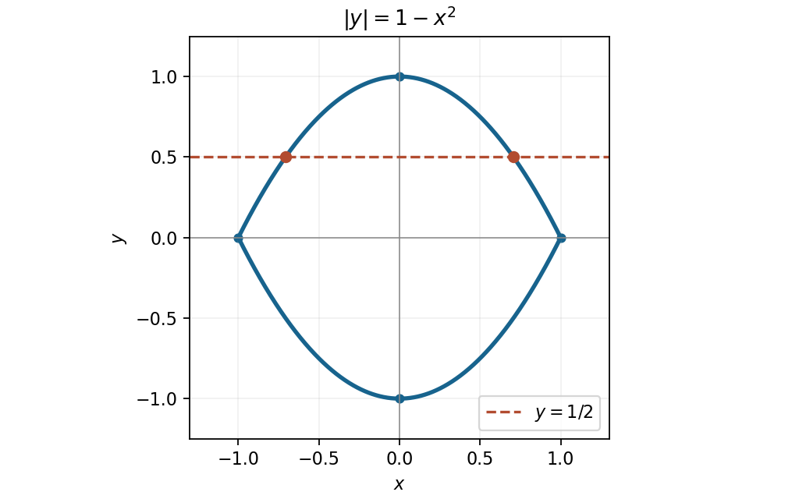

<h1 id="5/a/solution">Solution</h1>

↑ **Parent:** [A](../a.md)

The [absolute value](../../../../../absolute-value.md) is nonnegative, so a real point must satisfy $1-x^2\geq0$, or $-1\leq x\leq1$. On that interval the two branches are

$$
\boxed{y=1-x^2\quad\text{or}\quad y=x^2-1,\qquad -1\leq x\leq1.}
$$

They form a closed lens symmetric about both coordinate axes, meeting at $(\pm1,0)$ and reaching $(0,\pm1)$. The [parabolas](../../../../../parabola.md) outside the stated interval do not belong to the original [locus](../../../../../locus-mathematics.md).

**[Figure 1](#5/a/image-the-absolute-value-locus-and-its-intersections-with-the-horizontal-line-y-1-2). The absolute-value locus and its intersections with the horizontal line y = 1/2**.

## ↑ Ancestors (13)

1. [A](../a.md)
2. [5](../../5.md)
3. [Paper 1](../../../paper-1-split.md)
4. [2016](../../../split.md)
5. [Past exam of the mathematics course of the year 1 of the natural sciences course of the University of Cambridge](../../../../split.md)
6. [Mathematics course of the year 1 of the natural sciences course of the University of Cambridge](../../../../../mathematics-course-of-the-year-1-of-the-natural-sciences-course-of-the-university-of-cambridge.md)
7. [Year 1 of the natural sciences course of the University of Cambridge](../../../../../year-1-of-the-natural-sciences-course-of-the-university-of-cambridge.md)
8. [Year of the natural sciences course of the University of Cambridge](../../../../../year-of-the-natural-sciences-course-of-the-university-of-cambridge.md)
9. [Natural sciences course of the University of Cambridge](../../../../../natural-sciences-course-of-the-university-of-cambridge.md)
10. [Course of the University of Cambridge](../../../../../course-of-the-university-of-cambridge.md)
11. [University of Cambridge](../../../../../university-of-cambridge-split.md)
12. [List of universities](../../../../../list-of-universities.md)
13. [Codex Wiki](../../../../../split.md)
