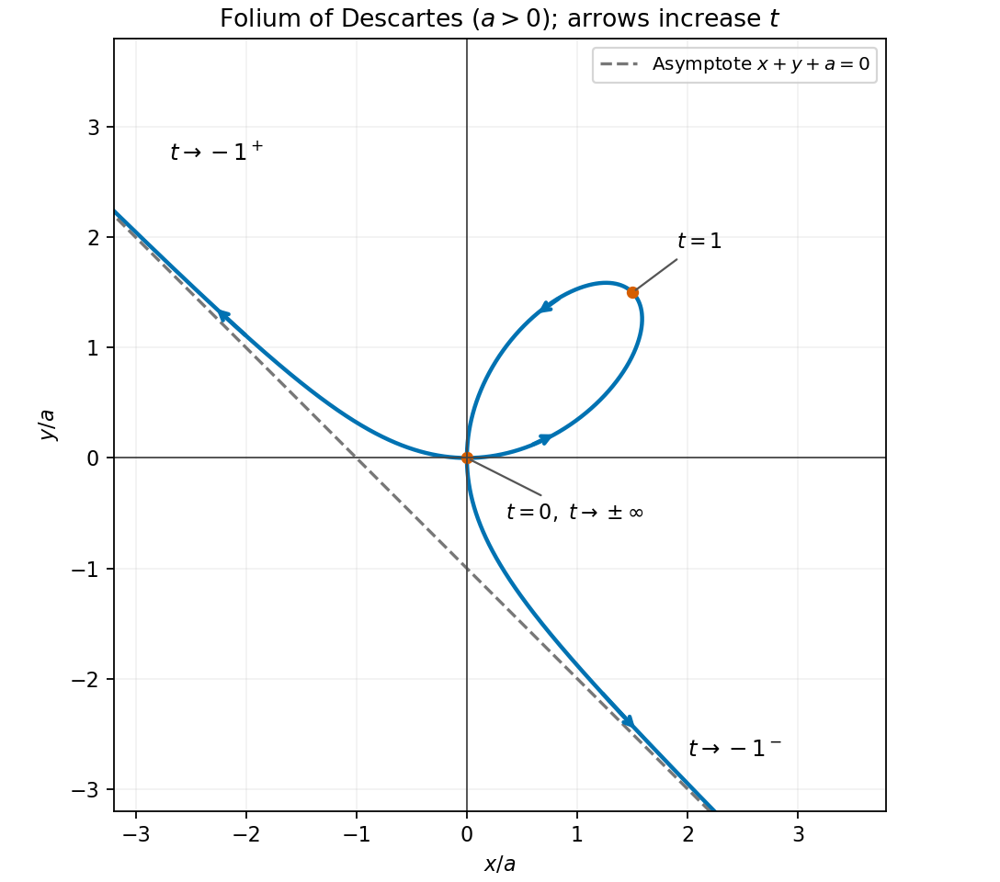

# Paper 2

↑ **Parent:** [2016](../2016.md)

[https://www.maths.cam.ac.uk/undergradnst/files/2016/papernst_ia_2.pdf](https://www.maths.cam.ac.uk/undergradnst/files/2016/papernst_ia_2.pdf)

**Table of contents**

- [1](#1)
  - [Solution](#1/solution)
- [2](#2)
  - [Solution](#2/solution)
- [3](#3)
  - [Solution](#3/solution)
- [4](#4)
  - [a](#4/a)
    - [Solution](#4/a/solution)
  - [b](#4/b)
    - [Solution](#4/b/solution)
- [5](#5)
  - [a](#5/a)
    - [Solution](#5/a/solution)
  - [b](#5/b)
    - [Solution](#5/b/solution)
- [6](#6)
  - [a](#6/a)
    - [Solution](#6/a/solution)
  - [b](#6/b)
    - [Solution](#6/b/solution)
- [7](#7)
  - [a](#7/a)
    - [Solution](#7/a/solution)
  - [b](#7/b)
    - [Solution](#7/b/solution)
- [8](#8)
  - [Solution](#8/solution)
- [9](#9)
  - [Solution](#9/solution)
- [10](#10)
  - [a](#10/a)
    - [Solution](#10/a/solution)
  - [b](#10/b)
    - [Solution](#10/b/solution)
- [11](#11)
  - [a](#11/a)
    - [i](#11/a/i)
      - [Solution](#11/a/i/solution)
    - [ii](#11/a/ii)
      - [Solution](#11/a/ii/solution)
  - [b](#11/b)
    - [Solution](#11/b/solution)
  - [c](#11/c)
    - [Solution](#11/c/solution)
  - [d](#11/d)
    - [Solution](#11/d/solution)
- [12](#12)
  - [a](#12/a)
    - [Solution](#12/a/solution)
  - [b](#12/b)
    - [Solution](#12/b/solution)
  - [c](#12/c)
    - [Solution](#12/c/solution)
  - [d](#12/d)
    - [Solution](#12/d/solution)
  - [e](#12/e)
    - [Solution](#12/e/solution)
- [13](#13)
  - [a](#13/a)
    - [Solution](#13/a/solution)
  - [b](#13/b)
    - [i](#13/b/i)
      - [Solution](#13/b/i/solution)
    - [ii](#13/b/ii)
      - [Solution](#13/b/ii/solution)
  - [c](#13/c)
    - [Solution](#13/c/solution)
- [14](#14)
  - [a](#14/a)
    - [Solution](#14/a/solution)
  - [b](#14/b)
    - [i](#14/b/i)
      - [Solution](#14/b/i/solution)
    - [ii](#14/b/ii)
      - [Solution](#14/b/ii/solution)
  - [c](#14/c)
    - [i](#14/c/i)
      - [Solution](#14/c/i/solution)
    - [ii](#14/c/ii)
      - [Solution](#14/c/ii/solution)
    - [iii](#14/c/iii)
      - [Solution](#14/c/iii/solution)
- [15](#15)
  - [a](#15/a)
    - [Solution](#15/a/solution)
  - [b](#15/b)
    - [Solution](#15/b/solution)
- [16](#16)
  - [a](#16/a)
    - [i](#16/a/i)
      - [Solution](#16/a/i/solution)
    - [ii](#16/a/ii)
      - [Solution](#16/a/ii/solution)
    - [iii](#16/a/iii)
      - [Solution](#16/a/iii/solution)
    - [iv](#16/a/iv)
      - [Solution](#16/a/iv/solution)
  - [b](#16/b)
    - [i](#16/b/i)
      - [Solution](#16/b/i/solution)
    - [ii](#16/b/ii)
      - [Solution](#16/b/ii/solution)
- [17](#17)
  - [a](#17/a)
    - [Solution](#17/a/solution)
  - [b](#17/b)
    - [i](#17/b/i)
      - [Solution](#17/b/i/solution)
    - [ii](#17/b/ii)
      - [Solution](#17/b/ii/solution)
    - [iii](#17/b/iii)
      - [Solution](#17/b/iii/solution)
    - [iv](#17/b/iv)
      - [Solution](#17/b/iv/solution)
    - [v](#17/b/v)
      - [Solution](#17/b/v/solution)
    - [vi](#17/b/vi)
      - [Solution](#17/b/vi/solution)
- [18](#18)
  - [a](#18/a)
    - [Solution](#18/a/solution)
  - [b](#18/b)
    - [i](#18/b/i)
      - [Solution](#18/b/i/solution)
    - [ii](#18/b/ii)
      - [Solution](#18/b/ii/solution)
    - [iii](#18/b/iii)
      - [Solution](#18/b/iii/solution)
  - [c](#18/c)
    - [i](#18/c/i)
      - [Solution](#18/c/i/solution)
    - [ii](#18/c/ii)
      - [Solution](#18/c/ii/solution)
    - [iii](#18/c/iii)
      - [Solution](#18/c/iii/solution)
- [19](#19)
  - [a](#19/a)
    - [Solution](#19/a/solution)
  - [b](#19/b)
    - [Solution](#19/b/solution)
  - [c](#19/c)
    - [i](#19/c/i)
      - [Solution](#19/c/i/solution)
    - [ii](#19/c/ii)
      - [Solution](#19/c/ii/solution)
    - [iii](#19/c/iii)
      - [Solution](#19/c/iii/solution)
- [20](#20)
  - [a](#20/a)
    - [Solution](#20/a/solution)
  - [b](#20/b)
    - [Solution](#20/b/solution)
  - [c](#20/c)
    - [Solution](#20/c/solution)
  - [d](#20/d)
    - [Solution](#20/d/solution)

## 1

↑ **Parent:** [Paper 2](paper-2.md)

<h3 id="1/solution">Solution</h3>

↑ **Parent:** [1](#1)

The [complex modulus](../../complex-analysis.md#complex-modulus) is a nonnegative [real number](../../arithmetic.md#real-number). Equality therefore requires $z-1$ itself to be real and nonnegative. Its [imaginary part](../../complex-analysis.md#imaginary-part) gives $y=0$, and its [real part](../../complex-analysis.md#real-part) then gives $x-1\geq0$. Conversely every such point satisfies the equality. Hence the complete [solution set](../../set.md#solution-set) is

$$
\boxed{y=0,\qquad x\geq1}.
$$

Geometrically this is the closed ray on the [real axis](../../complex-analysis.md#real-axis) starting at $z=1$.

## 2

↑ **Parent:** [Paper 2](paper-2.md)

<h3 id="2/solution">Solution</h3>

↑ **Parent:** [2](#2)

The common ratio in the two [plane](../../geometry-and-topology.md#plane) equations can be denoted by $u$. Their intersection then has $x=1+4u$, $y=2+3u$, and $z=-1+2u$. The direction vector $(4,3,2)$ has [Euclidean norm](../../normed-vector-space.md#euclidean-norm) $\sqrt{29}$, so the requested [unit vector](../../vector-space.md#unit-vector) form is

$$
\boxed{\mathbf r=(1,2,-1)+\lambda\frac{(4,3,2)}{\sqrt{29}},\qquad\lambda\in\mathbb R}.
$$

Substituting this expression into both equations gives the same ratio $\lambda/\sqrt{29}$, verifying the entire line.

## 3

↑ **Parent:** [Paper 2](paper-2.md)

<h3 id="3/solution">Solution</h3>

↑ **Parent:** [3](#3)

Apply the [multivariable chain rule](../../calculus.md#multivariable-chain-rule), keeping the other new coordinate fixed in each differentiation. At fixed $\theta$, the [derivatives](../../calculus.md#derivative) of $x,y$ with respect to $r$ are $\cos2\theta,\sin2\theta$. At fixed $r$, their [derivatives](../../calculus.md#derivative) with respect to $\theta$ are $-2r\sin2\theta,2r\cos2\theta$. Thus

$$
\boxed{\left(\frac{\partial f}{\partial r}\right)_\theta
=\cos2\theta\left(\frac{\partial f}{\partial x}\right)_y
+\sin2\theta\left(\frac{\partial f}{\partial y}\right)_x},
$$

$$
\boxed{\left(\frac{\partial f}{\partial\theta}\right)_r
=-2r\sin2\theta\left(\frac{\partial f}{\partial x}\right)_y
+2r\cos2\theta\left(\frac{\partial f}{\partial y}\right)_x}.
$$

The factor two arises because the ordinary polar angle is $2\theta$.

## 4

↑ **Parent:** [Paper 2](paper-2.md)

<h3 id="4/a">a</h3>

↑ **Parent:** [4](#4)

<h4 id="4/a/solution">Solution</h4>

↑ **Parent:** [A](#4/a)

A double six has [probability](../../probability-theory.md#probability) $p=1/36$ on each independent throw. For Alice to win on her second turn, her first throw and Bob's first throw must both fail, then her second throw must succeed. Therefore

$$
\boxed{P=\left(\frac{35}{36}\right)^2\frac1{36}=\frac{1225}{46656}}.
$$

<h3 id="4/b">b</h3>

↑ **Parent:** [4](#4)

<h4 id="4/b/solution">Solution</h4>

↑ **Parent:** [B](#4/b)

Write $q=35/36$. Alice wins on her $(n+1)$st turn if $n$ complete rounds fail and then she succeeds. These disjoint events give the [geometric series](../../sequence-and-series.md#geometric-series)

$$
P_A=\sum_{n=0}^{\infty}q^{2n}p=\frac{p}{1-q^2}
=\frac{1}{1+q}.
$$

Consequently

$$
\boxed{P_A=\frac{36}{71}}.
$$

The [probability](../../probability-theory.md#probability) of never obtaining a winner is $\lim_{n\to\infty}q^{2n}=0$. The small advantage over $1/2$ comes from taking the first turn.

## 5

↑ **Parent:** [Paper 2](paper-2.md)

<h3 id="5/a">a</h3>

↑ **Parent:** [5](#5)

<h4 id="5/a/solution">Solution</h4>

↑ **Parent:** [A](#5/a)

**Yes.** The matrix is a real [symmetric matrix](../../linear-algebra.md#symmetric-matrix), so the [spectral theorem for real symmetric matrices](../../linear-algebra.md#spectral-theorem-for-real-symmetric-matrices) provides an [orthonormal basis](../../inner-product.md#orthonormal-basis) of real [eigenvectors](../../linear-operator-theory.md#eigenvector) and hence a real diagonal form. Explicitly its [characteristic polynomial](../../linear-operator-theory.md#characteristic-polynomial) is $\lambda^2-7\lambda-4$, with distinct real [eigenvalues](../../linear-operator-theory.md#eigenvalue)

$$
\boxed{\lambda_\pm=\frac{7\pm\sqrt{65}}2}.
$$

<h3 id="5/b">b</h3>

↑ **Parent:** [5](#5)

<h4 id="5/b/solution">Solution</h4>

↑ **Parent:** [B](#5/b)

The [characteristic polynomial](../../linear-operator-theory.md#characteristic-polynomial) is $\lambda^2-2\lambda\cos\theta+1$, with [eigenvalues](../../linear-operator-theory.md#eigenvalue) $\cos\theta\pm i\sin\theta$. A real diagonal form can have only real [eigenvalues](../../linear-operator-theory.md#eigenvalue), so it requires $\sin\theta=0$. Conversely, when $\theta=k\pi$, the [rotation matrix](../../linear-algebra.md#rotation-matrix) is already $(-1)^kI$. Thus

$$
\boxed{\text{real diagonalization is possible exactly when }\theta\in\pi\mathbb Z}.
$$

## 6

↑ **Parent:** [Paper 2](paper-2.md)

<h3 id="6/a">a</h3>

↑ **Parent:** [6](#6)

<h4 id="6/a/solution">Solution</h4>

↑ **Parent:** [A](#6/a)

The potential is smooth everywhere, so its mixed [partial derivatives](../../multivariable-calculus.md#partial-derivative) commute. The [curl of a gradient](../../multivariable-calculus.md#curl-of-a-gradient) therefore vanishes:

$$
\boxed{\nabla\times\mathbf F=\nabla\times\nabla\phi=\mathbf0}.
$$

<h3 id="6/b">b</h3>

↑ **Parent:** [6](#6)

<h4 id="6/b/solution">Solution</h4>

↑ **Parent:** [B](#6/b)

The [fundamental theorem for line integrals](../../multivariable-calculus.md#fundamental-theorem-for-line-integrals) evaluates this [conservative vector field](../../multivariable-calculus.md#conservative-vector-field) integral by the change in potential. At the initial point $\phi=0$. At the final point $z=0$, so the exponential factor is one, and

$$
\boxed{\int_C\mathbf F\cdot d\mathbf r
=\phi(C_{\rm end})-\phi(C_{\rm start})
=\sin\frac\pi8\cos\frac\pi4
=\frac{\sqrt2}{2}\sin\frac\pi8}.
$$

The detailed shape of the path does not affect this [line integral](../../multivariable-calculus.md#line-integral).

## 7

↑ **Parent:** [Paper 2](paper-2.md)

<h3 id="7/a">a</h3>

↑ **Parent:** [7](#7)

<h4 id="7/a/solution">Solution</h4>

↑ **Parent:** [A](#7/a)

Use the double-angle identity $2\sin x\cos x=\sin2x$. The [Fourier series](../../fourier-series.md) is already a finite trigonometric sum:

$$
\boxed{f(x)=\sin x+\sin2x+\sin3x}.
$$

In the usual [Fourier sine series](../../fourier-series.md#fourier-sine-series) convention, $b_1=b_2=b_3=1$, all other $b_n$ vanish, and all [cosine](../../geometry-and-topology.md#cosine) coefficients and the constant coefficient vanish.

<h3 id="7/b">b</h3>

↑ **Parent:** [7](#7)

<h4 id="7/b/solution">Solution</h4>

↑ **Parent:** [B](#7/b)

Differentiation of the finite sum involves no convergence issue. The [derivative](../../calculus.md#derivative) has the [Fourier cosine series](../../fourier-series.md#fourier-cosine-series)

$$
\boxed{f'(x)=\cos x+2\cos2x+3\cos3x}.
$$

## 8

↑ **Parent:** [Paper 2](paper-2.md)

<h3 id="8/solution">Solution</h3>

↑ **Parent:** [8](#8)

The [characteristic equation](../../linear-ordinary-differential-equation.md#characteristic-equation-of-a-constant-coefficient-differential-equation) is $(r-1)^2=0$, so the [repeated-root constant-coefficient differential equation](../../linear-ordinary-differential-equation.md#repeated-root-constant-coefficient-differential-equation) gives the [general solution](../../linear-ordinary-differential-equation.md#general-solution) $y=(A+Bx)e^x$. The first [boundary condition](../../differential-equation.md#boundary-condition) gives $A=0$, and the second gives $B\pi e^\pi=\pi e^\pi$, hence $B=1$. Therefore

$$
\boxed{y(x)=xe^x}.
$$

## 9

↑ **Parent:** [Paper 2](paper-2.md)

<h3 id="9/solution">Solution</h3>

↑ **Parent:** [9](#9)

For a spherically symmetric [mass density](../../fluid-mechanics.md#density), the angular integral in [spherical coordinates](../../multivariable-calculus.md#spherical-coordinate-system) is $4\pi$. The two disjoint shell contributions therefore give the [mass](../../classical-mechanics.md#mass)

$$
M=4\pi\int_a^b r^2\,dr+4\pi\int_c^d r^{-2}\,dr,
$$

so

$$
\boxed{M=4\pi\left[\frac{b^3-a^3}{3}+\frac1c-\frac1d\right]}.
$$

Both contributions are positive because $a<b$ and $c<d$.

## 10

↑ **Parent:** [Paper 2](paper-2.md)

<h3 id="10/a">a</h3>

↑ **Parent:** [10](#10)

<h4 id="10/a/solution">Solution</h4>

↑ **Parent:** [A](#10/a)

In a multivariable [Taylor series](../../calculus.md#taylor-series), order means total degree. The only nonzero [monomial](../../polynomial.md#monomial) of total degree at most three is $xy$; there are no constant, linear, or cubic terms. Thus

$$
\boxed{\phi(x,y)=xy+O\left((x^2+y^2)^2\right)}
$$

near the origin.

<h3 id="10/b">b</h3>

↑ **Parent:** [10](#10)

<h4 id="10/b/solution">Solution</h4>

↑ **Parent:** [B](#10/b)

The [gradient](../../multivariable-calculus.md#gradient) vanishes at the origin. Its [Hessian matrix](../../multivariable-calculus.md#hessian-matrix) there is

$$
H=\begin{pmatrix}0&1\\1&0\end{pmatrix},
$$

with [eigenvalues](../../linear-operator-theory.md#eigenvalue) $1$ and $-1$. The quadratic term is therefore indefinite, so the origin is a **[saddle point of a scalar function](../../analysis.md#saddle-point-of-a-scalar-function)**. Equivalently, the leading term $xy$ is positive along $y=x$ and negative along $y=-x$.

## 11

↑ **Parent:** [Paper 2](paper-2.md)

<h3 id="11/a">a</h3>

↑ **Parent:** [11](#11)

<h4 id="11/a/i">i</h4>

↑ **Parent:** [A](#11/a)

<h5 id="11/a/i/solution">Solution</h5>

↑ **Parent:** [I](#11/a/i)

The independent vectors $\mathbf a,\mathbf b$ span the [plane](../../geometry-and-topology.md#plane) through the origin, and their [cross product](../../vector-space.md#cross-product) is a nonzero [normal vector](../../differential-geometry.md#normal-vector). Thus the required nonparametric equation is

$$
\boxed{\mathbf r\cdot(\mathbf a\times\mathbf b)=0}.
$$

<h4 id="11/a/ii">ii</h4>

↑ **Parent:** [A](#11/a)

<h5 id="11/a/ii/solution">Solution</h5>

↑ **Parent:** [Ii](#11/a/ii)

The orientation assumption gives $\mathbf c\cdot(\mathbf a\times\mathbf b)>0$. The same open [half-space](../../geometry-and-topology.md#half-space) is therefore characterized by

$$
\boxed{\mathbf r\cdot(\mathbf a\times\mathbf b)>0}.
$$

Equality would put the point in the separating [plane](../../geometry-and-topology.md#plane), rather than strictly on the same side.

<h3 id="11/b">b</h3>

↑ **Parent:** [11](#11)

<h4 id="11/b/solution">Solution</h4>

↑ **Parent:** [B](#11/b)

Take two edge vectors in the face, $\mathbf b-\mathbf a$ and $\mathbf c-\mathbf a$. Their [cross product](../../vector-space.md#cross-product) is the face [normal vector](../../differential-geometry.md#normal-vector)

$$
\mathbf n=(\mathbf b-\mathbf a)\times(\mathbf c-\mathbf a)
=\mathbf a\times\mathbf b+\mathbf b\times\mathbf c+\mathbf c\times\mathbf a.
$$

The face [plane](../../geometry-and-topology.md#plane) is $(\mathbf r-\mathbf a)\cdot\mathbf n=0$. Every term in $\mathbf a\cdot\mathbf n$ except $\mathbf a\cdot(\mathbf b\times\mathbf c)$ vanishes, giving

$$
\boxed{\mathbf r\cdot(\mathbf a\times\mathbf b+\mathbf b\times\mathbf c+\mathbf c\times\mathbf a)
=\mathbf a\cdot(\mathbf b\times\mathbf c)}.
$$

The [scalar triple product](../../multilinear-algebra.md#scalar-triple-product) is nonzero, so this normal cannot vanish.

<h3 id="11/c">c</h3>

↑ **Parent:** [11](#11)

<h4 id="11/c/solution">Solution</h4>

↑ **Parent:** [C](#11/c)

Set $D=\mathbf a\cdot(\mathbf b\times\mathbf c)>0$. Since these vectors form a [basis](../../vector-space.md#basis), write $\mathbf r=\alpha\mathbf a+\beta\mathbf b+\gamma\mathbf c$. The [reciprocal basis](../../multilinear-algebra.md#reciprocal-basis) gives

$$
\alpha=\frac{\mathbf r\cdot(\mathbf b\times\mathbf c)}D,\qquad
\beta=\frac{\mathbf r\cdot(\mathbf c\times\mathbf a)}D,\qquad
\gamma=\frac{\mathbf r\cdot(\mathbf a\times\mathbf b)}D.
$$

A point is in the closed [tetrahedron](../../euclidean-geometry.md#tetrahedron) precisely when it is a [convex combination](../../convex-set.md#convex-combination) of the four vertices, with weights $1-\alpha-\beta-\gamma,\alpha,\beta,\gamma$. Thus the necessary and sufficient conditions are

$$
\boxed{\begin{gathered}
\mathbf r\cdot(\mathbf b\times\mathbf c)\geq0,\quad
\mathbf r\cdot(\mathbf c\times\mathbf a)\geq0,\quad
\mathbf r\cdot(\mathbf a\times\mathbf b)\geq0,\\
\mathbf r\cdot(\mathbf a\times\mathbf b+\mathbf b\times\mathbf c+\mathbf c\times\mathbf a)\leq D.
\end{gathered}}
$$

These four [half-spaces](../../geometry-and-topology.md#half-space) are the four inward sides of its faces. This is [tetrahedron membership via scalar triple products](../../euclidean-geometry.md#tetrahedron-membership-via-scalar-triple-products); making all inequalities strict describes the interior.

<h3 id="11/d">d</h3>

↑ **Parent:** [11](#11)

<h4 id="11/d/solution">Solution</h4>

↑ **Parent:** [D](#11/d)

The opposite face lies in the [plane](../../geometry-and-topology.md#plane) spanned by $\mathbf a,\mathbf b$ through the origin. Directly,

$$
\mathbf a\times\mathbf b=(-2,2,4),\qquad
\mathbf c\cdot(\mathbf a\times\mathbf b)=12,\qquad
|\mathbf a\times\mathbf b|=2\sqrt6.
$$

The [distance from a point to a plane](../../geometry-and-topology.md#distance-from-a-point-to-a-plane) is the absolute normal component, so

$$
\boxed{d=\frac{12}{2\sqrt6}=\sqrt6}.
$$

Here $\mathbf c=(\mathbf a\times\mathbf b)/2$, so the perpendicular foot is the origin, a vertex of the opposite triangular face. Thus the distance to the actual face equals the distance to its containing [plane](../../geometry-and-topology.md#plane).

## 12

↑ **Parent:** [Paper 2](paper-2.md)

<h3 id="12/a">a</h3>

↑ **Parent:** [12](#12)

<h4 id="12/a/solution">Solution</h4>

↑ **Parent:** [A](#12/a)

Put $R=|b|$ so that the radial range respects the stated allowance $b\ne0$. With the azimuth measured from the starting meridian, the [cylindrical coordinates](../../multivariable-calculus.md#cylindrical-coordinate-system) of the curved [surface](../../topological-surface.md) satisfy

$$
\boxed{0\leq r\leq R,\qquad0\leq\theta\leq\alpha,\qquad
z=a\left(1-\frac{r^2}{b^2}\right)}.
$$

At $r=0$ all azimuths describe the same apex. The [surface](../../topological-surface.md) is a sector of an [elliptic paraboloid](../../euclidean-geometry.md#elliptic-paraboloid).

<h3 id="12/b">b</h3>

↑ **Parent:** [12](#12)

<h4 id="12/b/solution">Solution</h4>

↑ **Parent:** [B](#12/b)

The [volume element](../../integral.md#volume-element) in [cylindrical coordinates](../../multivariable-calculus.md#cylindrical-coordinate-system) is $r\,dz\,dr\,d\theta$. Integrating from the base to the curved [surface](../../topological-surface.md) gives

$$
V=\int_0^\alpha\!d\theta\int_0^R\!r\,dr\int_0^{a(1-r^2/b^2)}\!dz
=\alpha a\left[\frac{r^2}{2}-\frac{r^4}{4b^2}\right]_0^R.
$$

Hence

$$
\boxed{V=\frac{\alpha ab^2}{4}}.
$$

For a complete rotation this is half the [volume](../../geometry-and-topology.md#volume) of the enclosing cylinder.

<h3 id="12/c">c</h3>

↑ **Parent:** [12](#12)

<h4 id="12/c/solution">Solution</h4>

↑ **Parent:** [C](#12/c)

Use the [embedded surface parametrization](../../differential-geometry.md#embedded-surface-parametrization)

$$
\mathbf X(r,\theta)=\left(r\cos\theta,r\sin\theta,a\left(1-\frac{r^2}{b^2}\right)\right).
$$

Its tangent vectors have [cross product](../../vector-space.md#cross-product)

$$
\mathbf X_r\times\mathbf X_\theta
=\left(\frac{2ar^2}{b^2}\cos\theta,
\frac{2ar^2}{b^2}\sin\theta,r\right),
$$

whose magnitude is $r\sqrt{1+4a^2r^2/b^4}$. Thus the [surface area](../../differential-geometry.md#surface-area) is

$$
A=\alpha\int_0^R r\sqrt{1+\frac{4a^2r^2}{b^4}}\,dr.
$$

With $u=1+4a^2r^2/b^4$, the radial integral becomes $b^4(8a^2)^{-1}\int u^{1/2}\,du$. Evaluating its endpoints gives

$$
\boxed{A=\frac{\alpha b^4}{12a^2}
\left[\left(1+\frac{4a^2}{b^2}\right)^{3/2}-1\right]}.
$$

This is the scalar-area part of the [paraboloid sector surface measures](../../euclidean-geometry.md#paraboloid-sector-surface-measures).

<h3 id="12/d">d</h3>

↑ **Parent:** [12](#12)

<h4 id="12/d/solution">Solution</h4>

↑ **Parent:** [D](#12/d)

For $a/|b|\ll1$, apply the [binomial series](../../sequence-and-series.md#binomial-series) to the result in (c):

$$
\left(1+\frac{4a^2}{b^2}\right)^{3/2}
=1+\frac{6a^2}{b^2}+\frac{6a^4}{b^4}+O(a^6/b^6).
$$

Therefore

$$
\boxed{A=\frac{\alpha b^2}{2}+\frac{\alpha a^2}{2}+O(a^4/b^2)
\sim\frac{\alpha b^2}{2}}.
$$

For $\alpha=2\pi$, the leading term is $\pi b^2$, the [area](../../differential-geometry.md#surface-area) of the base disk. A very shallow cap is nearly planar; its first [area](../../differential-geometry.md#surface-area) excess is $\pi a^2$.

<h3 id="12/e">e</h3>

↑ **Parent:** [12](#12)

<h4 id="12/e/solution">Solution</h4>

↑ **Parent:** [E](#12/e)

The upward orientation of $\mathbf X_r\times\mathbf X_\theta$ corresponds to traversing the boundary from the apex to the starting rim, around the rim in increasing azimuth, and back to the apex. This is the indicated $ABCA$ orientation and is outward from the solid. Integrate that [vector area element](../../differential-geometry.md#vector-area-element) directly:

$$
\mathbf S=\int_0^\alpha\!\int_0^R
\left(\frac{2ar^2}{b^2}\cos\theta,
\frac{2ar^2}{b^2}\sin\theta,r\right)\,dr\,d\theta.
$$

The radial integrals are $2aR/3$ in the horizontal components and $b^2/2$ in the vertical component. Hence the [vector area](../../differential-geometry.md#vector-area) is

$$
\boxed{\mathbf S_{ABCA}
=\frac{2a|b|}{3}\sin\alpha\,\mathbf i
+\frac{2a|b|}{3}(1-\cos\alpha)\,\mathbf j
+\frac{\alpha b^2}{2}\,\mathbf k}.
$$

The absolute value is needed only because the original statement permits negative $b$. Reversing the boundary orientation reverses the entire vector. For a full rotation the horizontal components cancel, leaving $\pi b^2\mathbf k$, the signed projected [area](../../differential-geometry.md#surface-area) of the base.

## 13

↑ **Parent:** [Paper 2](paper-2.md)

<h3 id="13/a">a</h3>

↑ **Parent:** [13](#13)

<h4 id="13/a/solution">Solution</h4>

↑ **Parent:** [A](#13/a)

Take $a>0$ for the sketch; changing its sign rotates the picture by $\pi$. The [parametric curve](../../topology.md#parametric-curve) passes through $(0,0)$ at $t=0$ and through $(3a/2,3a/2)$ at $t=1$. As $t\to\pm\infty$ it returns towards the origin, since $x\sim3a/t^2$ and $y\sim3a/t$. The positive-$t$ branch makes a loop in the first quadrant, leaving the origin tangent to the positive $x$ axis and returning tangent to the positive $y$ axis.

For a more precise sketch, differentiation gives

$$
x'(t)=\frac{3a(1-2t^3)}{(1+t^3)^2},\qquad
y'(t)=\frac{3at(2-t^3)}{(1+t^3)^2}.
$$

The loop has its largest $x$ at $t=2^{-1/3}$ and largest $y$ at $t=2^{1/3}$. Their coordinates are $a(2^{2/3},2^{1/3})$ and its reflection in $y=x$.

The parameter value $t=-1$ is excluded. Cancelling the common factor in the sum gives

$$
x+y=\frac{3at}{t^2-t+1}\longrightarrow-a,
\qquad x-y\sim-\frac{2a}{t+1}.
$$

Thus the [asymptote](../../topology.md#asymptote) is $\boxed{x+y+a=0}$. As $t\to-1^-$, $x\to+\infty$ and $y\to-\infty$; as $t\to-1^+$, $x\to-\infty$ and $y\to+\infty$. The branch $t<-1$ approaches the origin from the fourth quadrant as $t\to-\infty$, while $-1<t<0$ connects the other infinite branch to the origin through the second quadrant.

**[Figure 1](#13/a/image-folium-of-descartes-with-parameter-directions-marked-points-and-its-oblique-asymptote). Folium of Descartes with parameter directions, marked points, and its oblique asymptote**.

This is the [folium of Descartes](../../algebraic-variety.md#folium-of-descartes). If $a=0$, the parametrization degenerates to the origin for every defined parameter value and there is no nontrivial loop.

<h3 id="13/b">b</h3>

↑ **Parent:** [13](#13)

<h4 id="13/b/i">i</h4>

↑ **Parent:** [B](#13/b)

<h5 id="13/b/i/solution">Solution</h5>

↑ **Parent:** [I](#13/b/i)

For $a>0$, both coordinates are nonnegative exactly on the loop branch $t\geq0$. It leaves the origin at $t=0$ and returns there in the limit $t\to+\infty$. Thus the loop is traced once by

$$
\boxed{0\leq t<\infty},
$$

with the limiting endpoint identified with the starting point. The same parameter range traces the rotated loop when $a<0$.

<h4 id="13/b/ii">ii</h4>

↑ **Parent:** [B](#13/b)

<h5 id="13/b/ii/solution">Solution</h5>

↑ **Parent:** [Ii](#13/b/ii)

On the loop, $y=tx$, so $dy=t\,dx+x\,dt$ and $x\,dy-y\,dx=x^2\,dt$. The traversal is anticlockwise. The [area](../../differential-geometry.md#surface-area) formula from [Green's theorem](../../multivariable-calculus.md#green-theorem) becomes

$$
A_{\rm loop}=\frac12\int_0^\infty x(t)^2\,dt
=\frac{9a^2}{2}\int_0^\infty\frac{t^2}{(1+t^3)^2}\,dt.
$$

Set $u=1+t^3$ to obtain

$$
\boxed{A_{\rm loop}=\frac{3a^2}{2}\int_1^\infty u^{-2}\,du
=\frac{3a^2}{2}}.
$$

Although the parameter interval is unbounded, the return to the origin closes the loop and the integral converges.

<h3 id="13/c">c</h3>

↑ **Parent:** [13](#13)

<h4 id="13/c/solution">Solution</h4>

↑ **Parent:** [C](#13/c)

Cubing and adding the parametrized coordinates yields

$$
x^3+y^3=\frac{27a^3t^3(1+t^3)}{(1+t^3)^3}
=\frac{27a^3t^3}{(1+t^3)^2}=3axy.
$$

Therefore the implicit [algebraic curve](../../algebraic-variety.md#algebraic-curve) is

$$
\boxed{x^3+y^3-3axy=0}.
$$

For $a\ne0$, every nonorigin real point on this curve has $x\ne0$ and can be recovered using $t=y/x$; the origin is already included. The equation is invariant under exchanging $x$ and $y$, so its reflection line is $\boxed{y=x}$. In the parametrization that reflection corresponds to replacing $t$ by $1/t$. If $a=0$, the implicit cubic degenerates to the line $x+y=0$, whereas the given parametrization only describes the origin, so this degenerate case must be kept separate.

## 14

↑ **Parent:** [Paper 2](paper-2.md)

<h3 id="14/a">a</h3>

↑ **Parent:** [14](#14)

<h4 id="14/a/solution">Solution</h4>

↑ **Parent:** [A](#14/a)

An [integrating factor](../../linear-ordinary-differential-equation.md#integrating-factor) is

$$
I(x)=\exp\int\frac{x}{a^2+x^2}\,dx=\sqrt{a^2+x^2}.
$$

Multiplying the [linear ordinary differential equation](../../linear-ordinary-differential-equation.md) by it gives

$$
\frac{d}{dx}\left(y\sqrt{a^2+x^2}\right)=x\sqrt{a^2+x^2}.
$$

The right-hand side integrates to $(a^2+x^2)^{3/2}/3$, so

$$
\boxed{y=\frac{a^2+x^2}{3}+\frac{C}{\sqrt{a^2+x^2}}}.
$$

This holds on every interval where the coefficient is defined. If $a=0$, intervals cannot cross $x=0$; equivalently the family is $y=x^2/3+C/x$ on either half-line, with an independently chosen constant.

<h3 id="14/b">b</h3>

↑ **Parent:** [14](#14)

<h4 id="14/b/i">i</h4>

↑ **Parent:** [B](#14/b)

<h5 id="14/b/i/solution">Solution</h5>

↑ **Parent:** [I](#14/b/i)

With $v=x+y$, the [chain rule](../../calculus.md#chain-rule) gives

$$
\frac{dv}{dx}=1+\frac{dy}{dx}
=\frac{2(v-2)}{3v-4}.
$$

For $v\ne2$, this [separable differential equation](../../differential-equation.md#separable-differential-equation) gives

$$
x=\int\frac{3v-4}{2(v-2)}\,dv
=\frac32v+\log|v-2|+C.
$$

Restoring $v$ and absorbing constants, the nonconstant branches satisfy

$$
\boxed{x+3y+2\log|x+y-2|=C}.
$$

The constant branch lost in division is $v=2$, giving the additional solution $\boxed{y=2-x}$. All branches must avoid $v=4/3$, where the original differential equation is undefined.

<h4 id="14/b/ii">ii</h4>

↑ **Parent:** [B](#14/b)

<h5 id="14/b/ii/solution">Solution</h5>

↑ **Parent:** [Ii](#14/b/ii)

**Yes: $y=2-x$.** Its [derivative](../../calculus.md#derivative) is $-1$, while substitution into the right-hand side gives $-2/(6-4)=-1$. This is the equilibrium $v=2$ of the transformed [autonomous differential equation](../../dynamical-systems.md#autonomous-system-mathematics); it must be restored separately after dividing by $v-2$ in the separated solution.

It is the only straight-line solution. Substituting $y=mx+d$ into the original equation shows that $m\ne-1$ would require $m=-1/3$ from the $x$ coefficients, but the constant coefficients would then give $4/3=0$. For $m=-1$, the constant equation gives $d=2$.

<h3 id="14/c">c</h3>

↑ **Parent:** [14](#14)

<h4 id="14/c/i">i</h4>

↑ **Parent:** [C](#14/c)

<h5 id="14/c/i/solution">Solution</h5>

↑ **Parent:** [I](#14/c/i)

Let $F(p)=2p/(1-p^2)$, so that $y=xF(p)$. Differentiation gives

$$
p=\frac{2p}{1-p^2}
+x\frac{2(1+p^2)}{(1-p^2)^2}\frac{dp}{dx}.
$$

Move the first term to the left and use

$$
p-\frac{2p}{1-p^2}=-\frac{p(1+p^2)}{1-p^2}.
$$

Since $1+p^2>0$ for real $p$ and $p\ne\pm1$, cancellation gives

$$
\boxed{2x\frac{dp}{dx}=-p(1-p^2)}.
$$

This is the [slope parameter for a homogeneous first-order equation](../../differential-equation.md#slope-parameter-for-a-homogeneous-first-order-equation) reduction.

<h4 id="14/c/ii">ii</h4>

↑ **Parent:** [C](#14/c)

<h5 id="14/c/ii/solution">Solution</h5>

↑ **Parent:** [Ii](#14/c/ii)

For $p\ne0,\pm1$, separate variables and use [partial fraction decomposition](../../isolated-singularity.md#partial-fraction-decomposition):

$$
\frac{dp}{p(1-p^2)}=-\frac{dx}{2x},\qquad
\frac1{p(1-p^2)}=\frac1p+\frac{p}{1-p^2}.
$$

Integration yields

$$
\log|p|-\frac12\log|1-p^2|=-\frac12\log|x|+C_0.
$$

On any connected solution interval, absorb the fixed signs into a real constant to write

$$
\boxed{\frac{xp^2}{1-p^2}=C,\qquad
p^2=\frac{C}{x+C}}.
$$

The two real signs of the square root are chosen consistently on a branch where $C/(x+C)>0$. The constant solutions of the reduced equation are $p=0,1,-1$. The original equation excludes the last two; $p=0$ is retained by $C=0$ for $x\ne0$.

<h4 id="14/c/iii">iii</h4>

↑ **Parent:** [C](#14/c)

<h5 id="14/c/iii/solution">Solution</h5>

↑ **Parent:** [Iii](#14/c/iii)

From $p^2=C/(x+C)$, we have $1-p^2=x/(x+C)$. Substitution into the original relation gives $y=2(x+C)p$, so

$$
\boxed{y^2=4C(x+C)}.
$$

These are real [parabola](../../euclidean-geometry.md#parabola) branches, with either sign of $C$ allowed when the branch is real. For $C\ne0$, differentiating gives $p=2C/y$ and verifies both the relation and the slope. Use graph intervals with $y\ne0$ and $x\ne0$, so the slope is finite and $p\ne\pm1$. The separate constant-slope case $p=0$ gives $y=0$, also represented by the degenerate choice $C=0$. Squaring has not imposed a sign on $y$, so both real graph branches must be included.

## 15

↑ **Parent:** [Paper 2](paper-2.md)

<h3 id="15/a">a</h3>

↑ **Parent:** [15](#15)

<h4 id="15/a/solution">Solution</h4>

↑ **Parent:** [A](#15/a)

The homogeneous [linear system](../../linear-algebra.md#system-of-linear-equations) has [solution set](../../set.md#solution-set) $\ker A$, a [vector subspace](../../vector-space.md#vector-subspace). If it contains only the zero vector, no two different solutions of the full system can exist: their difference would be a nonzero homogeneous solution.

A [particular solution](../../linear-ordinary-differential-equation.md#particular-solution) $\mathbf v_p$ to the full system exists exactly when $\mathbf w$ belongs to the [image of a linear map](../../vector-space.md#image-of-a-linear-map) $\operatorname{im}A$. If it exists, every solution is

$$
\boxed{\mathbf v=\mathbf v_p+\mathbf v_h,\qquad\mathbf v_h\in\ker A}.
$$

Indeed, subtracting $A\mathbf v_p=\mathbf w$ from $A\mathbf v=\mathbf w$ gives $A(\mathbf v-\mathbf v_p)=0$, and conversely adding a [kernel](../../kernel-of-a-linear-map.md) vector preserves the right-hand side. Thus there are **no solutions**, **one solution** if the [kernel](../../kernel-of-a-linear-map.md) is trivial, or **infinitely many solutions** if it is nontrivial. The last [solution set](../../set.md#solution-set) is an [affine subspace](../../vector-space.md#affine-subspace) of [dimension](../../vector-space.md#dimension-vector-space) $\dim\ker A$, determined by the [rank-nullity theorem](../../kernel-of-a-linear-map.md#rank-nullity-theorem). For a square nonsingular matrix there is one solution for every right-hand side.

<h3 id="15/b">b</h3>

↑ **Parent:** [15](#15)

<h4 id="15/b/solution">Solution</h4>

↑ **Parent:** [B](#15/b)

Subtracting the third row from the first gives $z=-1$, and the third row gives $y=2-x$. The second row then reduces to

$$
(1-t)x=s-t.
$$

For $t\ne1$, the unique solution is

$$
\boxed{x=\frac{s-t}{1-t},\qquad y=\frac{2-t-s}{1-t},\qquad z=-1}.
$$

Consequently $s=1$ gives $\boxed{(x,y,z)=(1,1,-1)}$ for every $t\ne1$, whereas $s=6$ gives

$$
\boxed{(x,y,z)=\left(\frac{6-t}{1-t},\frac{-4-t}{1-t},-1\right),\qquad t\ne1}.
$$

When $t=1$, the first and second left-hand sides coincide. If $s=1$, they are the same [plane](../../geometry-and-topology.md#plane), and the remaining independent [plane](../../geometry-and-topology.md#plane) cuts it in the line

$$
\boxed{(x,y,z)=(\lambda,2-\lambda,-1),\qquad\lambda\in\mathbb R}.
$$

If $s=6$, the two [planes](../../geometry-and-topology.md#plane) are distinct and parallel, so **there is no solution**. Geometrically, for $t\ne1$ the three [planes](../../geometry-and-topology.md#plane) intersect at a single point; at $t=1$ the coincident-plane case leaves an entire line, while the parallel-plane case has empty intersection.

## 16

↑ **Parent:** [Paper 2](paper-2.md)

<h3 id="16/a">a</h3>

↑ **Parent:** [16](#16)

<h4 id="16/a/i">i</h4>

↑ **Parent:** [A](#16/a)

<h5 id="16/a/i/solution">Solution</h5>

↑ **Parent:** [I](#16/a/i)

Let $X$ count green balls. Sampling without replacement gives a [hypergeometric distribution](../../discrete-probability-distribution.md#hypergeometric-distribution). The possible values are $0,1,2$, and counting equally likely three-element samples gives

$$
P(X=k)=\frac{\binom2k\binom3{3-k}}{\binom53}.
$$

Therefore

$$
\boxed{P(X=0)=\frac1{10},\qquad P(X=1)=\frac35,\qquad P(X=2)=\frac3{10}}.
$$

Their sum is $(1+6+3)/10=1$, as required for a [probability distribution](../../probability-distribution.md).

<h4 id="16/a/ii">ii</h4>

↑ **Parent:** [A](#16/a)

<h5 id="16/a/ii/solution">Solution</h5>

↑ **Parent:** [Ii](#16/a/ii)

Compute the first two moments from the [probability distribution](../../probability-distribution.md):

$$
\mu=E[X]=\frac6{10}+\frac6{10}=\frac65,\qquad
E[X^2]=\frac6{10}+\frac{12}{10}=\frac95.
$$

The [variance](../../variance.md) is $E[X^2]-E[X]^2=9/5-36/25=9/25$, so the [expected value](../../expected-value.md) and [standard deviation](../../variance.md#standard-deviation) are

$$
\boxed{\mu=\frac65,\qquad\sigma=\frac35}.
$$

<h4 id="16/a/iii">iii</h4>

↑ **Parent:** [A](#16/a)

<h5 id="16/a/iii/solution">Solution</h5>

↑ **Parent:** [Iii](#16/a/iii)

The interval within one [standard deviation](../../variance.md#standard-deviation) is $[3/5,9/5]$. Of the possible integer outcomes $0,1,2$, only $1$ lies in this interval. Hence

$$
\boxed{P(|X-\mu|\leq\sigma)=P(X=1)=\frac35}.
$$

<h4 id="16/a/iv">iv</h4>

↑ **Parent:** [A](#16/a)

<h5 id="16/a/iv/solution">Solution</h5>

↑ **Parent:** [Iv](#16/a/iv)

Three draws cannot all be green because there are only two green balls. Thus **the [probability](../../probability-theory.md#probability) of at least one red ball is $1$**. At least two red balls means $X\leq1$, so

$$
\boxed{P(\text{at least two red})=\frac1{10}+\frac35=\frac7{10}}.
$$

<h3 id="16/b">b</h3>

↑ **Parent:** [16](#16)

<h4 id="16/b/i">i</h4>

↑ **Parent:** [B](#16/b)

<h5 id="16/b/i/solution">Solution</h5>

↑ **Parent:** [I](#16/b/i)

Let $Y$ indicate whether the draw from the second bag is green. It is independent of $X$, with $P(Y=1)=1/3$ and $P(Y=0)=2/3$. Exactly one green overall arises from the disjoint alternatives $(X,Y)=(1,0)$ or $(0,1)$. Therefore

$$
\boxed{P(X+Y=1)=\frac35\frac23+\frac1{10}\frac13=\frac{13}{30}}.
$$

<h4 id="16/b/ii">ii</h4>

↑ **Parent:** [B](#16/b)

<h5 id="16/b/ii/solution">Solution</h5>

↑ **Parent:** [Ii](#16/b/ii)

The sole green ball comes from the first bag exactly on the event $(X,Y)=(1,0)$. Divide this joint [probability](../../probability-theory.md#probability) by the conditioning event's [probability](../../probability-theory.md#probability):

$$
\boxed{P(X=1,Y=0\mid X+Y=1)
=\frac{(3/5)(2/3)}{13/30}=\frac{12}{13}}.
$$

This is the [conditional probability](../../probability-theory.md#conditional-probability) form of [Bayes' theorem](../../probability-theory.md#bayes-theorem).

## 17

↑ **Parent:** [Paper 2](paper-2.md)

<h3 id="17/a">a</h3>

↑ **Parent:** [17](#17)

<h4 id="17/a/solution">Solution</h4>

↑ **Parent:** [A](#17/a)

Taking the second [partial derivatives](../../multivariable-calculus.md#partial-derivative) of the [polynomial](../../polynomial.md) gives

$$
w_{xx}=\frac{180x^2y^2-30x^4+30y^4}{360},\qquad
w_{yy}=\frac{180x^2y^2+30x^4-30y^4}{360}.
$$

Adding cancels the pure fourth powers and leaves

$$
\boxed{w_{xx}+w_{yy}=x^2y^2}.
$$

Thus direct substitution verifies the stated [Poisson equation](../../partial-differential-equation.md#poisson-s-equation).

<h3 id="17/b">b</h3>

↑ **Parent:** [17](#17)

<h4 id="17/b/i">i</h4>

↑ **Parent:** [B](#17/b)

<h5 id="17/b/i/solution">Solution</h5>

↑ **Parent:** [I](#17/b/i)

**Yes.** The [differential operator](../../analysis.md#differential-operator) $\mathcal L=2y\partial_x-x\partial_y$ is linear, even though its coefficients depend on position. For constants $A,B$,

$$
\mathcal L(Au_1+Bu_2)=A\mathcal Lu_1+B\mathcal Lu_2.
$$

If each homogeneous right-hand side is zero, so is their combination. Hence the [superposition principle](../../vector-space.md#superposition-principle) holds.

<h4 id="17/b/ii">ii</h4>

↑ **Parent:** [B](#17/b)

<h5 id="17/b/ii/solution">Solution</h5>

↑ **Parent:** [Ii](#17/b/ii)

The homogeneous equation is the [dot product](../../inner-product.md#dot-product) condition $(2y,-x)\cdot\nabla u=0$. A suitable [vector field](../../multivariable-calculus.md#vector-field) is therefore

$$
\boxed{\mathbf v(x,y)=(2y,-x)}.
$$

Where nonzero, it is tangent to the level curves of $u$ and perpendicular to its [gradient](../../multivariable-calculus.md#gradient). At the origin this vector vanishes, so no direction is defined there.

<h4 id="17/b/iii">iii</h4>

↑ **Parent:** [B](#17/b)

<h5 id="17/b/iii/solution">Solution</h5>

↑ **Parent:** [Iii](#17/b/iii)

For $\phi=x^2+2y^2$, the [gradient](../../multivariable-calculus.md#gradient) is $\nabla\phi=(2x,4y)$, and

$$
(2y,-x)\cdot(2x,4y)=0.
$$

Away from the origin, both $\nabla\phi$ and $\nabla u$ lie in the one-dimensional subspace perpendicular to $(2y,-x)$, so they are parallel. More precisely,

$$
\boxed{\nabla u=\lambda(x,y)\nabla\phi}
$$

for some scalar $\lambda$, including $\lambda=0$. If $\nabla u\ne0$, this can also be inverted to express $\nabla\phi$ as a multiple of $\nabla u$. At a [stationary point](../../calculus-of-variations.md#stationary-point) of $u$ with $\nabla\phi\ne0$, that literal inverse wording is not valid; the geometric assertion is parallelism of the nonzero [gradient](../../multivariable-calculus.md#gradient) directions.

<h4 id="17/b/iv">iv</h4>

↑ **Parent:** [B](#17/b)

<h5 id="17/b/iv/solution">Solution</h5>

↑ **Parent:** [Iv](#17/b/iv)

Write $u(x,y)=F(\phi(x,y))$ for any differentiable $F$. The [multivariable chain rule](../../calculus.md#multivariable-chain-rule) gives $u_x=2xF'(\phi)$ and $u_y=4yF'(\phi)$. Consequently

$$
2yu_x-xu_y=4xyF'(\phi)-4xyF'(\phi)=0.
$$

Thus $\boxed{u=F(x^2+2y^2)}$ solves the homogeneous equation. The [method of characteristics](../../transport-equation.md#method-of-characteristics) also explains completeness on the full [plane](../../geometry-and-topology.md#plane): the [characteristic curves](../../transport-equation.md#characteristic-curve) are the connected [ellipses](../../euclidean-geometry.md#ellipse) $x^2+2y^2=\text{constant}$, and $u$ is constant on each one. These are the [elliptic characteristics of a planar transport equation](../../transport-equation.md#elliptic-characteristics-of-a-planar-transport-equation).

<h4 id="17/b/v">v</h4>

↑ **Parent:** [B](#17/b)

<h5 id="17/b/v/solution">Solution</h5>

↑ **Parent:** [V](#17/b/v)

For a [monomial](../../polynomial.md#monomial) trial $u_p=Ax^my^n$, the operator gives

$$
\mathcal Lu_p=2Amx^{m-1}y^{n+1}-Anx^{m+1}y^{n-1}.
$$

Choosing $m=n=2$ matches the two powers in the forcing, and $A=1/2$ matches their coefficients. A [particular solution](../../linear-ordinary-differential-equation.md#particular-solution) is therefore $u_p=x^2y^2/2$. Adding the homogeneous solutions gives

$$
\boxed{u(x,y)=\frac12x^2y^2+F(x^2+2y^2)}.
$$

The arbitrary [function](../../function.md) labels the values on the [characteristic curves](../../transport-equation.md#characteristic-curve); it must have sufficient regularity for the desired classical solution.

<h4 id="17/b/vi">vi</h4>

↑ **Parent:** [B](#17/b)

<h5 id="17/b/vi/solution">Solution</h5>

↑ **Parent:** [Vi](#17/b/vi)

Substitution of $y=1$ into the [general solution](../../linear-ordinary-differential-equation.md#general-solution) gives

$$
\frac{x^2}{2}+F(x^2+2)=x^2.
$$

Thus $F(s)=(s-2)/2$ for $s\geq2$. Choosing this same formula everywhere gives the [polynomial](../../polynomial.md) solution

$$
\boxed{u(x,y)=\frac12x^2y^2+\frac12x^2+y^2-1}.
$$

It directly satisfies the differential equation and $u(x,1)=x^2$.

**The [boundary condition](../../differential-equation.md#boundary-condition) does not determine a unique solution on the entire [plane](../../geometry-and-topology.md#plane).** Every characteristic [ellipse](../../euclidean-geometry.md#ellipse) $x^2+2y^2<2$ misses the data line $y=1$. More generally, $F$ is arbitrary for $0\leq s<2$, subject to matching the chosen regularity at $s=2$ and at the origin. The displayed [polynomial](../../polynomial.md) is one global extension; it is forced on $x^2+2y^2\geq2$. A smooth [function](../../function.md) supported strictly inside $0<s<2$ may be added to $F$ without changing the boundary data.

## 18

↑ **Parent:** [Paper 2](paper-2.md)

<h3 id="18/a">a</h3>

↑ **Parent:** [18](#18)

<h4 id="18/a/solution">Solution</h4>

↑ **Parent:** [A](#18/a)

The required property is **odd symmetry**, $\boxed{f(-x)=-f(x)}$, up to irrelevant changes on a set of measure zero when discussing [Fourier coefficients](../../fourier-series.md#fourier-coefficient). An [odd function](../../calculus.md#odd-function) has zero mean, and its products with [cosine](../../geometry-and-topology.md#cosine) are odd, so every [cosine](../../geometry-and-topology.md#cosine) coefficient vanishes. Its [sine](../../geometry-and-topology.md#sine) coefficients may remain nonzero.

For pointwise representation, the [Fourier series](../../fourier-series.md) takes the average of the one-sided limits at a jump. In particular a pure [Fourier sine series](../../fourier-series.md#fourier-sine-series) has value zero at the origin and at the endpoints; arbitrary assigned values there need not equal the series sum.

<h3 id="18/b">b</h3>

↑ **Parent:** [18](#18)

<h4 id="18/b/i">i</h4>

↑ **Parent:** [B](#18/b)

<h5 id="18/b/i/solution">Solution</h5>

↑ **Parent:** [I](#18/b/i)

Use the periodic extension of $f$ when the translated argument falls outside the original interval. With $k_n=2\pi n/L$, the [sine](../../geometry-and-topology.md#sine) subtraction identity gives

$$
\boxed{g(x)=\sum_{n=1}^\infty b_n
\left[\sin(k_nx)\cos(k_n\ell)-\cos(k_nx)\sin(k_n\ell)\right]}.
$$

This [translation of a Fourier series](../../fourier-series.md#translation-of-a-fourier-series) generally introduces [cosine](../../geometry-and-topology.md#cosine) terms: a translated [odd function](../../calculus.md#odd-function) need not be odd about the original origin. Equality is understood wherever the original [Fourier series](../../fourier-series.md) represents its periodic extension, with midpoint values at jumps.

<h4 id="18/b/ii">ii</h4>

↑ **Parent:** [B](#18/b)

<h5 id="18/b/ii/solution">Solution</h5>

↑ **Parent:** [Ii](#18/b/ii)

If $\ell=mL$ with integer $m>0$, then $k_n\ell=2\pi nm$. All [sine](../../geometry-and-topology.md#sine) phase factors vanish and all [cosine](../../geometry-and-topology.md#cosine) phase factors equal one. Therefore

$$
\boxed{g(x)=f(x)}
$$

for the periodic extension, and every [Fourier coefficient](../../fourier-series.md#fourier-coefficient) is unchanged.

<h4 id="18/b/iii">iii</h4>

↑ **Parent:** [B](#18/b)

<h5 id="18/b/iii/solution">Solution</h5>

↑ **Parent:** [Iii](#18/b/iii)

Write the translated [Fourier series](../../fourier-series.md) in the convention $a_0^{(g)}/2+\sum_{n\geq1}(a_n^{(g)}\cos k_nx+b_n^{(g)}\sin k_nx)$. Comparing with (i) gives

$$
\boxed{a_0^{(g)}=0,\qquad a_n^{(g)}=-b_n\sin\frac{2\pi n\ell}{L},\qquad
b_n^{(g)}=b_n\cos\frac{2\pi n\ell}{L}}.
$$

The minus sign in the [cosine](../../geometry-and-topology.md#cosine) coefficient records translation in the positive $x$ direction.

<h3 id="18/c">c</h3>

↑ **Parent:** [18](#18)

<h4 id="18/c/i">i</h4>

↑ **Parent:** [C](#18/c)

<h5 id="18/c/i/solution">Solution</h5>

↑ **Parent:** [I](#18/c/i)

Apart from its endpoint convention, the ramp is odd, so its constant and [cosine](../../geometry-and-topology.md#cosine) [Fourier coefficients](../../fourier-series.md#fourier-coefficient) vanish. For the [sine](../../geometry-and-topology.md#sine) coefficient, evenness of the integrand and [integration by parts](../../calculus.md#integration-by-parts) give

$$
b_n=\frac{4K}{L^2}\int_0^{L/2}x\sin\frac{2\pi nx}{L}\,dx
=\frac{4K}{L^2}\left[-\frac{xL}{2\pi n}\cos\frac{2\pi nx}{L}
+\frac{L^2}{4\pi^2n^2}\sin\frac{2\pi nx}{L}\right]_0^{L/2}.
$$

Hence

$$
\boxed{a_0=a_n=0,\qquad b_n=\frac{K(-1)^{n+1}}{\pi n}}.
$$

This is the [Fourier series of a periodic sawtooth](../../fourier-series.md#fourier-series-of-a-periodic-sawtooth). At the periodic jump, the series sums to zero rather than the assigned endpoint value $K/2$; changing a value at one endpoint does not change the coefficients.

<h4 id="18/c/ii">ii</h4>

↑ **Parent:** [C](#18/c)

<h5 id="18/c/ii/solution">Solution</h5>

↑ **Parent:** [Ii](#18/c/ii)

Constant translation speed gives $\boxed{\ell(t)=vt}$, since the initial displacement is zero. Substituting into the [Fourier series](../../fourier-series.md) gives

$$
\boxed{g(x,t)=\frac K\pi\sum_{n=1}^\infty\frac{(-1)^{n+1}}n
\sin\left[\frac{2\pi n}{L}(x-vt)\right]}.
$$

The periodic ramp moves in the positive $x$ direction for $v>0$. At the moving jumps, this series gives the average of the two one-sided values.

<h4 id="18/c/iii">iii</h4>

↑ **Parent:** [C](#18/c)

<h5 id="18/c/iii/solution">Solution</h5>

↑ **Parent:** [Iii](#18/c/iii)

**Not as ordinary convergent [Fourier series](../../fourier-series.md)**, for a nontrivial moving ramp. Formal spatial differentiation would give

$$
\frac{2K}{L}\sum_{n=1}^\infty(-1)^{n+1}
\cos\left[\frac{2\pi n}{L}(x-vt)\right],
$$

and formal time differentiation multiplies that expression by $-v$. The summands have nondecaying amplitude and do not tend to zero, so the ordinary series cannot converge. The periodic extension has jumps, violating the regularity needed for [Termwise differentiation of a Fourier series](../../fourier-series.md#termwise-differentiation-of-a-fourier-series).

Away from the moving jumps, the classical [derivatives](../../calculus.md#derivative) exist and are $g_x=K/L$ and $g_t=-vK/L$. A [distributional derivative](../../distribution-theory.md#distributional-derivative) also includes the [Dirac delta distribution](../../distribution-theory.md#dirac-delta-function) contributions at the jumps, so distributional differentiation is possible, but it is a different interpretation. If $v=0$, the time [derivative](../../calculus.md#derivative) is trivially zero; if $K=0$, both [derivatives](../../calculus.md#derivative) are zero.

## 19

↑ **Parent:** [Paper 2](paper-2.md)

<h3 id="19/a">a</h3>

↑ **Parent:** [19](#19)

<h4 id="19/a/solution">Solution</h4>

↑ **Parent:** [A](#19/a)

Let the fixed positive [volume](../../geometry-and-topology.md#volume) be $V=abc$. For an interior constrained extremum, [Lagrange multipliers](../../mathematical-optimization.md#lagrange-multiplier) applied to the energy give

$$
-\frac{2A}{a^3}+\lambda bc=0,\qquad
-\frac{2A}{b^3}+\lambda ac=0,\qquad
-\frac{2A}{c^3}+\lambda ab=0.
$$

Multiplying these equations by $a,b,c$ shows that $2A/a^2=2A/b^2=2A/c^2=\lambda V$. Since the lengths are positive, $a=b=c=V^{1/3}$.

The [arithmetic-geometric mean inequality](../../mathematical-optimization.md#arithmetic-geometric-mean-inequality) proves this is the [global minimum](../../analysis.md#global-minimum):

$$
\frac1{a^2}+\frac1{b^2}+\frac1{c^2}\geq
3\left(\frac1{a^2b^2c^2}\right)^{1/3}=3V^{-2/3},
$$

with equality exactly for equal sides. Thus the optimal shape is a **cube**, and $\boxed{E_{\min}=3AV^{-2/3}}$.

<h3 id="19/b">b</h3>

↑ **Parent:** [19](#19)

<h4 id="19/b/solution">Solution</h4>

↑ **Parent:** [B](#19/b)

Put $q=2.4048$ and let the fixed constraint value be $C>0$. For $V=\pi R^2H$, the [Lagrange multiplier](../../mathematical-optimization.md#lagrange-multiplier) equations give

$$
2\pi RH=\lambda\frac{-2q^2}{R^3},\qquad
\pi R^2=\lambda\frac{-2\pi^2}{H^3}.
$$

Dividing removes $\lambda$ and yields

$$
\frac{2H}{R}=\frac{q^2H^3}{\pi^2R^3},\qquad
\boxed{\frac HR=\frac{\sqrt2\pi}{q}=\frac{\sqrt2\pi}{2.4048}}.
$$

To establish a minimum, rather than merely a stationary ratio, set $u=q^2/R^2$ and $v=\pi^2/H^2$. Then $u+v=C$ and $V=\pi^2q^2/(u\sqrt v)$. The denominator squared is $u^2(C-u)$; its [derivative](../../calculus.md#derivative) is $u(2C-3u)$, giving a unique maximum at $u=2C/3$, $v=C/3$. The [volume](../../geometry-and-topology.md#volume) tends to infinity at either endpoint. This proves the stated ratio is the unique [global minimum](../../analysis.md#global-minimum), as in the [optimal cylinder for a reciprocal-square constraint](../../mathematical-optimization.md#optimal-cylinder-for-a-reciprocal-square-constraint).

<h3 id="19/c">c</h3>

↑ **Parent:** [19](#19)

<h4 id="19/c/i">i</h4>

↑ **Parent:** [C](#19/c)

<h5 id="19/c/i/solution">Solution</h5>

↑ **Parent:** [I](#19/c/i)

A trigonometric simplification avoids repeated differentiation:

$$
\frac{\tan x-\sin x}{\sin^3x}
=\frac{1-\cos x}{\cos x\sin^2x}
=\frac1{\cos x(1+\cos x)}
$$

for sufficiently small nonzero $x$. Continuity of [cosine](../../geometry-and-topology.md#cosine) then gives

$$
\boxed{\lim_{x\to0}\frac{\tan x-\sin x}{\sin^3x}=\frac12}.
$$

<h4 id="19/c/ii">ii</h4>

↑ **Parent:** [C](#19/c)

<h5 id="19/c/ii/solution">Solution</h5>

↑ **Parent:** [Ii](#19/c/ii)

This is the defining difference quotient for the [derivative](../../calculus.md#derivative) of [sine](../../geometry-and-topology.md#sine) at $a$. Therefore

$$
\boxed{\lim_{x\to a}\frac{\sin x-\sin a}{x-a}=\cos a}.
$$

The result holds for every real constant $a$.

<h4 id="19/c/iii">iii</h4>

↑ **Parent:** [C](#19/c)

<h5 id="19/c/iii/solution">Solution</h5>

↑ **Parent:** [Iii](#19/c/iii)

For every fixed real $a$, the base is positive once $x>|a|$. Taking its logarithm gives

$$
\log\left[\left(\frac{x+a}{x-a}\right)^x\right]
=x\left[\log\left(1+\frac ax\right)-\log\left(1-\frac ax\right)\right].
$$

The [Taylor series](../../calculus.md#taylor-series) of the logarithm makes the bracket $2a/x+O(x^{-3})$, so this logarithm tends to $2a$. Continuity of the exponential gives

$$
\boxed{\lim_{x\to\infty}\left(\frac{x+a}{x-a}\right)^x=e^{2a}}.
$$

For $a=0$ the base is identically one, consistently giving the same answer.

## 20

↑ **Parent:** [Paper 2](paper-2.md)

<h3 id="20/a">a</h3>

↑ **Parent:** [20](#20)

<h4 id="20/a/solution">Solution</h4>

↑ **Parent:** [A](#20/a)

**Yes.** The [wave equation](../../wave-equation.md) is linear and homogeneous. For $\mathcal W=\partial_x^2-c^{-2}\partial_t^2$ and constants $A,B$,

$$
\mathcal W(Af_1+Bf_2)=A\mathcal Wf_1+B\mathcal Wf_2.
$$

If both terms on the right vanish, their combination is also a solution. Thus the [superposition principle](../../vector-space.md#superposition-principle) applies, and it also preserves homogeneous fixed-end [boundary conditions](../../differential-equation.md#boundary-condition).

<h3 id="20/b">b</h3>

↑ **Parent:** [20](#20)

<h4 id="20/b/solution">Solution</h4>

↑ **Parent:** [B](#20/b)

Use [separation of variables](../../partial-differential-equation.md#separation-of-variables), $f=X(x)T(t)$, and set

$$
\frac{X''}{X}=\frac{T''}{c^2T}=\kappa.
$$

For $\kappa=-\lambda^2$, with $\lambda>0$, the separated solutions are

$$
\boxed{f=(A\cos\lambda x+B\sin\lambda x)
(C\cos c\lambda t+D\sin c\lambda t)}.
$$

For $\kappa=0$, they are

$$
\boxed{f=(Ax+B)(Ct+D)}.
$$

For $\kappa=+\lambda^2$, they are

$$
\boxed{f=(A\cosh\lambda x+B\sinh\lambda x)
(C\cosh c\lambda t+D\sinh c\lambda t)}.
$$

Arbitrary admissible superpositions of separated solutions are again solutions. An individual product is only a separated family, not the entire [general solution](../../linear-ordinary-differential-equation.md#general-solution). Without prescribed boundaries, the general twice-differentiable solution is equivalently [D'Alembert's formula](../../wave-equation.md#d-alembert-s-formula),

$$
\boxed{f(x,t)=F(x-ct)+G(x+ct)}.
$$

For example, changing to $\xi=x-ct$, $\eta=x+ct$ makes the differential equation $f_{\xi\eta}=0$, whose two integrations give this form.

<h3 id="20/c">c</h3>

↑ **Parent:** [20](#20)

<h4 id="20/c/solution">Solution</h4>

↑ **Parent:** [C](#20/c)

At $x=0$ and $x=L$, the fixed-end [boundary conditions](../../differential-equation.md#boundary-condition) require $X(0)=X(L)=0$. In the oscillatory family, the first condition removes the [cosine](../../geometry-and-topology.md#cosine) term and the second requires $\sin\lambda L=0$, so $\lambda=n\pi/L$ with $n\geq1$. The linear and hyperbolic spatial families satisfy both [boundary conditions](../../differential-equation.md#boundary-condition) only when identically zero.

Thus the nonzero [normal modes](../../wave-equation.md#normal-mode) and their [superposition](../../vector-space.md#superposition-principle) give

$$
\boxed{f(x,t)=\sum_{n=1}^\infty
\left[A_n\cos\frac{n\pi ct}{L}+B_n\sin\frac{n\pi ct}{L}\right]
\sin\frac{n\pi x}{L}}.
$$

For initial displacement $h(x)$ and velocity $j(x)$ compatible with the fixed ends, [orthogonality](../../inner-product.md#orthogonal-vectors) of the [sine](../../geometry-and-topology.md#sine) functions determines

$$
A_n=\frac2L\int_0^L h(x)\sin\frac{n\pi x}{L}\,dx,\qquad
B_n=\frac{2}{n\pi c}\int_0^L j(x)\sin\frac{n\pi x}{L}\,dx.
$$

These are all the string solutions in the usual class where the series has the regularity needed to satisfy the [wave equation](../../wave-equation.md).

<h3 id="20/d">d</h3>

↑ **Parent:** [20](#20)

<h4 id="20/d/solution">Solution</h4>

↑ **Parent:** [D](#20/d)

The initial displacement is already the first spatial [normal mode](../../wave-equation.md#normal-mode), so [sine](../../geometry-and-topology.md#sine) [orthogonality](../../inner-product.md#orthogonal-vectors) gives $A_1=1$ and every other $A_n=0$. Zero initial velocity gives every $B_n=0$. Consequently

$$
\boxed{f(x,t)=\sin\frac{\pi x}{L}\cos\frac{\pi ct}{L}}.
$$

Both fixed-end values vanish for all time, and differentiation shows that the initial velocity is zero. This is the fundamental [standing wave](../../mathematical-physics.md#standing-wave), with [angular frequency](../../lagrangian-mechanics.md#angular-frequency) $\pi c/L$.

## ↑ Ancestors (10)

1. [2016](../2016.md)
2. [Past exam of the mathematics course of the year 1 of the natural sciences course of the University of Cambridge](../../past-exam-of-the-mathematics-course-of-the-year-1-of-the-natural-sciences-course-of-the-university-of-cambridge.md)
3. [Mathematics course of the year 1 of the natural sciences course of the University of Cambridge](../../university-of-cambridge.md#mathematics-course-of-the-year-1-of-the-natural-sciences-course-of-the-university-of-cambridge)
4. [Year 1 of the natural sciences course of the University of Cambridge](../../university-of-cambridge.md#year-1-of-the-natural-sciences-course-of-the-university-of-cambridge)
5. [Year of the natural sciences course of the University of Cambridge](../../university-of-cambridge.md#year-of-the-natural-sciences-course-of-the-university-of-cambridge)
6. [Natural sciences course of the University of Cambridge](../../university-of-cambridge.md#natural-sciences-course-of-the-university-of-cambridge)
7. [Course of the University of Cambridge](../../university-of-cambridge.md#course-of-the-university-of-cambridge)
8. [University of Cambridge](../../university-of-cambridge.md)
9. [List of universities](../../README.md#list-of-universities)
10. [Codex Wiki](../../README.md)
