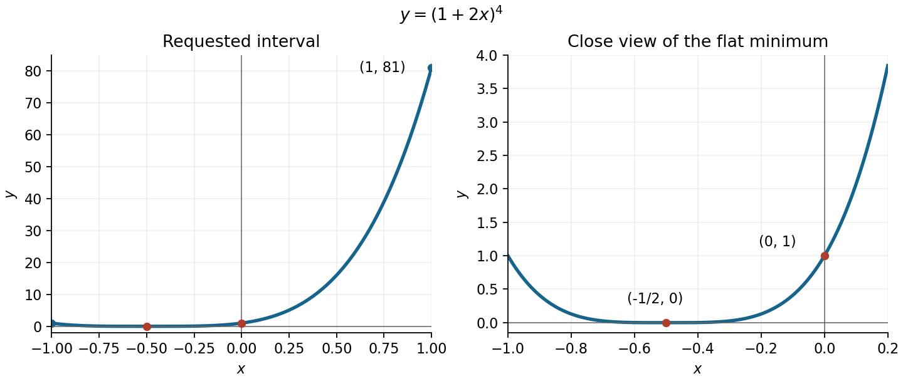
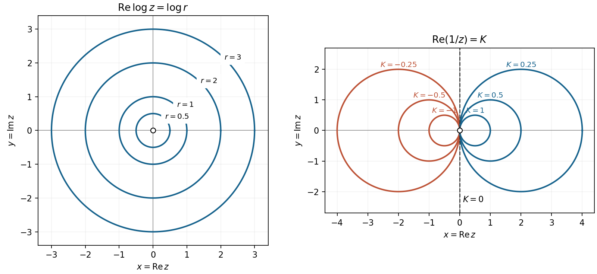
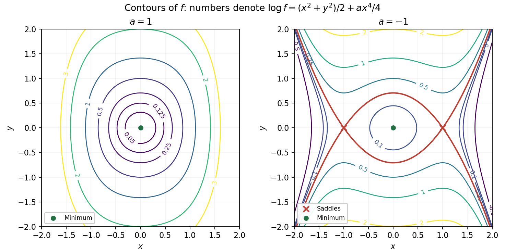
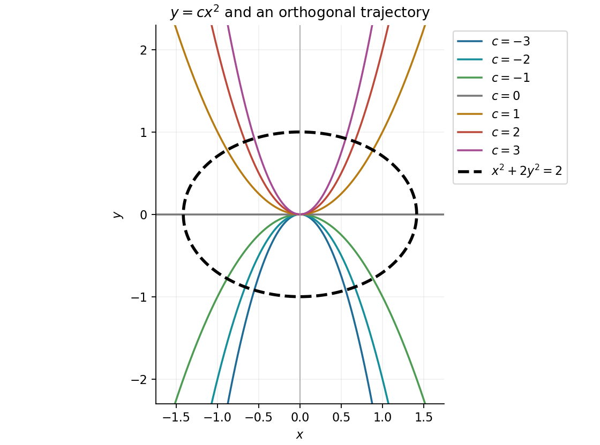

# Paper 1

↑ **Parent:** [2017](../2017.md)

[https://www.maths.cam.ac.uk/undergradnst/files/2017/papernst_ia_1_0.pdf](https://www.maths.cam.ac.uk/undergradnst/files/2017/papernst_ia_1_0.pdf)

**Table of contents**

- [1](#1)
  - [a](#1/a)
    - [Solution](#1/a/solution)
  - [b](#1/b)
    - [Solution](#1/b/solution)
- [2](#2)
  - [a](#2/a)
    - [Solution](#2/a/solution)
  - [b](#2/b)
    - [Solution](#2/b/solution)
- [3](#3)
  - [a](#3/a)
    - [Solution](#3/a/solution)
  - [b](#3/b)
    - [Solution](#3/b/solution)
- [4](#4)
  - [a](#4/a)
    - [Solution](#4/a/solution)
  - [b](#4/b)
    - [Solution](#4/b/solution)
- [5](#5)
  - [a](#5/a)
    - [Solution](#5/a/solution)
  - [b](#5/b)
    - [Solution](#5/b/solution)
- [6](#6)
  - [a](#6/a)
    - [Solution](#6/a/solution)
  - [b](#6/b)
    - [Solution](#6/b/solution)
- [7](#7)
  - [a](#7/a)
    - [Solution](#7/a/solution)
  - [b](#7/b)
    - [Solution](#7/b/solution)
- [8](#8)
  - [a](#8/a)
    - [Solution](#8/a/solution)
  - [b](#8/b)
    - [Solution](#8/b/solution)
- [9](#9)
  - [a](#9/a)
    - [Solution](#9/a/solution)
  - [b](#9/b)
    - [Solution](#9/b/solution)
- [10](#10)
  - [a](#10/a)
    - [Solution](#10/a/solution)
  - [b](#10/b)
    - [Solution](#10/b/solution)
- [11](#11)
  - [a](#11/a)
    - [Solution](#11/a/solution)
  - [b](#11/b)
    - [i](#11/b/i)
      - [Solution](#11/b/i/solution)
    - [ii](#11/b/ii)
      - [Solution](#11/b/ii/solution)
    - [iii](#11/b/iii)
      - [Solution](#11/b/iii/solution)
    - [iv](#11/b/iv)
      - [Solution](#11/b/iv/solution)
  - [c](#11/c)
    - [Solution](#11/c/solution)
  - [d](#11/d)
    - [Solution](#11/d/solution)
- [12](#12)
  - [a](#12/a)
    - [i](#12/a/i)
      - [Solution](#12/a/i/solution)
    - [ii](#12/a/ii)
      - [Solution](#12/a/ii/solution)
  - [b](#12/b)
    - [i](#12/b/i)
      - [Solution](#12/b/i/solution)
    - [ii](#12/b/ii)
      - [Solution](#12/b/ii/solution)
    - [iii](#12/b/iii)
      - [Solution](#12/b/iii/solution)
- [13](#13)
  - [a](#13/a)
    - [Solution](#13/a/solution)
  - [b](#13/b)
    - [Solution](#13/b/solution)
  - [c](#13/c)
    - [Solution](#13/c/solution)
- [14](#14)
  - [a](#14/a)
    - [i](#14/a/i)
      - [Solution](#14/a/i/solution)
    - [ii](#14/a/ii)
      - [Solution](#14/a/ii/solution)
  - [b](#14/b)
    - [i](#14/b/i)
      - [Solution](#14/b/i/solution)
    - [ii](#14/b/ii)
      - [Solution](#14/b/ii/solution)
    - [iii](#14/b/iii)
      - [Solution](#14/b/iii/solution)
- [15](#15)
  - [a](#15/a)
    - [Solution](#15/a/solution)
  - [b](#15/b)
    - [Solution](#15/b/solution)
  - [c](#15/c)
    - [i](#15/c/i)
      - [Solution](#15/c/i/solution)
    - [ii](#15/c/ii)
      - [Solution](#15/c/ii/solution)
- [16](#16)
  - [a](#16/a)
    - [Solution](#16/a/solution)
  - [b](#16/b)
    - [Solution](#16/b/solution)
  - [c](#16/c)
    - [i](#16/c/i)
      - [Solution](#16/c/i/solution)
    - [ii](#16/c/ii)
      - [Solution](#16/c/ii/solution)
    - [iii](#16/c/iii)
      - [Solution](#16/c/iii/solution)
- [17](#17)
  - [a](#17/a)
    - [i](#17/a/i)
      - [Solution](#17/a/i/solution)
    - [ii](#17/a/ii)
      - [Solution](#17/a/ii/solution)
  - [b](#17/b)
    - [Solution](#17/b/solution)
- [18](#18)
  - [a](#18/a)
    - [Solution](#18/a/solution)
  - [b](#18/b)
    - [Solution](#18/b/solution)
  - [c](#18/c)
    - [Solution](#18/c/solution)
  - [d](#18/d)
    - [Solution](#18/d/solution)
- [19](#19)
  - [a](#19/a)
    - [Solution](#19/a/solution)
  - [b](#19/b)
    - [Solution](#19/b/solution)
  - [c](#19/c)
    - [Solution](#19/c/solution)
  - [d](#19/d)
    - [i](#19/d/i)
      - [Solution](#19/d/i/solution)
    - [ii](#19/d/ii)
      - [Solution](#19/d/ii/solution)
- [20](#20)
  - [a](#20/a)
    - [Solution](#20/a/solution)
  - [b](#20/b)
    - [Solution](#20/b/solution)

## 1

↑ **Parent:** [Paper 1](paper-1.md)

<h3 id="1/a">a</h3>

↑ **Parent:** [1](#1)

<h4 id="1/a/solution">Solution</h4>

↑ **Parent:** [A](#1/a)

On the negative half-line, an [antiderivative](../../integral.md#antiderivative) of $1/x$ is $\ln|x|$. The [fundamental theorem of calculus](../../calculus.md#fundamental-theorem-of-calculus) therefore gives

$$
\int_{-2}^{-1}\frac{dx}{x}=\big[\ln|x|\big]_{-2}^{-1}=\ln1-\ln2=\boxed{-\ln2}.
$$

The negative sign agrees with the negative integrand throughout the interval.

<h3 id="1/b">b</h3>

↑ **Parent:** [1](#1)

<h4 id="1/b/solution">Solution</h4>

↑ **Parent:** [B](#1/b)

The [separable differential equation](../../differential-equation.md#separable-differential-equation) gives $dy/y=-dx$, so $y=Ce^{-x}$. The [initial condition](../../differential-equation.md#initial-condition) fixes $C=2$, and hence

$$
\boxed{y(2)=2e^{-2}\approx0.270671.}
$$

## 2

↑ **Parent:** [Paper 1](paper-1.md)

<h3 id="2/a">a</h3>

↑ **Parent:** [2](#2)

<h4 id="2/a/solution">Solution</h4>

↑ **Parent:** [A](#2/a)

The double-angle [trigonometric identity](../../geometry-and-topology.md#trigonometric-identity) $\sin2x=2\sin x\cos x$ makes the integrand $2\sin x\cos^2x$. The [integration by substitution](../../integral.md#integration-by-substitution) $u=\cos x$, $du=-\sin x\,dx$, gives

$$
\int\sin2x\cos x\,dx=-2\int u^2\,du=\boxed{-\frac23\cos^3x+C}.
$$

<h3 id="2/b">b</h3>

↑ **Parent:** [2](#2)

<h4 id="2/b/solution">Solution</h4>

↑ **Parent:** [B](#2/b)

Use [integration by parts](../../calculus.md#integration-by-parts) with $u=\ln x$ and $dv=x\,dx$. Since $du=dx/x$ and $v=x^2/2$,

$$
\int x\ln x\,dx=\frac{x^2}2\ln x-\frac12\int x\,dx
=\boxed{\frac{x^2}2\ln x-\frac{x^2}4+C},\qquad x>0.
$$

## 3

↑ **Parent:** [Paper 1](paper-1.md)

<h3 id="3/a">a</h3>

↑ **Parent:** [3](#3)

<h4 id="3/a/solution">Solution</h4>

↑ **Parent:** [A](#3/a)

Rewrite the [exponential function](../../calculus.md#exponential-function) as $2^x=e^{x\ln2}$. The [chain rule](../../calculus.md#chain-rule) gives

$$
\boxed{\frac{dy}{dx}=2^x\ln2.}
$$

<h3 id="3/b">b</h3>

↑ **Parent:** [3](#3)

<h4 id="3/b/solution">Solution</h4>

↑ **Parent:** [B](#3/b)

Differentiate each coordinate with respect to the parameter $t$ and use the [chain rule](../../calculus.md#chain-rule):

$$
\frac{dy}{dx}=\frac{dy/dt}{dx/dt}
=\frac{\sec^2t}{-\csc^2t}=\boxed{-\tan^2t}.
$$

Both coordinates are defined where $\sin t\ne0$ and $\cos t\ne0$. As a check, $xy=1$ there, so the same [derivative](../../calculus.md#derivative) is $-1/x^2$.

## 4

↑ **Parent:** [Paper 1](paper-1.md)

<h3 id="4/a">a</h3>

↑ **Parent:** [4](#4)

<h4 id="4/a/solution">Solution</h4>

↑ **Parent:** [A](#4/a)

[Implicit differentiation](../../multivariable-calculus.md#implicit-differentiation) yields $3y^2y'+2x=0$. At $x=1$, the real curve has $y^3=1$, hence $y=1$. Therefore

$$
\boxed{\left.\frac{dy}{dx}\right|_{(1,1)}=-\frac23.}
$$

<h3 id="4/b">b</h3>

↑ **Parent:** [4](#4)

<h4 id="4/b/solution">Solution</h4>

↑ **Parent:** [B](#4/b)

A [tangent line](../../calculus.md#tangent-line) through $(1,1)$ with slope $-2/3$ has equation

$$
\boxed{y-1=-\frac23(x-1),\qquad 2x+3y=5.}
$$

## 5

↑ **Parent:** [Paper 1](paper-1.md)

<h3 id="5/a">a</h3>

↑ **Parent:** [5](#5)

<h4 id="5/a/solution">Solution</h4>

↑ **Parent:** [A](#5/a)

Writing the [polynomial](../../polynomial.md) as $p(x)$, direct evaluation gives $p(0)=-6$ and $p(3)=42$. A [polynomial](../../polynomial.md) is continuous, so the [intermediate value theorem](../../calculus.md#intermediate-value-theorem) guarantees a [polynomial root](../../polynomial.md#root-of-a-polynomial) between them. Trying the integer $2$ gives $16+12-22-6=0$, hence **$x=2$ is a root**.

<h3 id="5/b">b</h3>

↑ **Parent:** [5](#5)

<h4 id="5/b/solution">Solution</h4>

↑ **Parent:** [B](#5/b)

By the [factor theorem](../../polynomial.md#factor-theorem), $x-2$ divides the [polynomial](../../polynomial.md). Division gives $2x^2+7x+3=(2x+1)(x+3)$, so

$$
\boxed{2x^3+3x^2-11x-6=(x-2)(2x+1)(x+3).}
$$

Its three [polynomial roots](../../polynomial.md#root-of-a-polynomial) are $2,-1/2,-3$.

## 6

↑ **Parent:** [Paper 1](paper-1.md)

<h3 id="6/a">a</h3>

↑ **Parent:** [6](#6)

<h4 id="6/a/solution">Solution</h4>

↑ **Parent:** [A](#6/a)

The [binomial theorem](../../binomial-coefficient.md#binomial-theorem) gives coefficients $1,4,6,4,1$ for the fourth power. Substituting $2x$ for its variable gives

$$
\boxed{1+8x+24x^2+32x^3+16x^4=(1+2x)^4,\qquad a=1,\ b=2,\ m=4.}
$$

<h3 id="6/b">b</h3>

↑ **Parent:** [6](#6)

<h4 id="6/b/solution">Solution</h4>

↑ **Parent:** [B](#6/b)

The [function graph](../../function.md#graph-of-a-function) is a horizontally shifted and scaled fourth power. It is nonnegative and touches the horizontal axis at its fourfold [polynomial root](../../polynomial.md#root-of-a-polynomial). The axis intersections are

$$
\boxed{(-1/2,0)\quad\text{and}\quad(0,1).}
$$

The [derivative](../../calculus.md#derivative) is $8(1+2x)^3$, so the graph decreases to its flat [local minimum](../../analysis.md#local-minimum) at $x=-1/2$ and then increases. Its endpoint values on the requested interval are $f(-1)=1$ and $f(1)=81$. The original sketch includes a closer view of the minimum so that the small values are visible beside the much larger right endpoint.

**[Figure 1](#6/b/image-the-fourth-power-polynomial-on-the-requested-interval-with-a-close-view-of-its-flat-minimum). The fourth-power polynomial on the requested interval, with a close view of its flat minimum**.

## 7

↑ **Parent:** [Paper 1](paper-1.md)

<h3 id="7/a">a</h3>

↑ **Parent:** [7](#7)

<h4 id="7/a/solution">Solution</h4>

↑ **Parent:** [A](#7/a)

Put $\theta=\pi/12$. The double-angle [trigonometric identities](../../geometry-and-topology.md#trigonometric-identity) imply $\cos^2(2\theta)=1-\sin^2(2\theta)$. Since $2\theta=\pi/6$ is in the first quadrant, the positive [square root](../../algebra.md#square-root) is required. The [half-angle identities](../../geometry-and-topology.md#half-angle-identities) then give the requested expression in terms of $\sin(\pi/6)$:

$$
\boxed{\sin^2\frac\pi{12}=\frac{1-\sqrt{1-\sin^2(\pi/6)}}2.}
$$

<h3 id="7/b">b</h3>

↑ **Parent:** [7](#7)

<h4 id="7/b/solution">Solution</h4>

↑ **Parent:** [B](#7/b)

Using $\sin(\pi/6)=1/2$ in the preceding [half-angle identities](../../geometry-and-topology.md#half-angle-identities) gives

$$
\sin^2\frac\pi{12}=\frac{2-\sqrt3}{4}\approx\frac{2-1.732}{4}=0.067.
$$

To two decimal places the answer is **$0.07$**.

## 8

↑ **Parent:** [Paper 1](paper-1.md)

<h3 id="8/a">a</h3>

↑ **Parent:** [8](#8)

<h4 id="8/a/solution">Solution</h4>

↑ **Parent:** [A](#8/a)

The double-angle [trigonometric identity](../../geometry-and-topology.md#trigonometric-identity) gives $\cos x=2\sin x\cos x$, or $\cos x(1-2\sin x)=0$. Preserve both factors: $\cos x=0$ contributes the endpoint, while $\sin x=1/2$ contributes the interior solution. In the specified interval,

$$
\boxed{x=\frac\pi6,\quad\frac\pi2.}
$$

<h3 id="8/b">b</h3>

↑ **Parent:** [8](#8)

<h4 id="8/b/solution">Solution</h4>

↑ **Parent:** [B](#8/b)

Since $1+\cos2x=2\cos^2x$, the equation reduces to $\cos^2x=0$. The only solution in the open interval $(\pi,2\pi)$ is

$$
\boxed{x=\frac{3\pi}{2}.}
$$

## 9

↑ **Parent:** [Paper 1](paper-1.md)

<h3 id="9/a">a</h3>

↑ **Parent:** [9](#9)

<h4 id="9/a/solution">Solution</h4>

↑ **Parent:** [A](#9/a)

For $y\ne0$, the [separable differential equation](../../differential-equation.md#separable-differential-equation) gives $dy/y^2=dx$. Integrating gives $-1/y=x+C_0$, or

$$
\boxed{y(x)=\frac1{C-x},\qquad x\ne C.}
$$

Each solution is considered on an interval not containing its pole. The additional [stationary solution](../../differential-equation.md#stationary-solution) $y=0$ is excluded by the stated condition.

<h3 id="9/b">b</h3>

↑ **Parent:** [9](#9)

<h4 id="9/b/solution">Solution</h4>

↑ **Parent:** [B](#9/b)

The [initial condition](../../differential-equation.md#initial-condition) gives $1=1/(C-1)$, hence $C=2$. Thus

$$
\boxed{y(x)=\frac1{2-x},\qquad x<2.}
$$

The displayed interval is the maximal connected interval containing the initial point $x=1$; the [solution of a differential equation](../../differential-equation.md#solution-of-a-differential-equation) diverges at $x=2$.

## 10

↑ **Parent:** [Paper 1](paper-1.md)

<h3 id="10/a">a</h3>

↑ **Parent:** [10](#10)

<h4 id="10/a/solution">Solution</h4>

↑ **Parent:** [A](#10/a)

The [Euclidean norm](../../normed-vector-space.md#euclidean-norm) of each position [vector](../../vector-space.md#vector) gives

$$
\boxed{|OA|=\sqrt{3^2+4^2}=5,\qquad |OB|=\sqrt{5^2+12^2}=13.}
$$

<h3 id="10/b">b</h3>

↑ **Parent:** [10](#10)

<h4 id="10/b/solution">Solution</h4>

↑ **Parent:** [B](#10/b)

The [dot product](../../inner-product.md#dot-product) formula for the angle between two nonzero [vectors](../../vector-space.md#vector) gives

$$
\boxed{\cos\angle AOB=\frac{(3,4)\cdot(5,12)}{5\cdot13}=\frac{15+48}{65}=\frac{63}{65}.}
$$

## 11

↑ **Parent:** [Paper 1](paper-1.md)

<h3 id="11/a">a</h3>

↑ **Parent:** [11](#11)

<h4 id="11/a/solution">Solution</h4>

↑ **Parent:** [A](#11/a)

In [polar coordinates](../../multivariable-calculus.md#polar-coordinates), $x=r\cos\theta$, $y=r\sin\theta$, with $r=\sqrt{x^2+y^2}$. Thus the [polar form of a complex number](../../complex-analysis.md#polar-form-of-a-complex-number) is

$$
\boxed{z=r(\cos\theta+i\sin\theta)=re^{i\theta}.}
$$

Here $r=|z|\geq0$ is its [complex modulus](../../complex-analysis.md#complex-modulus); for $z\ne0$, the [complex argument](../../complex-analysis.md#argument-complex-analysis) $\theta$ is determined modulo $2\pi$. At $z=0$ the angle is undefined, although every value of $\theta$ gives the same point when $r=0$.

<h3 id="11/b">b</h3>

↑ **Parent:** [11](#11)

<h4 id="11/b/i">i</h4>

↑ **Parent:** [B](#11/b)

<h5 id="11/b/i/solution">Solution</h5>

↑ **Parent:** [I](#11/b/i)

For $z\ne0$, the [complex logarithm](../../analysis.md#complex-logarithm) is $\ln z=\ln r+i(\theta+2\pi k)$, where $k\in\mathbb Z$. Consequently

$$
\boxed{\operatorname{Re}\ln z=\frac12\ln(x^2+y^2),\qquad
\operatorname{Im}\ln z=\arg(x+iy)+2\pi k.}
$$

A specified branch chooses one continuous determination of the [complex argument](../../complex-analysis.md#argument-complex-analysis) on an appropriate cut domain. For the usual principal-value convention use the [principal argument](../../complex-analysis.md#principal-argument) $\operatorname{Arg}(x+iy)\in(-\pi,\pi]$. A formula using only $\arctan(y/x)$ would lose the quadrant information; it is a valid local angle only with the appropriate additive multiple of $\pi$.

<h4 id="11/b/ii">ii</h4>

↑ **Parent:** [B](#11/b)

<h5 id="11/b/ii/solution">Solution</h5>

↑ **Parent:** [Ii](#11/b/ii)

Multiply numerator and denominator by the [complex conjugate](../../complex-analysis.md#complex-conjugate):

$$
\frac1z=\frac{x-iy}{x^2+y^2}.
$$

Therefore, away from the origin,

$$
\boxed{\operatorname{Re}(1/z)=\frac{x}{x^2+y^2},\qquad
\operatorname{Im}(1/z)=-\frac{y}{x^2+y^2}.}
$$

<h4 id="11/b/iii">iii</h4>

↑ **Parent:** [B](#11/b)

<h5 id="11/b/iii/solution">Solution</h5>

↑ **Parent:** [Iii](#11/b/iii)

Use $|z|^2=z\bar z$ and $z-\bar z=2iy$. Then

$$
\bar z(z^2-|z|^2)=\bar z\,z(z-\bar z)=2iy|z|^2=2iy(x^2+y^2).
$$

The [real part](../../complex-analysis.md#real-part) and [imaginary part](../../complex-analysis.md#imaginary-part) are therefore

$$
\boxed{0\quad\text{and}\quad2y(x^2+y^2),\ \text{respectively}.}
$$

<h4 id="11/b/iv">iv</h4>

↑ **Parent:** [B](#11/b)

<h5 id="11/b/iv/solution">Solution</h5>

↑ **Parent:** [Iv](#11/b/iv)

Expand the defining [complex exponential functions](../../calculus.md#complex-exponential-function):

$$
\cosh(x+iy)=\frac{e^{x+iy}+e^{-x-iy}}2
=\cosh x\cos y+i\sinh x\sin y.
$$

Thus the [real part](../../complex-analysis.md#real-part) and [imaginary part](../../complex-analysis.md#imaginary-part) of the [hyperbolic cosine](../../calculus.md#hyperbolic-cosine) are

$$
\boxed{\operatorname{Re}\cosh z=\cosh x\cos y,\qquad
\operatorname{Im}\cosh z=\sinh x\sin y.}
$$

<h3 id="11/c">c</h3>

↑ **Parent:** [11](#11)

<h4 id="11/c/solution">Solution</h4>

↑ **Parent:** [C](#11/c)

A constant [real part](../../complex-analysis.md#real-part) $\operatorname{Re}\ln z=L$ means $\ln|z|=L$, so its [level sets](../../topology.md#level-set) are the concentric [circles](../../topology.md#circle)

$$
\boxed{x^2+y^2=e^{2L},\qquad L\in\mathbb R.}
$$

Their radii are strictly positive. The [real part](../../complex-analysis.md#real-part) is independent of the logarithm's branch, so there is no branch ambiguity in these [circles](../../topology.md#circle).

For $\operatorname{Re}(1/z)=K$, the equation is $x=K(x^2+y^2)$. If $K\ne0$, complete the square to obtain

$$
\boxed{\left(x-\frac1{2K}\right)^2+y^2=\frac1{4K^2},\qquad (x,y)\ne(0,0).}
$$

These [circles](../../topology.md#circle) have centres on the real axis and are tangent to the imaginary axis at the excluded origin. Positive $K$ puts the [circle](../../topology.md#circle) to the right, negative $K$ to the left. The separate case $K=0$ gives the punctured imaginary axis $\boxed{x=0,\ y\ne0}$. The sketch uses an open marker at the origin to emphasize that $1/z$ is never defined there.

**[Figure 2](#11/c/image-constant-real-part-contours-of-the-complex-logarithm-and-reciprocal). Constant real-part contours of the complex logarithm and reciprocal**.

<h3 id="11/d">d</h3>

↑ **Parent:** [11](#11)

<h4 id="11/d/solution">Solution</h4>

↑ **Parent:** [D](#11/d)

Set $w=e^z\ne0$. The [hyperbolic cosine](../../calculus.md#hyperbolic-cosine) equation becomes $w+w^{-1}=-4$, hence $w^2+4w+1=0$. Its two [polynomial roots](../../polynomial.md#root-of-a-polynomial) are $w=-2\pm\sqrt3$, both negative. Taking every value of the [complex logarithm](../../analysis.md#complex-logarithm) yields

$$
z=\ln|w|+i(2k+1)\pi,\qquad k\in\mathbb Z.
$$

Since $(2-\sqrt3)(2+\sqrt3)=1$, their real logarithms have opposite signs. All solutions are therefore

$$
\boxed{z=\pm\ln(2+\sqrt3)+i(2k+1)\pi,\qquad k\in\mathbb Z.}
$$

The positive real constant is also $\operatorname{arcosh}2$, the [inverse hyperbolic cosine](../../calculus.md#inverse-hyperbolic-cosine) of $2$. Substitution gives $\cosh z=-\cosh(\ln(2+\sqrt3))=-2$ for both signs and every integer $k$.

## 12

↑ **Parent:** [Paper 1](paper-1.md)

<h3 id="12/a">a</h3>

↑ **Parent:** [12](#12)

<h4 id="12/a/i">i</h4>

↑ **Parent:** [A](#12/a)

<h5 id="12/a/i/solution">Solution</h5>

↑ **Parent:** [I](#12/a/i)

Assume $F$ is [continuously differentiable](../../multivariable-calculus.md#continuously-differentiable-function) near the point of interest on $F=0$, and that the relevant denominators below are nonzero. The [total differential](../../multivariable-calculus.md#total-differential) on the surface is

$$
dF=F_x\,dx+F_y\,dy+F_z\,dz=0.
$$

Holding $z$ fixed gives $F_x\,dx+F_y\,dy=0$, so the [implicit function theorem](../../multivariable-calculus.md#implicit-function-theorem) gives

$$
\left(\frac{\partial y}{\partial x}\right)_z=-\frac{F_x}{F_y},\qquad
\left(\frac{\partial x}{\partial y}\right)_z=-\frac{F_y}{F_x}.
$$

When $F_xF_y\ne0$, their product proves the [reciprocity rule for constrained partial derivatives](../../multivariable-calculus.md#reciprocity-rule-for-constrained-partial-derivatives):

$$
\boxed{\left(\frac{\partial y}{\partial x}\right)_z
\left(\frac{\partial x}{\partial y}\right)_z=1.}
$$

Similarly, holding $y$ or $x$ fixed gives $(\partial x/\partial z)_y=-F_z/F_x$ and $(\partial z/\partial y)_x=-F_y/F_z$. With $F_xF_yF_z\ne0$, multiply the three ratios:

$$
\boxed{\left(\frac{\partial y}{\partial x}\right)_z
\left(\frac{\partial x}{\partial z}\right)_y
\left(\frac{\partial z}{\partial y}\right)_x
=\left(-\frac{F_x}{F_y}\right)\left(-\frac{F_z}{F_x}\right)\left(-\frac{F_y}{F_z}\right)=-1.}
$$

This is the [cyclic partial derivative identity](../../multivariable-calculus.md#cyclic-partial-derivative-identity). Nonzero denominators and local differentiable coordinate representations are substantive assumptions: at a singular coordinate representation, a formal cancellation of zero or infinite factors is not a valid proof.

<h4 id="12/a/ii">ii</h4>

↑ **Parent:** [A](#12/a)

<h5 id="12/a/ii/solution">Solution</h5>

↑ **Parent:** [Ii](#12/a/ii)

Differentiate the defining function with the other coordinates independent. Put $C=\cosh(x+z)$ for brevity. Then

$$
F_x=yz-C,\qquad F_y=xz,\qquad F_z=xy-C.
$$

The [implicit differentiation](../../multivariable-calculus.md#implicit-differentiation) ratios therefore give

$$
\boxed{\left(\frac{\partial x}{\partial y}\right)_z=-\frac{xz}{yz-C},\quad
\left(\frac{\partial x}{\partial z}\right)_y=-\frac{xy-C}{yz-C},\quad
\left(\frac{\partial y}{\partial z}\right)_x=-\frac{xy-C}{xz}.}
$$

Each expression applies on the implicit surface wherever its own denominator is nonzero. The [hyperbolic cosine](../../calculus.md#hyperbolic-cosine) appears because the [derivative](../../calculus.md#derivative) of $\sinh(x+z)$ with respect to either $x$ or $z$ is $\cosh(x+z)$.

<h3 id="12/b">b</h3>

↑ **Parent:** [12](#12)

<h4 id="12/b/i">i</h4>

↑ **Parent:** [B](#12/b)

<h5 id="12/b/i/solution">Solution</h5>

↑ **Parent:** [I](#12/b/i)

There is a global-domain issue in the printed question. Write $D=a^2x^2+b^2y^2>0$ away from the origin. Direct [partial differentiation](../../multivariable-calculus.md#partial-derivative) gives

$$
P_y=-\frac{ab(a^2x^2-b^2y^2)}{D^2}
=Q_x.
$$

Thus the [differential one-form](../../differential-form.md#one-form) is a [closed differential form](../../differential-form.md#closed-differential-form) for **every real $a,b\ne0$**. The [Poincaré lemma](../../differential-form.md#poincare-lemma) makes it locally an [exact differential form](../../differential-form.md#exact-differential-form) on small neighborhoods avoiding the origin. There is no additional condition such as $a^2=b^2$.

However, the stated domain is the whole [punctured plane](../../riemann-surfaces.md#punctured-complex-plane), which is not [simply connected](../../algebraic-topology.md#simply-connected-space). To test global exactness, use the closed [ellipse](../../euclidean-geometry.md#ellipse) $x=\cos t/a$, $y=\sin t/b$, $0\leq t\leq2\pi$. Here $D=1$ and

$$
P\,dx+Q\,dy=ab(x\,dy-y\,dx)=dt,\qquad
\oint(P\,dx+Q\,dy)=2\pi.
$$

The [line integral](../../multivariable-calculus.md#line-integral) of a globally [exact differential form](../../differential-form.md#exact-differential-form) around any closed curve would be zero. Consequently

$$
\boxed{\text{globally exact on }\mathbb R^2\setminus\{0\}:\ \text{no allowed }a,b;\qquad
\text{locally exact}:\ \text{all }a,b\ne0.}
$$

The distinction is precisely that of the [elliptically scaled angular one-form](../../differential-form.md#elliptically-scaled-angular-one-form). The remaining parts can be answered consistently using a local angle branch, as follows.

<h4 id="12/b/ii">ii</h4>

↑ **Parent:** [B](#12/b)

<h5 id="12/b/ii/solution">Solution</h5>

↑ **Parent:** [Ii](#12/b/ii)

On a chart with $x\ne0$, set

$$
\boxed{f(x,y)=\arctan\!\left(\frac{by}{ax}\right)+C.}
$$

The [chain rule](../../calculus.md#chain-rule) verifies both components:

$$
f_x=\frac1{1+(by/(ax))^2}\left(-\frac{by}{ax^2}\right)
=-\frac{aby}{D}=P,\qquad
f_y=\frac1{1+(by/(ax))^2}\frac{b}{ax}
=\frac{abx}{D}=Q.
$$

A coordinate-independent description of the local potential is a continuous branch of $\arg(ax+iby)$, the [complex argument](../../complex-analysis.md#argument-complex-analysis) of the scaled coordinates. Such branches can also cover points where $x=0$, using a different angular chart. Continuing once around the missing origin changes that angle by a nonzero multiple of $2\pi$, so **there is no global single-valued $f$ on the full stated domain**.

<h4 id="12/b/iii">iii</h4>

↑ **Parent:** [B](#12/b)

<h5 id="12/b/iii/solution">Solution</h5>

↑ **Parent:** [Iii](#12/b/iii)

The nonzero factor $ab/D$ can be cancelled in the local [differential equation](../../differential-equation.md), leaving $x\,dy-y\,dx=0$. On an interval with $x\ne0$,

$$
\frac{d}{dx}\left(\frac yx\right)=\frac{xy'-y}{x^2}=0.
$$

Hence the explicit [general solution](../../linear-ordinary-differential-equation.md#general-solution) is

$$
\boxed{y(x)=Cx,\qquad C\in\mathbb R,}
$$

on any interval that avoids the excluded origin. It also follows from fixing the local angle potential, with slope $C=(a/b)\tan(f-C_0)$. As parameterized curves there are also vertical rays $x=0$, which cannot be represented as single-valued functions $y(x)$. Geometrically the connected [integral curves](../../multivariable-calculus.md#integral-curve-of-a-vector-field) are rays, not lines continued through the undefined origin.

## 13

↑ **Parent:** [Paper 1](paper-1.md)

<h3 id="13/a">a</h3>

↑ **Parent:** [13](#13)

<h4 id="13/a/solution">Solution</h4>

↑ **Parent:** [A](#13/a)

The homogeneous [characteristic equation](../../linear-ordinary-differential-equation.md#characteristic-equation-of-a-constant-coefficient-differential-equation) is $r^2+2r=r(r+2)=0$, giving the [complementary solution](../../linear-ordinary-differential-equation.md#homogeneous-solution) $C_1+C_2e^{-2x}$. For a [particular solution](../../linear-ordinary-differential-equation.md#particular-solution), try $Ax^2+Bx$. Substitution gives $2A+4Ax+2B=4x$, so $A=1$ and $B=-1$. Therefore the [general solution](../../linear-ordinary-differential-equation.md#general-solution) is

$$
\boxed{y=x^2-x+C_1+C_2e^{-2x}.}
$$

As a direct check, the [polynomial](../../polynomial.md) part contributes $2+2(2x-1)=4x$, while both complementary terms contribute zero.

<h3 id="13/b">b</h3>

↑ **Parent:** [13](#13)

<h4 id="13/b/solution">Solution</h4>

↑ **Parent:** [B](#13/b)

For the first-order [linear ordinary differential equation](../../linear-ordinary-differential-equation.md), seek an [integrating factor](../../linear-ordinary-differential-equation.md#integrating-factor) $M(x)$ that makes its left side a [product rule](../../calculus.md#product-rule) [derivative](../../calculus.md#derivative). Multiplying by $M$ gives $My'+MPy$, and comparison with $(My)'=My'+M'y$ requires $M'=PM$. On an interval where $P$ is continuous choose

$$
M(x)=\exp\!\left(\int_{x_0}^xP(t)\,dt\right),\qquad M(x_0)=1.
$$

This factor is never zero. The transformed equation is $(My)'=MQ$, so integration from $x_0$ to $x$ yields

$$
\boxed{y(x)=\frac{1}{M(x)}\left[C+\int_{x_0}^x M(t)Q(t)\,dt\right].}
$$

Here $C=y(x_0)$ for an [initial value problem](../../differential-equation.md#initial-value-problem). The [indefinite integral](../../integral.md#antiderivative) version is $y=e^{-\int Pdx}[C+\int Qe^{\int Pdx}dx]$, with any constant choices inside the [integrating factor](../../linear-ordinary-differential-equation.md#integrating-factor) absorbed into $C$. Continuity of $P,Q$ is a convenient sufficient hypothesis for a classical differentiable [solution of a differential equation](../../differential-equation.md#solution-of-a-differential-equation).

<h3 id="13/c">c</h3>

↑ **Parent:** [13](#13)

<h4 id="13/c/solution">Solution</h4>

↑ **Parent:** [C](#13/c)

Since $1+x^2>0$ for all real $x$, divide the equation by that factor. Its linear coefficient can be integrated by [polynomial division](../../polynomial.md#polynomial-division):

$$
P(x)=\frac{3x^3}{1+x^2}=3x-\frac{3x}{1+x^2},\qquad
\int P(x)\,dx=\frac32x^2-\frac32\ln(1+x^2).
$$

Thus a positive [integrating factor](../../linear-ordinary-differential-equation.md#integrating-factor) is $M=e^{3x^2/2}(1+x^2)^{-3/2}$. Multiplying the divided equation gives the [product rule](../../calculus.md#product-rule) form

$$
\frac d{dx}(My)=\frac{6x}{(1+x^2)^{5/2}}.
$$

The [integration by substitution](../../integral.md#integration-by-substitution) $u=1+x^2$ gives

$$
My=-\frac{2}{(1+x^2)^{3/2}}+C,\qquad
y=e^{-3x^2/2}\big[C(1+x^2)^{3/2}-2\big].
$$

The [initial condition](../../differential-equation.md#initial-condition) $y(0)=1$ fixes $C-2=1$. The required solution is therefore

$$
\boxed{y(x)=e^{-3x^2/2}\left[3(1+x^2)^{3/2}-2\right],\qquad x\in\mathbb R.}
$$

No real singularity was introduced by the division or the [integrating factor](../../linear-ordinary-differential-equation.md#integrating-factor), so the solution extends over the entire real line.

## 14

↑ **Parent:** [Paper 1](paper-1.md)

<h3 id="14/a">a</h3>

↑ **Parent:** [14](#14)

<h4 id="14/a/i">i</h4>

↑ **Parent:** [A](#14/a)

<h5 id="14/a/i/solution">Solution</h5>

↑ **Parent:** [I](#14/a/i)

An interior [stationary point](../../calculus-of-variations.md#stationary-point) has vanishing [gradient](../../multivariable-calculus.md#gradient):

$$
\boxed{\nabla f(x_0,y_0)=\mathbf0,\qquad f_x(x_0,y_0)=f_y(x_0,y_0)=0.}
$$

For a differentiable [function](../../function.md), this is the necessary first-order condition for an interior [local minimum](../../analysis.md#local-minimum) or [local maximum](../../analysis.md#local-maximum).

<h4 id="14/a/ii">ii</h4>

↑ **Parent:** [A](#14/a)

<h5 id="14/a/ii/solution">Solution</h5>

↑ **Parent:** [Ii](#14/a/ii)

Write $A=f_{xx}$, $B=f_{xy}$, $C=f_{yy}$ at the [stationary point](../../calculus-of-variations.md#stationary-point), and let $D=AC-B^2\ne0$. Under the usual second-order [Taylor expansion](../../calculus.md#taylor-expansion) hypothesis, the [second-derivative test](../../multivariable-calculus.md#second-derivative-test) gives

$$
\boxed{\begin{array}{c|c}
D>0,\ A>0&\text{strict local minimum}\\
D>0,\ A<0&\text{strict local maximum}\\
D<0&\text{saddle point}
\end{array}}
$$

Indeed the quadratic term is $(A\xi^2+2B\xi\eta+C\eta^2)/2$. For $A\ne0$, completing its square gives $[A(\xi+B\eta/A)^2+(D/A)\eta^2]/2$. The two coefficients have the same positive sign, the same negative sign, or opposite signs in the respective cases. A negative $D$ also forces the two [Hessian](../../multivariable-calculus.md#hessian-matrix) [eigenvalues](../../linear-operator-theory.md#eigenvalue) to have opposite signs, including the case $A=0$.

There is a qualification to the printed assumptions: existence of second [partial derivatives](../../multivariable-calculus.md#partial-derivative) only at the point does not ensure the needed quadratic approximation. Continuous second [partial derivatives](../../multivariable-calculus.md#partial-derivative) in a neighborhood are sufficient. The [existence of second partial derivatives does not justify the Hessian test](../../multivariable-calculus.md#existence-of-second-partial-derivatives-does-not-justify-the-hessian-test): for example, the function $g=x^2+y^2-6x^2y^2/(x^2+y^2)$ away from the origin, extended by $g(0,0)=0$, has [Hessian](../../multivariable-calculus.md#hessian-matrix) $2I$ at the origin but $g(t,t)=-t^2$ and $g(t,0)=t^2$. Thus the classification above uses the standard additional regularity assumption, which the smooth function in part (b) satisfies.

<h3 id="14/b">b</h3>

↑ **Parent:** [14](#14)

<h4 id="14/b/i">i</h4>

↑ **Parent:** [B](#14/b)

<h5 id="14/b/i/solution">Solution</h5>

↑ **Parent:** [I](#14/b/i)

Put $G=(x^2+y^2)/2+ax^4/4$, so $f=e^G>0$. Since $f_x=fG_x$ and $f_y=fG_y$, its [stationary points](../../calculus-of-variations.md#stationary-point) satisfy

$$
y=0,\qquad x(1+ax^2)=0.
$$

The origin occurs for every real $a$. There are two additional points only for $a<0$, at $x=\pm1/\sqrt{-a}$.

At a [stationary point](../../calculus-of-variations.md#stationary-point), the [Hessian matrix](../../multivariable-calculus.md#hessian-matrix) simplifies because $\nabla G=0$:

$$
H_f=fH_G=f\begin{pmatrix}1+3ax^2&0\\0&1\end{pmatrix}.
$$

At the origin this is $I$, so **$(0,0)$ is a strict local minimum for every $a$**, with $f=1$. If $a\geq0$ it is also the unique global minimum, since $G\geq0$ with equality only there. For $a<0$, the two extra points have $1+3ax^2=-2$, so their [Hessian](../../multivariable-calculus.md#hessian-matrix) has opposite-sign [eigenvalues](../../linear-operator-theory.md#eigenvalue). Thus

$$
\boxed{a<0:\ \left(\pm\frac1{\sqrt{-a}},0\right)\text{ are saddle points},\qquad
f=\exp\!\left(-\frac1{4a}\right).}
$$

There are no [local maxima](../../analysis.md#local-maximum). When $a<0$, the origin is not a global minimum: $f(x,0)\to0$ as $|x|\to\infty$, but $f$ never attains zero.

<h4 id="14/b/ii">ii</h4>

↑ **Parent:** [B](#14/b)

<h5 id="14/b/ii/solution">Solution</h5>

↑ **Parent:** [Ii](#14/b/ii)

Because the [exponential function](../../calculus.md#exponential-function) is strictly increasing, the [level sets](../../topology.md#level-set) $f=L>0$ are exactly those of $G=\ln L$. For $a=1$ they satisfy

$$
y^2=2\ln L-x^2-\frac{x^4}{2}.
$$

There are no contours for $L<1$, the level $L=1$ is the origin, and $L>1$ gives nested closed ovals symmetric about both axes. Their stronger fourth-power growth in $x$ makes them relatively narrower horizontally as the level rises.

For $a=-1$, the contour equation becomes

$$
y^2=2\ln L-x^2+\frac{x^4}{2}.
$$

The central [local minimum](../../analysis.md#local-minimum) is surrounded by closed ovals for $1<L<e^{1/4}$, accompanied by outer open branches. At $L=e^{1/4}$, the level passes through the two [saddle points](../../analysis.md#saddle-point) $(\pm1,0)$ and changes its connectivity. Levels $L<1$ have only outer branches, while levels above the saddle value have an upper and a lower branch. The sketch is restricted to the requested square; labels give $G=\ln f$, so they identify the corresponding contours of $f$ without exponentially large labels.

**[Figure 3](#14/b/ii/image-contours-for-the-two-parameter-signs-labels-are-log-f-and-dots-mark-stationary-points). Contours for the two parameter signs; labels are log f and dots mark stationary points**.

<h4 id="14/b/iii">iii</h4>

↑ **Parent:** [B](#14/b)

<h5 id="14/b/iii/solution">Solution</h5>

↑ **Parent:** [Iii](#14/b/iii)

For $a=-1$, the [local minimum](../../analysis.md#local-minimum) at the origin has $f=1$. Its full [level set](../../topology.md#level-set) is

$$
\boxed{y^2=\frac{x^4}{2}-x^2.}
$$

The connected component containing the minimum is just the isolated origin. The same level also has the outer branches $y=\pm\sqrt{x^4/2-x^2}$ for $|x|\geq\sqrt2$; these are different connected components, not curves approaching the origin.

Both [saddle points](../../analysis.md#saddle-point) $(\pm1,0)$ have $f=e^{1/4}$. Their common [level set](../../topology.md#level-set) factors as

$$
y^2=\frac{x^4}{2}-x^2+\frac12=\frac{(x^2-1)^2}{2}.
$$

Its explicit equations are therefore

$$
\boxed{y=\frac{x^2-1}{\sqrt2}\quad\text{or}\quad y=-\frac{x^2-1}{\sqrt2}.}
$$

The two [parabolas](../../euclidean-geometry.md#parabola) cross at each saddle, explaining the change of contour connectivity there. Each displayed equation can be restricted to the square of part (ii) if only that sketch window is wanted.

## 15

↑ **Parent:** [Paper 1](paper-1.md)

<h3 id="15/a">a</h3>

↑ **Parent:** [15](#15)

<h4 id="15/a/solution">Solution</h4>

↑ **Parent:** [A](#15/a)

With the first $n$ terms counted from the constant term, [Taylor's theorem](../../calculus.md#taylor-s-theorem) gives

$$
\boxed{f(x)=\sum_{k=0}^{n-1}\frac{f^{(k)}(a)}{k!}(x-a)^k+R_n(x),\qquad
R_n(x)=\frac{f^{(n)}(\xi)}{n!}(x-a)^n,}
$$

where $\xi$ lies between $a$ and $x$. Continuous [derivatives](../../calculus.md#derivative) through order $n$ on the joining interval are a sufficient hypothesis for this [Taylor theorem with Lagrange remainder](../../calculus.md#taylor-theorem-with-lagrange-remainder). The [Taylor remainder](../../calculus.md#taylor-remainder) measures the error of the finite [Taylor polynomial](../../calculus.md#taylor-polynomial); convergence of the corresponding infinite [Taylor series](../../calculus.md#taylor-series) is a separate question.

<h3 id="15/b">b</h3>

↑ **Parent:** [15](#15)

<h4 id="15/b/solution">Solution</h4>

↑ **Parent:** [B](#15/b)

For $f(x)=x^{1/3}$, the required [derivatives](../../calculus.md#derivative) are

$$
f'(x)=\frac13x^{-2/3},\quad f''(x)=-\frac29x^{-5/3},\quad
f^{(3)}(x)=\frac{10}{27}x^{-8/3}.
$$

At $a=8$ these give $f(8)=2$, $f'(8)=1/12$, and $f''(8)=-1/144$. Setting $x-a=1$, the three-term [Taylor polynomial](../../calculus.md#taylor-polynomial) yields

$$
\boxed{9^{1/3}\approx2+\frac1{12}-\frac1{288}=\frac{599}{288}\approx2.07986111.}
$$

By the [Taylor theorem with Lagrange remainder](../../calculus.md#taylor-theorem-with-lagrange-remainder), the signed error is

$$
R_3=\frac{f^{(3)}(\xi)}{6}=\frac5{81}\xi^{-8/3},\qquad 8<\xi<9.
$$

It is positive, and $\xi^{-8/3}<8^{-8/3}=1/256$. Consequently

$$
\boxed{0<9^{1/3}-\frac{599}{288}<\frac5{20736}<\frac1{4000}.}
$$

The last comparison is exact because $5\cdot4000=20000<20736$. Thus the estimate is an underestimate with the required rigorous [absolute error](../../numerical-analysis.md#absolute-error) bound.

<h3 id="15/c">c</h3>

↑ **Parent:** [15](#15)

<h4 id="15/c/i">i</h4>

↑ **Parent:** [C](#15/c)

<h5 id="15/c/i/solution">Solution</h5>

↑ **Parent:** [I](#15/c/i)

Use the [Maclaurin series](../../calculus.md#maclaurin-series) $\sin x=x-x^3/6+O(x^5)$ and $e^u=1+u+u^2/2+u^3/6+u^4/24+O(u^5)$. The terms through fourth degree give

$$
\begin{aligned}
e^{\sin x}
&=1+\left(x-\frac{x^3}{6}\right)
+\frac12\left(x^2-\frac{x^4}{3}\right)
+\frac{x^3}{6}+\frac{x^4}{24}+O(x^5)\\
&=\boxed{1+x+\frac{x^2}{2}-\frac{x^4}{8}+O(x^5).}
\end{aligned}
$$

In particular the cubic coefficient cancels; it has not been omitted accidentally.

<h4 id="15/c/ii">ii</h4>

↑ **Parent:** [C](#15/c)

<h5 id="15/c/ii/solution">Solution</h5>

↑ **Parent:** [Ii](#15/c/ii)

The [Maclaurin series](../../calculus.md#maclaurin-series) give $e^{-x^3}=1-x^3+O(x^6)$ and $\cosh x=1+x^2/2+x^4/24+O(x^6)$. Inverting the latter using the [geometric series](../../sequence-and-series.md#geometric-series) gives

$$
\frac1{\cosh x}=1-\frac{x^2}{2}+\left(\frac14-\frac1{24}\right)x^4+O(x^6)
=1-\frac{x^2}{2}+\frac5{24}x^4+O(x^6).
$$

Multiplying the two expansions yields

$$
\boxed{\frac{e^{-x^3}}{\cosh x}=1-\frac{x^2}{2}-x^3+\frac5{24}x^4+O(x^5).}
$$

The remainder is $O(x^5)$ because the product already generates an $x^5$ term from $(-x^3)(-x^2/2)$.

## 16

↑ **Parent:** [Paper 1](paper-1.md)

<h3 id="16/a">a</h3>

↑ **Parent:** [16](#16)

<h4 id="16/a/solution">Solution</h4>

↑ **Parent:** [A](#16/a)

A uniformly shuffled deck makes all unordered five-card hands equally likely, giving $\binom{52}{5}$ possible hands. Choose the rank appearing four times in $13$ ways; all four suits of that rank are then fixed. The remaining card can be any of the other $48$ cards. No hand is counted twice, because five cards cannot contain two different complete four-card ranks. This use of [combinatorics](../../combinatorics.md) gives the [probability](../../probability-theory.md#probability)

$$
\boxed{\mathbb P(\text{four of a kind})=\frac{13\cdot48}{\binom{52}{5}}
=\frac{624}{\binom{52}{5}},\qquad N=624.}
$$

Here $\binom{52}{5}=2\,598\,960$ is a [binomial coefficient](../../binomial-coefficient.md); the [probability](../../probability-theory.md#probability) also simplifies to $1/4165\approx0.000240096$.

<h3 id="16/b">b</h3>

↑ **Parent:** [16](#16)

<h4 id="16/b/solution">Solution</h4>

↑ **Parent:** [B](#16/b)

Assume that wrong-note events are [independent events](../../probability-theory.md#independent-events) and that each note has the same error [probability](../../probability-theory.md#probability) $p$, with $0\leq p\leq1$. Then their count $N$ has a [binomial distribution](../../discrete-probability-distribution.md#binomial-distribution). Choose the $n$ mistaken positions in $\binom{100}{n}$ ways and multiply the probabilities of the errors and correct notes:

$$
\boxed{\mathbb P(N=n)=\binom{100}{n}p^n(1-p)^{100-n},\qquad n=0,1,\ldots,100.}
$$

The endpoint cases $p=0$ or $p=1$ are understood by continuity, giving deterministic counts. More than half means at least $51$ mistakes, so

$$
\boxed{\mathbb P(\text{booing})=\sum_{n=51}^{100}\binom{100}{n}p^n(1-p)^{100-n}.}
$$

The single-note error [probability](../../probability-theory.md#probability) alone would not determine this count distribution if mistakes were correlated; [independence](../../random-variable.md#independent-random-variables) is the additional standard modeling assumption.

<h3 id="16/c">c</h3>

↑ **Parent:** [16](#16)

<h4 id="16/c/i">i</h4>

↑ **Parent:** [C](#16/c)

<h5 id="16/c/i/solution">Solution</h5>

↑ **Parent:** [I](#16/c/i)

A [probability density function](../../continuous-probability-distribution.md#probability-density-function) must be nonnegative. The printed condition $s\ne0$ is therefore too weak: for $s<0$ the given prefactor makes the function negative everywhere. The [location-scale form of the logistic distribution](../../statistical-modelling.md#location-scale-form-of-the-logistic-distribution) requires **$s>0$**, which is assumed in the remaining parts.

Set $t=(x-\mu)/(2s)$, so $dx=2s\,dt$. The [normalization of a probability distribution](../../probability-distribution.md#normalization-of-a-probability-distribution) follows from the [antiderivative](../../integral.md#antiderivative) of the squared [hyperbolic secant](../../calculus.md#hyperbolic-secant):

$$
\int_{-\infty}^{\infty}f(x)\,dx
=\frac12\int_{-\infty}^{\infty}\operatorname{sech}^2t\,dt
=\frac12\big[\tanh t\big]_{-\infty}^{\infty}
=\boxed{1}.
$$

For completeness, the same expression with $s<0$ integrates to $-1$, since the transformed limits reverse. If a signed scale were desired, replacing its prefactor by $1/(4|s|)$ would give a valid density, but that is a correction to the printed formula.

<h4 id="16/c/ii">ii</h4>

↑ **Parent:** [C](#16/c)

<h5 id="16/c/ii/solution">Solution</h5>

↑ **Parent:** [Ii](#16/c/ii)

For $s>0$, integrate the [probability density function](../../continuous-probability-distribution.md#probability-density-function) to obtain the [cumulative distribution function](../../probability-distribution.md#cumulative-distribution-function)

$$
F_X(x)=\frac12\left[1+\tanh\!\left(\frac{x-\mu}{2s}\right)\right].
$$

If $\mu>0$, the requested [probability](../../probability-theory.md#probability) is $F_X(\mu)-F_X(0)$. Since the [hyperbolic tangent](../../calculus.md#hyperbolic-tangent) is odd, this gives

$$
\boxed{\mathbb P(0<X<\mu)=
\begin{cases}
\dfrac12\tanh\!\left(\dfrac{\mu}{2s}\right),&\mu>0,\\
0,&\mu\leq0.
\end{cases}}
$$

The second case matters because the question places no sign restriction on $\mu$: the event is empty when its upper endpoint is nonpositive. Using an oriented [integral](../../integral.md) from $0$ to a negative $\mu$ would give a negative number, not a [probability](../../probability-theory.md#probability).

<h4 id="16/c/iii">iii</h4>

↑ **Parent:** [C](#16/c)

<h5 id="16/c/iii/solution">Solution</h5>

↑ **Parent:** [Iii](#16/c/iii)

The same [integration by substitution](../../integral.md#integration-by-substitution) gives the [expected value](../../expected-value.md)

$$
\mathbb E[X]=\frac12\int_{-\infty}^{\infty}(\mu+2st)\operatorname{sech}^2t\,dt
=\mu+s\int_{-\infty}^{\infty}t\operatorname{sech}^2t\,dt.
$$

The remaining integrand is an [odd function](../../calculus.md#odd-function). Its [integral](../../integral.md) is absolutely convergent, since $\operatorname{sech}^2t\leq4e^{-2|t|}$ and $|t|e^{-2|t|}$ is integrable. Thus cancellation under [symmetry in integration](../../calculus.md#symmetry-in-integration) is legitimate, rather than merely a principal-value calculation. Consequently

$$
\boxed{\mathbb E[X]=\mu.}
$$

Equivalently, the [logistic distribution](../../statistical-modelling.md#logistic-distribution) is symmetric about $\mu$, and its exponentially decaying tails ensure that its [expected value](../../expected-value.md) exists.

## 17

↑ **Parent:** [Paper 1](paper-1.md)

<h3 id="17/a">a</h3>

↑ **Parent:** [17](#17)

<h4 id="17/a/i">i</h4>

↑ **Parent:** [A](#17/a)

<h5 id="17/a/i/solution">Solution</h5>

↑ **Parent:** [I](#17/a/i)

Use [integration by substitution](../../integral.md#integration-by-substitution) with $u=\ln x$, so $du=dx/x$. For $x>1$, also $u>0$, and

$$
\int\frac{dx}{x\ln x}=\int\frac{du}{u}=\boxed{\ln(\ln x)+C}.
$$

The domain condition explains why no absolute value is needed around the inner logarithm.

<h4 id="17/a/ii">ii</h4>

↑ **Parent:** [A](#17/a)

<h5 id="17/a/ii/solution">Solution</h5>

↑ **Parent:** [Ii](#17/a/ii)

Separate one factor of the [hyperbolic sine](../../calculus.md#hyperbolic-sine) and use the [hyperbolic Pythagorean identity](../../calculus.md#hyperbolic-pythagorean-identity) $\sinh^2x=\cosh^2x-1$. With $u=\cosh x$ and $du=\sinh x\,dx$, [integration by substitution](../../integral.md#integration-by-substitution) gives

$$
\int\frac{\sinh^3x}{\cosh^2x}\,dx
=\int\frac{u^2-1}{u^2}\,du
=\int(1-u^{-2})\,du
=\boxed{\cosh x+\frac1{\cosh x}+C}.
$$

For real $x$, the [hyperbolic cosine](../../calculus.md#hyperbolic-cosine) never vanishes. Differentiating the result gives $\sinh x(1-\operatorname{sech}^2x)=\sinh^3x/\cosh^2x$, checking the sign of the reciprocal term.

<h3 id="17/b">b</h3>

↑ **Parent:** [17](#17)

<h4 id="17/b/solution">Solution</h4>

↑ **Parent:** [B](#17/b)

Use [integration by parts](../../calculus.md#integration-by-parts) in $I_{n+1}$, writing the integrand as $x^{2n+1}(xe^{-x^2})$. Since an [antiderivative](../../integral.md#antiderivative) of $xe^{-x^2}$ is $-e^{-x^2}/2$,

$$
\begin{aligned}
I_{n+1}
&=\left[-\frac12x^{2n+1}e^{-x^2}\right]_{-\infty}^{\infty}
+\frac{2n+1}{2}\int_{-\infty}^{\infty}x^{2n}e^{-x^2}\,dx\\
&=\boxed{\left(n+\frac12\right)I_n}.
\end{aligned}
$$

The boundary term vanishes because the Gaussian [exponential function](../../calculus.md#exponential-function) decays faster than any fixed power. These [improper integrals](../../real-analysis.md#improper-integral) are absolutely convergent, justifying the limiting [integration by parts](../../calculus.md#integration-by-parts).

Starting from the permitted [Gaussian integral](../../integral.md#gaussian-integral) $I_0=\sqrt\pi$, the [Gaussian moment recurrence](../../integral.md#gaussian-moment-recurrence) gives $I_1=\sqrt\pi/2$ and then

$$
\boxed{I_2=\frac34\sqrt\pi,\qquad I_3=\frac{15}{8}\sqrt\pi.}
$$

More generally, iteration gives $I_n=(2n-1)!!\sqrt\pi/2^n$, using the [double factorial](../../combinatorics.md#double-factorial) with $(-1)!!=1$.

## 18

↑ **Parent:** [Paper 1](paper-1.md)

<h3 id="18/a">a</h3>

↑ **Parent:** [18](#18)

<h4 id="18/a/solution">Solution</h4>

↑ **Parent:** [A](#18/a)

A row's squared [Euclidean norm](../../normed-vector-space.md#euclidean-norm) is $[(1+\sqrt3)^2+1+(1-\sqrt3)^2]/6=3/2$, and the [dot product](../../inner-product.md#dot-product) of the two rows is $[2(1-3)+1]/6=-1/2$. Thus the row [Gram matrix](../../inner-product.md#gram-matrix) is

$$
\boxed{AA^{\mathsf T}=\begin{pmatrix}3/2&-1/2\\-1/2&3/2\end{pmatrix}.}
$$

For the column [Gram matrix](../../inner-product.md#gram-matrix), the first and third squared column norms are $4/3$, the middle one is $1/3$, and the respective cross-products are $1/3,-2/3,1/3$. Hence

$$
\boxed{A^{\mathsf T}A=\frac13\begin{pmatrix}4&1&-2\\1&1&1\\-2&1&4\end{pmatrix}.}
$$

The two products are square [matrices](../../vector-space.md#matrix) of different sizes; their unequal dimensions are consistent with $A$ being rectangular.

<h3 id="18/b">b</h3>

↑ **Parent:** [18](#18)

<h4 id="18/b/solution">Solution</h4>

↑ **Parent:** [B](#18/b)

For a [matrix](../../vector-space.md#matrix) with equal diagonal entries, the symmetric and antisymmetric directions $(1,1)$ and $(1,-1)$ are [eigenvectors](../../linear-operator-theory.md#eigenvector). Direct multiplication of $AA^{\mathsf T}$ gives [eigenvalues](../../linear-operator-theory.md#eigenvalue) $3/2-1/2=1$ and $3/2+1/2=2$. Dividing each direction by its [Euclidean norm](../../normed-vector-space.md#euclidean-norm) gives

$$
\boxed{\lambda_1=1,\quad \mathbf u_1=\frac1{\sqrt2}\begin{pmatrix}1\\1\end{pmatrix};\qquad
\lambda_2=2,\quad \mathbf u_2=\frac1{\sqrt2}\begin{pmatrix}1\\-1\end{pmatrix}.}
$$

The two normalized [eigenvectors](../../linear-operator-theory.md#eigenvector) are [orthogonal](../../inner-product.md#orthogonal-vectors); either may independently be replaced by its negative.

<h3 id="18/c">c</h3>

↑ **Parent:** [18](#18)

<h4 id="18/c/solution">Solution</h4>

↑ **Parent:** [C](#18/c)

In $A^{\mathsf T}A$, every row sums to one, so $(1,1,1)$ is an [eigenvector](../../linear-operator-theory.md#eigenvector) with [eigenvalue](../../linear-operator-theory.md#eigenvalue) $1$. The antisymmetric direction $(1,0,-1)$ gives [eigenvalue](../../linear-operator-theory.md#eigenvalue) $2$. A direction orthogonal to both is $(1,-2,1)$, and direct multiplication shows that it lies in the [kernel of a linear map](../../kernel-of-a-linear-map.md). Normalizing all three gives the complete system

$$
\boxed{\begin{array}{c|c}
\sigma_1=1&\mathbf v_1=\dfrac1{\sqrt3}(1,1,1)^{\mathsf T}\\[3pt]
\sigma_2=2&\mathbf v_2=\dfrac1{\sqrt2}(1,0,-1)^{\mathsf T}\\[3pt]
\sigma_3=0&\mathbf v_3=\dfrac1{\sqrt6}(1,-2,1)^{\mathsf T}
\end{array}}
$$

They form an [orthonormal basis](../../inner-product.md#orthonormal-basis) of $\mathbb R^3$. The extra zero [eigenvalue](../../linear-operator-theory.md#eigenvalue) reflects the one-dimensional [kernel of a linear map](../../kernel-of-a-linear-map.md) for this rank-two rectangular [matrix](../../vector-space.md#matrix). The question's symbols $\sigma_m$ denote the [eigenvalues](../../linear-operator-theory.md#eigenvalue) of $A^{\mathsf T}A$; the nonzero [singular values](../../linear-algebra.md#singular-value) of $A$ are their [square roots](../../algebra.md#square-root), namely $1$ and $\sqrt2$.

<h3 id="18/d">d</h3>

↑ **Parent:** [18](#18)

<h4 id="18/d/solution">Solution</h4>

↑ **Parent:** [D](#18/d)

Using the signs chosen above, explicit multiplication gives

$$
\boxed{A\mathbf v_1=\frac1{\sqrt2}\begin{pmatrix}1\\1\end{pmatrix}=\mathbf u_1,\qquad
A\mathbf v_2=\begin{pmatrix}1\\-1\end{pmatrix}=\sqrt2\,\mathbf u_2,\qquad
A\mathbf v_3=\mathbf0.}
$$

Thus the nonzero cases obey $A\mathbf v_m=\sqrt{\sigma_m}\,\mathbf u_m$. This relates the [right singular vectors](../../linear-algebra.md#right-singular-vector) and [left singular vectors](../../linear-algebra.md#left-singular-vector) in a [singular value decomposition](../../linear-algebra.md#singular-value-decomposition). For example, if $U=(\mathbf u_1\ \mathbf u_2)$ and $V=(\mathbf v_1\ \mathbf v_2\ \mathbf v_3)$, then $A=U\Sigma V^{\mathsf T}$ with $\Sigma=\begin{pmatrix}1&0&0\\0&\sqrt2&0\end{pmatrix}$.

## 19

↑ **Parent:** [Paper 1](paper-1.md)

<h3 id="19/a">a</h3>

↑ **Parent:** [19](#19)

<h4 id="19/a/solution">Solution</h4>

↑ **Parent:** [A](#19/a)

The [Newton root-finding iteration](../../numerical-analysis.md#newton-root-finding-iteration) follows the current [tangent line](../../calculus.md#tangent-line) to its horizontal-axis intersection. Since $f'(x)=2x$, it gives

$$
\boxed{x_{n+1}=x_n-\frac{x_n^2-a}{2x_n}
=\frac12\left(x_n+\frac a{x_n}\right),\qquad x_n\ne0.}
$$

A positive initial guess is appropriate for the positive [square root](../../algebra.md#square-root); negative starting values instead target the negative root.

<h3 id="19/b">b</h3>

↑ **Parent:** [19](#19)

<h4 id="19/b/solution">Solution</h4>

↑ **Parent:** [B](#19/b)

Write $r=\sqrt a>0$ and subtract it from the iteration:

$$
e_{n+1}=\frac{x_n^2+a-2rx_n}{2x_n}
=\frac{(x_n-r)^2}{2x_n}
=\boxed{\frac{e_n^2}{2x_n}}.
$$

This is an [Exact Newton error identity for a quadratic](../../numerical-analysis.md#exact-newton-error-identity-for-a-quadratic). If $x_n>r$, then $x_n>0$ and $e_n>0$, so $e_{n+1}>0$. Induction from $x_0>r$ proves **$x_n>r$ for every $n$**. Also $x_{n+1}-x_n=(a-x_n^2)/(2x_n)<0$, so the iterates decrease while remaining above the root. Their limit must satisfy $L=(L+a/L)/2$, hence $L=r$. The squared error numerator explains the ensuing [quadratic convergence](../../numerical-analysis.md#quadratic-convergence).

<h3 id="19/c">c</h3>

↑ **Parent:** [19](#19)

<h4 id="19/c/solution">Solution</h4>

↑ **Parent:** [C](#19/c)

The supplied bracket gives $0<e_0=1.5-\sqrt2<0.1$. Part (b) ensures $x_n>\sqrt2>1.4$, so each error satisfies

$$
0<e_{n+1}<\frac{e_n^2}{2.8}.
$$

Writing $d_n=e_n/2.8$ gives $d_{n+1}<d_n^2$ and $d_0<0.1/2.8=1/28$. After three steps the exponent has doubled three times:

$$
\boxed{0<e_3<\frac{2.8}{28^8}\approx7.4113\times10^{-12}<10^{-11}.}
$$

This rigorous [error bound](../../numerical-analysis.md#error-bound) uses only the given bracket, not advance knowledge of the digits of $\sqrt2$.

The actual rational iterates are $x_1=17/12$, $x_2=577/408$, and $x_3=665857/470832\approx1.414213562374690$. They illustrate the bound, but the proof comes from the exact error identity and the positive lower bound on the denominators.

<h3 id="19/d">d</h3>

↑ **Parent:** [19](#19)

<h4 id="19/d/i">i</h4>

↑ **Parent:** [D](#19/d)

<h5 id="19/d/i/solution">Solution</h5>

↑ **Parent:** [I](#19/d/i)

The function $g(x)=1/(x\ln x)$ is positive and decreasing for $x\geq2$, since $g'(x)=-(\ln x+1)/(x^2\ln^2x)<0$. The [integral test for convergence](../../sequence-and-series.md#integral-test-for-convergence) therefore applies. Its comparison [improper integral](../../real-analysis.md#improper-integral) is

$$
\int_2^R\frac{dx}{x\ln x}=\ln(\ln R)-\ln(\ln2)\longrightarrow+\infty.
$$

Consequently **$\displaystyle\sum_{n=2}^{\infty}1/(n\ln n)$ diverges**.

<h4 id="19/d/ii">ii</h4>

↑ **Parent:** [D](#19/d)

<h5 id="19/d/ii/solution">Solution</h5>

↑ **Parent:** [Ii](#19/d/ii)

The function $g(x)=1/(x\ln^2x)$ is likewise positive and decreasing on $[2,\infty)$, with $g'(x)=-(\ln x+2)/(x^2\ln^3x)<0$. Now

$$
\int_2^\infty\frac{dx}{x\ln^2x}
=\left[-\frac1{\ln x}\right]_2^\infty=\frac1{\ln2}<\infty.
$$

The [integral test for convergence](../../sequence-and-series.md#integral-test-for-convergence) shows that **$\displaystyle\sum_{n=2}^{\infty}1/(n\ln^2n)$ converges**. This comparison [integral](../../integral.md) determines convergence, not the numerical value of the series itself.

## 20

↑ **Parent:** [Paper 1](paper-1.md)

<h3 id="20/a">a</h3>

↑ **Parent:** [20](#20)

<h4 id="20/a/solution">Solution</h4>

↑ **Parent:** [A](#20/a)

The original [differential equation](../../differential-equation.md) is defined only where $x\ne0$ and $y\ne0$. Put $w=y^3$, so the [chain rule](../../calculus.md#chain-rule) gives $w'=3y^2y'$. Multiplying the equation by $3y^2$ yields a first-order [linear ordinary differential equation](../../linear-ordinary-differential-equation.md):

$$
w'=2x^2+\frac wx,\qquad w'-\frac wx=2x^2.
$$

An [integrating factor](../../linear-ordinary-differential-equation.md#integrating-factor) on either half-line is $1/x$, up to an irrelevant nonzero constant. Equivalently, apply the [quotient rule](../../calculus.md#quotient-rule) directly:

$$
\left(\frac wx\right)'=\frac{w'-w/x}{x}=2x.
$$

Integrating gives $w/x=x^2+C$. Thus the real [general solution](../../linear-ordinary-differential-equation.md#general-solution) is

$$
\boxed{y(x)=\sqrt[3]{x^3+Cx},\qquad C\in\mathbb R,}
$$

on any connected interval where $x\ne0$ and $x^3+Cx\ne0$. These restrictions preserve both the original denominator and differentiability of the real cube root. In particular $C=0$ includes $y=x$ on either half-line; this solution has not been lost through division by an expression involving $y/x-1$.

For verification, differentiating $y^3=x^3+Cx$ gives $3y^2y'=3x^2+C$, while $(2x^3+y^3)/x=3x^2+C$. The two sides agree wherever the original equation is defined.

<h3 id="20/b">b</h3>

↑ **Parent:** [20](#20)

<h4 id="20/b/solution">Solution</h4>

↑ **Parent:** [B](#20/b)

The seven requested [parabolas](../../euclidean-geometry.md#parabola) are $y=cx^2$ for $c=-3,-2,-1,0,1,2,3$; the case $c=0$ is the horizontal axis. Positive $c$ opens upward, negative $c$ downward, and larger $|c|$ gives a narrower [parabola](../../euclidean-geometry.md#parabola). All pass through the origin with a horizontal [tangent line](../../calculus.md#tangent-line).

To find [orthogonal trajectories](../../differential-equation.md#orthogonal-trajectory), use the continuous family $y=cx^2$ containing these seven representative members. Its slope is $y'=2cx=2y/x$ away from $x=0$. Two finite slopes of perpendicular tangents multiply to $-1$, so the orthogonal slope is

$$
\frac{dy}{dx}=-\frac{x}{2y}.
$$

This [separable differential equation](../../differential-equation.md#separable-differential-equation) gives $2y\,dy=-x\,dx$, hence

$$
\boxed{x^2+2y^2=C,\qquad C>0.}
$$

These [ellipses](../../euclidean-geometry.md#ellipse) are the regular real trajectories; $C=0$ is a single point, not a regular curve, and $C<0$ has no real points. One example is $x^2+2y^2=2$, with semiaxes $\sqrt2$ horizontally and $1$ vertically.

The implicit tangent relation $2x\,dx+4y\,dy=0$ also describes points with vertical tangents, where the slope quotient is unavailable. At intersections with the member $y=0$, the [ellipse](../../euclidean-geometry.md#ellipse) has a vertical [tangent line](../../calculus.md#tangent-line) and is perpendicular to that horizontal axis. The common origin of the [parabolas](../../euclidean-geometry.md#parabola) is not on any regular trajectory with $C>0$. The sketch shows the requested seven members and the example [ellipse](../../euclidean-geometry.md#ellipse).

**[Figure 4](#20/b/image-seven-parabolic-family-members-and-an-elliptical-orthogonal-trajectory). Seven parabolic family members and an elliptical orthogonal trajectory**.

## ↑ Ancestors (10)

1. [2017](../2017.md)
2. [Past exam of the mathematics course of the year 1 of the natural sciences course of the University of Cambridge](../../past-exam-of-the-mathematics-course-of-the-year-1-of-the-natural-sciences-course-of-the-university-of-cambridge.md)
3. [Mathematics course of the year 1 of the natural sciences course of the University of Cambridge](../../university-of-cambridge.md#mathematics-course-of-the-year-1-of-the-natural-sciences-course-of-the-university-of-cambridge)
4. [Year 1 of the natural sciences course of the University of Cambridge](../../university-of-cambridge.md#year-1-of-the-natural-sciences-course-of-the-university-of-cambridge)
5. [Year of the natural sciences course of the University of Cambridge](../../university-of-cambridge.md#year-of-the-natural-sciences-course-of-the-university-of-cambridge)
6. [Natural sciences course of the University of Cambridge](../../university-of-cambridge.md#natural-sciences-course-of-the-university-of-cambridge)
7. [Course of the University of Cambridge](../../university-of-cambridge.md#course-of-the-university-of-cambridge)
8. [University of Cambridge](../../university-of-cambridge.md)
9. [List of universities](../../README.md#list-of-universities)
10. [Codex Wiki](../../README.md)
