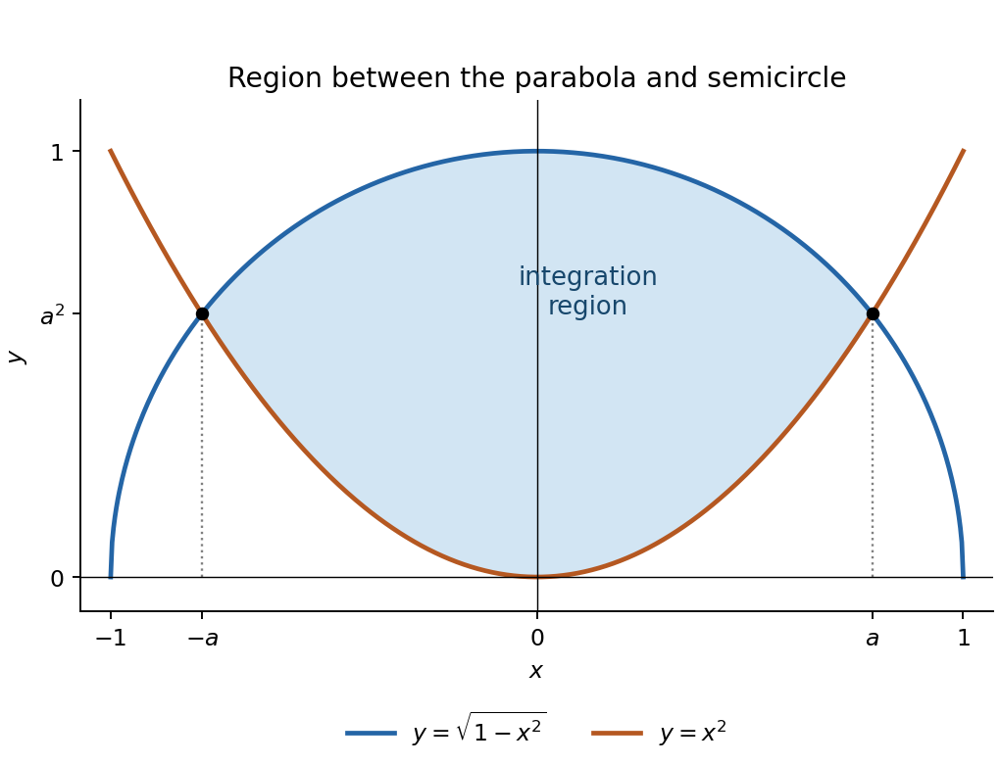

<h1 id="12/b/i/solution">Solution</h1>

↑ **Parent:** [I](../i.md)

The region lies above the [parabola](../../../../../../parabola.md) $y=x^2$ and below the upper semicircle $y=\sqrt{1-x^2}$. Their intersections satisfy $x^4+x^2-1=0$, hence $x=\pm a$ with $a^2=(\sqrt5-1)/2$. In particular, $\sqrt{1-a^2}=a^2$. The region is

$$
\boxed{D=\{(x,y):-a\leq x\leq a,\quad x^2\leq y\leq\sqrt{1-x^2}\}}.
$$

It is symmetric about the $y$ axis, with endpoints $(\pm a,a^2)$; at $x=0$ it extends from $y=0$ to $y=1$.

**[Figure 1](#12/b/i/image-integration-region-between-a-parabola-and-the-upper-unit-semicircle). Integration region between a parabola and the upper unit semicircle**.

## ↑ Ancestors (14)

1. [I](../i.md)
2. [B](../../b.md)
3. [12](../../../12.md)
4. [Paper 2](../../../../paper-2-split.md)
5. [2017](../../../../split.md)
6. [Past exam of the mathematics course of the year 1 of the natural sciences course of the University of Cambridge](../../../../../split.md)
7. [Mathematics course of the year 1 of the natural sciences course of the University of Cambridge](../../../../../../mathematics-course-of-the-year-1-of-the-natural-sciences-course-of-the-university-of-cambridge.md)
8. [Year 1 of the natural sciences course of the University of Cambridge](../../../../../../year-1-of-the-natural-sciences-course-of-the-university-of-cambridge.md)
9. [Year of the natural sciences course of the University of Cambridge](../../../../../../year-of-the-natural-sciences-course-of-the-university-of-cambridge.md)
10. [Natural sciences course of the University of Cambridge](../../../../../../natural-sciences-course-of-the-university-of-cambridge.md)
11. [Course of the University of Cambridge](../../../../../../course-of-the-university-of-cambridge.md)
12. [University of Cambridge](../../../../../../university-of-cambridge-split.md)
13. [List of universities](../../../../../../list-of-universities.md)
14. [Codex Wiki](../../../../../../split.md)
