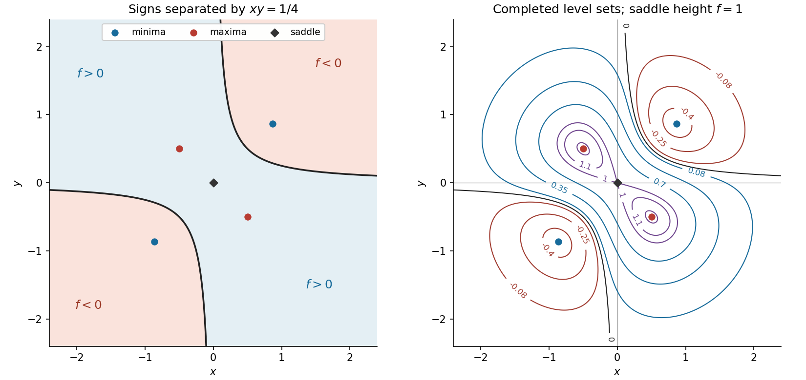

# Paper 1

↑ **Parent:** [2018](../2018.md)

[https://www.maths.cam.ac.uk/undergradnst/files/2018/papernst_ia_1_2018.pdf](https://www.maths.cam.ac.uk/undergradnst/files/2018/papernst_ia_1_2018.pdf)

**Table of contents**

- [1](#1)
  - [a](#1/a)
    - [Solution](#1/a/solution)
  - [b](#1/b)
    - [Solution](#1/b/solution)
- [2](#2)
  - [a](#2/a)
    - [Solution](#2/a/solution)
  - [b](#2/b)
    - [Solution](#2/b/solution)
- [3](#3)
  - [Solution](#3/solution)
- [4](#4)
  - [a](#4/a)
    - [Solution](#4/a/solution)
  - [b](#4/b)
    - [Solution](#4/b/solution)
- [5](#5)
  - [a](#5/a)
    - [Solution](#5/a/solution)
  - [b](#5/b)
    - [Solution](#5/b/solution)
- [6](#6)
  - [a](#6/a)
    - [Solution](#6/a/solution)
  - [b](#6/b)
    - [Solution](#6/b/solution)
- [7](#7)
  - [a](#7/a)
    - [Solution](#7/a/solution)
  - [b](#7/b)
    - [Solution](#7/b/solution)
- [8](#8)
  - [Solution](#8/solution)
- [9](#9)
  - [a](#9/a)
    - [Solution](#9/a/solution)
  - [b](#9/b)
    - [Solution](#9/b/solution)
- [10](#10)
  - [a](#10/a)
    - [Solution](#10/a/solution)
  - [b](#10/b)
    - [Solution](#10/b/solution)
- [11](#11)
  - [a](#11/a)
    - [Solution](#11/a/solution)
  - [b](#11/b)
    - [Solution](#11/b/solution)
  - [c](#11/c)
    - [Solution](#11/c/solution)
- [12](#12)
  - [a](#12/a)
    - [i](#12/a/i)
      - [Solution](#12/a/i/solution)
    - [ii](#12/a/ii)
      - [Solution](#12/a/ii/solution)
    - [iii](#12/a/iii)
      - [Solution](#12/a/iii/solution)
  - [b](#12/b)
    - [i](#12/b/i)
      - [Solution](#12/b/i/solution)
    - [ii](#12/b/ii)
      - [Solution](#12/b/ii/solution)
- [13](#13)
  - [a](#13/a)
    - [Solution](#13/a/solution)
  - [b](#13/b)
    - [Solution](#13/b/solution)
  - [c](#13/c)
    - [Solution](#13/c/solution)
  - [d](#13/d)
    - [Solution](#13/d/solution)
- [14](#14)
  - [a](#14/a)
    - [Solution](#14/a/solution)
  - [b](#14/b)
    - [Solution](#14/b/solution)
  - [c](#14/c)
    - [Solution](#14/c/solution)
  - [d](#14/d)
    - [Solution](#14/d/solution)
  - [e](#14/e)
    - [Solution](#14/e/solution)
- [15](#15)
  - [a](#15/a)
    - [Solution](#15/a/solution)
  - [b](#15/b)
    - [Solution](#15/b/solution)
  - [c](#15/c)
    - [Solution](#15/c/solution)
  - [d](#15/d)
    - [Solution](#15/d/solution)
- [16](#16)
  - [a](#16/a)
    - [Solution](#16/a/solution)
  - [b](#16/b)
    - [Solution](#16/b/solution)
  - [c](#16/c)
    - [Solution](#16/c/solution)
  - [d](#16/d)
    - [Solution](#16/d/solution)
  - [e](#16/e)
    - [Solution](#16/e/solution)
  - [f](#16/f)
    - [Solution](#16/f/solution)
  - [g](#16/g)
    - [Solution](#16/g/solution)
- [17](#17)
  - [a](#17/a)
    - [Solution](#17/a/solution)
  - [b](#17/b)
    - [Solution](#17/b/solution)
  - [c](#17/c)
    - [Solution](#17/c/solution)
- [18](#18)
  - [a](#18/a)
    - [Solution](#18/a/solution)
  - [b](#18/b)
    - [Solution](#18/b/solution)
  - [c](#18/c)
    - [Solution](#18/c/solution)
- [19](#19)
  - [a](#19/a)
    - [i](#19/a/i)
      - [Solution](#19/a/i/solution)
    - [ii](#19/a/ii)
      - [Solution](#19/a/ii/solution)
  - [b](#19/b)
    - [i](#19/b/i)
      - [Solution](#19/b/i/solution)
    - [ii](#19/b/ii)
      - [Solution](#19/b/ii/solution)
- [20](#20)
  - [a](#20/a)
    - [Solution](#20/a/solution)
  - [b](#20/b)
    - [Solution](#20/b/solution)

## 1

↑ **Parent:** [Paper 1](paper-1.md)

<h3 id="1/a">a</h3>

↑ **Parent:** [1](#1)

<h4 id="1/a/solution">Solution</h4>

↑ **Parent:** [A](#1/a)

Take the base-ten [logarithm](../../calculus.md#logarithm) of both positive sides. The [exponentiation](../../arithmetic.md#exponentiation) rule for [logarithms](../../calculus.md#logarithm) gives $x\log_{10}2=y$, hence

$$
\boxed{x=\frac{y}{\log_{10}2}.}
$$

<h3 id="1/b">b</h3>

↑ **Parent:** [1](#1)

<h4 id="1/b/solution">Solution</h4>

↑ **Parent:** [B](#1/b)

Substitution in the logarithmic expression gives $x\simeq23.8/0.301=79.069\ldots$. To two [significant figures](../../numerical-analysis.md#significant-figures),

$$
\boxed{x\simeq79.}
$$

## 2

↑ **Parent:** [Paper 1](paper-1.md)

<h3 id="2/a">a</h3>

↑ **Parent:** [2](#2)

<h4 id="2/a/solution">Solution</h4>

↑ **Parent:** [A](#2/a)

Move the constant term to the left and factor the [cubic polynomial](../../polynomial.md#cubic-polynomial):

$$
2x^3+9x^2-6x-5=(x-1)(2x+1)(x+5).
$$

Setting each factor to zero gives all three [polynomial roots](../../polynomial.md#root-of-a-polynomial):

$$
\boxed{x=1,\quad-\frac12,\quad-5.}
$$

<h3 id="2/b">b</h3>

↑ **Parent:** [2](#2)

<h4 id="2/b/solution">Solution</h4>

↑ **Parent:** [B](#2/b)

The [quadratic formula](../../polynomial.md#quadratic-formula) gives the two [polynomial roots](../../polynomial.md#root-of-a-polynomial) $(-3\pm\sqrt5)/2$. Its leading coefficient is positive, so the [quadratic polynomial](../../polynomial.md#quadratic-polynomial) is strictly negative between them. Therefore

$$
\boxed{\frac{-3-\sqrt5}{2}<x<\frac{-3+\sqrt5}{2}.}
$$

## 3

↑ **Parent:** [Paper 1](paper-1.md)

<h3 id="3/solution">Solution</h3>

↑ **Parent:** [3](#3)

Matching the two [parametric equations](../../geometry-and-topology.md#parametric-equation) at an intersection gives $\cos\phi=-t$ and $\sin\phi=1+t$. The [Pythagorean trigonometric identity](../../geometry-and-topology.md#pythagorean-trigonometric-identity) therefore requires

$$
t^2+(1+t)^2=1,\qquad2t(t+1)=0.
$$

For $t=0$, the [sine](../../geometry-and-topology.md#sine) is one and the [cosine](../../geometry-and-topology.md#cosine) is zero; for $t=-1$, the [cosine](../../geometry-and-topology.md#cosine) is one and the [sine](../../geometry-and-topology.md#sine) is zero. Keeping the stated half-open angular interval gives

$$
\boxed{(t,\phi)=(0,\pi/2)\quad\text{or}\quad(-1,0).}
$$

The corresponding points are $(0,1)$ and $(2,0)$; both satisfy the original [parametric equations](../../geometry-and-topology.md#parametric-equation).

## 4

↑ **Parent:** [Paper 1](paper-1.md)

<h3 id="4/a">a</h3>

↑ **Parent:** [4](#4)

<h4 id="4/a/solution">Solution</h4>

↑ **Parent:** [A](#4/a)

Use [integration by parts](../../calculus.md#integration-by-parts), taking $u=x$ and $dv=\sin3x\,dx$:

$$
\int_0^{\pi/6}x\sin3x\,dx=\left[-\frac x3\cos3x+\frac19\sin3x\right]_0^{\pi/6}
=\boxed{\frac19.}
$$

<h3 id="4/b">b</h3>

↑ **Parent:** [4](#4)

<h4 id="4/b/solution">Solution</h4>

↑ **Parent:** [B](#4/b)

Since $d(\sin^2x)/dx=2\sin x\cos x=\sin2x$, [integration by substitution](../../integral.md#integration-by-substitution) $u=\sin^2x$ immediately gives

$$
\boxed{\int(\sin2x)e^{\sin^2x}\,dx=e^{\sin^2x}+C.}
$$

Here $C$ is an arbitrary [constant of integration](../../integral.md#constant-of-integration).

## 5

↑ **Parent:** [Paper 1](paper-1.md)

<h3 id="5/a">a</h3>

↑ **Parent:** [5](#5)

<h4 id="5/a/solution">Solution</h4>

↑ **Parent:** [A](#5/a)

The two labelled regions in the original diagram are complementary [circular sectors](../../topology.md#circular-sector). Their [areas](../../differential-geometry.md#surface-area) add to $\pi r^2$ and satisfy $A=2B$, so $B=\pi r^2/3$. The sector with central [angle](../../geometry-and-topology.md#angle) $\theta$ has [area](../../differential-geometry.md#surface-area) $r^2\theta/2$. Hence

$$
\boxed{\theta=\frac{2\pi}{3}=120^\circ.}
$$

<h3 id="5/b">b</h3>

↑ **Parent:** [5](#5)

<h4 id="5/b/solution">Solution</h4>

↑ **Parent:** [B](#5/b)

The two radii enclose the [angle](../../geometry-and-topology.md#angle) $2\pi/3$, so the triangle has [area](../../differential-geometry.md#surface-area) $T=\tfrac12r^2\sin(2\pi/3)=\sqrt3r^2/4$. From the sector calculation, $r^2=3B/\pi$. Consequently

$$
\boxed{T=\frac{3\sqrt3}{4\pi}\,B.}
$$

## 6

↑ **Parent:** [Paper 1](paper-1.md)

<h3 id="6/a">a</h3>

↑ **Parent:** [6](#6)

<h4 id="6/a/solution">Solution</h4>

↑ **Parent:** [A](#6/a)

A space diagonal of the unit [cube](../../euclidean-geometry.md#cube) has displacement [vector](../../vector-space.md#vector) $(1,1,1)$. Its Euclidean [norm](../../normed-vector-space.md#norm), or two successive applications of the [Pythagorean theorem](../../euclidean-geometry.md#pythagorean-theorem), gives

$$
\boxed{d=\sqrt{1^2+1^2+1^2}=\sqrt3\text{ units}.}
$$

The requested diagonal joins opposite vertices; $\sqrt2$ would be the diagonal of a face.

<h3 id="6/b">b</h3>

↑ **Parent:** [6](#6)

<h4 id="6/b/solution">Solution</h4>

↑ **Parent:** [B](#6/b)

Choose two distinct space-diagonal directions $\mathbf u=(1,1,1)$ and $\mathbf v=(-1,1,1)$. Their [dot product](../../inner-product.md#dot-product) is one and their [norms](../../normed-vector-space.md#norm) are both $\sqrt3$. Thus the acute [angle](../../geometry-and-topology.md#angle) between their unoriented lines is

$$
\boxed{\theta=\arccos\frac13\simeq70.53^\circ.}
$$

Any two distinct space diagonals have an absolute [dot product](../../inner-product.md#dot-product) of one when represented with components $\pm1$, so they give the same acute [angle](../../geometry-and-topology.md#angle).

## 7

↑ **Parent:** [Paper 1](paper-1.md)

<h3 id="7/a">a</h3>

↑ **Parent:** [7](#7)

<h4 id="7/a/solution">Solution</h4>

↑ **Parent:** [A](#7/a)

The [binomial theorem](../../binomial-coefficient.md#binomial-theorem) gives

$$
(1+0.01)^9=1+9(0.01)+36(0.01)^2+84(0.01)^3+126(0.01)^4+\cdots
=1.093685272\ldots.
$$

Thus, to three decimal places,

$$
\boxed{(1.01)^9\simeq1.094.}
$$

The first three nonconstant terms already determine this rounding; the remaining positive terms total less than $1.3\times10^{-6}$.

<h3 id="7/b">b</h3>

↑ **Parent:** [7](#7)

<h4 id="7/b/solution">Solution</h4>

↑ **Parent:** [B](#7/b)

The initial term at $n=-1$ is three, and the common ratio is $1/3$. The convergent [geometric series](../../sequence-and-series.md#geometric-series) therefore sums to

$$
\boxed{\sum_{n=-1}^{\infty}\left(\frac13\right)^n=\frac3{1-1/3}=\frac92.}
$$

## 8

↑ **Parent:** [Paper 1](paper-1.md)

<h3 id="8/solution">Solution</h3>

↑ **Parent:** [8](#8)

The [product rule](../../calculus.md#product-rule) gives $y'=e^x(\cos x-\sin x)$. The [exponential function](../../calculus.md#exponential-function) never vanishes, so a [stationary point](../../calculus-of-variations.md#stationary-point) requires $\tan x=1$. In the given interval this means $x=\pi/4$. Substitution gives

$$
\boxed{(x,y)=\left(\frac\pi4,\frac{e^{\pi/4}}{\sqrt2}\right).}
$$

The [derivative](../../calculus.md#derivative) changes from positive to negative there, making it a strict [local maximum](../../analysis.md#local-maximum).

## 9

↑ **Parent:** [Paper 1](paper-1.md)

<h3 id="9/a">a</h3>

↑ **Parent:** [9](#9)

<h4 id="9/a/solution">Solution</h4>

↑ **Parent:** [A](#9/a)

Completing the squares gives the standard equation of a [circle](../../topology.md#circle):

$$
\left(x+\frac12\right)^2+(y+1)^2=\frac94.
$$

Its centre is therefore

$$
\boxed{\left(-\frac12,-1\right).}
$$

<h3 id="9/b">b</h3>

↑ **Parent:** [9](#9)

<h4 id="9/b/solution">Solution</h4>

↑ **Parent:** [B](#9/b)

In the completed-square equation, the right side is the squared radius of the [circle](../../topology.md#circle). Taking its positive square root gives

$$
\boxed{r=\frac32.}
$$

## 10

↑ **Parent:** [Paper 1](paper-1.md)

<h3 id="10/a">a</h3>

↑ **Parent:** [10](#10)

<h4 id="10/a/solution">Solution</h4>

↑ **Parent:** [A](#10/a)

Equating the two [polynomials](../../polynomial.md) gives $x^3-3x^2+3x-1=(x-1)^3=0$. Thus the only intersection has $x=1$ and $y=4$:

$$
\boxed{(1,4).}
$$

<h3 id="10/b">b</h3>

↑ **Parent:** [10](#10)

<h4 id="10/b/solution">Solution</h4>

↑ **Parent:** [B](#10/b)

The two [derivatives](../../calculus.md#derivative) are $3x^2+3$ and $6x$, both equal to six at $x=1$. Their common [tangent line](../../calculus.md#tangent-line) through $(1,4)$ is $y-4=6(x-1)$, or $y=6x-2$. Setting $x=0$ gives its intersection with the vertical axis:

$$
\boxed{(0,-2).}
$$

## 11

↑ **Parent:** [Paper 1](paper-1.md)

<h3 id="11/a">a</h3>

↑ **Parent:** [11](#11)

<h4 id="11/a/solution">Solution</h4>

↑ **Parent:** [A](#11/a)

The factor $1+i$ has [modulus](../../complex-analysis.md#modulus) $\sqrt2$ and [principal argument](../../complex-analysis.md#principal-argument) $\pi/4$. Multiplication by $e^{i\pi/6}$ adds $\pi/6$ to its [complex argument](../../complex-analysis.md#argument-complex-analysis), while the real factor $1/2$ halves its [modulus](../../complex-analysis.md#modulus). Hence

$$
\boxed{|z|=\frac1{\sqrt2},\qquad\arg z=\frac{5\pi}{12}+2\pi k\quad(k\in\mathbb Z).}
$$

Taking the [principal logarithm](../../analysis.md#principal-complex-logarithm) for $w$ gives

$$
w=-\frac12\ln2+i\frac{5\pi}{12}.
$$

This [complex number](../../complex-analysis.md#complex-number) lies in the second quadrant. Its [modulus](../../complex-analysis.md#modulus) follows from the sum of squared components, and its [principal argument](../../complex-analysis.md#principal-argument) follows by the second-quadrant correction:

$$
\boxed{|w|=\sqrt{\frac{(\ln2)^2}{4}+\frac{25\pi^2}{144}},\qquad
\operatorname{Arg}w=\pi-\arctan\frac{5\pi}{6\ln2}.}
$$

All arguments of this fixed $w$ add integer multiples of $2\pi$ to the displayed one.

If $\ln z$ is interpreted as the multivalued [complex logarithm](../../analysis.md#complex-logarithm), there is instead a family $w_k=-a+ib_k$, where $a=\tfrac12\ln2>0$ and $b_k=5\pi/12+2\pi k$. Then $|w_k|=\sqrt{a^2+b_k^2}$, and the [principal argument](../../complex-analysis.md#principal-argument) is $\pi-\arctan(b_k/a)$ for $b_k>0$, or $-\pi-\arctan(b_k/a)$ for $b_k<0$. This records the logarithm-branch choice that the paper leaves implicit.

<h3 id="11/b">b</h3>

↑ **Parent:** [11](#11)

<h4 id="11/b/solution">Solution</h4>

↑ **Parent:** [B](#11/b)

Using the exponential definition of [hyperbolic tangent](../../calculus.md#hyperbolic-tangent), set $q=e^{2z}$:

$$
\frac{q-1}{q+1}=-i,\qquad(1+i)q=1-i,\qquad q=-i.
$$

Here $q+1=1-i\ne0$, so the resulting points are not [poles](../../isolated-singularity.md#pole). Taking all values of the [complex logarithm](../../analysis.md#complex-logarithm) gives $2z=i(-\pi/2+2\pi k)$. Thus

$$
\boxed{z=-\frac{i\pi}{4}+i\pi k,\qquad k\in\mathbb Z.}
$$

Equivalently $\tanh(iu)=i\tan u$, so these are exactly the imaginary-axis solutions of $\tan u=-1$.

<h3 id="11/c">c</h3>

↑ **Parent:** [11](#11)

<h4 id="11/c/solution">Solution</h4>

↑ **Parent:** [C](#11/c)

By [De Moivre's theorem](../../analysis.md#de-moivre-s-theorem), $\cos5\theta$ is the [real part](../../complex-analysis.md#real-part) of $(\cos\theta+i\sin\theta)^5$. Writing $c=\cos\theta$ and $s=\sin\theta$, the [binomial theorem](../../binomial-coefficient.md#binomial-theorem) gives

$$
\cos5\theta=c^5-10c^3s^2+5cs^4.
$$

Use the [Pythagorean trigonometric identity](../../geometry-and-topology.md#pythagorean-trigonometric-identity) $s^2=1-c^2$ and expand:

$$
c^5-10c^3(1-c^2)+5c(1-2c^2+c^4)=16c^5-20c^3+5c.
$$

Therefore

$$
\boxed{\cos5\theta=16\cos^5\theta-20\cos^3\theta+5\cos\theta.}
$$

## 12

↑ **Parent:** [Paper 1](paper-1.md)

<h3 id="12/a">a</h3>

↑ **Parent:** [12](#12)

<h4 id="12/a/i">i</h4>

↑ **Parent:** [A](#12/a)

<h5 id="12/a/i/solution">Solution</h5>

↑ **Parent:** [I](#12/a/i)

The region is an unbounded wedge in the first quadrant, lying between the rays $y=x/2$ and $y=x$. Both boundaries and the origin are included. For integration in the opposite order, the same region is $y\ge0$ with $y\le x\le2y$.

**[Figure 1](#12/a/i/image-the-integration-wedge-and-representative-vertical-and-horizontal-slices). The integration wedge and representative vertical and horizontal slices**.

<h4 id="12/a/ii">ii</h4>

↑ **Parent:** [A](#12/a)

<h5 id="12/a/ii/solution">Solution</h5>

↑ **Parent:** [Ii](#12/a/ii)

For fixed $x>0$, integrate first over $y$:

$$
I=\int_0^\infty\left[\int_{x/2}^{x}xe^{-xy}\,dy\right]dx
=\int_0^\infty\left(e^{-x^2/2}-e^{-x^2}\right)dx.
$$

The integrand is nonnegative, so this order of the [double integral](../../integral.md#double-integral) is legitimate even before its finiteness is known. Applying the scaled [Gaussian integral](../../integral.md#gaussian-integral) $\int_0^\infty e^{-ax^2}\,dx=\sqrt\pi/(2\sqrt a)$ yields

$$
\boxed{I=\frac{\sqrt\pi}{2}(\sqrt2-1).}
$$

<h4 id="12/a/iii">iii</h4>

↑ **Parent:** [A](#12/a)

<h5 id="12/a/iii/solution">Solution</h5>

↑ **Parent:** [Iii](#12/a/iii)

Reverse the order in the nonnegative [double integral](../../integral.md#double-integral), using $0\le y<\infty$ and $y\le x\le2y$. For $y>0$, an [antiderivative](../../integral.md#antiderivative) in $x$ is $-(x/y+1/y^2)e^{-xy}$. Thus

$$
I=\int_0^\infty\left[\left(1+\frac1{y^2}\right)e^{-y^2}
-\left(2+\frac1{y^2}\right)e^{-2y^2}\right]dy.
$$

Let $J$ denote the requested [improper integral](../../real-analysis.md#improper-integral). Its numerator is $y^2+O(y^4)$ near zero, so its apparent singularity is removable; it also decays at infinity. We may therefore separate the preceding expression into the convergent integrals

$$
I=\int_0^\infty(e^{-y^2}-2e^{-2y^2})\,dy+J
=\frac{\sqrt\pi}{2}(1-\sqrt2)+J=-I+J.
$$

It follows that

$$
\boxed{J=\int_0^\infty\frac{e^{-x^2}-e^{-2x^2}}{x^2}\,dx=\sqrt\pi(\sqrt2-1).}
$$

The two terms divided separately by $x^2$ would each have a divergent [integral](../../integral.md) at zero; the cancellation in their difference is essential.

<h3 id="12/b">b</h3>

↑ **Parent:** [12](#12)

<h4 id="12/b/i">i</h4>

↑ **Parent:** [B](#12/b)

<h5 id="12/b/i/solution">Solution</h5>

↑ **Parent:** [I](#12/b/i)

Scale the [ellipsoid](../../euclidean-geometry.md#ellipsoid) to a unit [ball](../../topological-analysis.md#ball-mathematics) using

$$
x=ar\sin\theta\cos\phi,\qquad y=br\sin\theta\sin\phi,\qquad z=cr\cos\theta,
$$

with $0\le r\le1$, $0\le\theta\le\pi$ and $0\le\phi<2\pi$. This is [spherical coordinates](../../multivariable-calculus.md#spherical-coordinate-system) followed by a diagonal [linear transformation](../../vector-space.md#linear-map), so the [Jacobian determinant](../../multivariable-calculus.md#jacobian-determinant) is $abc\,r^2\sin\theta$. The required [volume integral](../../multivariable-calculus.md#volume-integral) is

$$
\boxed{V=abc\int_0^{2\pi}\int_0^\pi\int_0^1r^2\sin\theta\,dr\,d\theta\,d\phi
=\frac{4\pi abc}{3}.}
$$

<h4 id="12/b/ii">ii</h4>

↑ **Parent:** [B](#12/b)

<h5 id="12/b/ii/solution">Solution</h5>

↑ **Parent:** [Ii](#12/b/ii)

The [ellipsoid](../../euclidean-geometry.md#ellipsoid) and the exponential factor are invariant under separate reflections of any coordinate. Split the integrand into its two polynomial terms. The term $x^4y^2z$ times that exponential is odd in $z$, so its [volume integral](../../multivariable-calculus.md#volume-integral) vanishes by reflecting $z\mapsto-z$. The other term $xy^2z^4$ times the exponential is odd in $x$, so its [volume integral](../../multivariable-calculus.md#volume-integral) vanishes by reflecting $x\mapsto-x$. Both integrands are continuous on a bounded region. Therefore [odd-integrand cancellation by reflection](../../integral.md#odd-integrand-cancellation-by-reflection) gives

$$
\boxed{\iiint_V(x^4y^2z+xy^2z^4)e^{-(x/a)^2-(y/b)^2-(z/c)^2}\,dx\,dy\,dz=0.}
$$

## 13

↑ **Parent:** [Paper 1](paper-1.md)

<h3 id="13/a">a</h3>

↑ **Parent:** [13](#13)

<h4 id="13/a/solution">Solution</h4>

↑ **Parent:** [A](#13/a)

For $x\ne0$, divide by $x^2$ to obtain $y'+y/x=1/x^2$, a first-order [linear ordinary differential equation](../../linear-ordinary-differential-equation.md). An [integrating factor](../../linear-ordinary-differential-equation.md#integrating-factor) is $x$ on either interval not crossing zero, since the [product rule](../../calculus.md#product-rule) gives

$$
(xy)'=\frac1x.
$$

Integration and division by $x$ give the explicit [general solution](../../linear-ordinary-differential-equation.md#general-solution)

$$
\boxed{y(x)=\frac{\ln|x|+C}{x},\qquad x\ne0.}
$$

The original equation would read $0=1$ at zero, so no solution can include that point.

<h3 id="13/b">b</h3>

↑ **Parent:** [13](#13)

<h4 id="13/b/solution">Solution</h4>

↑ **Parent:** [B](#13/b)

Rewrite the [linear ordinary differential equation](../../linear-ordinary-differential-equation.md) as $y'+y=e^{3x}$. Multiplication by its [integrating factor](../../linear-ordinary-differential-equation.md#integrating-factor) $e^x$ gives $(e^xy)'=e^{4x}$. Integrating yields

$$
\boxed{y(x)=\frac14e^{3x}+Ce^{-x}.}
$$

The [general solution](../../linear-ordinary-differential-equation.md#general-solution) consists of this [particular solution](../../linear-ordinary-differential-equation.md#particular-solution) and the [homogeneous solution](../../linear-ordinary-differential-equation.md#homogeneous-solution) $Ce^{-x}$.

<h3 id="13/c">c</h3>

↑ **Parent:** [13](#13)

<h4 id="13/c/solution">Solution</h4>

↑ **Parent:** [C](#13/c)

The original PDF has $8y^3-4x$ in the denominator and $dy/dx$ on the left. Rearrange it into the [differential form](../../differential-form.md)

$$
(5x+4y)\,dx+(4x-8y^3)\,dy=0.
$$

The cross [partial derivatives](../../multivariable-calculus.md#partial-derivative) of its coefficients are both four, so it is an [exact differential form](../../differential-form.md#exact-differential-form). Integrating its first coefficient in $x$ gives a potential $F=\tfrac52x^2+4xy+h(y)$. Matching $F_y=4x-8y^3$ gives $h(y)=-2y^4$. Therefore an implicit [general solution](../../linear-ordinary-differential-equation.md#general-solution) is

$$
\boxed{\frac52x^2+4xy-2y^4=C.}
$$

Differentiating verifies $y'=(5x+4y)/(8y^3-4x)$. A solution graph is understood only on intervals where its denominator is nonzero; the printed quotient does not define a [derivative](../../calculus.md#derivative) when $8y^3=4x$.

<h3 id="13/d">d</h3>

↑ **Parent:** [13](#13)

<h4 id="13/d/solution">Solution</h4>

↑ **Parent:** [D](#13/d)

For real solutions with $x>0$, the square root requires $y\ge0$. First retain the solution $y\equiv0$, which would be lost by dividing by a square root of $y$.

For $y>0$, use the [homogeneous first-order differential equation](../../differential-equation.md#homogeneous-first-order-differential-equation) substitution $v=\sqrt{y/x}>0$, so $y=xv^2$, $\sqrt{xy}=xv$ and $y'=v^2+2xvv'$. The equation becomes

$$
(1+v)(v^2+2xvv')=v^2,
\qquad\frac{2(1+v)}{v^2}\,dv=-\frac{dx}{x}.
$$

This is now a [separable differential equation](../../differential-equation.md#separable-differential-equation). Integration gives $-2/v+2\ln v=-\ln x+C$. Since $xv^2=y$, the positive solutions satisfy

$$
\boxed{\ln y-2\sqrt{\frac xy}=C\quad(y>0),\qquad\text{together with }y\equiv0.}
$$

The implicit family is sufficient here because only parts (a) and (b) request an explicit expression. It also shows why the nonnegative choice of $v$ matters: $\sqrt{xy}$ denotes the positive square root.

## 14

↑ **Parent:** [Paper 1](paper-1.md)

<h3 id="14/a">a</h3>

↑ **Parent:** [14](#14)

<h4 id="14/a/solution">Solution</h4>

↑ **Parent:** [A](#14/a)

The [exponential function](../../calculus.md#exponential-function) is strictly positive, so the zero [level set](../../topology.md#level-set) is determined entirely by its prefactor:

$$
\boxed{xy=\frac14,\qquad\text{equivalently }y=\frac1{4x}\ (x\ne0).}
$$

This is a rectangular [hyperbola](../../euclidean-geometry.md#hyperbola) with branches in the first and third quadrants.

<h3 id="14/b">b</h3>

↑ **Parent:** [14](#14)

<h4 id="14/b/solution">Solution</h4>

↑ **Parent:** [B](#14/b)

The sign of $f$ is the sign of $1-4xy$. Therefore

$$
\boxed{f>0\text{ when }xy<\frac14,\qquad f<0\text{ when }xy>\frac14.}
$$

The positive region includes both coordinate axes, the second and fourth quadrants, and the portions of the first and third quadrants on the origin side of the [hyperbola](../../euclidean-geometry.md#hyperbola). The two negative regions lie beyond its branches. The left-hand panel shows these regions; its markers locate the [stationary points](../../calculus-of-variations.md#stationary-point) calculated next.

**[Figure 2](#14/b/image-sign-regions-stationary-points-and-completed-contour-map-of-the-gaussian-weighted-function). Sign regions, stationary points and completed contour map of the Gaussian-weighted function**.

<h3 id="14/c">c</h3>

↑ **Parent:** [14](#14)

<h4 id="14/c/solution">Solution</h4>

↑ **Parent:** [C](#14/c)

Set both components of the [gradient](../../multivariable-calculus.md#gradient) to zero. After dividing out the nonzero exponential, they are equivalent to

$$
x(1-4xy)+2y=0,\qquad y(1-4xy)+2x=0.
$$

Adding and subtracting gives $(x+y)(3-4xy)=0$ and $(x-y)(1+4xy)=0$. If $x=y$, the first equation reduces to $x(3-4x^2)=0$, giving the origin and the two diagonal points. If $x=-y$, it reduces to $x(4x^2-1)=0$, giving the origin and the two opposite-diagonal points. The alternative simultaneous values $xy=3/4$ and $xy=-1/4$ are incompatible, so these cases exhaust the possibilities. Thus the five [stationary points](../../calculus-of-variations.md#stationary-point) are

$$
\boxed{(0,0),\quad\left(\frac{\sqrt3}{2},\frac{\sqrt3}{2}\right),\quad\left(-\frac{\sqrt3}{2},-\frac{\sqrt3}{2}\right),\quad
\left(\frac12,-\frac12\right),\quad\left(-\frac12,\frac12\right).}
$$

They are marked in both panels of the figure.

<h3 id="14/d">d</h3>

↑ **Parent:** [14](#14)

<h4 id="14/d/solution">Solution</h4>

↑ **Parent:** [D](#14/d)

Evaluate the [Hessian matrix](../../multivariable-calculus.md#hessian-matrix) at the five [stationary points](../../calculus-of-variations.md#stationary-point). At the origin it is

$$
H(0,0)=\begin{pmatrix}-2&-4\\-4&-2\end{pmatrix},
$$

whose [eigenvalues](../../linear-operator-theory.md#eigenvalue) are $-6$ and $2$, so the origin is a [saddle point](../../analysis.md#saddle-point). At the two points with $x=y=\pm\sqrt3/2$,

$$
H=e^{-3/2}\begin{pmatrix}10&2\\2&10\end{pmatrix},
$$

whose [eigenvalues](../../linear-operator-theory.md#eigenvalue) are $12e^{-3/2}$ and $8e^{-3/2}$. Both are positive, so these are strict [local minima](../../analysis.md#local-minimum). At the two points with $x=-y=\pm1/2$,

$$
H=e^{-1/2}\begin{pmatrix}-6&-2\\-2&-6\end{pmatrix},
$$

whose [eigenvalues](../../linear-operator-theory.md#eigenvalue) are $-8e^{-1/2}$ and $-4e^{-1/2}$. Both are negative, so these are strict [local maxima](../../analysis.md#local-maximum). In summary,

$$
\boxed{(0,0):\text{ saddle};\quad x=y=\pm\sqrt3/2:\text{ minima};\quad x=-y=\pm1/2:\text{ maxima}.}
$$

The quadratic changes along the [orthogonal](../../inner-product.md#orthogonal-vectors) directions $(1,1)$ and $(1,-1)$ also provide a direct justification of these classifications.

<h3 id="14/e">e</h3>

↑ **Parent:** [14](#14)

<h4 id="14/e/solution">Solution</h4>

↑ **Parent:** [E](#14/e)

The completed [contour plot](../../topology.md#contour-plot) is shown in the right-hand panel. Its geometry follows from the symmetries $f(-x,-y)=f(x,y)$ and $f(y,x)=f(x,y)$, together with $f\to0$ as $x^2+y^2\to\infty$. For orientation, the two [local minima](../../analysis.md#local-minimum) have value $-2e^{-3/2}$, the two [local maxima](../../analysis.md#local-maximum) have value $2e^{-1/2}$, and the [saddle point](../../analysis.md#saddle-point) has value one.

Negative [level sets](../../topology.md#level-set) between $-2e^{-3/2}$ and zero form separate closed curves around the two [local minima](../../analysis.md#local-minimum) in the first and third quadrants. Positive [level sets](../../topology.md#level-set) below one form a single closed curve enclosing the origin and both [local maxima](../../analysis.md#local-maximum). At level one, a critical [level set](../../topology.md#level-set) crosses itself at the origin and surrounds the two [local maxima](../../analysis.md#local-maximum) in two lobes. Between one and $2e^{-1/2}$, the [level sets](../../topology.md#level-set) split into separate closed curves around those [local maxima](../../analysis.md#local-maximum). The zero [level set](../../topology.md#level-set) remains the two unbounded branches $xy=1/4$.

Near the origin, the [Taylor expansion](../../calculus.md#taylor-expansion) is $f=1-x^2-4xy-y^2+O((x^2+y^2)^2)$. Consequently the crossing directions at the saddle height satisfy $y=(-2\pm\sqrt3)x$, giving the local shape of the critical [level set](../../topology.md#level-set).

## 15

↑ **Parent:** [Paper 1](paper-1.md)

<h3 id="15/a">a</h3>

↑ **Parent:** [15](#15)

<h4 id="15/a/solution">Solution</h4>

↑ **Parent:** [A](#15/a)

The first $n$ terms of [Taylor's theorem](../../calculus.md#taylor-s-theorem), with the [Taylor remainder](../../calculus.md#taylor-remainder) in mean-value form, are

$$
\boxed{f(x)=\sum_{k=0}^{n-1}\frac{f^{(k)}(a)}{k!}(x-a)^k+R_n(x),\qquad R_n(x)=\frac{f^{(n)}(\xi)}{n!}(x-a)^n,}
$$

where $\xi$ lies between $a$ and $x$ for $x\ne a$. Sufficient hypotheses are continuous [derivatives](../../calculus.md#derivative) through order $n-1$ on the interval between the endpoints and an $n$th [derivative](../../calculus.md#derivative) in its interior. At $x=a$ the remainder is zero. The finite [Taylor polynomial](../../calculus.md#taylor-polynomial) ends at degree $n-1$; this identity does not require convergence of an infinite [Taylor series](../../calculus.md#taylor-series).

<h3 id="15/b">b</h3>

↑ **Parent:** [15](#15)

<h4 id="15/b/solution">Solution</h4>

↑ **Parent:** [B](#15/b)

Since $a_0=f(0)\ne0$, write $1/f(x)=b_0+b_1x+b_2x^2+O(x^3)$ and multiply the two [power series](../../sequence-and-series.md#power-series). Equating coefficients with the identity $f(x)/f(x)=1$ gives

$$
a_0b_0=1,\qquad a_0b_1+a_1b_0=0,\qquad a_0b_2+a_1b_1+a_2b_0=0.
$$

Solving successively yields

$$
\boxed{\frac1{f(x)}=\frac1{a_0}-\frac{a_1}{a_0^2}x+\frac{a_1^2-a_0a_2}{a_0^3}x^2+O(x^3).}
$$

These are the constant, linear and quadratic terms; particular coefficients may vanish. For a convergent [power series](../../sequence-and-series.md#power-series) defining $f$ near zero, continuity and $a_0\ne0$ ensure its reciprocal is also defined in a neighborhood of zero.

<h3 id="15/c">c</h3>

↑ **Parent:** [15](#15)

<h4 id="15/c/solution">Solution</h4>

↑ **Parent:** [C](#15/c)

Multiply the [Maclaurin series](../../calculus.md#maclaurin-series) of [hyperbolic cosine](../../calculus.md#hyperbolic-cosine) by the [binomial series](../../sequence-and-series.md#binomial-series) for the reciprocal square root:

$$
\cosh x=1+\frac{x^2}{2}+\frac{x^4}{24}+O(x^6),\qquad
(1+x^2)^{-1/2}=1-\frac{x^2}{2}+\frac{3x^4}{8}+O(x^6).
$$

The quadratic terms cancel, while the quartic coefficient is $1/24-1/4+3/8=1/6$. Hence

$$
\boxed{\frac{\cosh x}{\sqrt{1+x^2}}=1+\frac{x^4}{6}+O(x^6).}
$$

The absence of odd powers follows from the function's even symmetry.

<h3 id="15/d">d</h3>

↑ **Parent:** [15](#15)

<h4 id="15/d/solution">Solution</h4>

↑ **Parent:** [D](#15/d)

Combine the [logarithms](../../calculus.md#logarithm) first and factor out the limiting constant:

$$
\ln(1+x+2x^2)-\ln x^2=\ln\left(2+\frac1x+\frac1{x^2}\right)
=\ln2+\ln\left(1+\frac1{2x}+\frac1{2x^2}\right).
$$

Apply the [Taylor expansion](../../calculus.md#taylor-expansion) $\ln(1+u)=u-u^2/2+O(u^3)$ with $u=1/(2x)+1/(2x^2)$. The first three nonzero terms, including the constant, are

$$
\boxed{\ln(1+x+2x^2)-\ln x^2=\ln2+\frac1{2x}+\frac3{8x^2}+O(x^{-3}),\qquad x\to\infty.}
$$

This is an [asymptotic expansion](../../asymptotic-expansion.md) in reciprocal powers of $x$.

## 16

↑ **Parent:** [Paper 1](paper-1.md)

<h3 id="16/a">a</h3>

↑ **Parent:** [16](#16)

<h4 id="16/a/solution">Solution</h4>

↑ **Parent:** [A](#16/a)

The [slope](../../euclidean-geometry.md#slope) of the particle's straight trajectory is $\tan\theta_i=y_i/x_0$, so

$$
\boxed{y_i=x_0\tan\theta_i.}
$$

The endpoint directions $\pm\pi/2$ are parallel to the screen and do not give finite collisions, but each has zero [probability](../../probability-theory.md#probability) in the continuous angular model. The relation therefore holds [almost surely](../../convergence-of-random-variables.md#almost-sure-convergence).

<h3 id="16/b">b</h3>

↑ **Parent:** [16](#16)

<h4 id="16/b/solution">Solution</h4>

↑ **Parent:** [B](#16/b)

The angular interval has width $\pi$, so its [continuous uniform distribution](../../continuous-probability-distribution.md#continuous-uniform-distribution) has [probability density function](../../continuous-probability-distribution.md#probability-density-function)

$$
\boxed{g(\theta)=\begin{cases}1/\pi,&-\pi/2<\theta<\pi/2,\\0,&\text{otherwise}.
\end{cases}}
$$

Integrating this [probability density function](../../continuous-probability-distribution.md#probability-density-function) gives the [cumulative distribution function](../../probability-distribution.md#cumulative-distribution-function)

$$
\boxed{G(\theta)=\begin{cases}0,&\theta\le-\pi/2,\\\frac12+\theta/\pi,&-\pi/2<\theta<\pi/2,\\1,&\theta\ge\pi/2.\end{cases}}
$$

Values of the [probability density function](../../continuous-probability-distribution.md#probability-density-function) at the two individual endpoints may be assigned arbitrarily without changing any [probability](../../probability-theory.md#probability).

<h3 id="16/c">c</h3>

↑ **Parent:** [16](#16)

<h4 id="16/c/solution">Solution</h4>

↑ **Parent:** [C](#16/c)

The [tangent function](../../geometry-and-topology.md#tangent-function) is strictly increasing on the angular interval. Thus $Y\le y$ is equivalent, up to the zero-probability endpoints, to $\Theta\le\arctan(y/x_0)$. Substituting into the angular [cumulative distribution function](../../probability-distribution.md#cumulative-distribution-function) gives

$$
\boxed{F(y)=\frac12+\frac1\pi\arctan\frac y{x_0},\qquad-\infty<y<\infty.}
$$

Its [limits](../../calculus.md#limit-of-a-function) are zero and one at the two infinite endpoints. This is the construction in which the [tangent of a uniform angle has a Cauchy distribution](../../probability-distribution.md#tangent-of-a-uniform-angle-has-a-cauchy-distribution).

<h3 id="16/d">d</h3>

↑ **Parent:** [16](#16)

<h4 id="16/d/solution">Solution</h4>

↑ **Parent:** [D](#16/d)

Differentiate the [cumulative distribution function](../../probability-distribution.md#cumulative-distribution-function) using the [chain rule](../../calculus.md#chain-rule):

$$
\boxed{f(y)=F'(y)=\frac1{\pi x_0}\frac1{1+(y/x_0)^2}=\frac{x_0}{\pi(x_0^2+y^2)}.}
$$

This is a [Cauchy distribution](../../probability-distribution.md#cauchy-distribution) with location zero and scale $x_0$. The [probability density function](../../continuous-probability-distribution.md#probability-density-function) is nonnegative and integrates to $F(\infty)-F(-\infty)=1$.

<h3 id="16/e">e</h3>

↑ **Parent:** [16](#16)

<h4 id="16/e/solution">Solution</h4>

↑ **Parent:** [E](#16/e)

The [expected value](../../expected-value.md) is not defined: the integral of $yf(y)$ over the positive half-line diverges logarithmically to $+\infty$, and the negative half-line gives $-\infty$. In particular, symmetry alone does not supply a mean. More explicitly,

$$
\int_0^R yf(y)\,dy=\frac{x_0}{2\pi}\ln\left(1+\frac{R^2}{x_0^2}\right)\longrightarrow\infty.
$$

The second [moment](../../expected-value.md#moment) also diverges because $y^2f(y)\to x_0/\pi>0$ as $|y|\to\infty$. Thus

$$
\boxed{\text{the mean, variance and standard deviation are undefined}.}
$$

The symmetric [Cauchy principal value](../../complex-analysis.md#cauchy-principal-value) of the first-moment integral is zero, but it is not an [expected value](../../expected-value.md) and does not define a [variance](../../variance.md).

<h3 id="16/f">f</h3>

↑ **Parent:** [16](#16)

<h4 id="16/f/solution">Solution</h4>

↑ **Parent:** [F](#16/f)

The new angular interval has width $\pi/2$, so its [probability density function](../../continuous-probability-distribution.md#probability-density-function) is $2/\pi$ there. Its endpoints stay away from the [poles](../../isolated-singularity.md#pole) of the [tangent function](../../geometry-and-topology.md#tangent-function), making $Y$ bounded and its [expected value](../../expected-value.md) finite. Integrate over the [continuous uniform distribution](../../continuous-probability-distribution.md#continuous-uniform-distribution) of angles:

$$
E[Y]=\frac{2x_0}{\pi}\int_{-\pi/6}^{\pi/3}\tan\theta\,d\theta
=\frac{2x_0}{\pi}[-\ln(\cos\theta)]_{-\pi/6}^{\pi/3}.
$$

The two [cosines](../../geometry-and-topology.md#cosine) are $\sqrt3/2$ and $1/2$. Hence

$$
\boxed{E[Y]=\frac{2x_0}{\pi}\ln\sqrt3=\frac{x_0\ln3}{\pi}.}
$$

It has units of [length](../../physics.md#length) and is positive because the permitted positive angles extend farther than the negative ones.

<h3 id="16/g">g</h3>

↑ **Parent:** [16](#16)

<h4 id="16/g/solution">Solution</h4>

↑ **Parent:** [G](#16/g)

The $i$th screen distance is $x_0/2^i$, starting at $i=1$. The previous [expected value](../../expected-value.md) therefore scales to $E[Y_i]=x_0\ln3/(\pi2^i)$. To justify the infinite [linearity of expectation](../../expected-value.md#linearity-of-expectation), note that $|\tan\theta_i|\le\sqrt3$ throughout the restricted angular interval. Thus

$$
\sum_{i=1}^\infty|Y_i|\le\sqrt3x_0\sum_{i=1}^\infty2^{-i}=\sqrt3x_0.
$$

This deterministic integrable bound justifies the [expectation of an absolutely summable random series](../../expected-value.md#expectation-of-an-absolutely-summable-random-series), even without assuming independent firing angles. Summing the [geometric series](../../sequence-and-series.md#geometric-series) gives

$$
\boxed{E\left[\sum_{i=1}^\infty Y_i\right]=\frac{x_0\ln3}{\pi}\sum_{i=1}^\infty2^{-i}=\frac{x_0\ln3}{\pi}.}
$$

## 17

↑ **Parent:** [Paper 1](paper-1.md)

<h3 id="17/a">a</h3>

↑ **Parent:** [17](#17)

<h4 id="17/a/solution">Solution</h4>

↑ **Parent:** [A](#17/a)

Use [integration by substitution](../../integral.md#integration-by-substitution) $t=\tan x$, so $dt=dx/\cos^2x$. The [indefinite integral](../../integral.md#antiderivative) becomes $\int dt/[t(t^2-1)]$. Its [partial fraction decomposition](../../isolated-singularity.md#partial-fraction-decomposition) is

$$
\frac1{t(t^2-1)}=-\frac1t+\frac12\frac1{t-1}+\frac12\frac1{t+1}.
$$

Integrating gives $-\ln|t|+\tfrac12\ln|t^2-1|+C$. Hence

$$
\boxed{\int\frac{dx}{\cos^2x(\tan^3x-\tan x)}=\frac12\ln\left|1-\frac1{\tan^2x}\right|+C.}
$$

The formula applies on each interval where the printed integrand is defined: $\cos x\ne0$ and $\tan x\notin\{0,1,-1\}$. The [constant of integration](../../integral.md#constant-of-integration) may differ between such intervals.

<h3 id="17/b">b</h3>

↑ **Parent:** [17](#17)

<h4 id="17/b/solution">Solution</h4>

↑ **Parent:** [B](#17/b)

For $n>1$, [integration by parts](../../calculus.md#integration-by-parts) with $u=x^{n-1}$ and $dv=e^{-x}\,dx$ yields

$$
I_n=[-x^{n-1}e^{-x}]_0^\infty+(n-1)\int_0^\infty x^{n-2}e^{-x}\,dx=(n-1)I_{n-1}.
$$

The boundary term vanishes at zero because $n-1>0$, and at infinity because exponential decay dominates every fixed power. The initial [improper integral](../../real-analysis.md#improper-integral) is $I_1=\int_0^\infty e^{-x}\,dx=1$. Iterating the [recurrence relation](../../sequence-and-series.md#recurrence-relation) therefore gives

$$
\boxed{I_n=(n-1)(n-2)\cdots1\,I_1=(n-1)!,\qquad n\ge1.}
$$

This is the positive-integer case of the [Gamma function](../../complex-analysis.md#gamma-function) identity $\Gamma(n)=(n-1)!$.

<h3 id="17/c">c</h3>

↑ **Parent:** [17](#17)

<h4 id="17/c/solution">Solution</h4>

↑ **Parent:** [C](#17/c)

Differentiate $x/(1+x^2)^n$ and integrate between zero and infinity. Its boundary values vanish for every integer $n\ge1$, giving

$$
0=\int_0^\infty\left[\frac1{(1+x^2)^n}-\frac{2nx^2}{(1+x^2)^{n+1}}\right]dx.
$$

Since $x^2/(1+x^2)^{n+1}=(1+x^2)^{-n}-(1+x^2)^{-n-1}$, this becomes $0=E_n-2n(E_n-E_{n+1})$. Hence the [recurrence relation](../../sequence-and-series.md#recurrence-relation) is

$$
\boxed{E_{n+1}=\frac{2n-1}{2n}E_n.}
$$

The starting value is $E_1=[\arctan x]_0^\infty=\pi/2$. Therefore $E_2=\pi/4$, $E_3=3\pi/16$, and

$$
\boxed{\int_0^\infty\frac{dx}{(1+x^2)^4}=E_4=\frac56\frac34\frac12\frac\pi2=\frac{5\pi}{32}.}
$$

These are also [Wallis integrals](../../integral.md#wallis-integrals) after the [integration by substitution](../../integral.md#integration-by-substitution) $x=\tan t$.

## 18

↑ **Parent:** [Paper 1](paper-1.md)

<h3 id="18/a">a</h3>

↑ **Parent:** [18](#18)

<h4 id="18/a/solution">Solution</h4>

↑ **Parent:** [A](#18/a)

The middle row is $-1/2$ times the sum of the first and third rows, so the rows are linearly dependent and the [determinant](../../multilinear-algebra.md#determinant) is zero. The [matrix trace](../../linear-algebra.md#matrix-trace) is the sum of diagonal entries, $1+4+1=6$. A [transpose](../../vector-space.md#transpose) preserves the [determinant](../../multilinear-algebra.md#determinant), while the [determinant](../../multilinear-algebra.md#determinant) of a product is the product of its [determinants](../../multilinear-algebra.md#determinant). Consequently

$$
\boxed{\det A=0,\quad\operatorname{Tr}A=6,\quad\det(A^{\mathsf T})=0,\quad\det(A^2)=0.}
$$

<h3 id="18/b">b</h3>

↑ **Parent:** [18](#18)

<h4 id="18/b/solution">Solution</h4>

↑ **Parent:** [B](#18/b)

The [matrix](../../vector-space.md#matrix) is symmetric under interchange of the first and third coordinates. For an antisymmetric [vector](../../vector-space.md#vector) $(1,0,-1)$, direct multiplication gives $A(1,0,-1)^{\mathsf T}=-6(1,0,-1)^{\mathsf T}$. For a symmetric [vector](../../vector-space.md#vector) $(p,q,p)$, the [linear transformation](../../vector-space.md#linear-map) reduces to

$$
\begin{pmatrix}p\\q\end{pmatrix}\longmapsto\begin{pmatrix}8&-4\\-8&4\end{pmatrix}\begin{pmatrix}p\\q\end{pmatrix}.
$$

The reduced [characteristic polynomial](../../linear-operator-theory.md#characteristic-polynomial) is $\lambda(\lambda-12)$. At $\lambda=0$, its equations give $q=2p$; at $\lambda=12$, they give $q=-p$. Normalizing the three [eigenvectors](../../linear-operator-theory.md#eigenvector) gives

$$
\boxed{\begin{aligned}
\lambda=-6:&\quad\mathbf v_-=(1,0,-1)^{\mathsf T}/\sqrt2,\\
\lambda=0:&\quad\mathbf v_0=(1,2,1)^{\mathsf T}/\sqrt6,\\
\lambda=12:&\quad\mathbf v_+=(1,-1,1)^{\mathsf T}/\sqrt3.
\end{aligned}}
$$

Their [norms](../../normed-vector-space.md#norm) are one. Their unnormalized pairwise [dot products](../../inner-product.md#dot-product) are $1-1=0$, $1-1=0$ and $1-2+1=0$, proving mutual [orthogonality](../../inner-product.md#orthogonal-vectors). The [eigenvalues](../../linear-operator-theory.md#eigenvalue) sum to six and have product zero, agreeing with the [matrix trace](../../linear-algebra.md#matrix-trace) and [determinant](../../multilinear-algebra.md#determinant) from part (a).

<h3 id="18/c">c</h3>

↑ **Parent:** [18](#18)

<h4 id="18/c/solution">Solution</h4>

↑ **Parent:** [C](#18/c)

The three [eigenvectors](../../linear-operator-theory.md#eigenvector) form an [orthonormal basis](../../inner-product.md#orthonormal-basis), so an arbitrary [vector](../../vector-space.md#vector) has expansion $\mathbf r=a\mathbf v_-+b\mathbf v_0+c\mathbf v_+$. Multiplication by $A$ removes the zero-eigenvalue component:

$$
A\mathbf r=-6a\mathbf v_-+12c\mathbf v_+.
$$

Its [dot product](../../inner-product.md#dot-product) with $\mathbf v_0$ is zero for every $a,b,c$. Thus one convenient answer is the nonzero [vector](../../vector-space.md#vector)

$$
\boxed{\mathbf u=(1,2,1)^{\mathsf T}.}
$$

Equivalently, $A^{\mathsf T}\mathbf u=A\mathbf u=0$, so $(A\mathbf r)\cdot\mathbf u=\mathbf r\cdot(A^{\mathsf T}\mathbf u)=0$. Any nonzero scalar multiple of this [vector](../../vector-space.md#vector) in the [null space](../../kernel-of-a-linear-map.md) also works.

## 19

↑ **Parent:** [Paper 1](paper-1.md)

<h3 id="19/a">a</h3>

↑ **Parent:** [19](#19)

<h4 id="19/a/i">i</h4>

↑ **Parent:** [A](#19/a)

<h5 id="19/a/i/solution">Solution</h5>

↑ **Parent:** [I](#19/a/i)

For statement (1), [continuity](../../calculus.md#continuous-function) at the interior point means

$$
\boxed{\lim_{x\to x_0}f(x)=f(x_0).}
$$

Explicitly, for every $\varepsilon>0$ there exists $\delta>0$ such that $|x-x_0|<\delta$ implies $|f(x)-f(x_0)|<\varepsilon$ for points in the domain. This is the [epsilon-delta definition of continuity](../../calculus.md#epsilon-delta-definition-of-continuity).

For statement (2), [differentiability](../../analysis.md#differentiability) means the two-sided difference quotient has a finite [limit](../../calculus.md#limit-of-a-function):

$$
\boxed{f'(x_0)=\lim_{h\to0}\frac{f(x_0+h)-f(x_0)}h\in\mathbb R.}
$$

The same finite value must be obtained from positive and negative $h$. [Differentiability](../../analysis.md#differentiability) implies [continuity](../../calculus.md#continuous-function), whereas the converse need not hold.

<h4 id="19/a/ii">ii</h4>

↑ **Parent:** [A](#19/a)

<h5 id="19/a/ii/solution">Solution</h5>

↑ **Parent:** [Ii](#19/a/ii)

For $m=0$, [continuity](../../calculus.md#continuous-function) fails. Take $x_k=(\pi/2+2\pi k)^{-1}$ and $\widetilde x_k=(3\pi/2+2\pi k)^{-1}$. Both tend to zero, but the corresponding function values are $1$ and $-1$. Thus there is no [limit](../../calculus.md#limit-of-a-function), and the function is not [differentiable](../../analysis.md#differentiable-function) either, since [differentiability](../../analysis.md#differentiability) would imply [continuity](../../calculus.md#continuous-function).

For $m=1$, the bound $|x\sin(1/x)|\le|x|$ and the [squeeze theorem](../../calculus.md#squeeze-theorem) give [continuity](../../calculus.md#continuous-function) at zero. Its difference quotient is $\sin(1/h)$, however, which has no [limit](../../calculus.md#limit-of-a-function) by the same two sequences. It is therefore not [differentiable](../../analysis.md#differentiable-function) there.

For $m=2$, the bound $|x^2\sin(1/x)|\le x^2$ proves [continuity](../../calculus.md#continuous-function). Its difference quotient is $h\sin(1/h)$, whose absolute value is bounded by $|h|$, so the [derivative](../../calculus.md#derivative) exists and equals zero. The complete classification is

$$
\boxed{\begin{array}{c|c|c}m&\text{continuous at }0&\text{differentiable at }0\\\hline0&\text{no}&\text{no}\\1&\text{yes}&\text{no}\\2&\text{yes}&\text{yes, }f_2'(0)=0\end{array}.}
$$

<h3 id="19/b">b</h3>

↑ **Parent:** [19](#19)

<h4 id="19/b/i">i</h4>

↑ **Parent:** [B](#19/b)

<h5 id="19/b/i/solution">Solution</h5>

↑ **Parent:** [I](#19/b/i)

For the positive terms $a_n=n!/2^n$, the ratio is $a_{n+1}/a_n=(n+1)/2\to\infty$. The [ratio test](../../sequence-and-series.md#ratio-test) therefore gives divergence. More directly, the terms increase by a factor at least two for all $n\ge3$, so they fail the necessary [term test for divergence](../../sequence-and-series.md#term-test-for-divergence) condition $a_n\to0$. Hence

$$
\boxed{\sum_{n=1}^\infty\frac{n!}{2^n}\text{ diverges to }+\infty.}
$$

<h4 id="19/b/ii">ii</h4>

↑ **Parent:** [B](#19/b)

<h5 id="19/b/ii/solution">Solution</h5>

↑ **Parent:** [Ii](#19/b/ii)

Rationalize the positive difference:

$$
\sqrt{n^4+a^2}-n^2=\frac{a^2}{\sqrt{n^4+a^2}+n^2}.
$$

Since the denominator is at least $2n^2$,

$$
0<\sqrt{n^4+a^2}-n^2\le\frac{a^2}{2n^2}.
$$

The upper bound is a constant multiple of the convergent [p-series](../../sequence-and-series.md#p-series) with exponent two. The [comparison test](../../sequence-and-series.md#direct-comparison-test) therefore proves

$$
\boxed{\sum_{n=1}^\infty\left(\sqrt{n^4+a^2}-n^2\right)\text{ converges for every fixed }a>0.}
$$

The [asymptotic equivalence](../../real-analysis.md#asymptotic-equivalence) of its summand to $a^2/(2n^2)$ gives the same conclusion by [limit comparison test](../../sequence-and-series.md#limit-comparison-test).

## 20

↑ **Parent:** [Paper 1](paper-1.md)

<h3 id="20/a">a</h3>

↑ **Parent:** [20](#20)

<h4 id="20/a/solution">Solution</h4>

↑ **Parent:** [A](#20/a)

For $\alpha\ne0$, [integration by substitution](../../integral.md#integration-by-substitution) $t=\alpha x$ gives

$$
I(\alpha)=\int_0^1\frac{dx}{1+\alpha^2x^2}=\boxed{\frac{\arctan\alpha}{\alpha}.}
$$

At $\alpha=0$ the integrand is one, so $I(0)=1$, also the continuous [limit](../../calculus.md#limit-of-a-function) of this expression. For nonzero $\alpha$, [differentiation under the integral sign](../../analysis.md#differentiation-under-the-integral-sign) is valid on the finite interval and yields

$$
I'(\alpha)=-2\alpha\int_0^1\frac{x^2}{(1+\alpha^2x^2)^2}\,dx
=\frac{\alpha/(1+\alpha^2)-\arctan\alpha}{\alpha^2}.
$$

Set $\alpha=\sqrt3$ and use $\arctan\sqrt3=\pi/3$. The requested value is

$$
\boxed{\int_0^1\frac{x^2}{(1+3x^2)^2}\,dx=-\frac{I'(\sqrt3)}{2\sqrt3}
=\frac{\pi}{18\sqrt3}-\frac1{24}=\frac{\pi\sqrt3}{54}-\frac1{24}.}
$$

<h3 id="20/b">b</h3>

↑ **Parent:** [20](#20)

<h4 id="20/b/solution">Solution</h4>

↑ **Parent:** [B](#20/b)

The stated derivative formula needs a domain qualification. The original PDF calls $\alpha$ real, but the integral is even in $\alpha$; its derivative therefore cannot equal the printed positive expression on both sides of zero.

First take $\alpha>0$. The [improper integral](../../real-analysis.md#improper-integral) converges, with an $O(x^2)$ integrand near zero and $O(\ln x/x^2)$ decay at infinity. On compact positive parameter intervals, an integrable bound also justifies [differentiation under the integral sign](../../analysis.md#differentiation-under-the-integral-sign):

$$
E'(\alpha)=\int_0^\infty\frac{2\alpha x^2}{(1+\alpha^2x^2)(1+x^2)}\,dx.
$$

For $\alpha\ne1$, the [partial fraction decomposition](../../isolated-singularity.md#partial-fraction-decomposition) is

$$
\frac{x^2}{(1+\alpha^2x^2)(1+x^2)}
=\frac1{\alpha^2-1}\left(\frac1{1+x^2}-\frac1{1+\alpha^2x^2}\right).
$$

Integrating the rational functions gives

$$
E'(\alpha)=\frac{2\alpha}{\alpha^2-1}\left(\frac\pi2-\frac\pi{2\alpha}\right)
=\boxed{\frac\pi{1+\alpha}\quad(\alpha>0).}
$$

At $\alpha=1$, the same result follows by continuity, or directly from $2\int_0^\infty x^2/(1+x^2)^2\,dx=\pi/2$.

Integrating gives $E(\alpha)=\pi\ln(1+\alpha)+C$ on the positive half-line. To fix $C$, take $\alpha\to0^+$: for $0\le\alpha\le1$ the integrand is bounded by $\ln(1+x^2)/(1+x^2)$, an integrable function. The [dominated convergence theorem](../../measure-theory.md#dominated-convergence-theorem) gives $E(\alpha)\to E(0)=0$, so $C=0$. Evenness then extends the [logarithmic parameter integral with Cauchy weight](../../analysis.md#logarithmic-parameter-integral-with-cauchy-weight) to its full stated domain:

$$
\boxed{E(\alpha)=\pi\ln(1+|\alpha|)\quad(\alpha\in\mathbb R).}
$$

For negative $\alpha$, the derivative is $-\pi/(1-\alpha)$. At zero the right and left [derivatives](../../calculus.md#derivative) are $\pi$ and $-\pi$, so $E$ is not [differentiable](../../analysis.md#differentiable-function) there. The pointwise derivative of the integrand at zero is zero, but interchanging it with the infinite [integral](../../integral.md) at that parameter is invalid. Finally, substituting $\alpha=1$ gives the requested special value

$$
\boxed{\int_0^\infty\frac{\ln(1+x^2)}{1+x^2}\,dx=\pi\ln2.}
$$

## ↑ Ancestors (10)

1. [2018](../2018.md)
2. [Past exam of the mathematics course of the year 1 of the natural sciences course of the University of Cambridge](../../past-exam-of-the-mathematics-course-of-the-year-1-of-the-natural-sciences-course-of-the-university-of-cambridge.md)
3. [Mathematics course of the year 1 of the natural sciences course of the University of Cambridge](../../university-of-cambridge.md#mathematics-course-of-the-year-1-of-the-natural-sciences-course-of-the-university-of-cambridge)
4. [Year 1 of the natural sciences course of the University of Cambridge](../../university-of-cambridge.md#year-1-of-the-natural-sciences-course-of-the-university-of-cambridge)
5. [Year of the natural sciences course of the University of Cambridge](../../university-of-cambridge.md#year-of-the-natural-sciences-course-of-the-university-of-cambridge)
6. [Natural sciences course of the University of Cambridge](../../university-of-cambridge.md#natural-sciences-course-of-the-university-of-cambridge)
7. [Course of the University of Cambridge](../../university-of-cambridge.md#course-of-the-university-of-cambridge)
8. [University of Cambridge](../../university-of-cambridge.md)
9. [List of universities](../../README.md#list-of-universities)
10. [Codex Wiki](../../README.md)
