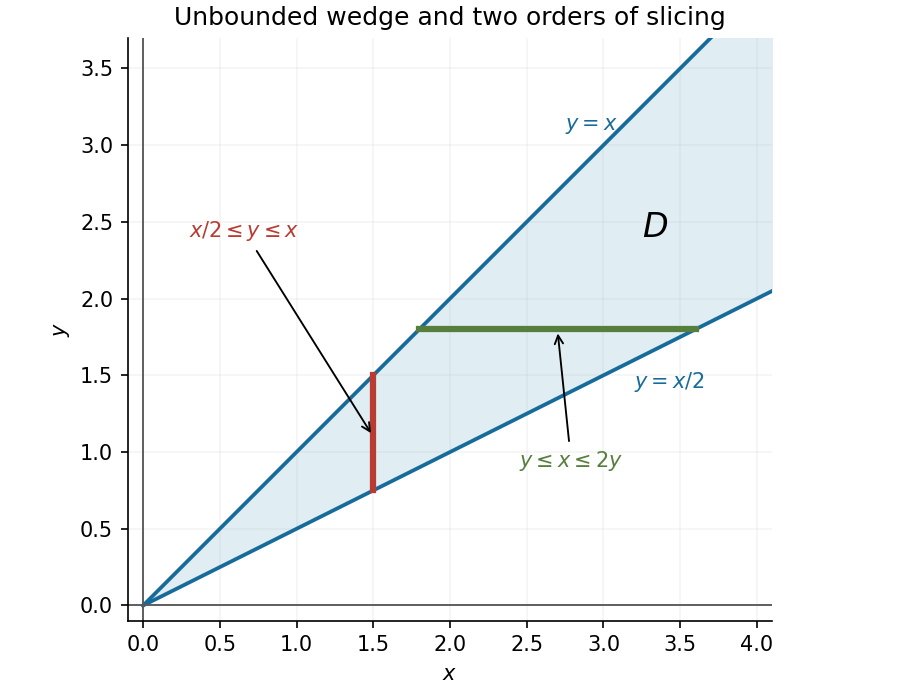

<h1 id="12/a/i/solution">Solution</h1>

↑ **Parent:** [I](../i.md)

The region is an unbounded wedge in the first quadrant, lying between the rays $y=x/2$ and $y=x$. Both boundaries and the origin are included. For integration in the opposite order, the same region is $y\ge0$ with $y\le x\le2y$.

**[Figure 1](#12/a/i/image-the-integration-wedge-and-representative-vertical-and-horizontal-slices). The integration wedge and representative vertical and horizontal slices**.

## ↑ Ancestors (14)

1. [I](../i.md)
2. [A](../../a.md)
3. [12](../../../12.md)
4. [Paper 1](../../../../paper-1-split.md)
5. [2018](../../../../split.md)
6. [Past exam of the mathematics course of the year 1 of the natural sciences course of the University of Cambridge](../../../../../split.md)
7. [Mathematics course of the year 1 of the natural sciences course of the University of Cambridge](../../../../../../mathematics-course-of-the-year-1-of-the-natural-sciences-course-of-the-university-of-cambridge.md)
8. [Year 1 of the natural sciences course of the University of Cambridge](../../../../../../year-1-of-the-natural-sciences-course-of-the-university-of-cambridge.md)
9. [Year of the natural sciences course of the University of Cambridge](../../../../../../year-of-the-natural-sciences-course-of-the-university-of-cambridge.md)
10. [Natural sciences course of the University of Cambridge](../../../../../../natural-sciences-course-of-the-university-of-cambridge.md)
11. [Course of the University of Cambridge](../../../../../../course-of-the-university-of-cambridge.md)
12. [University of Cambridge](../../../../../../university-of-cambridge-split.md)
13. [List of universities](../../../../../../list-of-universities.md)
14. [Codex Wiki](../../../../../../split.md)
