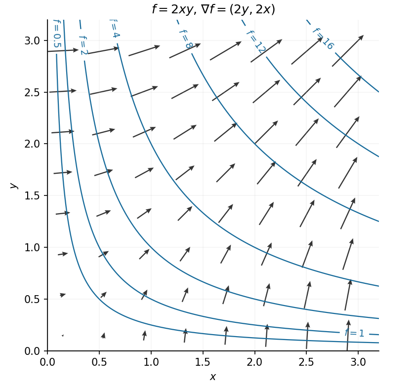
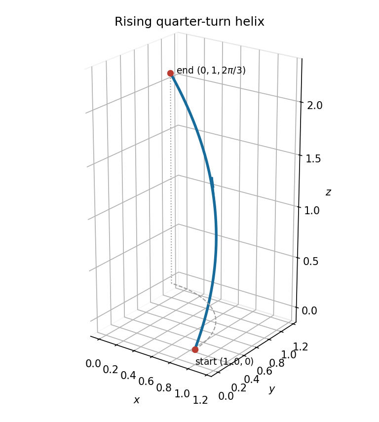

# Paper 2

↑ **Parent:** [2018](../2018.md)

[https://www.maths.cam.ac.uk/undergradnst/files/2018/papernst_ia_2_2018.pdf](https://www.maths.cam.ac.uk/undergradnst/files/2018/papernst_ia_2_2018.pdf)

**Table of contents**

- [1](#1)
  - [a](#1/a)
    - [Solution](#1/a/solution)
  - [b](#1/b)
    - [Solution](#1/b/solution)
- [2](#2)
  - [Solution](#2/solution)
- [3](#3)
  - [Solution](#3/solution)
- [4](#4)
  - [Solution](#4/solution)
- [5](#5)
  - [Solution](#5/solution)
- [6](#6)
  - [a](#6/a)
    - [Solution](#6/a/solution)
  - [b](#6/b)
    - [Solution](#6/b/solution)
- [7](#7)
  - [a](#7/a)
    - [Solution](#7/a/solution)
  - [b](#7/b)
    - [Solution](#7/b/solution)
- [8](#8)
  - [a](#8/a)
    - [Solution](#8/a/solution)
  - [b](#8/b)
    - [Solution](#8/b/solution)
- [9](#9)
  - [Solution](#9/solution)
- [10](#10)
  - [a](#10/a)
    - [Solution](#10/a/solution)
  - [b](#10/b)
    - [Solution](#10/b/solution)
- [11](#11)
  - [a](#11/a)
    - [Solution](#11/a/solution)
  - [b](#11/b)
    - [Solution](#11/b/solution)
  - [c](#11/c)
    - [Solution](#11/c/solution)
- [12](#12)
  - [a](#12/a)
    - [Solution](#12/a/solution)
  - [b](#12/b)
    - [Solution](#12/b/solution)
  - [c](#12/c)
    - [Solution](#12/c/solution)
  - [d](#12/d)
    - [Solution](#12/d/solution)
  - [e](#12/e)
    - [i](#12/e/i)
      - [Solution](#12/e/i/solution)
    - [ii](#12/e/ii)
      - [Solution](#12/e/ii/solution)
    - [iii](#12/e/iii)
      - [Solution](#12/e/iii/solution)
- [13](#13)
  - [a](#13/a)
    - [Solution](#13/a/solution)
    - [i](#13/a/i)
      - [Solution](#13/a/i/solution)
    - [ii](#13/a/ii)
      - [Solution](#13/a/ii/solution)
  - [b](#13/b)
    - [i](#13/b/i)
      - [Solution](#13/b/i/solution)
    - [ii](#13/b/ii)
      - [Solution](#13/b/ii/solution)
- [14](#14)
  - [a](#14/a)
    - [i](#14/a/i)
      - [Solution](#14/a/i/solution)
    - [ii](#14/a/ii)
      - [Solution](#14/a/ii/solution)
    - [iii](#14/a/iii)
      - [Solution](#14/a/iii/solution)
    - [iv](#14/a/iv)
      - [Solution](#14/a/iv/solution)
    - [v](#14/a/v)
      - [Solution](#14/a/v/solution)
  - [b](#14/b)
    - [i](#14/b/i)
      - [Solution](#14/b/i/solution)
    - [ii](#14/b/ii)
      - [Solution](#14/b/ii/solution)
    - [iii](#14/b/iii)
      - [Solution](#14/b/iii/solution)
- [15](#15)
  - [a](#15/a)
    - [i](#15/a/i)
      - [Solution](#15/a/i/solution)
    - [ii](#15/a/ii)
      - [Solution](#15/a/ii/solution)
  - [b](#15/b)
    - [Solution](#15/b/solution)
- [16](#16)
  - [a](#16/a)
    - [i](#16/a/i)
      - [Solution](#16/a/i/solution)
    - [ii](#16/a/ii)
      - [Solution](#16/a/ii/solution)
    - [iii](#16/a/iii)
      - [Solution](#16/a/iii/solution)
    - [iv](#16/a/iv)
      - [Solution](#16/a/iv/solution)
  - [b](#16/b)
    - [i](#16/b/i)
      - [Solution](#16/b/i/solution)
    - [ii](#16/b/ii)
      - [Solution](#16/b/ii/solution)
- [17](#17)
  - [a](#17/a)
    - [Solution](#17/a/solution)
  - [b](#17/b)
    - [Solution](#17/b/solution)
  - [c](#17/c)
    - [i](#17/c/i)
      - [Solution](#17/c/i/solution)
    - [ii](#17/c/ii)
      - [Solution](#17/c/ii/solution)
    - [iii](#17/c/iii)
      - [Solution](#17/c/iii/solution)
  - [d](#17/d)
    - [Solution](#17/d/solution)
- [18](#18)
  - [a](#18/a)
    - [Solution](#18/a/solution)
  - [b](#18/b)
    - [Solution](#18/b/solution)
  - [c](#18/c)
    - [Solution](#18/c/solution)
  - [d](#18/d)
    - [Solution](#18/d/solution)
- [19](#19)
  - [a](#19/a)
    - [i](#19/a/i)
      - [Solution](#19/a/i/solution)
    - [ii](#19/a/ii)
      - [Solution](#19/a/ii/solution)
  - [b](#19/b)
    - [Solution](#19/b/solution)
- [20](#20)
  - [a](#20/a)
    - [i](#20/a/i)
      - [Solution](#20/a/i/solution)
    - [ii](#20/a/ii)
      - [Solution](#20/a/ii/solution)
  - [b](#20/b)
    - [Solution](#20/b/solution)

## 1

↑ **Parent:** [Paper 2](paper-2.md)

<h3 id="1/a">a</h3>

↑ **Parent:** [1](#1)

<h4 id="1/a/solution">Solution</h4>

↑ **Parent:** [A](#1/a)

The direction [vectors](../../vector-space.md#vector) are $\mathbf u=(1,-2,1)$ and $\mathbf v=(0,-2,1)$. Their [cross product](../../vector-space.md#cross-product) is $(0,-1,-2)$, with [norm](../../normed-vector-space.md#norm) $\sqrt5$. A [unit normal](../../differential-geometry.md#unit-normal) to the plane is therefore

$$
\boxed{\mathbf n=\frac{(0,1,2)}{\sqrt5},\quad\text{or its negative}.}
$$

The two intersecting directions span the plane, so a [vector](../../vector-space.md#vector) [orthogonal](../../inner-product.md#orthogonal-vectors) to both is a [normal vector](../../differential-geometry.md#normal-vector) to that plane.

<h3 id="1/b">b</h3>

↑ **Parent:** [1](#1)

<h4 id="1/b/solution">Solution</h4>

↑ **Parent:** [B](#1/b)

The plane contains $(1,0,1)$ and has [normal vector](../../differential-geometry.md#normal-vector) $(0,1,2)$, so its equation is $y+2z=2$. In the equation $\mathbf n\cdot\mathbf r=d$ with a [unit normal](../../differential-geometry.md#unit-normal), $|d|$ is the perpendicular distance from the origin. Consequently

$$
\boxed{\text{distance}=\frac2{\sqrt5}.}
$$

## 2

↑ **Parent:** [Paper 2](paper-2.md)

<h3 id="2/solution">Solution</h3>

↑ **Parent:** [2](#2)

The exponential definition of [hyperbolic sine](../../calculus.md#hyperbolic-sine) gives $e^z-e^{-z}=0$, or $e^{2z}=1$. Taking every branch of the [complex logarithm](../../analysis.md#complex-logarithm) gives

$$
\boxed{\sinh z=0\iff z=i\pi k,\qquad k\in\mathbb Z.}
$$

For [hyperbolic cosine](../../calculus.md#hyperbolic-cosine), multiply $\cosh z+1=0$ by $2e^z$ to obtain $(e^z+1)^2=0$. Thus $e^z=-1$, giving

$$
\boxed{\cosh z+1=0\iff z=i(2k+1)\pi,\qquad k\in\mathbb Z.}
$$

## 3

↑ **Parent:** [Paper 2](paper-2.md)

<h3 id="3/solution">Solution</h3>

↑ **Parent:** [3](#3)

The [vectors](../../vector-space.md#vector) $(1,1)^{\mathsf T}$ and $(1,-1)^{\mathsf T}$ are [eigenvectors](../../linear-operator-theory.md#eigenvector): multiplication adds or subtracts the two entries in a row. Their [eigenvalues](../../linear-operator-theory.md#eigenvalue) are therefore

$$
\boxed{\lambda_+=e^\phi+e^{-\phi}=2\cosh\phi,\qquad\lambda_-=e^\phi-e^{-\phi}=2\sinh\phi.}
$$

The second [eigenvalue](../../linear-operator-theory.md#eigenvalue) may be positive, zero or negative as the real parameter changes.

## 4

↑ **Parent:** [Paper 2](paper-2.md)

<h3 id="4/solution">Solution</h3>

↑ **Parent:** [4](#4)

Multiply the [Maclaurin series](../../calculus.md#maclaurin-series) $\ln(1+x^2)=x^2-x^4/2+O(x^6)$ and the [geometric series](../../sequence-and-series.md#geometric-series) $(1+x^2)^{-1}=1-x^2+O(x^4)$. The first two nonzero terms are

$$
\boxed{\frac{\ln(1+x^2)}{1+x^2}=x^2-\frac32x^4+O(x^6).}
$$

## 5

↑ **Parent:** [Paper 2](paper-2.md)

<h3 id="5/solution">Solution</h3>

↑ **Parent:** [5](#5)

To distinguish the one-variable profile from the resulting two-variable [function](../../function.md), write $u(x,t)=F(\xi)$ with $\xi=xe^{-t}$. The [chain rule](../../calculus.md#chain-rule) gives $u_t=-xe^{-t}F'(\xi)$ and $u_x=e^{-t}F'(\xi)$, so $u_t+xu_x=0$. Thus any differentiable profile of $xe^{-t}$ solves the [partial differential equation](../../partial-differential-equation.md).

The [initial condition](../../differential-equation.md#initial-condition) selects $F(\xi)=\ln\xi$ on the positive half-line. Hence

$$
\boxed{u(x,t)=\ln(xe^{-t})=\ln x-t,\qquad x>0.}
$$

This satisfies both the [partial differential equation](../../partial-differential-equation.md) and the given data at $t=0$.

## 6

↑ **Parent:** [Paper 2](paper-2.md)

<h3 id="6/a">a</h3>

↑ **Parent:** [6](#6)

<h4 id="6/a/solution">Solution</h4>

↑ **Parent:** [A](#6/a)

For $r>0$, the [partial derivatives](../../multivariable-calculus.md#partial-derivative) of radius are $r_x=x/r$, $r_y=y/r$ and $r_z=z/r$. Applying the [chain rule](../../calculus.md#chain-rule) to the outer [sine](../../geometry-and-topology.md#sine) and then the radial profile gives the [Cartesian coordinates](../../linear-algebra.md#cartesian-coordinate-system) of the [gradient](../../multivariable-calculus.md#gradient):

$$
\boxed{\nabla\sin[f(r)]=\frac{f'(r)\cos[f(r)]}{r}(x,y,z).}
$$

At the origin these coordinate formulas require a differentiable radial extension; differentiability of $f$ as a one-variable profile alone does not guarantee it.

<h3 id="6/b">b</h3>

↑ **Parent:** [6](#6)

<h4 id="6/b/solution">Solution</h4>

↑ **Parent:** [B](#6/b)

The [vector field](../../multivariable-calculus.md#vector-field) has only a vertical component, namely $f(r)$. Its [divergence](../../multivariable-calculus.md#divergence) is therefore its vertical [partial derivative](../../multivariable-calculus.md#partial-derivative):

$$
\boxed{\nabla\cdot[\widehat{\mathbf k}f(r)]=\frac{\partial f(r)}{\partial z}=\frac zr f'(r),\qquad r>0.}
$$

## 7

↑ **Parent:** [Paper 2](paper-2.md)

<h3 id="7/a">a</h3>

↑ **Parent:** [7](#7)

<h4 id="7/a/solution">Solution</h4>

↑ **Parent:** [A](#7/a)

The [integrating factor](../../linear-ordinary-differential-equation.md#integrating-factor) for this [linear ordinary differential equation](../../linear-ordinary-differential-equation.md) is $e^x$. Multiplication gives $(e^xy)'=1$, so $e^xy=x+C$. The [initial condition](../../differential-equation.md#initial-condition) sets $C=0$, giving

$$
\boxed{y(x)=xe^{-x}.}
$$

<h3 id="7/b">b</h3>

↑ **Parent:** [7](#7)

<h4 id="7/b/solution">Solution</h4>

↑ **Parent:** [B](#7/b)

Near the [initial condition](../../differential-equation.md#initial-condition) $y=1$, divide by $y^2$ and separate variables: $y^{-2}\,dy=-x^2\,dx$. Integration gives $-1/y=-x^3/3+C$; the initial value fixes $C=-1$. Thus the solution of the [separable differential equation](../../differential-equation.md#separable-differential-equation) is

$$
\boxed{y(x)=\frac1{1+x^3/3}=\frac3{x^3+3},\qquad x>-\sqrt[3]3.}
$$

The stated interval is the maximal connected interval containing zero: the solution diverges at its left endpoint. The constant solution $y=0$ does not satisfy the [initial condition](../../differential-equation.md#initial-condition).

## 8

↑ **Parent:** [Paper 2](paper-2.md)

<h3 id="8/a">a</h3>

↑ **Parent:** [8](#8)

<h4 id="8/a/solution">Solution</h4>

↑ **Parent:** [A](#8/a)

The [vector field](../../multivariable-calculus.md#vector-field) is radial, while the differential displacement along a centred [circle](../../topology.md#circle) is tangential. These directions are [orthogonal](../../inner-product.md#orthogonal-vectors), so the [dot product](../../inner-product.md#dot-product) vanishes at every point. Hence

$$
\boxed{\int_C\mathbf F\cdot d\mathbf r=0.}
$$

<h3 id="8/b">b</h3>

↑ **Parent:** [8](#8)

<h4 id="8/b/solution">Solution</h4>

↑ **Parent:** [B](#8/b)

Use the outward [unit normal](../../differential-geometry.md#unit-normal) on the unit [sphere](../../euclidean-geometry.md#sphere) and the convention that $\theta$ is measured from the positive vertical axis. Then $\mathbf F\cdot\mathbf n=\sin\theta$, while the [spherical coordinates](../../multivariable-calculus.md#spherical-coordinate-system) [area element](../../differential-geometry.md#area-element-of-a-surface) is $dS=\sin\theta\,d\theta\,d\phi$. The [flux](../../mathematical-physics.md#flux) is therefore

$$
\boxed{\int_S\mathbf F\cdot d\mathbf S=\int_0^{2\pi}\int_0^\pi\sin^2\theta\,d\theta\,d\phi=\pi^2.}
$$

## 9

↑ **Parent:** [Paper 2](paper-2.md)

<h3 id="9/solution">Solution</h3>

↑ **Parent:** [9](#9)

The [gradient](../../multivariable-calculus.md#gradient) components are

$$
u_x=x^2(3-2x^2)e^{-x^2-y^2},\qquad u_y=-2yx^3e^{-x^2-y^2}.
$$

Away from the vertical axis, $x\ne0$, so $u_y=0$ forces $y=0$. The other [stationary point](../../calculus-of-variations.md#stationary-point) equation then gives $x^2=3/2$. Therefore the two requested points are

$$
\boxed{\left(\sqrt{\frac32},0\right),\qquad\left(-\sqrt{\frac32},0\right).}
$$

Every point with $x=0$ also has zero [gradient](../../multivariable-calculus.md#gradient), but those points are explicitly excluded.

## 10

↑ **Parent:** [Paper 2](paper-2.md)

<h3 id="10/a">a</h3>

↑ **Parent:** [10](#10)

<h4 id="10/a/solution">Solution</h4>

↑ **Parent:** [A](#10/a)

Normalization of the [probability density function](../../continuous-probability-distribution.md#probability-density-function) requires $1=\alpha\int_0^\pi\sin x\,dx=2\alpha$. Thus

$$
\boxed{\alpha=\frac12.}
$$

<h3 id="10/b">b</h3>

↑ **Parent:** [10](#10)

<h4 id="10/b/solution">Solution</h4>

↑ **Parent:** [B](#10/b)

The [expected value](../../expected-value.md) follows by [integration by parts](../../calculus.md#integration-by-parts):

$$
E[X]=\frac12\int_0^\pi x\sin x\,dx
=\frac12[-x\cos x+\sin x]_0^\pi=\boxed{\frac\pi2.}
$$

The same result follows from symmetry of the [probability density function](../../continuous-probability-distribution.md#probability-density-function) about $\pi/2$.

## 11

↑ **Parent:** [Paper 2](paper-2.md)

<h3 id="11/a">a</h3>

↑ **Parent:** [11](#11)

<h4 id="11/a/solution">Solution</h4>

↑ **Parent:** [A](#11/a)

Let $\Delta=[\mathbf a,\mathbf b,\mathbf c]\ne0$. These three [vectors](../../vector-space.md#vector) are linearly independent, so write $\mathbf d=\alpha\mathbf a+\beta\mathbf b+\gamma\mathbf c$. Taking the [dot product](../../inner-product.md#dot-product) with $\mathbf b\times\mathbf c$ gives $\alpha=[\mathbf b,\mathbf c,\mathbf d]/\Delta$. Likewise, the [dot products](../../inner-product.md#dot-product) with $\mathbf c\times\mathbf a$ and $\mathbf a\times\mathbf b$ give

$$
\beta=\frac{[\mathbf c,\mathbf a,\mathbf d]}\Delta=-\frac{[\mathbf c,\mathbf d,\mathbf a]}\Delta,
\qquad\gamma=\frac{[\mathbf a,\mathbf b,\mathbf d]}\Delta.
$$

Here the cyclic invariance and sign change under an interchange of the [scalar triple product](../../multilinear-algebra.md#scalar-triple-product) fix every sign. Substituting the three coefficients proves

$$
\boxed{\mathbf d=\frac{[\mathbf b,\mathbf c,\mathbf d]}\Delta\mathbf a
-\frac{[\mathbf c,\mathbf d,\mathbf a]}\Delta\mathbf b
+\frac{[\mathbf a,\mathbf b,\mathbf d]}\Delta\mathbf c.}
$$

This is precisely coordinate extraction using the [reciprocal basis](../../multilinear-algebra.md#reciprocal-basis) $(\mathbf b\times\mathbf c,\mathbf c\times\mathbf a,\mathbf a\times\mathbf b)/\Delta$.

<h3 id="11/b">b</h3>

↑ **Parent:** [11](#11)

<h4 id="11/b/solution">Solution</h4>

↑ **Parent:** [B](#11/b)

Put $\mathbf v=\mathbf r_0-\mathbf a$. The squared distance to a point on the line is $|\mathbf v-\lambda\widehat{\mathbf t}|^2$. Since $|\widehat{\mathbf t}|=1$, completing the square in $\lambda$ gives its minimum at $\lambda=\widehat{\mathbf t}\cdot\mathbf v$, with value $|\mathbf v|^2-(\widehat{\mathbf t}\cdot\mathbf v)^2$. The [cross product](../../vector-space.md#cross-product) identity $|\widehat{\mathbf t}\times\mathbf v|^2=|\mathbf v|^2-(\widehat{\mathbf t}\cdot\mathbf v)^2$ therefore proves

$$
\boxed{\ell=|\widehat{\mathbf t}\times(\mathbf r_0-\mathbf a)|.}
$$

For the given line, $\widehat{\mathbf t}=(1,1,0)/\sqrt2$, so its squared distance to $(x,y,z)$ is $(x-y)^2/2+z^2$. Substituting the [parabola](../../euclidean-geometry.md#parabola) gives

$$
\ell^2(\mu)=6\mu^2+(\mu^2-4)^2=(\mu^2-1)^2+15.
$$

The global minimum occurs at $\mu=\pm1$, hence

$$
\boxed{\ell_{\min}=\sqrt{15}.}
$$

The corresponding points on the [parabola](../../euclidean-geometry.md#parabola) are $\pm(1,1+2\sqrt3,0)+(0,0,-3)$; their nearest points on the line are $\pm(1+\sqrt3,1+\sqrt3,0)$. The connecting [vectors](../../vector-space.md#vector) are [orthogonal](../../inner-product.md#orthogonal-vectors) to the line, as the projection calculation requires.

<h3 id="11/c">c</h3>

↑ **Parent:** [11](#11)

<h4 id="11/c/solution">Solution</h4>

↑ **Parent:** [C](#11/c)

Write $s=\widehat{\mathbf n}\cdot\mathbf x$. Taking the [dot product](../../inner-product.md#dot-product) of the equation with the [unit vector](../../vector-space.md#unit-vector) $\widehat{\mathbf n}$ gives $2s+s^2=-1$, so $(s+1)^2=0$ and $s=-1$.

Now take the [cross product](../../vector-space.md#cross-product) with $\widehat{\mathbf n}$. The [vector triple product](../../multivariable-calculus.md#vector-triple-product) gives $\widehat{\mathbf n}\times(\widehat{\mathbf n}\times\mathbf x)=s\widehat{\mathbf n}-\mathbf x=-\widehat{\mathbf n}-\mathbf x$, so

$$
2\widehat{\mathbf n}\times\mathbf x-\widehat{\mathbf n}-\mathbf x=\widehat{\mathbf n}\times\mathbf b.
$$

The original equation, now with $s^2=1$, also gives $\widehat{\mathbf n}\times\mathbf x=\mathbf b-\widehat{\mathbf n}-2\mathbf x$. Substitution eliminates the remaining [cross product](../../vector-space.md#cross-product) of the unknown and yields

$$
\boxed{\mathbf x=\frac{2\mathbf b-3\widehat{\mathbf n}-\widehat{\mathbf n}\times\mathbf b}{5}.}
$$

Its [dot product](../../inner-product.md#dot-product) with $\widehat{\mathbf n}$ is $-1$, and direct substitution using the [vector triple product](../../multivariable-calculus.md#vector-triple-product) verifies the original equation. The elimination gives a unique solution without choosing components. It is also an application of the [inverse of a scalar plus a cross-product operator](../../vector-space.md#inverse-of-a-scalar-plus-a-cross-product-operator) after the scalar component has been fixed.

## 12

↑ **Parent:** [Paper 2](paper-2.md)

<h3 id="12/a">a</h3>

↑ **Parent:** [12](#12)

<h4 id="12/a/solution">Solution</h4>

↑ **Parent:** [A](#12/a)

For $r>0$, differentiate $r=\sqrt{x^2+y^2}$ while keeping the other coordinate fixed in the [Cartesian coordinate system](../../linear-algebra.md#cartesian-coordinate-system):

$$
\boxed{r_x=\frac xr=\cos\phi,\qquad r_y=\frac yr=\sin\phi.}
$$

The origin is excluded from this [polar coordinates](../../multivariable-calculus.md#polar-coordinates) chart.

<h3 id="12/b">b</h3>

↑ **Parent:** [12](#12)

<h4 id="12/b/solution">Solution</h4>

↑ **Parent:** [B](#12/b)

Differentiate the angular relation locally, or use $d\phi=(x\,dy-y\,dx)/(x^2+y^2)$. Holding each other coordinate fixed gives

$$
\boxed{\phi_x=-\frac y{r^2}=-\frac{\sin\phi}{r},\qquad
\phi_y=\frac x{r^2}=\frac{\cos\phi}{r}.}
$$

These are local [partial derivatives](../../multivariable-calculus.md#partial-derivative) on a consistent angular branch, independent of where its branch cut is placed.

<h3 id="12/c">c</h3>

↑ **Parent:** [12](#12)

<h4 id="12/c/solution">Solution</h4>

↑ **Parent:** [C](#12/c)

Apply the multivariable [chain rule](../../calculus.md#chain-rule) to $f(x,y)=g(r(x,y),\phi(x,y))$. Using the coordinate [partial derivatives](../../multivariable-calculus.md#partial-derivative) above gives

$$
\boxed{f_x=g_r\cos\phi-\frac{g_\phi}{r}\sin\phi,\qquad
f_y=g_r\sin\phi+\frac{g_\phi}{r}\cos\phi.}
$$

Equivalently, $\partial_x=\cos\phi\,\partial_r-(\sin\phi/r)\partial_\phi$ and $\partial_y=\sin\phi\,\partial_r+(\cos\phi/r)\partial_\phi$. Their coefficients vary with position and must also be differentiated when applying them twice.

<h3 id="12/d">d</h3>

↑ **Parent:** [12](#12)

<h4 id="12/d/solution">Solution</h4>

↑ **Parent:** [D](#12/d)

Write $c=\cos\phi$ and $s=\sin\phi$. The needed coefficient [derivatives](../../calculus.md#derivative) are $c_x=s^2/r$, $s_x=-sc/r$, $c_y=-sc/r$ and $s_y=c^2/r$. Apply the [product rule](../../calculus.md#product-rule) to both terms of $f_x=cg_r-(s/r)g_\phi$ and use the [chain rule](../../calculus.md#chain-rule) for the [derivatives](../../calculus.md#derivative) of $g$. Collecting terms gives

$$
\boxed{f_{xx}=c^2g_{rr}-\frac{2sc}{r}g_{r\phi}+\frac{2sc}{r^2}g_\phi
+\frac{s^2}{r}g_r+\frac{s^2}{r^2}g_{\phi\phi}.}
$$

Similarly, differentiating $f_y=sg_r+(c/r)g_\phi$ gives

$$
\boxed{f_{yy}=s^2g_{rr}+\frac{2sc}{r}g_{r\phi}-\frac{2sc}{r^2}g_\phi
+\frac{c^2}{r}g_r+\frac{c^2}{r^2}g_{\phi\phi}.}
$$

On addition, both the mixed [partial derivative](../../multivariable-calculus.md#partial-derivative) terms and the first angular [derivative](../../calculus.md#derivative) terms cancel. Using $s^2+c^2=1$, the [Laplacian](../../multivariable-calculus.md#laplacian) in [polar coordinates](../../multivariable-calculus.md#polar-coordinates) is

$$
\boxed{\nabla^2f=g_{rr}+\frac1r g_r+\frac1{r^2}g_{\phi\phi},\qquad r>0.}
$$

<h3 id="12/e">e</h3>

↑ **Parent:** [12](#12)

<h4 id="12/e/i">i</h4>

↑ **Parent:** [E](#12/e)

<h5 id="12/e/i/solution">Solution</h5>

↑ **Parent:** [I](#12/e/i)

The [double-angle formula](../../geometry-and-topology.md#double-angle-formula) gives $r^2\sin2\phi=2(r\cos\phi)(r\sin\phi)=2xy$. Therefore

$$
\boxed{f(x,y)=2xy,\qquad\nabla f=(2y,2x).}
$$

<h4 id="12/e/ii">ii</h4>

↑ **Parent:** [E](#12/e)

<h5 id="12/e/ii/solution">Solution</h5>

↑ **Parent:** [Ii](#12/e/ii)

In the positive quadrant, both components of the [gradient](../../multivariable-calculus.md#gradient) are positive. Along $y=x$ the arrows point along $(1,1)$; near the horizontal axis they point mainly upwards, and near the vertical axis mainly rightwards. The [level sets](../../topology.md#level-set) are the [hyperbolas](../../euclidean-geometry.md#hyperbola) $xy=f/2$, including the coordinate axes for level zero. The [gradient](../../multivariable-calculus.md#gradient) is [orthogonal](../../inner-product.md#orthogonal-vectors) to each regular [level set](../../topology.md#level-set) and points towards increasing values of $f$.

**[Figure 1](#12/e/ii/image-gradient-vectors-and-hyperbolic-level-sets-of-twice-the-coordinate-product). Gradient vectors and hyperbolic level sets of twice the coordinate product**.

<h4 id="12/e/iii">iii</h4>

↑ **Parent:** [E](#12/e)

<h5 id="12/e/iii/solution">Solution</h5>

↑ **Parent:** [Iii](#12/e/iii)

At $(1,2)$, the [gradient](../../multivariable-calculus.md#gradient) is $(4,2)$. The requested direction must be normalized to the [unit vector](../../vector-space.md#unit-vector) $(1,1)/\sqrt2$. The [directional derivative](../../multivariable-calculus.md#directional-derivative) is therefore

$$
\boxed{D_{(1,1)/\sqrt2}f(1,2)=\nabla f(1,2)\cdot\frac{(1,1)}{\sqrt2}=3\sqrt2.}
$$

Using $(1,1)$ without normalization would instead measure change per unit of a differently scaled path parameter.

## 13

↑ **Parent:** [Paper 2](paper-2.md)

<h3 id="13/a">a</h3>

↑ **Parent:** [13](#13)

<h4 id="13/a/solution">Solution</h4>

↑ **Parent:** [A](#13/a)

The field $\mathbf F$ is not a [conservative vector field](../../multivariable-calculus.md#conservative-vector-field): either nonzero closed [line integral](../../multivariable-calculus.md#line-integral) computed below rules out a [scalar potential](../../classical-field-theory.md#scalar-potential). Equivalently, its planar [curl](../../multivariable-calculus.md#curl) is $\partial_xF_y-\partial_yF_x=1-(-1)=2$.

For $\mathbf G$, integrating $\Phi_x=2xy^2$ gives $\Phi=x^2y^2+h(y)$. Matching $\Phi_y=2yx^2$ then gives $h'=0$. Thus

$$
\boxed{\mathbf F\text{ is not conservative};\qquad\mathbf G=\nabla\Phi,\quad\Phi=x^2y^2+C.}
$$

This also explains why both closed [line integrals](../../multivariable-calculus.md#line-integral) of $\mathbf G$ vanish.

<h4 id="13/a/i">i</h4>

↑ **Parent:** [A](#13/a)

<h5 id="13/a/i/solution">Solution</h5>

↑ **Parent:** [I](#13/a/i)

Starting at $(1,0)$, traverse the right, top, left and bottom sides in that order. For $\mathbf F$, the differential expression is $-y\,dx+x\,dy$. The four [line integral](../../multivariable-calculus.md#line-integral) contributions are respectively $1,1,0,0$, so the total is two.

For $\mathbf G$, the expression is $2xy^2\,dx+2yx^2\,dy$. The right side contributes $\int_0^12y\,dy=1$, and the top side contributes $\int_1^02x\,dx=-1$; the other sides contribute zero. Therefore

$$
\boxed{\oint_{\rm square}\mathbf F\cdot d\mathbf r=2,\qquad
\oint_{\rm square}\mathbf G\cdot d\mathbf r=0.}
$$

<h4 id="13/a/ii">ii</h4>

↑ **Parent:** [A](#13/a)

<h5 id="13/a/ii/solution">Solution</h5>

↑ **Parent:** [Ii](#13/a/ii)

Parametrize the [circle](../../topology.md#circle) by $\mathbf r(t)=(\cos t,\sin t)$, $0\le t\le2\pi$. Its tangent is $\mathbf r'=(-\sin t,\cos t)=\mathbf F(\mathbf r(t))$, so the [dot product](../../inner-product.md#dot-product) $\mathbf F\cdot\mathbf r'$ is one. For the other field,

$$
\mathbf G\cdot\mathbf r'=2\sin t\cos t(\cos^2t-\sin^2t)=\frac12\sin4t.
$$

Integrating around the full [circle](../../topology.md#circle) gives

$$
\boxed{\oint_{\rm circle}\mathbf F\cdot d\mathbf r=2\pi,\qquad
\oint_{\rm circle}\mathbf G\cdot d\mathbf r=0.}
$$

<h3 id="13/b">b</h3>

↑ **Parent:** [13](#13)

<h4 id="13/b/i">i</h4>

↑ **Parent:** [B](#13/b)

<h5 id="13/b/i/solution">Solution</h5>

↑ **Parent:** [I](#13/b/i)

Substituting the endpoint parameter values gives

$$
\boxed{\mathbf r(0)=(1,0,0),\qquad\mathbf r(\pi/12)=(0,1,2\pi/3).}
$$

The curve lies on the unit circular [cylinder](../../geometry-and-topology.md#cylinder-geometry) $x^2+y^2=1$. Its azimuth increases from zero to $\pi/2$ while its height increases linearly, so it is one quarter-turn of a rising [helix](../../topology.md#helix). The arrow in the sketch indicates increasing parameter.

**[Figure 2](#13/b/i/image-quarter-turn-helix-with-its-endpoints-and-projection-onto-the-horizontal-plane). Quarter-turn helix with its endpoints and projection onto the horizontal plane**.

<h4 id="13/b/ii">ii</h4>

↑ **Parent:** [B](#13/b)

<h5 id="13/b/ii/solution">Solution</h5>

↑ **Parent:** [Ii](#13/b/ii)

The [arc length](../../riemannian-geometry.md#arc-length) factor is the [norm](../../normed-vector-space.md#norm) of the tangent:

$$
\left|\frac{d\mathbf r}{dt}\right|=\sqrt{36\sin^26t+36\cos^26t+64}=10.
$$

Hence $ds=10\,dt$ and $\Phi=xy=\cos6t\sin6t=\tfrac12\sin12t$. The scalar [line integral](../../multivariable-calculus.md#line-integral) is therefore

$$
\boxed{\int_\Gamma\Phi\,ds=5\int_0^{\pi/12}\sin12t\,dt=\frac56.}
$$

This uses scalar [arc length](../../riemannian-geometry.md#arc-length), rather than the oriented displacement used in the vector [line integrals](../../multivariable-calculus.md#line-integral) of part (a).

## 14

↑ **Parent:** [Paper 2](paper-2.md)

<h3 id="14/a">a</h3>

↑ **Parent:** [14](#14)

<h4 id="14/a/i">i</h4>

↑ **Parent:** [A](#14/a)

<h5 id="14/a/i/solution">Solution</h5>

↑ **Parent:** [I](#14/a/i)

Distinguish the production type as well as the stopping position. The [sample space](../../probability-space.md#sample-space) has the six outcomes

$$
\boxed{\Omega=\{G\cap x_0,G\cap x_1,G\cap x_2,D\cap x_0,D\cap x_1,D\cap x_2\}.}
$$

Here $x_k$ in an event means $X=x_k$. Their joint [probabilities](../../probability-theory.md#probability) are $pg_k$ and $(1-p)d_k$, respectively. The conditional stopping laws obey $\sum_{k=0}^2g_k=\sum_{k=0}^2d_k=1$; with the stated strict positivity all six outcomes are possible.

<h4 id="14/a/ii">ii</h4>

↑ **Parent:** [A](#14/a)

<h5 id="14/a/ii/solution">Solution</h5>

↑ **Parent:** [Ii](#14/a/ii)

Multiply the production [probability](../../probability-theory.md#probability) by the conditional stopping [probability](../../probability-theory.md#probability):

$$
\boxed{P(G\cap x_0)=P(G)P(x_0\mid G)=pg_0.}
$$

<h4 id="14/a/iii">iii</h4>

↑ **Parent:** [A](#14/a)

<h5 id="14/a/iii/solution">Solution</h5>

↑ **Parent:** [Iii](#14/a/iii)

The good and defective cases are disjoint and exhaustive. The [law of total probability](../../probability-space.md#law-of-total-probability) therefore gives

$$
\boxed{P(x_0)=pg_0+(1-p)d_0.}
$$

<h4 id="14/a/iv">iv</h4>

↑ **Parent:** [A](#14/a)

<h5 id="14/a/iv/solution">Solution</h5>

↑ **Parent:** [Iv](#14/a/iv)

Divide the relevant joint [probability](../../probability-theory.md#probability) by the marginal stopping [probability](../../probability-theory.md#probability). By [Bayes' theorem](../../probability-theory.md#bayes-theorem),

$$
\boxed{P(D\mid x_1)=\frac{(1-p)d_1}{pg_1+(1-p)d_1}.}
$$

The denominator is positive under the stated assumptions.

<h4 id="14/a/v">v</h4>

↑ **Parent:** [A](#14/a)

<h5 id="14/a/v/solution">Solution</h5>

↑ **Parent:** [V](#14/a/v)

The condition $X>x_0$ selects positions $x_1$ and $x_2$. Their combined good-ball joint [probability](../../probability-theory.md#probability) is $p(g_1+g_2)$, and their total [probability](../../probability-theory.md#probability) is $p(g_1+g_2)+(1-p)(d_1+d_2)$. Thus

$$
\boxed{P(G\mid X>x_0)=\frac{p(g_1+g_2)}{p(g_1+g_2)+(1-p)(d_1+d_2)}
=\frac{p(1-g_0)}{p(1-g_0)+(1-p)(1-d_0)}.}
$$

<h3 id="14/b">b</h3>

↑ **Parent:** [14](#14)

<h4 id="14/b/i">i</h4>

↑ **Parent:** [B](#14/b)

<h5 id="14/b/i/solution">Solution</h5>

↑ **Parent:** [I](#14/b/i)

For $0\le k\le n$, sum the marginal stopping [probabilities](../../probability-theory.md#probability) over the selected tail:

$$
\boxed{P(X>x_k)=p\sum_{j=k+1}^ng_j+(1-p)\sum_{j=k+1}^nd_j.}
$$

Equivalently it is $p(1-\sum_{j=0}^kg_j)+(1-p)(1-\sum_{j=0}^kd_j)$. At $k=n$, both empty tail sums are zero, as required.

<h4 id="14/b/ii">ii</h4>

↑ **Parent:** [B](#14/b)

<h5 id="14/b/ii/solution">Solution</h5>

↑ **Parent:** [Ii](#14/b/ii)

The event includes stopping positions zero through $k$. Applying [Bayes' theorem](../../probability-theory.md#bayes-theorem) to their joint and marginal [probabilities](../../probability-theory.md#probability) gives

$$
\boxed{P(G\mid X\le x_k)=\frac{p\sum_{j=0}^kg_j}{p\sum_{j=0}^kg_j+(1-p)\sum_{j=0}^kd_j}.}
$$

This [conditional probability](../../probability-theory.md#conditional-probability) is defined whenever its conditioning event has positive [probability](../../probability-theory.md#probability). At $k=n$, it reduces to $p$.

<h4 id="14/b/iii">iii</h4>

↑ **Parent:** [B](#14/b)

<h5 id="14/b/iii/solution">Solution</h5>

↑ **Parent:** [Iii](#14/b/iii)

There are $99$ possible stopping points, so the equal defective-ball [probabilities](../../probability-theory.md#probability) are $d_k=1/99$. With $g_0>0$, the desired [conditional probability](../../probability-theory.md#conditional-probability) gives

$$
\frac{pg_0}{pg_0+(1-p)/99}=\frac{99}{100},
\qquad100pg_0=99pg_0+1-p.
$$

Thus, for a fixed good-ball stopping law,

$$
\boxed{p=\frac1{1+g_0}.}
$$

Since $g_0\le1$, the smallest possible production [probability](../../probability-theory.md#probability) over admissible stopping laws is

$$
\boxed{p_{\min}=\frac12,\qquad\text{attained when }g_0=1.}
$$

If strict positivity of every $g_k$ is additionally imposed in this general case, then $g_0<1$ and one only has the infimum $1/2$, approached as $g_0\to1$. The paper states that strict-positivity assumption explicitly for part (a), not for the general case in part (b). Without choosing or bounding $g_0$, the exact fixed-law answer remains $1/(1+g_0)$.

## 15

↑ **Parent:** [Paper 2](paper-2.md)

<h3 id="15/a">a</h3>

↑ **Parent:** [15](#15)

<h4 id="15/a/i">i</h4>

↑ **Parent:** [A](#15/a)

<h5 id="15/a/i/solution">Solution</h5>

↑ **Parent:** [I](#15/a/i)

For the [homogeneous linear differential equation](../../differential-equation.md#homogeneous-linear-differential-equation), the [characteristic equation](../../linear-ordinary-differential-equation.md#characteristic-equation-of-a-constant-coefficient-differential-equation) is $r^2-2r+2=0$, with [polynomial roots](../../polynomial.md#root-of-a-polynomial) $1\pm i$. Its [homogeneous solution](../../linear-ordinary-differential-equation.md#homogeneous-solution) is therefore $e^x(A\cos x+B\sin x)$.

Use the [method of undetermined coefficients](../../linear-ordinary-differential-equation.md#method-of-undetermined-coefficients) for a [particular solution](../../linear-ordinary-differential-equation.md#particular-solution) $y_p=ax^2+bx+c$. Substitution gives

$$
2ax^2+(2b-4a)x+(2a-2b+2c)=2x^2.
$$

Equating coefficients yields $a=1$, $b=2$ and $c=1$. Hence the [general solution](../../linear-ordinary-differential-equation.md#general-solution) is

$$
\boxed{y=e^x(A\cos x+B\sin x)+x^2+2x+1.}
$$

<h4 id="15/a/ii">ii</h4>

↑ **Parent:** [A](#15/a)

<h5 id="15/a/ii/solution">Solution</h5>

↑ **Parent:** [Ii](#15/a/ii)

The [characteristic polynomial](../../linear-operator-theory.md#characteristic-polynomial) factors as $(r+1)(r+2)$, so the [homogeneous solution](../../linear-ordinary-differential-equation.md#homogeneous-solution) is $Ae^{-x}+Be^{-2x}$. The forcing $e^{-x}$ already occurs in that solution, so a constant multiple of $e^{-x}$ cannot be a [particular solution](../../linear-ordinary-differential-equation.md#particular-solution). Use $y_p=Cxe^{-x}$ instead. Its [derivatives](../../calculus.md#derivative) are $C(1-x)e^{-x}$ and $C(x-2)e^{-x}$, so substitution gives $Ce^{-x}$ and fixes $C=1$. Thus

$$
\boxed{y=Ae^{-x}+Be^{-2x}+xe^{-x}.}
$$

The extra factor of $x$ accounts for the repeated forcing exponent in the [method of undetermined coefficients](../../linear-ordinary-differential-equation.md#method-of-undetermined-coefficients).

<h3 id="15/b">b</h3>

↑ **Parent:** [15](#15)

<h4 id="15/b/solution">Solution</h4>

↑ **Parent:** [B](#15/b)

Under $y=xu$, the [product rule](../../calculus.md#product-rule) gives $y'=u+xu'$ and $y''=2u'+xu''$. Substitute these into the original equation:

$$
x(2u'+xu'')-(u+xu')+u=x^2u''+xu'=x(xu''+u')=0.
$$

Since $x>0$, this is precisely $xu''+u'=0$, or $(xu')'=0$. Integrating twice gives $xu'=C_1$ and $u=C_1\ln x+C_2$. Therefore

$$
\boxed{y(x)=x(C_1\ln x+C_2),\qquad x>0.}
$$

The two independent [solutions of a differential equation](../../differential-equation.md#solution-of-a-differential-equation) supply the [general solution](../../linear-ordinary-differential-equation.md#general-solution) of this second-order [linear ordinary differential equation](../../linear-ordinary-differential-equation.md).

## 16

↑ **Parent:** [Paper 2](paper-2.md)

<h3 id="16/a">a</h3>

↑ **Parent:** [16](#16)

<h4 id="16/a/i">i</h4>

↑ **Parent:** [A](#16/a)

<h5 id="16/a/i/solution">Solution</h5>

↑ **Parent:** [I](#16/a/i)

The fixed [vectors](../../vector-space.md#vector) have constant components, so $\mathbf a\cdot\mathbf b$ is constant, $\nabla\cdot\mathbf a=0$ and $\nabla\cdot\mathbf r=3$. Hence the [divergence](../../multivariable-calculus.md#divergence) is

$$
\boxed{\nabla\cdot[2(\mathbf a\cdot\mathbf b)\mathbf r+\mathbf a]=6\mathbf a\cdot\mathbf b.}
$$

<h4 id="16/a/ii">ii</h4>

↑ **Parent:** [A](#16/a)

<h5 id="16/a/ii/solution">Solution</h5>

↑ **Parent:** [Ii](#16/a/ii)

The [curl](../../multivariable-calculus.md#curl) of the constant [vector field](../../multivariable-calculus.md#vector-field) $\mathbf a\times\mathbf b$ vanishes. The [curl](../../multivariable-calculus.md#curl) of the position field $\mathbf r=(x,y,z)$ also vanishes, since all its cross-coordinate [partial derivatives](../../multivariable-calculus.md#partial-derivative) are zero. Thus

$$
\boxed{\nabla\times[(\mathbf a\times\mathbf b)+\mathbf r]=\mathbf0.}
$$

<h4 id="16/a/iii">iii</h4>

↑ **Parent:** [A](#16/a)

<h5 id="16/a/iii/solution">Solution</h5>

↑ **Parent:** [Iii](#16/a/iii)

The [vector triple product](../../multivariable-calculus.md#vector-triple-product) rewrites the field as $\mathbf b(\mathbf a\cdot\mathbf r)-\mathbf r(\mathbf a\cdot\mathbf b)$. Its first term has [divergence](../../multivariable-calculus.md#divergence) $\mathbf b\cdot\nabla(\mathbf a\cdot\mathbf r)=\mathbf a\cdot\mathbf b$, while the second contributes $3\mathbf a\cdot\mathbf b$. Therefore

$$
\boxed{\nabla\cdot[\mathbf a\times(\mathbf b\times\mathbf r)]=-2\mathbf a\cdot\mathbf b.}
$$

<h4 id="16/a/iv">iv</h4>

↑ **Parent:** [A](#16/a)

<h5 id="16/a/iv/solution">Solution</h5>

↑ **Parent:** [Iv](#16/a/iv)

Again write the field as $\mathbf b(\mathbf a\cdot\mathbf r)-\mathbf r(\mathbf a\cdot\mathbf b)$. The second term has zero [curl](../../multivariable-calculus.md#curl). Applying the [product rule](../../calculus.md#product-rule) to the first gives $\nabla(\mathbf a\cdot\mathbf r)\times\mathbf b=\mathbf a\times\mathbf b$. Thus

$$
\boxed{\nabla\times[\mathbf a\times(\mathbf b\times\mathbf r)]=\mathbf a\times\mathbf b.}
$$

<h3 id="16/b">b</h3>

↑ **Parent:** [16](#16)

<h4 id="16/b/i">i</h4>

↑ **Parent:** [B](#16/b)

<h5 id="16/b/i/solution">Solution</h5>

↑ **Parent:** [I](#16/b/i)

Use the orientation induced by the boundary order $O\to A\to B\to O$. The triangle's [vector area element](../../differential-geometry.md#vector-area-element) integrates to $\tfrac12\mathbf a\times\mathbf b$. Every point $\mathbf r$ in its plane is a linear combination of $\mathbf a,\mathbf b$, so $\mathbf r\cdot(\mathbf a\times\mathbf b)=0$. The radial term of the field therefore contributes no [flux](../../mathematical-physics.md#flux). The constant term gives

$$
\boxed{\int_{OAB}\mathbf F\cdot d\mathbf S
=(\mathbf a\times\mathbf b)\cdot\frac{\mathbf a\times\mathbf b}{2}
=\frac12|\mathbf a\times\mathbf b|^2.}
$$

Reversing the orientation reverses this sign. If $\mathbf a$ and $\mathbf b$ are collinear, the triangle has zero [area](../../differential-geometry.md#surface-area) and the displayed value is zero by the degenerate-area convention.

<h4 id="16/b/ii">ii</h4>

↑ **Parent:** [B](#16/b)

<h5 id="16/b/ii/solution">Solution</h5>

↑ **Parent:** [Ii](#16/b/ii)

Take the outward orientation of the complete closed surface, including its flat base. The constant part of the [vector field](../../multivariable-calculus.md#vector-field) has zero [divergence](../../multivariable-calculus.md#divergence), and the radial part has [divergence](../../multivariable-calculus.md#divergence) $3\mathbf a\cdot\mathbf b$. The [divergence theorem](../../multivariable-calculus.md#divergence-theorem) gives its [flux](../../mathematical-physics.md#flux) as that constant times the solid hemisphere's [volume](../../geometry-and-topology.md#volume), $2\pi R^3/3$:

$$
\boxed{\int_{\partial V}\mathbf F\cdot d\mathbf S=3(\mathbf a\cdot\mathbf b)\frac{2\pi R^3}{3}
=2\pi R^3\mathbf a\cdot\mathbf b.}
$$

The constant field may have nonzero [flux](../../mathematical-physics.md#flux) through the curved part alone, but its curved and base contributions cancel on the closed surface.

## 17

↑ **Parent:** [Paper 2](paper-2.md)

<h3 id="17/a">a</h3>

↑ **Parent:** [17](#17)

<h4 id="17/a/solution">Solution</h4>

↑ **Parent:** [A](#17/a)

Reading off coefficients gives the [matrix](../../vector-space.md#matrix) equation

$$
\boxed{A\mathbf r=\mathbf b,\qquad
A=\begin{pmatrix}1&\mu&0\\1&-1&3\\2&-2&\mu\end{pmatrix},\quad
\mathbf r=\begin{pmatrix}x\\y\\z\end{pmatrix},\quad
\mathbf b=\begin{pmatrix}b_1\\b_2\\b_3\end{pmatrix}.}
$$

<h3 id="17/b">b</h3>

↑ **Parent:** [17](#17)

<h4 id="17/b/solution">Solution</h4>

↑ **Parent:** [B](#17/b)

Multiplication of a [matrix](../../vector-space.md#matrix) by a column [vector](../../vector-space.md#vector) forms the linear combination of its columns with coefficients from that [vector](../../vector-space.md#vector). Here

$$
\boxed{\mathbf c_1=(1,1,2)^{\mathsf T},\quad\mathbf c_2=(\mu,-1,-2)^{\mathsf T},\quad\mathbf c_3=(0,3,\mu)^{\mathsf T},}
$$

so $A\mathbf r=x\mathbf c_1+y\mathbf c_2+z\mathbf c_3$. Equating this expression with $\mathbf b$ reproduces the original three [linear equations](../../linear-algebra.md#linear-equation).

<h3 id="17/c">c</h3>

↑ **Parent:** [17](#17)

<h4 id="17/c/i">i</h4>

↑ **Parent:** [C](#17/c)

<h5 id="17/c/i/solution">Solution</h5>

↑ **Parent:** [I](#17/c/i)

For $\mathbf b=0$, a nonzero coefficient [vector](../../vector-space.md#vector) $(x,y,z)$ with $x\mathbf c_1+y\mathbf c_2+z\mathbf c_3=0$ is precisely a linear dependence of the three columns. Three [vectors](../../vector-space.md#vector) in three dimensions are linearly dependent exactly when the [determinant](../../multilinear-algebra.md#determinant) of their column [matrix](../../vector-space.md#matrix), or their [scalar triple product](../../multilinear-algebra.md#scalar-triple-product), is zero. Thus

$$
\boxed{\text{a nontrivial solution requires }[\mathbf c_1,\mathbf c_2,\mathbf c_3]=0.}
$$

For this square homogeneous [linear system](../../linear-algebra.md#system-of-linear-equations), the condition is also sufficient.

<h4 id="17/c/ii">ii</h4>

↑ **Parent:** [C](#17/c)

<h5 id="17/c/ii/solution">Solution</h5>

↑ **Parent:** [Ii](#17/c/ii)

Subtract twice the second row from the third row when computing the [determinant](../../multilinear-algebra.md#determinant). The last row becomes $(0,0,\mu-6)$, so

$$
\det A=(\mu-6)\det\begin{pmatrix}1&\mu\\1&-1\end{pmatrix}=-(\mu-6)(\mu+1).
$$

Its zeros give exactly the parameter values with a nontrivial [null space](../../kernel-of-a-linear-map.md):

$$
\boxed{\mu=-1\quad\text{or}\quad\mu=6.}
$$

<h4 id="17/c/iii">iii</h4>

↑ **Parent:** [C](#17/c)

<h5 id="17/c/iii/solution">Solution</h5>

↑ **Parent:** [Iii](#17/c/iii)

At $\mu=-1$, the first equation gives $x=y$, and the second then gives $z=0$. All nonzero solutions are

$$
\boxed{\mathbf r=t(1,1,0)^{\mathsf T},\qquad t\ne0\quad(\mu=-1).}
$$

At $\mu=6$, the first equation gives $x=-6y$. The second then gives $3z=7y$, and the third is twice the second. Choosing an integer direction [vector](../../vector-space.md#vector), all nonzero solutions are

$$
\boxed{\mathbf r=t(-18,3,7)^{\mathsf T},\qquad t\ne0\quad(\mu=6).}
$$

Each full [null space](../../kernel-of-a-linear-map.md), including the zero solution, is a line through the origin. Geometrically, the three homogeneous constraint planes have that common intersection; in each case only two of their equations are independent.

<h3 id="17/d">d</h3>

↑ **Parent:** [17](#17)

<h4 id="17/d/solution">Solution</h4>

↑ **Parent:** [D](#17/d)

At $\mu=-1$, $\mathbf c_2=-\mathbf c_1$, while $\mathbf c_1$ and $\mathbf c_3$ are independent. Their span is a plane. A solution requires $\mathbf b$ to lie in that plane, so every [scalar triple product](../../multilinear-algebra.md#scalar-triple-product) formed from two columns and $\mathbf b$ must vanish. The product with $\mathbf c_1,\mathbf c_2$ vanishes identically; the other two give the plane condition.

Explicitly, $\mathbf c_1\times\mathbf c_3=(-7,1,3)$, so

$$
[\mathbf c_1,\mathbf c_3,\mathbf b]=(-7,1,3)\cdot(1,\lambda,0)=\lambda-7.
$$

Thus $\lambda=7$ is necessary and, since the two columns span the plane, sufficient. The equations then give $x-y=1$ and $z=2$, so

$$
\boxed{\lambda=7,\qquad\mathbf r=(1,0,2)^{\mathsf T}+t(1,1,0)^{\mathsf T},\quad t\in\mathbb R.}
$$

The solution is an affine line parallel to the homogeneous [null space](../../kernel-of-a-linear-map.md) from part (c), obtained by intersecting the compatible constraint planes. Every point on it is nonzero because $z=2$.

## 18

↑ **Parent:** [Paper 2](paper-2.md)

<h3 id="18/a">a</h3>

↑ **Parent:** [18](#18)

<h4 id="18/a/solution">Solution</h4>

↑ **Parent:** [A](#18/a)

With the real [Fourier series](../../fourier-series.md) convention,

$$
\boxed{f(\theta)\sim\frac{a_0}{2}+\sum_{n=1}^\infty[a_n\cos(n\theta)+b_n\sin(n\theta)],}
$$

where the [Fourier coefficients](../../fourier-series.md#fourier-coefficient) are

$$
\boxed{a_n=\frac1\pi\int_{-\pi}^{\pi}f(t)\cos(nt)\,dt\quad(n\ge0),\qquad
b_n=\frac1\pi\int_{-\pi}^{\pi}f(t)\sin(nt)\,dt\quad(n\ge1).}
$$

For a square-integrable periodic [function](../../function.md), [Parseval's identity](../../fourier-analysis.md#parseval-identity) is

$$
\boxed{\frac1\pi\int_{-\pi}^{\pi}|f(t)|^2\,dt=\frac{|a_0|^2}{2}+\sum_{n=1}^\infty(|a_n|^2+|b_n|^2).}
$$

The [Fourier coefficients](../../fourier-series.md#fourier-coefficient) require integrability, and the stated [Parseval identity](../../fourier-analysis.md#parseval-identity) requires square integrability. The expansion agrees with $f$ in the [L2 space](../../measure-theory.md#l2-space-is-a-hilbert-space) sense; for piecewise smooth data it converges pointwise to the average of the two one-sided limits. Without such qualifications an arbitrary periodic [function](../../function.md) need not have a pointwise-convergent [Fourier series](../../fourier-series.md).

<h3 id="18/b">b</h3>

↑ **Parent:** [18](#18)

<h4 id="18/b/solution">Solution</h4>

↑ **Parent:** [B](#18/b)

For fixed $r<1$, $\sum r^n\cos(n\theta)$ converges absolutely and uniformly. Thus for integrable $f$, one may integrate the kernel [series](../../sequence-and-series.md#series-mathematics) term by term. The [cosine addition formula](../../geometry-and-topology.md#cosine-addition-formula) gives

$$
\cos[n(\theta-t)]=\cos(n\theta)\cos(nt)+\sin(n\theta)\sin(nt).
$$

Substitute this into the defining [integral](../../integral.md). The constant kernel term gives $\tfrac1{2\pi}\int f=a_0/2$; the remaining terms give

$$
\boxed{y_f(r,\theta)=\frac{a_0}{2}+\sum_{n=1}^\infty r^n[a_n\cos(n\theta)+b_n\sin(n\theta)],}
$$

where

$$
\boxed{a_n=\frac1\pi\int_{-\pi}^{\pi}f(t)\cos(nt)\,dt,\qquad
b_n=\frac1\pi\int_{-\pi}^{\pi}f(t)\sin(nt)\,dt.}
$$

These are the same [Fourier coefficients](../../fourier-series.md#fourier-coefficient) as in part (a). The kernel $2K$ is the [Poisson kernel for the unit disk](../../partial-differential-equation.md#poisson-kernel-for-the-unit-disk); the factors $r^n$ suppress the higher angular frequencies inside the [disk](../../topology.md#disk-mathematics).

<h3 id="18/c">c</h3>

↑ **Parent:** [18](#18)

<h4 id="18/c/solution">Solution</h4>

↑ **Parent:** [C](#18/c)

The boundary data are odd except at isolated endpoint choices, which do not change [integrals](../../integral.md). Thus every cosine [Fourier coefficient](../../fourier-series.md#fourier-coefficient), including $a_0$, vanishes. For the sine [Fourier coefficients](../../fourier-series.md#fourier-coefficient),

$$
b_n=\frac2\pi\int_0^\pi\sin(nt)\,dt=\frac{2[1-(-1)^n]}{\pi n}
=\begin{cases}4/(\pi n),&n\text{ odd},\\0,&n\text{ even}.\end{cases}
$$

Consequently the extension is

$$
\boxed{y_{f_0}(r,\theta)=\frac4\pi\sum_{\substack{n\ge1\\n\text{ odd}}}\frac{r^n\sin(n\theta)}n.}
$$

It converges absolutely for every $r<1$; its limiting boundary values at jumps are the midpoint of the two one-sided limits.

<h3 id="18/d">d</h3>

↑ **Parent:** [18](#18)

<h4 id="18/d/solution">Solution</h4>

↑ **Parent:** [D](#18/d)

At a fixed radius, [Parseval's identity](../../fourier-analysis.md#parseval-identity) applied to the preceding [Fourier series](../../fourier-series.md) gives

$$
\int_{-\pi}^{\pi}[y_{f_0}(r,\theta)]^2\,d\theta
=\pi\sum_{\substack{n\ge1\\n\text{ odd}}}\frac{16r^{2n}}{\pi^2n^2}
=\frac{16}{\pi}\sum_{\substack{n\ge1\\n\text{ odd}}}\frac{r^{2n}}{n^2}.
$$

In [polar coordinates](../../multivariable-calculus.md#polar-coordinates), $dA=r\,dr\,d\theta$. Integrating over radius and interchanging the nonnegative sum and [integral](../../integral.md) gives

$$
\begin{aligned}
\int_D[y_{f_0}]^2\,dA
&=\frac{16}{\pi}\sum_{\substack{n\ge1\\n\text{ odd}}}\frac1{n^2}\int_0^1r^{2n+1}\,dr\\
&=\boxed{\frac8\pi\sum_{\substack{n\ge1\\n\text{ odd}}}\frac1{n^2(n+1)},\qquad p=2.}
\end{aligned}
$$

The interchange follows from the [monotone convergence theorem](../../measure-theory.md#monotone-convergence-theorem). This is the special case of the [area norm of the Poisson extension in the unit disk](../../partial-differential-equation.md#area-norm-of-the-poisson-extension-in-the-unit-disk) for the odd step boundary data.

## 19

↑ **Parent:** [Paper 2](paper-2.md)

<h3 id="19/a">a</h3>

↑ **Parent:** [19](#19)

<h4 id="19/a/i">i</h4>

↑ **Parent:** [A](#19/a)

<h5 id="19/a/i/solution">Solution</h5>

↑ **Parent:** [I](#19/a/i)

Let $h=x^2+y^2+z-x$. Using [Lagrange multipliers](../../mathematical-optimization.md#lagrange-multiplier) with $\nabla f=\lambda\nabla h$ gives

$$
ay=\lambda(2x-1),\qquad ax=2\lambda y,\qquad1=\lambda.
$$

The third equation fixes $\lambda=1$. The first two then reduce to $2x-ay=1$ and $2y=ax$. If $a^2\ne4$, their solution and the constraint give

$$
\boxed{x=\frac2{4-a^2},\qquad y=\frac a{4-a^2},\qquad
z=\frac{4-3a^2}{(4-a^2)^2}.}
$$

At $a=2$, the second equation requires $y=x$ and makes the first inconsistent; at $a=-2$, it requires $y=-x$ and gives the same inconsistency. Thus **there is no constrained stationary point when $a=\pm2$**. The constraint [gradient](../../multivariable-calculus.md#gradient) never vanishes because its vertical component is one, so the multiplier condition has not excluded any regular constrained [stationary points](../../calculus-of-variations.md#stationary-point).

<h4 id="19/a/ii">ii</h4>

↑ **Parent:** [A](#19/a)

<h5 id="19/a/ii/solution">Solution</h5>

↑ **Parent:** [Ii](#19/a/ii)

Eliminate $z$ using the constraint: $z=x-x^2-y^2$. The restricted objective is the [quadratic polynomial](../../polynomial.md#quadratic-polynomial) $F(x,y)=axy+x-x^2-y^2$, with constant [Hessian matrix](../../multivariable-calculus.md#hessian-matrix)

$$
H=\begin{pmatrix}-2&a\\a&-2\end{pmatrix}.
$$

Its [eigenvalues](../../linear-operator-theory.md#eigenvalue) are $-2+a$ and $-2-a$. Hence

$$
\boxed{|a|<2:\text{ strict constrained maximum};\qquad |a|>2:\text{ constrained saddle}.}
$$

For $|a|<2$, both [eigenvalues](../../linear-operator-theory.md#eigenvalue) are negative and the [quadratic polynomial](../../polynomial.md#quadratic-polynomial) is strictly concave, so the maximum is global on the entire constraint surface. For $|a|>2$, the opposite signs give increasing and decreasing directions. At $a=\pm2$ there is no [stationary point](../../calculus-of-variations.md#stationary-point), as already found, rather than a degenerate extremum to classify. No parameter value produces a constrained [local minimum](../../analysis.md#local-minimum).

<h3 id="19/b">b</h3>

↑ **Parent:** [19](#19)

<h4 id="19/b/solution">Solution</h4>

↑ **Parent:** [B](#19/b)

Write $\epsilon_k=E_0(k+\tfrac12)$ and use [Lagrange multipliers](../../mathematical-optimization.md#lagrange-multiplier) $\alpha,\beta$ for the particle-number and energy constraints. The stationary equations are

$$
\frac{\partial}{\partial n_k}\left[-\sum_j(n_j\ln n_j-n_j)-\alpha\left(\sum_jn_j-N\right)-\beta\left(\sum_j\epsilon_jn_j-E\right)\right]
=-\ln n_k-\alpha-\beta\epsilon_k=0.
$$

Thus $n_k=e^{-\alpha}e^{-\beta\epsilon_k}$. Finite normalization over infinitely many levels requires $\beta>0$. Put $q=e^{-\beta E_0}$, so $0<q<1$. The [geometric series](../../sequence-and-series.md#geometric-series) gives

$$
N=e^{-\alpha}\frac{e^{-\beta E_0/2}}{1-q},\qquad
e^{-\alpha}=N(1-q)e^{\beta E_0/2}=2N\sinh\frac{\beta E_0}{2}.
$$

Therefore

$$
\boxed{n_k=2N\sinh\left(\frac{\beta E_0}{2}\right)e^{-\beta E_0(k+1/2)}.}
$$

For the energy constraint, use $n_k=N(1-q)q^k$ and $\sum kq^k=q/(1-q)^2$, obtained by differentiating the [geometric series](../../sequence-and-series.md#geometric-series). This yields

$$
\frac E{NE_0}=(1-q)\sum_{k=0}^\infty\left(k+\frac12\right)q^k
=\frac12+\frac q{1-q}=\frac{1+q}{2(1-q)}.
$$

Recognizing the [hyperbolic cotangent](../../calculus.md#hyperbolic-cotangent) gives

$$
\boxed{E=\frac{NE_0}{2}\coth\left(\frac{\beta E_0}{2}\right).}
$$

The strict positivity of all occupations requires $E>NE_0/2$; the paper's positivity assumptions alone do not guarantee this feasibility condition. For admissible energy the multiplier is uniquely $\beta=E_0^{-1}\ln[(2E+NE_0)/(2E-NE_0)]>0$. Equality $E=NE_0/2$ is only the limiting state with all occupation in level zero, outside the stipulated strictly positive family; lower energy is impossible.

For rigor beyond formal multiplier equations, $p_k=n_k/N$ has fixed mean $E/(NE_0)-1/2$. The objective differs from $N$ times its [information entropy](../../information-entropy.md) only by the fixed constant $N-N\ln N$. The [maximum entropy distribution on the nonnegative integers](../../information-entropy.md#maximum-entropy-distribution-on-the-nonnegative-integers) is uniquely geometric at that mean, confirming the stationary family and its maximum character.

## 20

↑ **Parent:** [Paper 2](paper-2.md)

<h3 id="20/a">a</h3>

↑ **Parent:** [20](#20)

<h4 id="20/a/i">i</h4>

↑ **Parent:** [A](#20/a)

<h5 id="20/a/i/solution">Solution</h5>

↑ **Parent:** [I](#20/a/i)

The [chain rule](../../calculus.md#chain-rule) for the new coordinates gives $\partial_x=\partial_\xi+\partial_\eta$ and $\partial_y=\partial_\xi-\partial_\eta$. Since the coordinates depend linearly on $x,y$, their coefficients are constant. Expanding the squares of these differential operators gives

$$
u_{xx}-u_{yy}=(u_{\xi\xi}+2u_{\xi\eta}+u_{\eta\eta})-(u_{\xi\xi}-2u_{\xi\eta}+u_{\eta\eta})=4u_{\xi\eta}.
$$

Hence the [partial differential equation](../../partial-differential-equation.md) becomes $u_{\xi\eta}=1/4$. Integrating once in each variable introduces independent one-variable functions, giving the [general solution](../../linear-ordinary-differential-equation.md#general-solution)

$$
\boxed{u=\frac{\xi\eta}{4}+F(\xi)+G(\eta)
=\frac{x^2-y^2}{4}+F(x+y)+G(x-y),}
$$

where $F,G$ are arbitrary twice-differentiable functions on the relevant characteristic intervals. Their sum includes an arbitrary additive constant.

<h4 id="20/a/ii">ii</h4>

↑ **Parent:** [A](#20/a)

<h5 id="20/a/ii/solution">Solution</h5>

↑ **Parent:** [Ii](#20/a/ii)

The first [boundary condition](../../differential-equation.md#boundary-condition) requires $u(x,0)=ax^2+d=0$ for all $x$, so $a=d=0$. Since $u_y=bx+2cy$, the second [boundary condition](../../differential-equation.md#boundary-condition) gives $b=0$. The [partial differential equation](../../partial-differential-equation.md) then reads $2a-2c=1$, fixing $c=-1/2$. Thus

$$
\boxed{a=0,\quad b=0,\quad c=-\frac12,\quad d=0,\qquad u(x,y)=-\frac{y^2}{2}.}
$$

<h3 id="20/b">b</h3>

↑ **Parent:** [20](#20)

<h4 id="20/b/solution">Solution</h4>

↑ **Parent:** [B](#20/b)

On a smooth implicit branch, put $Q=x+z^2$ and require $Q\ne0$. This is exactly the [implicit function theorem](../../multivariable-calculus.md#implicit-function-theorem) condition, since the defining equation has vertical [partial derivative](../../multivariable-calculus.md#partial-derivative) $3Q$. Differentiating the cubic relation in $x$ and $y$ gives

$$
Qz_x=-z,\qquad Qz_y=1,
\qquad z_x=-\frac zQ,\quad z_y=\frac1Q.
$$

For a second [derivative](../../calculus.md#derivative), the dependence of $Q$ on $z$ must also be included: $Q_x=1+2zz_x$ and $Q_y=2zz_y$. Thus

$$
\begin{aligned}
z_{xx}&=-\frac{z_x}{Q}+\frac{z(1+2zz_x)}{Q^2}=\frac{2xz}{Q^3},\\
z_{yy}&=-\frac{2zz_y}{Q^2}=-\frac{2z}{Q^3},\\
z_{xy}&=-\frac{z_y}{Q}+\frac{2z^2z_y}{Q^2}=\frac{z^2-x}{Q^3}.
\end{aligned}
$$

The required cancellation follows immediately:

$$
\boxed{z_{xx}+xz_{yy}=\frac{2xz}{(x+z^2)^3}-\frac{2xz}{(x+z^2)^3}=0.}
$$

The verification is local to smooth branches with $x+z^2\ne0$; the implicit relation does not guarantee a differentiable function at its singular points.

## ↑ Ancestors (10)

1. [2018](../2018.md)
2. [Past exam of the mathematics course of the year 1 of the natural sciences course of the University of Cambridge](../../past-exam-of-the-mathematics-course-of-the-year-1-of-the-natural-sciences-course-of-the-university-of-cambridge.md)
3. [Mathematics course of the year 1 of the natural sciences course of the University of Cambridge](../../university-of-cambridge.md#mathematics-course-of-the-year-1-of-the-natural-sciences-course-of-the-university-of-cambridge)
4. [Year 1 of the natural sciences course of the University of Cambridge](../../university-of-cambridge.md#year-1-of-the-natural-sciences-course-of-the-university-of-cambridge)
5. [Year of the natural sciences course of the University of Cambridge](../../university-of-cambridge.md#year-of-the-natural-sciences-course-of-the-university-of-cambridge)
6. [Natural sciences course of the University of Cambridge](../../university-of-cambridge.md#natural-sciences-course-of-the-university-of-cambridge)
7. [Course of the University of Cambridge](../../university-of-cambridge.md#course-of-the-university-of-cambridge)
8. [University of Cambridge](../../university-of-cambridge.md)
9. [List of universities](../../README.md#list-of-universities)
10. [Codex Wiki](../../README.md)
