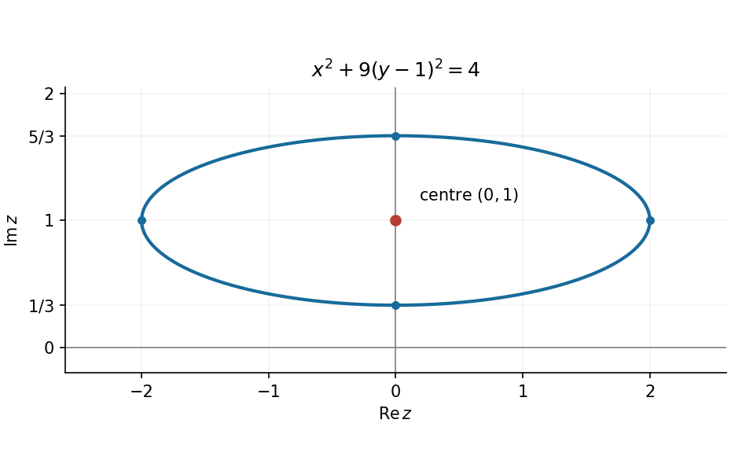

<h1 id="11/c/solution">Solution</h1>

↑ **Parent:** [C](../c.md)

With $z=x+iy$, the expression inside the [modulus](../../../../../modulus.md) is $x+3i(y-1)$. Squaring its nonnegative [modulus](../../../../../modulus.md) therefore gives

$$
\boxed{x^2+9(y-1)^2=4,\qquad\text{or}\qquad\frac{x^2}{4}+\frac{(y-1)^2}{4/9}=1.}
$$

The [locus](../../../../../locus-mathematics.md) is an [ellipse](../../../../../ellipse.md) in the [complex plane](../../../../../complex-plane.md), centred at $(0,1)$, with horizontal semiaxis $2$ and vertical semiaxis $2/3$. Its vertices are $(\pm2,1)$ and $(0,1\pm2/3)$.

**[Figure 1](#11/c/image-ellipse-obtained-from-the-complex-modulus-condition). Ellipse obtained from the complex modulus condition**.

## ↑ Ancestors (13)

1. [C](../c.md)
2. [11](../../11.md)
3. [Paper 1](../../../paper-1-split.md)
4. [2019](../../../split.md)
5. [Past exam of the mathematics course of the year 1 of the natural sciences course of the University of Cambridge](../../../../split.md)
6. [Mathematics course of the year 1 of the natural sciences course of the University of Cambridge](../../../../../mathematics-course-of-the-year-1-of-the-natural-sciences-course-of-the-university-of-cambridge.md)
7. [Year 1 of the natural sciences course of the University of Cambridge](../../../../../year-1-of-the-natural-sciences-course-of-the-university-of-cambridge.md)
8. [Year of the natural sciences course of the University of Cambridge](../../../../../year-of-the-natural-sciences-course-of-the-university-of-cambridge.md)
9. [Natural sciences course of the University of Cambridge](../../../../../natural-sciences-course-of-the-university-of-cambridge.md)
10. [Course of the University of Cambridge](../../../../../course-of-the-university-of-cambridge.md)
11. [University of Cambridge](../../../../../university-of-cambridge-split.md)
12. [List of universities](../../../../../list-of-universities.md)
13. [Codex Wiki](../../../../../split.md)
