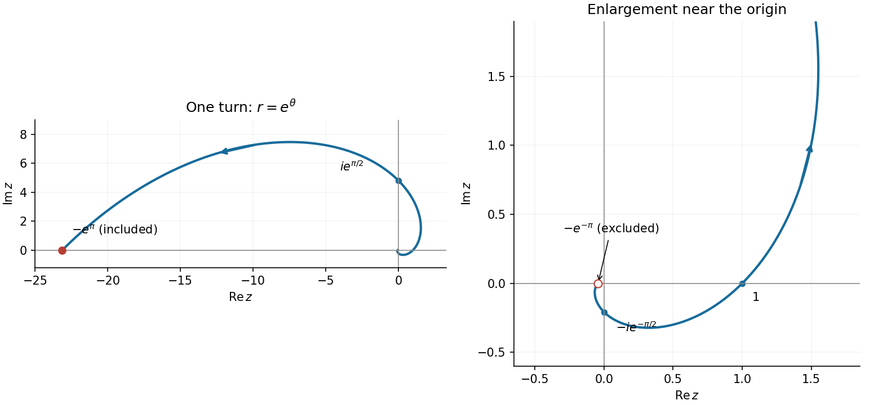

<h1 id="11/d/solution">Solution</h1>

↑ **Parent:** [D](../d.md)

Take $r>0$ and select a [complex argument](../../../../../argument-complex-analysis.md) $\theta$ for $z$. To specify the [complex exponentiation](../../../../../complex-exponentiation.md), use $z^{1+i}=\exp((1+i)(\ln r+i\theta))$. Expanding its exponent gives

$$
z^{1+i}=e^{\ln r-\theta}e^{i(\theta+\ln r)}.
$$

Its [complex logarithm](../../../../../complex-logarithm.md) therefore has values

$$
\boxed{\Re f=\ln r-\theta,\qquad\Im f=\theta+\ln r+2\pi k,\quad k\in\mathbb Z.}
$$

The continuous logarithm obtained by retaining the displayed exponent uses $k=0$. If the outer logarithm is the [principal logarithm](../../../../../principal-complex-logarithm.md), choose $k$ to put the [imaginary part](../../../../../imaginary-part.md) in $(-\pi,\pi]$ instead; the [real part](../../../../../real-part.md) is unchanged. In particular one cannot generally assert $\operatorname{Log}(e^w)=w$ without checking its [imaginary part](../../../../../imaginary-part.md).

The condition on the [real part](../../../../../real-part.md) gives $\ln r=\theta$, so the required [logarithmic spiral](../../../../../logarithmic-spiral.md) has [polar coordinates](../../../../../polar-coordinates.md)

$$
\boxed{r=e^\theta,\qquad z(\theta)=e^\theta(\cos\theta+i\sin\theta).}
$$

As $\theta$ increases, it runs from the negative [real axis](../../../../../real-axis.md) near radius $e^{-\pi}$ through $-ie^{-\pi/2}$, $1$ and $ie^{\pi/2}$ to the negative [real axis](../../../../../real-axis.md) at radius $e^\pi$. The [angle](../../../../../angle.md) increases by one complete turn. Using the conventional [principal argument](../../../../../principal-argument.md) $-\pi<\theta\le\pi$, the inner negative-axis endpoint is excluded and the outer endpoint is included. The convention $-\pi\le\theta<\pi$ reverses those endpoint choices. If both limiting arguments are admitted by the paper's wording, both limiting endpoints are drawn; the interior curve is the same. The origin is never included because the [complex logarithm](../../../../../complex-logarithm.md) is undefined there.

**[Figure 2](#11/d/image-one-turn-of-the-logarithmic-spiral-with-an-enlarged-view-near-the-origin). One turn of the logarithmic spiral, with an enlarged view near the origin**.

## ↑ Ancestors (13)

1. [D](../d.md)
2. [11](../../11.md)
3. [Paper 1](../../../paper-1-split.md)
4. [2019](../../../split.md)
5. [Past exam of the mathematics course of the year 1 of the natural sciences course of the University of Cambridge](../../../../split.md)
6. [Mathematics course of the year 1 of the natural sciences course of the University of Cambridge](../../../../../mathematics-course-of-the-year-1-of-the-natural-sciences-course-of-the-university-of-cambridge.md)
7. [Year 1 of the natural sciences course of the University of Cambridge](../../../../../year-1-of-the-natural-sciences-course-of-the-university-of-cambridge.md)
8. [Year of the natural sciences course of the University of Cambridge](../../../../../year-of-the-natural-sciences-course-of-the-university-of-cambridge.md)
9. [Natural sciences course of the University of Cambridge](../../../../../natural-sciences-course-of-the-university-of-cambridge.md)
10. [Course of the University of Cambridge](../../../../../course-of-the-university-of-cambridge.md)
11. [University of Cambridge](../../../../../university-of-cambridge-split.md)
12. [List of universities](../../../../../list-of-universities.md)
13. [Codex Wiki](../../../../../split.md)
