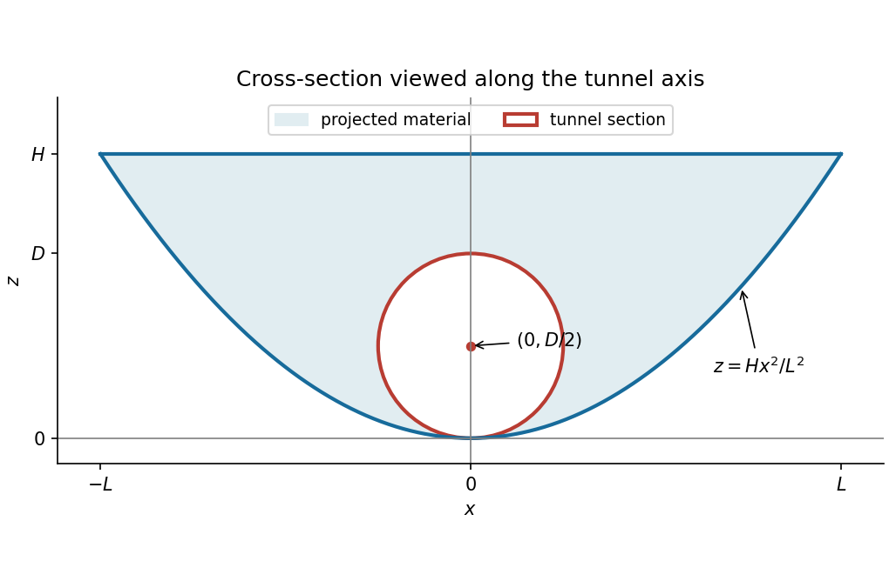

<h1 id="12/c/solution">Solution</h1>

↑ **Parent:** [C](../c.md)

In the $x,z$ plane, the embankment lies above the [parabola](../../../../../parabola.md) $z=Hx^2/L^2$ and below $z=H$. The bore has circular cross-section

$$
\mathcal D=\left\{(x,z):x^2+(z-D/2)^2\le D^2/4\right\}.
$$

It touches the valley floor at the origin. To check that this entire [disk](../../../../../disk-mathematics.md) lies inside the projected embankment, its equation gives $x^2\le Dz-z^2\le Dz$. Since $HD/L^2<1$, it follows that $Hx^2/L^2\le z$, with strict inequality away from the bottom contact. Also $z\le D<H$. Thus no circular segment needs to be subtracted from the tunnel section.

For each $(x,z)$ in the [disk](../../../../../disk-mathematics.md), the length of bore inside the material is the local width $2b(2-z/H)$. The required [volume integral](../../../../../volume-integral.md) is therefore

$$
V_{\rm cut}=\iint_{\mathcal D}2b\left(2-\frac zH\right)\,dx\,dz.
$$

The [disk](../../../../../disk-mathematics.md) has [area](../../../../../surface-area.md) $A=\pi D^2/4$ and [centroid](../../../../../centroid.md) height $D/2$, so $\iint_{\mathcal D}z\,dx\,dz=AD/2$. Applying the [volume of a solid with affine thickness](../../../../../volume-of-a-solid-with-affine-thickness.md) formula gives

$$
\boxed{V_{\rm cut}=2bA\left(2-\frac{D}{2H}\right)=\pi bD^2\left(1-\frac D{4H}\right).}
$$

The width varies along the circular section; multiplying its [area](../../../../../surface-area.md) by the top width alone would miss this variation.

**[Figure 3](#12/c/image-original-cross-section-of-the-parabolic-embankment-and-the-circular-tunnel). Original cross-section of the parabolic embankment and the circular tunnel**.

## ↑ Ancestors (13)

1. [C](../c.md)
2. [12](../../12.md)
3. [Paper 1](../../../paper-1-split.md)
4. [2019](../../../split.md)
5. [Past exam of the mathematics course of the year 1 of the natural sciences course of the University of Cambridge](../../../../split.md)
6. [Mathematics course of the year 1 of the natural sciences course of the University of Cambridge](../../../../../mathematics-course-of-the-year-1-of-the-natural-sciences-course-of-the-university-of-cambridge.md)
7. [Year 1 of the natural sciences course of the University of Cambridge](../../../../../year-1-of-the-natural-sciences-course-of-the-university-of-cambridge.md)
8. [Year of the natural sciences course of the University of Cambridge](../../../../../year-of-the-natural-sciences-course-of-the-university-of-cambridge.md)
9. [Natural sciences course of the University of Cambridge](../../../../../natural-sciences-course-of-the-university-of-cambridge.md)
10. [Course of the University of Cambridge](../../../../../course-of-the-university-of-cambridge.md)
11. [University of Cambridge](../../../../../university-of-cambridge-split.md)
12. [List of universities](../../../../../list-of-universities.md)
13. [Codex Wiki](../../../../../split.md)
