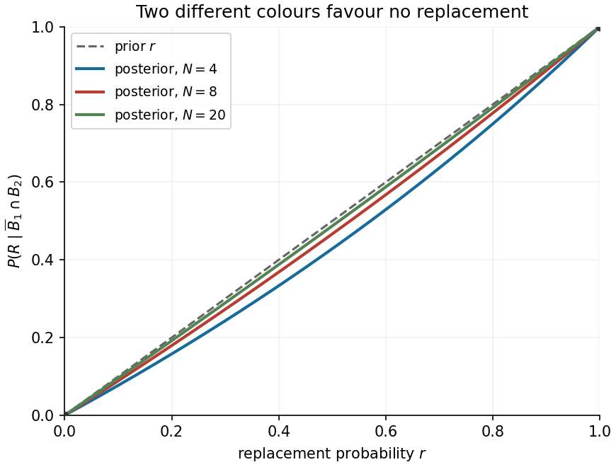

<h1 id="16/d/solution">Solution</h1>

↑ **Parent:** [D](../d.md)

Let $C=\overline B_1\cap B_2$. Under replacement its joint [probability](../../../../../probability.md) is

$$
P(R\cap C)=\frac{N-N_B}{N}\,r\,\frac{N_B}{N},
$$

whereas without replacement it is

$$
P(\overline R\cap C)=\frac{N-N_B}{N}\,(1-r)\,\frac{N_B}{N-1}.
$$

In the latter case the first removed ball is non-blue, so all $N_B$ blue balls remain. Applying [Bayes' theorem](../../../../../bayes-theorem.md) and cancelling the positive common factors yields the [posterior replacement probability after different-colour draws](../../../../../posterior-replacement-probability-after-different-colour-draws.md):

$$
\boxed{g(r)=P(R\mid C)=\frac{r/N}{r/N+(1-r)/(N-1)}=\frac{r(N-1)}{N-r}.}
$$

It does not depend on $N_B$. To prove the requested bound directly,

$$
\boxed{r-g(r)=\frac{r(1-r)}{N-r}\ge0,\qquad0\le r\le1.}
$$

Equality holds at $r=0$ and $r=1$, and the inequality is strict between them. Its sketch joins $(0,0)$ to $(1,1)$, stays below the diagonal, and is increasing and convex because

$$
g'(r)=\frac{N(N-1)}{(N-r)^2}>0,\qquad g''(r)=\frac{2N(N-1)}{(N-r)^3}>0.
$$

The interpretation is that removing a non-blue ball increases the chance of blue on the second draw; seeing the two different colours therefore favours the no-replacement explanation.

**[Figure 4](#16/d/image-posterior-replacement-probability-lies-below-the-original-replacement-probability). Posterior replacement probability lies below the original replacement probability**.

## ↑ Ancestors (13)

1. [D](../d.md)
2. [16](../../16.md)
3. [Paper 1](../../../paper-1-split.md)
4. [2019](../../../split.md)
5. [Past exam of the mathematics course of the year 1 of the natural sciences course of the University of Cambridge](../../../../split.md)
6. [Mathematics course of the year 1 of the natural sciences course of the University of Cambridge](../../../../../mathematics-course-of-the-year-1-of-the-natural-sciences-course-of-the-university-of-cambridge.md)
7. [Year 1 of the natural sciences course of the University of Cambridge](../../../../../year-1-of-the-natural-sciences-course-of-the-university-of-cambridge.md)
8. [Year of the natural sciences course of the University of Cambridge](../../../../../year-of-the-natural-sciences-course-of-the-university-of-cambridge.md)
9. [Natural sciences course of the University of Cambridge](../../../../../natural-sciences-course-of-the-university-of-cambridge.md)
10. [Course of the University of Cambridge](../../../../../course-of-the-university-of-cambridge.md)
11. [University of Cambridge](../../../../../university-of-cambridge-split.md)
12. [List of universities](../../../../../list-of-universities.md)
13. [Codex Wiki](../../../../../split.md)
