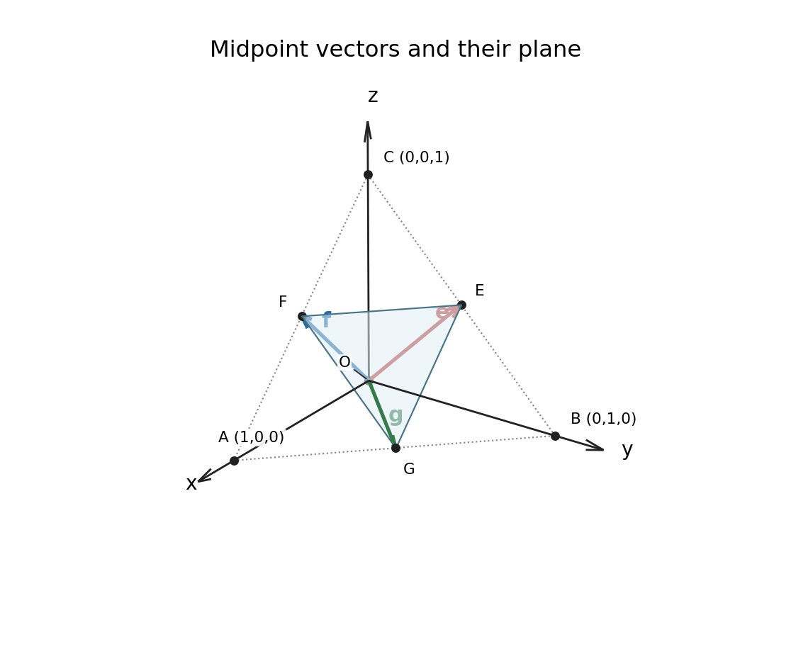
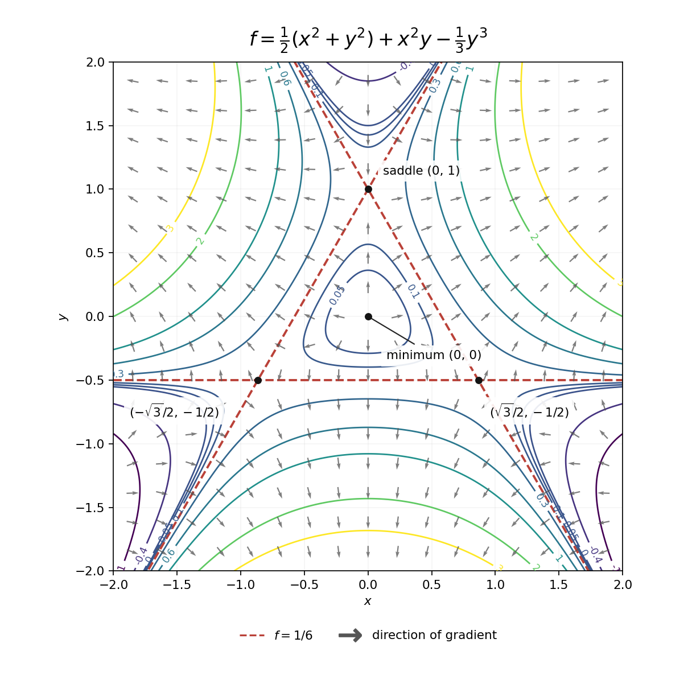
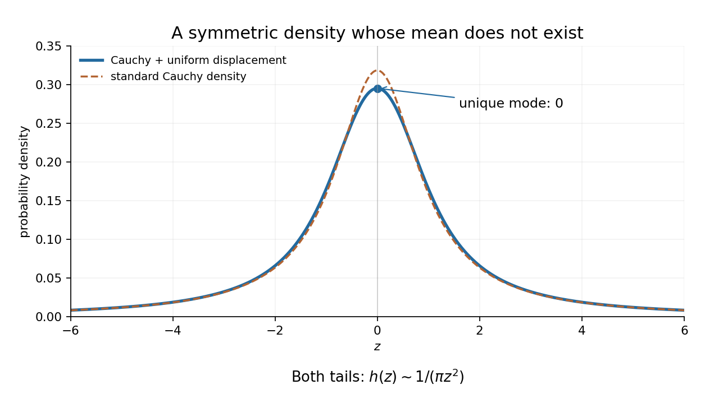

# Paper 2

↑ **Parent:** [2019](../2019.md)

[https://www.maths.cam.ac.uk/undergradnst/files/2019/papernst_ia_2_2019.pdf](https://www.maths.cam.ac.uk/undergradnst/files/2019/papernst_ia_2_2019.pdf)

**Table of contents**

- [1](#1)
  - [Solution](#1/solution)
- [2](#2)
  - [a](#2/a)
    - [Solution](#2/a/solution)
  - [b](#2/b)
    - [Solution](#2/b/solution)
- [3](#3)
  - [Solution](#3/solution)
- [4](#4)
  - [a](#4/a)
    - [Solution](#4/a/solution)
  - [b](#4/b)
    - [Solution](#4/b/solution)
- [5](#5)
  - [a](#5/a)
    - [Solution](#5/a/solution)
  - [b](#5/b)
    - [Solution](#5/b/solution)
- [6](#6)
  - [a](#6/a)
    - [Solution](#6/a/solution)
  - [b](#6/b)
    - [Solution](#6/b/solution)
- [7](#7)
  - [Solution](#7/solution)
- [8](#8)
  - [Solution](#8/solution)
- [9](#9)
  - [Solution](#9/solution)
- [10](#10)
  - [a](#10/a)
    - [Solution](#10/a/solution)
  - [b](#10/b)
    - [Solution](#10/b/solution)
- [11](#11)
  - [a](#11/a)
    - [i](#11/a/i)
      - [Solution](#11/a/i/solution)
    - [ii](#11/a/ii)
      - [Solution](#11/a/ii/solution)
    - [iii](#11/a/iii)
      - [Solution](#11/a/iii/solution)
  - [b](#11/b)
    - [Solution](#11/b/solution)
  - [c](#11/c)
    - [Solution](#11/c/solution)
- [12](#12)
  - [a](#12/a)
    - [Solution](#12/a/solution)
  - [b](#12/b)
    - [Solution](#12/b/solution)
  - [c](#12/c)
    - [Solution](#12/c/solution)
  - [d](#12/d)
    - [Solution](#12/d/solution)
- [13](#13)
  - [a](#13/a)
    - [Solution](#13/a/solution)
  - [b](#13/b)
    - [Solution](#13/b/solution)
  - [c](#13/c)
    - [Solution](#13/c/solution)
  - [d](#13/d)
    - [Solution](#13/d/solution)
- [14](#14)
  - [a](#14/a)
    - [Solution](#14/a/solution)
  - [b](#14/b)
    - [i](#14/b/i)
      - [Solution](#14/b/i/solution)
    - [ii](#14/b/ii)
      - [Solution](#14/b/ii/solution)
  - [c](#14/c)
    - [i](#14/c/i)
      - [Solution](#14/c/i/solution)
    - [ii](#14/c/ii)
      - [Solution](#14/c/ii/solution)
  - [d](#14/d)
    - [i](#14/d/i)
      - [Solution](#14/d/i/solution)
    - [ii](#14/d/ii)
      - [Solution](#14/d/ii/solution)
    - [iii](#14/d/iii)
      - [Solution](#14/d/iii/solution)
- [15](#15)
  - [a](#15/a)
    - [i](#15/a/i)
      - [Solution](#15/a/i/solution)
    - [ii](#15/a/ii)
      - [Solution](#15/a/ii/solution)
  - [b](#15/b)
    - [i](#15/b/i)
      - [Solution](#15/b/i/solution)
    - [ii](#15/b/ii)
      - [Solution](#15/b/ii/solution)
    - [iii](#15/b/iii)
      - [Solution](#15/b/iii/solution)
- [16](#16)
  - [a](#16/a)
    - [Solution](#16/a/solution)
  - [b](#16/b)
    - [Solution](#16/b/solution)
- [17](#17)
  - [a](#17/a)
    - [Solution](#17/a/solution)
  - [b](#17/b)
    - [i](#17/b/i)
      - [Solution](#17/b/i/solution)
    - [ii](#17/b/ii)
      - [Solution](#17/b/ii/solution)
    - [iii](#17/b/iii)
      - [Solution](#17/b/iii/solution)
  - [c](#17/c)
    - [i](#17/c/i)
      - [Solution](#17/c/i/solution)
    - [ii](#17/c/ii)
      - [Solution](#17/c/ii/solution)
- [18](#18)
  - [a](#18/a)
    - [Solution](#18/a/solution)
  - [b](#18/b)
    - [Solution](#18/b/solution)
  - [c](#18/c)
    - [Solution](#18/c/solution)
- [19](#19)
  - [a](#19/a)
    - [Solution](#19/a/solution)
  - [b](#19/b)
    - [Solution](#19/b/solution)
  - [c](#19/c)
    - [Solution](#19/c/solution)
- [20](#20)
  - [a](#20/a)
    - [i](#20/a/i)
      - [Solution](#20/a/i/solution)
    - [ii](#20/a/ii)
      - [Solution](#20/a/ii/solution)
  - [b](#20/b)
    - [Solution](#20/b/solution)

## 1

↑ **Parent:** [Paper 2](paper-2.md)

<h3 id="1/solution">Solution</h3>

↑ **Parent:** [1](#1)

Over the [complex numbers](../../complex-analysis.md#complex-number), the [polynomial factorization](../../polynomial.md#factorization-of-polynomials) $z^2+1=(z-i)(z+i)$ gives the [partial fraction decomposition](../../isolated-singularity.md#partial-fraction-decomposition)

$$
\frac{z+1}{z^2+1}=\frac{A}{z-i}+\frac{B}{z+i}.
$$

Multiplication by $(z-i)(z+i)$ and comparison of [polynomial](../../polynomial.md) coefficients give $A+B=1$ and $i(A-B)=1$. Hence

$$
\boxed{\frac{z+1}{z^2+1}=\frac{1-i}{2(z-i)}+\frac{1+i}{2(z+i)}},\qquad z\ne\pm i.
$$

## 2

↑ **Parent:** [Paper 2](paper-2.md)

<h3 id="2/a">a</h3>

↑ **Parent:** [2](#2)

<h4 id="2/a/solution">Solution</h4>

↑ **Parent:** [A](#2/a)

Substitute $x^3$ into the [Taylor series](../../calculus.md#taylor-series) for the [exponential function](../../calculus.md#exponential-function):

$$
\boxed{e^{x^3}=\sum_{n=0}^{\infty}\frac{x^{3n}}{n!}}.
$$

The general nonzero term is $x^{3n}/n!$; the [power series](../../sequence-and-series.md#power-series) coefficients of powers not divisible by three are zero. The [radius of convergence](../../sequence-and-series.md#radius-of-convergence) is infinite.

<h3 id="2/b">b</h3>

↑ **Parent:** [2](#2)

<h4 id="2/b/solution">Solution</h4>

↑ **Parent:** [B](#2/b)

The [power series](../../sequence-and-series.md#power-series) for $e^{y^3}$ has [uniform convergence](../../sequence-and-series.md#uniform-convergence) on every compact interval, so [termwise integration](../../mathematics.md#termwise-integration) from zero to $x$ is valid. Thus

$$
\int_0^x e^{y^3}\,dy=\sum_{n=0}^{\infty}\frac{1}{n!}\int_0^x y^{3n}\,dy
=\boxed{\sum_{n=0}^{\infty}\frac{x^{3n+1}}{(3n+1)n!}}.
$$

This [power series](../../sequence-and-series.md#power-series) converges for every real $x$, including negative $x$ with the usual orientation of a [definite integral](../../integral.md#definite-integral).

## 3

↑ **Parent:** [Paper 2](paper-2.md)

<h3 id="3/solution">Solution</h3>

↑ **Parent:** [3](#3)

On an interval excluding $t=0$, an [integrating factor](../../linear-ordinary-differential-equation.md#integrating-factor) for this [first-order linear differential equation](../../linear-ordinary-differential-equation.md#first-order-linear-differential-equation) is $t^4$. Multiplying through gives

$$
\frac{d}{dt}(t^4y)=3t^4.
$$

An [antiderivative](../../integral.md#antiderivative) then gives $t^4y=3t^5/5+C$, so

$$
\boxed{y(t)=\frac35t+\frac{C}{t^4}},\qquad t\ne0.
$$

The constant is arbitrary on each connected interval of the domain; the original [differential equation](../../differential-equation.md) is undefined at zero.

## 4

↑ **Parent:** [Paper 2](paper-2.md)

<h3 id="4/a">a</h3>

↑ **Parent:** [4](#4)

<h4 id="4/a/solution">Solution</h4>

↑ **Parent:** [A](#4/a)

Use [integration by parts](../../calculus.md#integration-by-parts) with $u=(\ln x)^{n+1}$ and $dv=dx$. Since $du=(n+1)(\ln x)^n\,dx/x$, this yields

$$
\boxed{I_{n+1}=x(\ln x)^{n+1}-(n+1)I_n}.
$$

As an identity between [indefinite integrals](../../integral.md#antiderivative), the formula is understood up to an additive constant.

<h3 id="4/b">b</h3>

↑ **Parent:** [4](#4)

<h4 id="4/b/solution">Solution</h4>

↑ **Parent:** [B](#4/b)

Here $I_0=x$ up to a constant. Substitution of $n=0$ in the [integration by parts](../../calculus.md#integration-by-parts) recurrence gives

$$
\boxed{I_1=x\ln x-x+C},\qquad x>0.
$$

Indeed, its [derivative](../../calculus.md#derivative) is $\ln x+1-1=\ln x$.

## 5

↑ **Parent:** [Paper 2](paper-2.md)

<h3 id="5/a">a</h3>

↑ **Parent:** [5](#5)

<h4 id="5/a/solution">Solution</h4>

↑ **Parent:** [A](#5/a)

A [stationary point](../../calculus-of-variations.md#stationary-point) has zero [gradient](../../multivariable-calculus.md#gradient). The two [partial derivatives](../../multivariable-calculus.md#partial-derivative) give

$$
f_x=2x-1+y=0,\qquad f_y=x-3-2y=0.
$$

Solving this [system of linear equations](../../linear-algebra.md#system-of-linear-equations) gives

$$
\boxed{(x,y)=(1,-1)},\qquad f(1,-1)=0.
$$

<h3 id="5/b">b</h3>

↑ **Parent:** [5](#5)

<h4 id="5/b/solution">Solution</h4>

↑ **Parent:** [B](#5/b)

The [Hessian matrix](../../multivariable-calculus.md#hessian-matrix) is

$$
H=\begin{pmatrix}2&1\\1&-2\end{pmatrix},\qquad \det H=-5<0.
$$

Its [eigenvalues](../../linear-operator-theory.md#eigenvalue) have opposite signs, so the [stationary point](../../calculus-of-variations.md#stationary-point) is a **[saddle point](../../analysis.md#saddle-point)**. More directly, putting $x=1+u$ and $y=-1+v$ gives $f=u^2+uv-v^2$: it increases along $v=0$ and decreases along $u=0$.

## 6

↑ **Parent:** [Paper 2](paper-2.md)

<h3 id="6/a">a</h3>

↑ **Parent:** [6](#6)

<h4 id="6/a/solution">Solution</h4>

↑ **Parent:** [A](#6/a)

The [inclusion-exclusion principle for probabilities](../../combinatorics.md#inclusion-exclusion-principle-for-probabilities) gives

$$
\boxed{\begin{aligned}
P(A\cup B\cup C)={}&P(A)+P(B)+P(C)\\
&-P(A\cap B)-P(A\cap C)-P(B\cap C)\\
&+P(A\cap B\cap C).
\end{aligned}}
$$

Each outcome belonging to two events is initially counted twice and must lose one count. An outcome in all three is counted three times and then subtracted three times, so the last term restores its single count.

<h3 id="6/b">b</h3>

↑ **Parent:** [6](#6)

<h4 id="6/b/solution">Solution</h4>

↑ **Parent:** [B](#6/b)

Write $U=A\cup B\cup C$. Since $D\subseteq U$, their [intersection](../../set.md#set-intersection) is $U\cap D=D$. Therefore the definition of [conditional probability](../../probability-theory.md#conditional-probability) gives

$$
\boxed{P(U\mid D)=\frac{P(U\cap D)}{P(D)}=1},\qquad P(D)>0.
$$

The positive-probability condition is necessary: if $P(D)=0$, this elementary definition of [conditional probability](../../probability-theory.md#conditional-probability) does not assign a value.

## 7

↑ **Parent:** [Paper 2](paper-2.md)

<h3 id="7/solution">Solution</h3>

↑ **Parent:** [7](#7)

This is a [generalized eigenvalue problem](../../linear-operator-theory.md#generalized-eigenvalue-problem). A nonzero [vector](../../vector-space.md#vector) lies in the [kernel](../../kernel-of-a-linear-map.md) of $A-\lambda B$ precisely when its [determinant](../../multilinear-algebra.md#determinant) vanishes:

$$
0=\det\begin{pmatrix}1&2-2\lambda\\2-2\lambda&1\end{pmatrix}
=1-4(1-\lambda)^2.
$$

Hence

$$
\boxed{\lambda=\frac12\quad\text{or}\quad\lambda=\frac32}.
$$

The corresponding [eigenvectors](../../linear-operator-theory.md#eigenvector) can be taken as $(1,-1)^T$ and $(1,1)^T$, respectively, which also checks that both values give nontrivial solutions.

## 8

↑ **Parent:** [Paper 2](paper-2.md)

<h3 id="8/solution">Solution</h3>

↑ **Parent:** [8](#8)

Use the [product-to-sum formula](../../geometry-and-topology.md#product-to-sum-formula) and the double-angle [trigonometric identities](../../geometry-and-topology.md#trigonometric-identity):

$$
\cos^3x\sin x=\frac14(1+\cos2x)\sin2x
=\frac14\sin2x+\frac18\sin4x.
$$

By [Fourier orthogonality](../../fourier-series.md#fourier-orthogonality), these are already its only nonzero [Fourier series](../../fourier-series.md) coefficients:

$$
\boxed{a_n=0\ (n\geq0),\qquad b_2=\frac14,\quad b_4=\frac18,\quad b_n=0\ (n\ne2,4)}.
$$

## 9

↑ **Parent:** [Paper 2](paper-2.md)

<h3 id="9/solution">Solution</h3>

↑ **Parent:** [9](#9)

In [spherical coordinates](../../multivariable-calculus.md#spherical-coordinate-system), integrating over the angular variables gives the [volume element](../../integral.md#volume-element) $4\pi r^2\,dr$ for a spherical shell. The [mass density](../../fluid-mechanics.md#density) therefore gives the total [mass](../../classical-mechanics.md#mass)

$$
M=4\pi\int_0^a(1+r)r^2\,dr
=4\pi\left[\frac{r^3}{3}+\frac{r^4}{4}\right]_0^a.
$$

Thus

$$
\boxed{M=\frac{4\pi a^3}{3}+\pi a^4}.
$$

## 10

↑ **Parent:** [Paper 2](paper-2.md)

<h3 id="10/a">a</h3>

↑ **Parent:** [10](#10)

<h4 id="10/a/solution">Solution</h4>

↑ **Parent:** [A](#10/a)

For the outward orientation of a [spherical cap](../../euclidean-geometry.md#spherical-cap), its [vector area element](../../differential-geometry.md#vector-area-element) is

$$
d\mathbf S=\hat{\mathbf r}\,a^2\sin\theta\,d\theta\,d\phi,\qquad
\hat{\mathbf r}=(\sin\theta\cos\phi,\sin\theta\sin\phi,\cos\theta).
$$

In the [surface integral](../../multivariable-calculus.md#surface-integral) defining the [vector area](../../differential-geometry.md#vector-area), the $x$ and $y$ components vanish by integration over a complete azimuth. The remaining component is

$$
S_z=2\pi a^2\int_0^{\pi/4}\cos\theta\sin\theta\,d\theta
=\frac{\pi a^2}{2}.
$$

Consequently

$$
\boxed{\mathbf S=\left(0,0,\frac{\pi a^2}{2}\right)}.
$$

This also equals the area of the cap's projection onto the horizontal plane, directed upwards.

<h3 id="10/b">b</h3>

↑ **Parent:** [10](#10)

<h4 id="10/b/solution">Solution</h4>

↑ **Parent:** [B](#10/b)

The direction must first be represented by a [unit vector](../../vector-space.md#unit-vector): $\hat{\mathbf q}=(1,1,1)/\sqrt3$. The [scalar projection](../../inner-product.md#scalar-projection) of the [vector area](../../differential-geometry.md#vector-area) is therefore

$$
\boxed{\mathbf S\cdot\hat{\mathbf q}=\frac{\pi a^2}{2\sqrt3}}.
$$

If a [vector projection](../../inner-product.md#vector-projection) is intended, multiply this scalar by $\hat{\mathbf q}$:

$$
\boxed{\operatorname{proj}_{\mathbf q}\mathbf S=\frac{\pi a^2}{6}(1,1,1)}.
$$

## 11

↑ **Parent:** [Paper 2](paper-2.md)

<h3 id="11/a">a</h3>

↑ **Parent:** [11](#11)

<h4 id="11/a/i">i</h4>

↑ **Parent:** [A](#11/a)

<h5 id="11/a/i/solution">Solution</h5>

↑ **Parent:** [I](#11/a/i)

Choose [Cartesian coordinates](../../linear-algebra.md#cartesian-coordinate-system) with [unit vectors](../../vector-space.md#unit-vector) satisfying the [right-hand rule](../../electromagnetism.md#right-hand-rule), $\hat{\mathbf x}\times\hat{\mathbf y}=\hat{\mathbf z}$. Put $A$, $B$ and $C$ one unit along the positive $x$, $y$ and $z$ axes, respectively. The following original drawing also includes the vectors needed in the next part.

**[Figure 1](#11/a/i/image-cartesian-axes-and-three-independent-midpoint-position-vectors). Cartesian axes and three independent midpoint position vectors**.

<h4 id="11/a/ii">ii</h4>

↑ **Parent:** [A](#11/a)

<h5 id="11/a/ii/solution">Solution</h5>

↑ **Parent:** [Ii](#11/a/ii)

The [position vectors](../../classical-mechanics.md#position-vector) end at the midpoints of $BC$, $CA$ and $AB$, respectively. The drawing places $E$, $F$ and $G$ on those edges and shows the arrows from the origin. The volume of their [parallelepiped](../../euclidean-geometry.md#parallelepiped) is the absolute [scalar triple product](../../multilinear-algebra.md#scalar-triple-product):

$$
\mathbf e\times\mathbf f=\left(\frac14,\frac14,-\frac14\right),\qquad
V=|(\mathbf e\times\mathbf f)\cdot\mathbf g|=\boxed{\frac14}.
$$

Equivalently, this is the absolute [determinant](../../multilinear-algebra.md#determinant) of the matrix whose columns are the three vectors. Since it is nonzero, the vectors are [linearly independent](../../vector-space.md#linear-independence). Three [linearly independent](../../vector-space.md#linear-independence) vectors in the three-dimensional [vector space](../../vector-space.md) $\mathbb R^3$ form a [basis](../../vector-space.md#basis).

<h4 id="11/a/iii">iii</h4>

↑ **Parent:** [A](#11/a)

<h5 id="11/a/iii/solution">Solution</h5>

↑ **Parent:** [Iii](#11/a/iii)

Writing $\overrightarrow{OA}=a\mathbf e+b\mathbf f+c\mathbf g$ and comparing [Cartesian coordinates](../../linear-algebra.md#cartesian-coordinate-system) gives

$$
\frac{b+c}{2}=1,\qquad \frac{a+c}{2}=0,\qquad \frac{a+b}{2}=0.
$$

The unique solution, guaranteed by the [basis](../../vector-space.md#basis) property, is $(a,b,c)=(-1,1,1)$. Thus

$$
\boxed{\overrightarrow{OA}=-\mathbf e+\mathbf f+\mathbf g}.
$$

<h3 id="11/b">b</h3>

↑ **Parent:** [11](#11)

<h4 id="11/b/solution">Solution</h4>

↑ **Parent:** [B](#11/b)

Two directions within the plane are

$$
\mathbf f-\mathbf e=\left(\frac12,-\frac12,0\right),\qquad
\mathbf g-\mathbf e=\left(\frac12,0,-\frac12\right).
$$

Their [cross product](../../vector-space.md#cross-product) is $(1,1,1)/4$, so a [unit vector](../../vector-space.md#unit-vector) normal to the plane is

$$
\boxed{\hat{\mathbf n}=\frac{(1,1,1)}{\sqrt3}}.
$$

Its negative is equally valid. An [equation of a plane through three points](../../geometry-and-topology.md#equation-of-a-plane-through-three-points) in vector form is

$$
\boxed{\hat{\mathbf n}\cdot(\mathbf r-\mathbf e)=0},
$$

or, parametrically, $\mathbf r=\mathbf e+s(\mathbf f-\mathbf e)+t(\mathbf g-\mathbf e)$. Since the coordinate sum of $E$ is one, the [Cartesian equation of a plane](../../geometry-and-topology.md#cartesian-equation-of-a-plane) is

$$
\boxed{x+y+z=1}.
$$

The [distance from a point to a plane](../../geometry-and-topology.md#distance-from-a-point-to-a-plane) is the absolute normal displacement, giving

$$
\boxed{d(O,EFG)=|\hat{\mathbf n}\cdot\mathbf e|=\frac1{\sqrt3}}.
$$

<h3 id="11/c">c</h3>

↑ **Parent:** [11](#11)

<h4 id="11/c/solution">Solution</h4>

↑ **Parent:** [C](#11/c)

Let $\mathbf d=\mathbf f-\mathbf e$. A point on the line has [position vector](../../classical-mechanics.md#position-vector) $\mathbf r=\mathbf e+t\mathbf d$. By bilinearity and antisymmetry of the [cross product](../../vector-space.md#cross-product),

$$
\boxed{\mathbf r\times\mathbf d=\mathbf e\times\mathbf d+t\mathbf d\times\mathbf d=\mathbf e\times\mathbf f}.
$$

For a point with [position vector](../../classical-mechanics.md#position-vector) $\mathbf c$, the area of the [parallelogram](../../euclidean-geometry.md#parallelogram) spanned by $\mathbf c-\mathbf e$ and $\mathbf d$ equals base length times perpendicular [Euclidean distance](../../topological-analysis.md#euclidean-distance). Hence the shortest [Euclidean distance](../../topological-analysis.md#euclidean-distance) to the line is

$$
\boxed{d=\frac{|(\mathbf c-\mathbf e)\times(\mathbf f-\mathbf e)|}{|\mathbf f-\mathbf e|}}.
$$

For $\mathbf c=(0,0,1)$, these quantities are

$$
(\mathbf c-\mathbf e)\times(\mathbf f-\mathbf e)=\left(\frac14,\frac14,\frac14\right),\qquad
|\mathbf f-\mathbf e|=\frac1{\sqrt2}.
$$

Thus $\boxed{d=\sqrt6/4}$. The perpendicular meets $EF$ at $(1/4,1/4,1/2)$, whose displacement from $C$ has precisely this length.

## 12

↑ **Parent:** [Paper 2](paper-2.md)

<h3 id="12/a">a</h3>

↑ **Parent:** [12](#12)

<h4 id="12/a/solution">Solution</h4>

↑ **Parent:** [A](#12/a)

The [gradient](../../multivariable-calculus.md#gradient) vanishes when

$$
f_x=x(1+2y)=0,\qquad f_y=y+x^2-y^2=0.
$$

If $x=0$, the second equation gives $y=0$ or $y=1$. If $y=-1/2$, it gives $x^2=3/4$. These exhaust the possibilities. The [stationary points](../../calculus-of-variations.md#stationary-point) and their values are

$$
\boxed{\begin{array}{c|c}
(x,y)&f(x,y)\\\hline
(0,0)&0\\
(0,1)&1/6\\
(\sqrt3/2,-1/2)&1/6\\
(-\sqrt3/2,-1/2)&1/6
\end{array}}.
$$

<h3 id="12/b">b</h3>

↑ **Parent:** [12](#12)

<h4 id="12/b/solution">Solution</h4>

↑ **Parent:** [B](#12/b)

The [Hessian matrix](../../multivariable-calculus.md#hessian-matrix) is

$$
H(x,y)=\begin{pmatrix}1+2y&2x\\2x&1-2y\end{pmatrix}.
$$

At the origin it is the identity, so the origin is a strict **[local minimum](../../analysis.md#local-minimum)**. At $(0,1)$ it is $\operatorname{diag}(3,-1)$, so this point is a **[saddle point](../../analysis.md#saddle-point)**. At either remaining [stationary point](../../calculus-of-variations.md#stationary-point),

$$
H=\begin{pmatrix}0&\pm\sqrt3\\\pm\sqrt3&2\end{pmatrix},\qquad \det H=-3<0,
$$

which again gives a **[saddle point](../../analysis.md#saddle-point)**. All three [saddle points](../../analysis.md#saddle-point) have [eigenvalues](../../linear-operator-theory.md#eigenvalue) $3$ and $-1$; there are no [local maxima](../../analysis.md#local-maximum).

<h3 id="12/c">c</h3>

↑ **Parent:** [12](#12)

<h4 id="12/c/solution">Solution</h4>

↑ **Parent:** [C](#12/c)

The most useful guide to the [contour plot](../../topology.md#contour-plot) is the common saddle value. Direct [polynomial factorization](../../polynomial.md#factorization-of-polynomials) gives

$$
6f-1=(2y+1)\bigl[3x^2-(y-1)^2\bigr].
$$

Thus the [level set](../../topology.md#level-set) $f=1/6$ is exactly the three complete lines

$$
\boxed{y=-\frac12,\qquad y=1+\sqrt3x,\qquad y=1-\sqrt3x}.
$$

Their intersections are the three [saddle points](../../analysis.md#saddle-point), and they enclose the origin in an equilateral triangle. Near the [local minimum](../../analysis.md#local-minimum), the [level sets](../../topology.md#level-set) are nearly circles because the leading term is $(x^2+y^2)/2$. For $0<c<1/6$, a closed contour surrounds the origin, while three separate open branches lie outside the triangular barrier. At the saddle level these components meet at the [saddle points](../../analysis.md#saddle-point); above it the central closed contour has opened into the three outer channels.

The identity in [polar coordinates](../../multivariable-calculus.md#polar-coordinates)

$$
f=\frac12r^2+\frac13r^3\sin3\theta
$$

shows the rotation symmetry through $2\pi/3$. It identifies the function as the [Hénon-Heiles potential](../../hamiltonian-mechanics.md#henon-heiles-potential) and helps organize all three channels in the original sketch below. The dashed straight lines are the saddle level; labels on the other contours give $f$.

**[Figure 2](#12/c/image-contours-and-gradient-directions-of-the-henon-heiles-potential). Contours and gradient directions of the Hénon-Heiles potential**.

<h3 id="12/d">d</h3>

↑ **Parent:** [12](#12)

<h4 id="12/d/solution">Solution</h4>

↑ **Parent:** [D](#12/d)

At each regular point, the [gradient](../../multivariable-calculus.md#gradient)

$$
\boxed{\nabla f=\bigl(x(1+2y),\ y+x^2-y^2\bigr)}
$$

is normal to the [level set](../../topology.md#level-set) and points towards increasing $f$. The arrows in the [contour plot](../../topology.md#contour-plot) above show this direction; their lengths have been normalized to keep the outer arrows legible. Near the origin they point outwards, as expected for a [local minimum](../../analysis.md#local-minimum). Near $(0,1)$, write $\eta=y-1$; the linear approximation is $\nabla f\simeq(3x,-\eta)$. Thus the arrows point away along the horizontal direction and towards the point along the vertical direction. The other two [saddle points](../../analysis.md#saddle-point) have the same behaviour after rotations through $2\pi/3$. All four [stationary points](../../calculus-of-variations.md#stationary-point) have zero [gradient](../../multivariable-calculus.md#gradient), so no direction arrow is assigned at the points themselves.

## 13

↑ **Parent:** [Paper 2](paper-2.md)

<h3 id="13/a">a</h3>

↑ **Parent:** [13](#13)

<h4 id="13/a/solution">Solution</h4>

↑ **Parent:** [A](#13/a)

A [line integral](../../multivariable-calculus.md#line-integral) uses $\mathbf F(\mathbf r(t))\cdot\mathbf r'(t)$, including the tangent vector. With $\mathbf r(t)=(t,t,t)$, $0\leq t\leq1$, the three components sum to

$$
\mathbf F(\mathbf r(t))\cdot\mathbf r'(t)=(4\alpha+2\alpha^2+\beta)t+\beta t^2.
$$

Consequently

$$
\int\mathbf F\cdot d\mathbf r
=\frac{4\alpha+2\alpha^2+\beta}{2}+\frac\beta3
=\boxed{\alpha^2+2\alpha+\frac56\beta}.
$$

<h3 id="13/b">b</h3>

↑ **Parent:** [13](#13)

<h4 id="13/b/solution">Solution</h4>

↑ **Parent:** [B](#13/b)

It is helpful first to separate an exact [gradient](../../multivariable-calculus.md#gradient):

$$
\mathbf F=\nabla\bigl(\alpha x^2+\alpha^2xy+\alpha xz\bigr)+(0,\beta z,\beta y^2).
$$

The [fundamental theorem for line integrals](../../multivariable-calculus.md#fundamental-theorem-for-line-integrals) makes the gradient contribution $2\alpha+\alpha^2$ for either path. On the curved path, $dy=2t\,dt$, $dz=3t^2\,dt$, $y=t^2$ and $z=t^3$, so the remaining contribution is

$$
\beta\int_0^1(z\,dy+y^2\,dz)=\beta\int_0^1(2t^4+3t^6)\,dt=\frac{29\beta}{35}.
$$

Thus

$$
\boxed{\int\mathbf F\cdot d\mathbf r=\alpha^2+2\alpha+\frac{29\beta}{35}}.
$$

<h3 id="13/c">c</h3>

↑ **Parent:** [13](#13)

<h4 id="13/c/solution">Solution</h4>

↑ **Parent:** [C](#13/c)

A continuously differentiable [conservative vector field](../../multivariable-calculus.md#conservative-vector-field) has zero [curl](../../multivariable-calculus.md#curl). Here

$$
\nabla\times\mathbf F=
\left(\frac{\partial F_z}{\partial y}-\frac{\partial F_y}{\partial z},\frac{\partial F_x}{\partial z}-\frac{\partial F_z}{\partial x},\frac{\partial F_y}{\partial x}-\frac{\partial F_x}{\partial y}\right)
=\bigl(\beta(2y-1),0,0\bigr).
$$

This vanishes everywhere if and only if $\boxed{\beta=0}$. Since the field is smooth on the [simply connected](../../algebraic-topology.md#simply-connected-space) domain $\mathbb R^3$, zero [curl](../../multivariable-calculus.md#curl) is also sufficient; the explicit [scalar potential](../../classical-field-theory.md#scalar-potential) in the next part confirms it.

<h3 id="13/d">d</h3>

↑ **Parent:** [13](#13)

<h4 id="13/d/solution">Solution</h4>

↑ **Parent:** [D](#13/d)

With $\beta=0$, integrating $\Phi_x=2\alpha x+\alpha^2y+\alpha z$ gives

$$
\Phi=\alpha x^2+\alpha^2xy+\alpha xz+K(y,z).
$$

The other two [partial derivatives](../../multivariable-calculus.md#partial-derivative) require $K_y=K_z=0$. The origin condition fixes the remaining constant to zero. Hence the [scalar potential](../../classical-field-theory.md#scalar-potential) is

$$
\boxed{\Phi(x,y,z)=\alpha x^2+\alpha^2xy+\alpha xz}.
$$

Its value at $(1,1,1)$ gives $\alpha^2+2\alpha=1$, so

$$
\boxed{\alpha=-1\pm\sqrt2}.
$$

## 14

↑ **Parent:** [Paper 2](paper-2.md)

<h3 id="14/a">a</h3>

↑ **Parent:** [14](#14)

<h4 id="14/a/solution">Solution</h4>

↑ **Parent:** [A](#14/a)

For a continuous [random variable](../../random-variable.md), the [probability density](../../wave-function.md#probability-density) integrates to the probability of an interval:

$$
\boxed{P(a\leq X\leq b)=\int_a^b f(x)\,dx}.
$$

Individual endpoints have zero probability, so strict or non-strict inequalities give the same answer.

<h3 id="14/b">b</h3>

↑ **Parent:** [14](#14)

<h4 id="14/b/i">i</h4>

↑ **Parent:** [B](#14/b)

<h5 id="14/b/i/solution">Solution</h5>

↑ **Parent:** [I](#14/b/i)

Subtracting the constant translates the event without changing its probability. Therefore

$$
\boxed{P(a\leq U\leq b)=P(a-c\leq X\leq b-c)=\int_{a-c}^{b-c}f(x)\,dx}.
$$

This is a translation of the interval in the [probability distribution](../../probability-distribution.md) of $X$.

<h4 id="14/b/ii">ii</h4>

↑ **Parent:** [B](#14/b)

<h5 id="14/b/ii/solution">Solution</h5>

↑ **Parent:** [Ii](#14/b/ii)

Apply the preceding interval formula on a short interval and use the [change of variables](../../multivariable-calculus.md#change-of-variables-formula) $v=x+c$:

$$
P(u\leq U\leq u+du)=\int_{u-c}^{u+du-c}f(x)\,dx
=\int_u^{u+du}f(v-c)\,dv.
$$

Comparison with the defining integral for a [probability density](../../wave-function.md#probability-density) gives

$$
\boxed{t(u)=f(u-c)}.
$$

At continuity points, this can also be read as $P(u\leq U\leq u+du)=f(u-c)\,du+o(du)$.

<h3 id="14/c">c</h3>

↑ **Parent:** [14](#14)

<h4 id="14/c/i">i</h4>

↑ **Parent:** [C](#14/c)

<h5 id="14/c/i/solution">Solution</h5>

↑ **Parent:** [I](#14/c/i)

The [independence of random variables](../../random-variable.md#independent-random-variables) means that fixing $Y=y$ leaves the [conditional probability density](../../probability-theory.md#conditional-density) of $X$ equal to $f$. Given that value of $Y$, $Z$ is the translate $X+y$. Hence

$$
\boxed{P(z\leq Z\leq z+dz\mid Y=y)=\int_{z-y}^{z+dz-y}f(x)\,dx}.
$$

At a continuity point of $f$, the expression is $f(z-y)\,dz+o(dz)$. Since $P(Y=y)=0$, this conditioning uses a [conditional probability density](../../probability-theory.md#conditional-density), rather than division by the probability of the single event $Y=y$.

<h4 id="14/c/ii">ii</h4>

↑ **Parent:** [C](#14/c)

<h5 id="14/c/ii/solution">Solution</h5>

↑ **Parent:** [Ii](#14/c/ii)

Use the [law of total probability](../../probability-space.md#law-of-total-probability) to average the conditional interval probability over $Y$:

$$
P(z\leq Z\leq z+dz)=\int_{-\infty}^{\infty}g(y)\int_z^{z+dz}f(v-y)\,dv\,dy.
$$

The integrands are nonnegative, so [Tonelli's theorem](../../measure-theory.md#tonelli-theorem) permits interchanging the [integrals](../../integral.md). Thus

$$
P(z\leq Z\leq z+dz)=\int_z^{z+dz}\left[\int_{-\infty}^{\infty}g(y)f(v-y)\,dy\right]dv.
$$

Reading off the [probability density](../../wave-function.md#probability-density) gives the [convolution of probability densities](../../probability-distribution.md#convolution-of-independent-random-variables):

$$
\boxed{h(z)=\int_{-\infty}^{\infty}g(y)f(z-y)\,dy}.
$$

<h3 id="14/d">d</h3>

↑ **Parent:** [14](#14)

<h4 id="14/d/i">i</h4>

↑ **Parent:** [D](#14/d)

<h5 id="14/d/i/solution">Solution</h5>

↑ **Parent:** [I](#14/d/i)

A [uniform distribution](../../continuous-probability-distribution.md#continuous-uniform-distribution) has constant [probability density](../../wave-function.md#probability-density) on its interval, and the integral of that density must be one. The interval has length one, so

$$
\boxed{g(y)=\begin{cases}1,&-1/2\leq y\leq1/2,\\0,&\text{otherwise}.\end{cases}}
$$

Changing either endpoint value has no effect on the [probability distribution](../../probability-distribution.md).

<h4 id="14/d/ii">ii</h4>

↑ **Parent:** [D](#14/d)

<h5 id="14/d/ii/solution">Solution</h5>

↑ **Parent:** [Ii](#14/d/ii)

Insert the two densities into the [convolution of probability densities](../../probability-distribution.md#convolution-of-independent-random-variables):

$$
h(z)=\frac1\pi\int_{-1/2}^{1/2}\frac{dy}{1+(z-y)^2}.
$$

Using the [antiderivative](../../integral.md#antiderivative) $-\arctan(z-y)$ with respect to $y$ gives

$$
\boxed{h(z)=\frac{\arctan(z+1/2)-\arctan(z-1/2)}{\pi}},\qquad z\in\mathbb R.
$$

This is the [convolution of a Cauchy distribution and a uniform distribution](../../probability-distribution.md#convolution-of-a-cauchy-distribution-and-a-uniform-distribution) with half-width $1/2$.

<h4 id="14/d/iii">iii</h4>

↑ **Parent:** [D](#14/d)

<h5 id="14/d/iii/solution">Solution</h5>

↑ **Parent:** [Iii](#14/d/iii)

The [probability density](../../wave-function.md#probability-density) is an [even function](../../calculus.md#even-function). Its [derivative](../../calculus.md#derivative) simplifies to

$$
h'(z)=\frac1\pi\left[\frac1{1+(z+1/2)^2}-\frac1{1+(z-1/2)^2}\right]
=\frac{-2z}{\pi[1+(z+1/2)^2][1+(z-1/2)^2]}.
$$

It increases for $z<0$ and decreases for $z>0$, with maximum height $h(0)=2\arctan(1/2)/\pi$. Thus the most probable value, or [mode](../../probability-and-statistics.md#mode-statistics), is $\boxed{z=0}$. The original sketch shows the symmetric, slightly flattened peak and long tails.

**[Figure 3](#14/d/iii/image-density-of-a-standard-cauchy-variable-after-an-independent-uniform-displacement). Density of a standard Cauchy variable after an independent uniform displacement**.

There is a genuine qualification to the request for a mean: **the mean does not exist**. The integral representation shows that $h(z)\sim1/(\pi z^2)$ as $|z|\to\infty$, so

$$
\int_0^\infty z h(z)\,dz=\infty,\qquad
\int_{-\infty}^0 z h(z)\,dz=-\infty.
$$

The two divergent integrals cannot be subtracted to define an [expected value](../../expected-value.md). Symmetry does give the [Cauchy principal value](../../complex-analysis.md#cauchy-principal-value) $\lim_{A\to\infty}\int_{-A}^A zh(z)\,dz=0$, but that is not the mean. Equivalently, adding the bounded variable $Y$ cannot make the first absolute moment of a [Cauchy distribution](../../probability-distribution.md#cauchy-distribution) finite.

## 15

↑ **Parent:** [Paper 2](paper-2.md)

<h3 id="15/a">a</h3>

↑ **Parent:** [15](#15)

<h4 id="15/a/i">i</h4>

↑ **Parent:** [A](#15/a)

<h5 id="15/a/i/solution">Solution</h5>

↑ **Parent:** [I](#15/a/i)

The [characteristic equation](../../linear-ordinary-differential-equation.md#characteristic-equation-of-a-constant-coefficient-differential-equation) of the [homogeneous linear differential equation](../../differential-equation.md#homogeneous-linear-differential-equation) is

$$
m^2-4m+13=0,\qquad m=2\pm3i.
$$

The real [general solution](../../linear-ordinary-differential-equation.md#general-solution) is $y=e^{2x}(A\cos3x+B\sin3x)$. The first boundary value gives $A=\pi$. At $x=-\pi/2$, $\cos(-3\pi/2)=0$ and $\sin(-3\pi/2)=1$, so $1=e^{-\pi}B$. Hence

$$
\boxed{y(x)=e^{2x}\bigl(\pi\cos3x+e^\pi\sin3x\bigr)}.
$$

<h4 id="15/a/ii">ii</h4>

↑ **Parent:** [A](#15/a)

<h5 id="15/a/ii/solution">Solution</h5>

↑ **Parent:** [Ii](#15/a/ii)

The [characteristic equation](../../linear-ordinary-differential-equation.md#characteristic-equation-of-a-constant-coefficient-differential-equation) has a repeated root $-1$, suggesting the substitution $y=e^{-x}v$. By the [product rule](../../calculus.md#product-rule),

$$
y'=e^{-x}(v'-v),\qquad y''=e^{-x}(v''-2v'+v),
$$

so $y''+2y'+y=e^{-x}v''$. The [inhomogeneous linear differential equation](../../differential-equation.md#inhomogeneous-linear-differential-equation) reduces to $v''=2x$. Two integrations give

$$
v=\frac{x^3}{3}+C_1x+C_2.
$$

Therefore

$$
\boxed{y(x)=e^{-x}\left(\frac{x^3}{3}+C_1x+C_2\right)}.
$$

The two arbitrary constants account for the repeated-root [homogeneous solution](../../linear-ordinary-differential-equation.md#homogeneous-solution).

<h3 id="15/b">b</h3>

↑ **Parent:** [15](#15)

<h4 id="15/b/i">i</h4>

↑ **Parent:** [B](#15/b)

<h5 id="15/b/i/solution">Solution</h5>

↑ **Parent:** [I](#15/b/i)

The first equation gives $v=u'+3u$. Differentiate it and eliminate $v'$ using the second equation:

$$
u''=-3u'+v'=-3u'-5u+v=-3u'-5u+u'+3u.
$$

Thus the required [second-order linear differential equation](../../linear-ordinary-differential-equation.md#second-order-linear-differential-equation) is

$$
\boxed{u''+2u'+2u=0}.
$$

Conversely, a solution of this equation together with $v=u'+3u$ solves both original equations, so the elimination loses no solutions.

<h4 id="15/b/ii">ii</h4>

↑ **Parent:** [B](#15/b)

<h5 id="15/b/ii/solution">Solution</h5>

↑ **Parent:** [Ii](#15/b/ii)

The [characteristic equation](../../linear-ordinary-differential-equation.md#characteristic-equation-of-a-constant-coefficient-differential-equation) is $m^2+2m+2=0$, with roots $-1\pm i$. Therefore

$$
\boxed{u(t)=e^{-t}(A\cos t+B\sin t)}.
$$

If the second component is also wanted, the relation $v=u'+3u$ gives

$$
v(t)=e^{-t}\bigl[(2A+B)\cos t+(2B-A)\sin t\bigr].
$$

These are damped oscillations associated with the complex conjugate [eigenvalues](../../linear-operator-theory.md#eigenvalue) of the coefficient matrix.

<h4 id="15/b/iii">iii</h4>

↑ **Parent:** [B](#15/b)

<h5 id="15/b/iii/solution">Solution</h5>

↑ **Parent:** [Iii](#15/b/iii)

The first [initial condition](../../differential-equation.md#initial-condition) gives $A=1$. The original first equation gives $u'(0)=-3u(0)+v(0)=-2$, whereas the [general solution](../../linear-ordinary-differential-equation.md#general-solution) gives $u'(0)=B-A$. Thus $B=-1$ and

$$
\boxed{u(t)=e^{-t}(\cos t-\sin t)}.
$$

The corresponding $v=e^{-t}(\cos t-3\sin t)$ has $v(0)=1$, checking the other [initial condition](../../differential-equation.md#initial-condition).

## 16

↑ **Parent:** [Paper 2](paper-2.md)

<h3 id="16/a">a</h3>

↑ **Parent:** [16](#16)

<h4 id="16/a/solution">Solution</h4>

↑ **Parent:** [A](#16/a)

Each of the three surface pieces is invariant under $y\mapsto-y$, while $y^3$ is an [odd function](../../calculus.md#odd-function) under that reflection. Its [surface integral](../../multivariable-calculus.md#surface-integral) therefore vanishes on each piece separately. Only $z$ contributes.

On the cylindrical side, use [cylindrical coordinates](../../multivariable-calculus.md#cylindrical-coordinate-system) $x=a\cos\phi$, $y=a\sin\phi$, with [area element](../../differential-geometry.md#area-element-of-a-surface) $dS=a\,d\phi\,dz$:

$$
I_{\mathrm{side}}=\int_0^{2\pi}\int_0^b az\,dz\,d\phi=\pi ab^2.
$$

The upper disc has constant $z=b$ and area $\pi a^2$, giving $I_{\mathrm{top}}=\pi a^2b$. On the hemispherical indentation, use [spherical coordinates](../../multivariable-calculus.md#spherical-coordinate-system) with $z=a\cos\theta$ and $dS=a^2\sin\theta\,d\theta\,d\phi$:

$$
I_{\mathrm{hemisphere}}=2\pi a^3\int_0^{\pi/2}\cos\theta\sin\theta\,d\theta=\pi a^3.
$$

Adding the three contributions yields

$$
\boxed{\iint_S(z+y^3)\,dS=\pi a(b^2+ab+a^2)}.
$$

This is a scalar [surface integral](../../multivariable-calculus.md#surface-integral), so the indentation contributes positively through $dS$; an inward or outward orientation does not change its sign.

<h3 id="16/b">b</h3>

↑ **Parent:** [16](#16)

<h4 id="16/b/solution">Solution</h4>

↑ **Parent:** [B](#16/b)

Write $q(x)=1/[x(1+(\ln x)^2)]$. The [vector field](../../multivariable-calculus.md#vector-field) is undefined at $x=0$ because $q$ diverges there, but this component is tangential to that face. The face fluxes have finite [improper integral](../../real-analysis.md#improper-integral) limits. In particular, the substitution $s=\ln x$ gives

$$
J=\int_0^1q(x)\,dx=\int_{-\infty}^0\frac{ds}{1+s^2}=\frac\pi2.
$$

Using the outward [unit normal](../../differential-geometry.md#unit-normal) on each face, the [flux](../../mathematical-physics.md#flux) contributions are

$$
\boxed{\begin{array}{c|c|c}
\text{face}&\mathbf F\cdot\hat{\mathbf n}&\text{outward flux}\\\hline
x=0&-1\text{ (normal trace)}&-1\\
x=1&e^{-1}&e^{-1}\\
y=0&-q(x)&-\pi/2\\
y=1&q(x)&\pi/2\\
z=0&0&0\\
z=1&1&1
\end{array}}
$$

Hence

$$
\boxed{\text{total outward flux}=e^{-1}}.
$$

For a precise justification at the singular face, first use the truncated cube $\varepsilon\leq x\leq1$. Its opposite $y$-face integrals cancel, the $x$-faces contribute $e^{-1}-e^{-\varepsilon}$, and the upper $z$-face contributes $1-\varepsilon$. The limit as $\varepsilon\downarrow0$ is $e^{-1}$. On each truncated cube the [divergence theorem](../../multivariable-calculus.md#divergence-theorem) gives the same answer, since $\nabla\cdot\mathbf F=1-e^{-x}$. Thus the result is a [flux of a vector field with an integrable tangential singularity](../../multivariable-calculus.md#flux-of-a-vector-field-with-an-integrable-tangential-singularity), rather than an application of the classical smooth-field theorem directly at $x=0$.

## 17

↑ **Parent:** [Paper 2](paper-2.md)

<h3 id="17/a">a</h3>

↑ **Parent:** [17](#17)

<h4 id="17/a/solution">Solution</h4>

↑ **Parent:** [A](#17/a)

A [left eigenvector](../../linear-operator-theory.md#left-eigenvector) satisfies $(M-\lambda I)^T\mathbf x=0$. Here $M$ is a [symmetric matrix](../../linear-algebra.md#symmetric-matrix), so its left and right [eigenspaces](../../linear-operator-theory.md#eigenspace) have the same components. The [characteristic polynomial](../../linear-operator-theory.md#characteristic-polynomial) factors as

$$
\det(M-\lambda I)=(1-\lambda)\bigl[(1-\lambda)^2-4\bigr].
$$

The [eigenvalues](../../linear-operator-theory.md#eigenvalue) and all corresponding nonzero row [eigenvectors](../../linear-operator-theory.md#eigenvector) are

$$
\boxed{\begin{array}{c|c}
\lambda&\mathbf x^T\\\hline
3&c(1,1,0)\\
-1&c(1,-1,0)\\
1&c(0,0,1)
\end{array}\qquad c\ne0}.
$$

For example, in the $xy$ block, equal components give the eigenvalue $3$ and opposite components give $-1$, while the $z$ coordinate is unaffected.

<h3 id="17/b">b</h3>

↑ **Parent:** [17](#17)

<h4 id="17/b/i">i</h4>

↑ **Parent:** [B](#17/b)

<h5 id="17/b/i/solution">Solution</h5>

↑ **Parent:** [I](#17/b/i)

The [determinant](../../multilinear-algebra.md#determinant) is multiplicative under [matrix multiplication](../../vector-space.md#matrix-multiplication):

$$
\boxed{|AB|=|A|\,|B|}.
$$

This also holds when $B$ is singular, in which case both sides vanish.

<h4 id="17/b/ii">ii</h4>

↑ **Parent:** [B](#17/b)

<h5 id="17/b/ii/solution">Solution</h5>

↑ **Parent:** [Ii](#17/b/ii)

Multiplying an $n\times n$ matrix by $\alpha$ scales every row, giving a factor $\alpha^n$ in its [determinant](../../multilinear-algebra.md#determinant). Also $|A^{-1}|=1/|A|$, since $AA^{-1}=I$. Hence

$$
\boxed{|\alpha A^{-1}|=\frac{\alpha^n}{|A|}}.
$$

Only $A$ needs to be invertible; the result remains valid when $\alpha=0$.

<h4 id="17/b/iii">iii</h4>

↑ **Parent:** [B](#17/b)

<h5 id="17/b/iii/solution">Solution</h5>

↑ **Parent:** [Iii](#17/b/iii)

Let $D_\beta=\operatorname{diag}(\beta_1,\ldots,\beta_n)$ and $D_\gamma=\operatorname{diag}(\gamma_1,\ldots,\gamma_n)$. The specified entries mean $C=D_\beta A D_\gamma$. Multiplication of [determinants](../../multilinear-algebra.md#determinant) therefore gives

$$
\boxed{|C|=\left(\prod_{i=1}^n\beta_i\right)\left(\prod_{j=1}^n\gamma_j\right)|A|}.
$$

This is also the direct row- and column-scaling rule, and it includes zero scaling factors.

<h3 id="17/c">c</h3>

↑ **Parent:** [17](#17)

<h4 id="17/c/i">i</h4>

↑ **Parent:** [C](#17/c)

<h5 id="17/c/i/solution">Solution</h5>

↑ **Parent:** [I](#17/c/i)

The [eigenvector](../../linear-operator-theory.md#eigenvector) equations $Q\mathbf e_i=\lambda_i\mathbf e_i$ combine column by column into $QE=ED$. Since $|E|\ne0$, multiplication by the [inverse matrix](../../matrix-inverse.md) gives the [diagonalization](../../linear-operator-theory.md#diagonalization-of-a-matrix)

$$
\boxed{Q=EDE^{-1}}.
$$

The nonzero [determinant](../../multilinear-algebra.md#determinant) of $E$ ensures that its columns form an [eigenbasis](../../linear-operator-theory.md#eigenbasis).

<h4 id="17/c/ii">ii</h4>

↑ **Parent:** [C](#17/c)

<h5 id="17/c/ii/solution">Solution</h5>

↑ **Parent:** [Ii](#17/c/ii)

Successive substitution in the [matrix](../../vector-space.md#matrix) [recurrence relation](../../sequence-and-series.md#recurrence-relation) gives $V_k=V_0Q^k$. In the [matrix power](../../vector-space.md#matrix-power) of $Q=EDE^{-1}$, every adjacent $E^{-1}E$ cancels, so $Q^k=ED^kE^{-1}$. Consequently

$$
\boxed{V_k=V_0ED^kE^{-1}},\qquad k\geq0.
$$

Here $D^k=\operatorname{diag}(\lambda_1^k,\ldots,\lambda_n^k)$ for $k\geq1$, and $D^0=I$. The formula also gives $V_0$ correctly at $k=0$.

## 18

↑ **Parent:** [Paper 2](paper-2.md)

<h3 id="18/a">a</h3>

↑ **Parent:** [18](#18)

<h4 id="18/a/solution">Solution</h4>

↑ **Parent:** [A](#18/a)

For period two, the [Fourier series](../../fourier-series.md) convention is

$$
f(x)=\frac{a_0}{2}+\sum_{n=1}^{\infty}\bigl[a_n\cos(n\pi x)+b_n\sin(n\pi x)\bigr].
$$

Since $f$ is an [even function](../../calculus.md#even-function), every $b_n$ is zero. Also $a_0=\int_{-1}^1\cosh x\,dx=2\sinh1$. For $n\geq1$, an [antiderivative](../../integral.md#antiderivative) useful for the cosine coefficient is

$$
\int\cosh x\cos(n\pi x)\,dx=
\frac{\sinh x\cos(n\pi x)+n\pi\cosh x\sin(n\pi x)}{1+n^2\pi^2}.
$$

Evaluation at $\pm1$ gives $a_n=2(-1)^n\sinh1/(1+n^2\pi^2)$. Thus

$$
\boxed{f(x)=\sinh1\left[1+2\sum_{n=1}^{\infty}\frac{(-1)^n\cos(n\pi x)}{1+n^2\pi^2}\right]}.
$$

The periodic extension is continuous at $x=1$, so its [Fourier series](../../fourier-series.md) converges to $\cosh1$ there. Since $\cos(n\pi)=(-1)^n$,

$$
\cosh1=\sinh1\left[1+2\sum_{n=1}^{\infty}\frac1{1+n^2\pi^2}\right].
$$

Therefore $\boxed{p=2,\ q=\pi}$, with $q=-\pi$ giving the same expression because only $q^2$ occurs. This is the $\beta=1$ case of [Fourier series of periodic hyperbolic sine and cosine](../../fourier-series.md#fourier-series-of-periodic-hyperbolic-sine-and-cosine).

<h3 id="18/b">b</h3>

↑ **Parent:** [18](#18)

<h4 id="18/b/solution">Solution</h4>

↑ **Parent:** [B](#18/b)

On the open interval, $g=f'$. It is an [odd function](../../calculus.md#odd-function) there, so its constant and cosine coefficients vanish; assigned values at the endpoints do not affect these [integrals](../../integral.md). For its sine coefficient, [integration by parts](../../calculus.md#integration-by-parts) gives

$$
b_n^{(g)}=\int_{-1}^1 f'(x)\sin(n\pi x)\,dx
=\left[f(x)\sin(n\pi x)\right]_{-1}^1-n\pi\int_{-1}^1 f(x)\cos(n\pi x)\,dx
=-n\pi a_n.
$$

Consequently

$$
\boxed{g(x)=2\pi\sinh1\sum_{n=1}^{\infty}\frac{(-1)^{n+1}n\sin(n\pi x)}{1+n^2\pi^2}},\qquad -1<x<1.
$$

The endpoint qualification matters. The periodic $g$ has a [jump discontinuity](../../calculus.md#jump-discontinuity) at every odd integer, with one-sided limits $\pm\sinh1$. By the [Dirichlet-Jordan convergence theorem](../../fourier-series.md#dirichlet-jordan-convergence-theorem), the [Fourier series](../../fourier-series.md) converges to their average, zero, there, not to the assigned value $g(1)=\sinh1$. The [integration by parts](../../calculus.md#integration-by-parts) argument also avoids assuming unrestricted termwise differentiation of the first series.

<h3 id="18/c">c</h3>

↑ **Parent:** [18](#18)

<h4 id="18/c/solution">Solution</h4>

↑ **Parent:** [C](#18/c)

For the period-two [Fourier series](../../fourier-series.md) of a [square-integrable function](../../measure-theory.md#square-integrable-function) $w$, [Parseval's identity](../../fourier-analysis.md#parseval-identity) states

$$
\int_{-1}^1|w(x)|^2\,dx=\frac{|a_0|^2}{2}+\sum_{n=1}^{\infty}\bigl(|a_n|^2+|b_n|^2\bigr).
$$

For $w=f-g$, write $s=\sinh1$. Its coefficients are $a_0=2s$, $a_n=2(-1)^ns/(1+n^2\pi^2)$ and $b_n=n\pi a_n$, because $g$ is subtracted. Therefore

$$
\begin{aligned}
\int_{-1}^1(f-g)^2\,dx
&=2s^2+4s^2\sum_{n=1}^{\infty}\frac{1+n^2\pi^2}{(1+n^2\pi^2)^2}\\
&=2s^2\left[1+2\sum_{n=1}^{\infty}\frac1{1+n^2\pi^2}\right]\\
&=2\sinh1\cosh1=\boxed{\sinh2}.
\end{aligned}
$$

The sum was obtained in part (a). As a separate check, $f-g=e^{-x}$ in the interval, whose square has integral $\int_{-1}^1e^{-2x}\,dx=\sinh2$. Endpoint jumps have no effect on this [integral](../../integral.md).

## 19

↑ **Parent:** [Paper 2](paper-2.md)

<h3 id="19/a">a</h3>

↑ **Parent:** [19](#19)

<h4 id="19/a/solution">Solution</h4>

↑ **Parent:** [A](#19/a)

For a closed [circular cylinder](../../differential-geometry.md#circular-cylinder), $S=2\pi r^2+2\pi rh$ and the volume constraint is $\pi r^2h=V$. Use a [Lagrange multiplier](../../mathematical-optimization.md#lagrange-multiplier):

$$
\mathcal L=2\pi r^2+2\pi rh-\lambda(\pi r^2h-V).
$$

The stationary equations are

$$
4\pi r+2\pi h-2\lambda\pi rh=0,\qquad 2\pi r-\lambda\pi r^2=0.
$$

For $r>0$, the second gives $\lambda=2/r$; the first then gives $h=2r$. The constraint yields

$$
\boxed{r=\left(\frac{V}{2\pi}\right)^{1/3},\qquad h=2\left(\frac{V}{2\pi}\right)^{1/3}},
$$

and

$$
\boxed{S_{\min}=6\pi\left(\frac{V}{2\pi}\right)^{2/3}}.
$$

To verify a global [minimum](../../set.md#minimum-of-a-subset-of-a-total-order), eliminate $h$ to obtain $S(r)=2\pi r^2+2V/r$. It tends to infinity at both ends of $r>0$ and has $S''(r)=4\pi+4V/r^3>0$, so its unique [stationary point](../../calculus-of-variations.md#stationary-point) is the global [minimum](../../set.md#minimum-of-a-subset-of-a-total-order).

<h3 id="19/b">b</h3>

↑ **Parent:** [19](#19)

<h4 id="19/b/solution">Solution</h4>

↑ **Parent:** [B](#19/b)

The base lies in the plane $z=R-h$. Its circular rim lies on the [sphere](../../euclidean-geometry.md#sphere), so

$$
r^2+(R-h)^2=R^2,\qquad 0\leq h\leq2R.
$$

Maximize the [cone](../../euclidean-geometry.md#cone-geometry) volume $V_c=\pi r^2h/3$ using the [Lagrange multiplier](../../mathematical-optimization.md#lagrange-multiplier) expression

$$
\mathcal L=\frac\pi3r^2h-\lambda\bigl[r^2+(R-h)^2-R^2\bigr].
$$

For a nondegenerate [cone](../../euclidean-geometry.md#cone-geometry), the $r$ equation gives $\lambda=\pi h/3$. The $h$ equation is $\pi r^2/3+2\lambda(R-h)=0$, hence $r^2=2h(h-R)$. Combining this with $r^2=2Rh-h^2$ gives

$$
\boxed{h=\frac{4R}{3},\qquad r=\frac{2\sqrt2}{3}R}.
$$

Indeed, eliminating $r$ gives $V_c(h)=\pi h^2(2R-h)/3$, which vanishes at the endpoints and has a unique positive interior maximum at $4R/3$. Thus

$$
\boxed{V_{c,\max}=\frac{32\pi R^3}{81},\qquad
\frac{V_{c,\max}}{(4/3)\pi R^3}=\frac8{27}}.
$$

<h3 id="19/c">c</h3>

↑ **Parent:** [19](#19)

<h4 id="19/c/solution">Solution</h4>

↑ **Parent:** [C](#19/c)

Because all variables are positive, the product constraint is equivalent to $\sum_i\ln x_i=\ln a$. The [Lagrange multiplier](../../mathematical-optimization.md#lagrange-multiplier) equations for

$$
\mathcal L=\sum_{i=1}^n x_i-\lambda\left(\sum_{i=1}^n\ln x_i-\ln a\right)
$$

are $1-\lambda/x_i=0$. Thus every $x_i$ equals $\lambda$, and the constraint requires $\lambda=a^{1/n}$. The candidate [minimum](../../set.md#minimum-of-a-subset-of-a-total-order) is therefore

$$
\boxed{\min\sum_{i=1}^n x_i=na^{1/n},\qquad x_1=\cdots=x_n=a^{1/n}}.
$$

For a global justification, put $y_i=\ln x_i$. The objective becomes the strictly [convex function](../../real-analysis.md#convex-function) $\sum_i e^{y_i}$ on the affine constraint $\sum_i y_i=\ln a$. A stationary point of this restricted [convex function](../../real-analysis.md#convex-function) is its unique global [minimum](../../set.md#minimum-of-a-subset-of-a-total-order), establishing the claim without presupposing the desired inequality.

Finally take $a=\prod_i x_i$ and divide the minimum bound by $n$. This is the [arithmetic-geometric mean inequality](../../mathematical-optimization.md#arithmetic-geometric-mean-inequality):

$$
\boxed{\frac1n\sum_{i=1}^n x_i\geq\left(\prod_{i=1}^n x_i\right)^{1/n}},
$$

with equality exactly when all the positive variables are equal.

## 20

↑ **Parent:** [Paper 2](paper-2.md)

<h3 id="20/a">a</h3>

↑ **Parent:** [20](#20)

<h4 id="20/a/i">i</h4>

↑ **Parent:** [A](#20/a)

<h5 id="20/a/i/solution">Solution</h5>

↑ **Parent:** [I](#20/a/i)

Use [separation of variables](../../partial-differential-equation.md#separation-of-variables) with $u=X(x)Y(y)$ on a region where the factors do not vanish. The equation becomes $X'Y-xXY'=0$, so

$$
\frac{X'}{xX}=\frac{Y'}Y=\lambda.
$$

The separated equations are $X'=\lambda xX$ and $Y'=\lambda Y$, giving $u=C\exp[\lambda(y+x^2/2)]$. Choosing $C=\lambda=1$ gives the nonconstant real solution

$$
\boxed{u(x,y)=\exp\left(y+\frac{x^2}{2}\right)}.
$$

Although the division used $x\ne0$, the resulting solution extends smoothly across $x=0$ and directly satisfies $u_x=xu_y$ everywhere.

<h4 id="20/a/ii">ii</h4>

↑ **Parent:** [A](#20/a)

<h5 id="20/a/ii/solution">Solution</h5>

↑ **Parent:** [Ii](#20/a/ii)

With the same [separation of variables](../../partial-differential-equation.md#separation-of-variables) ansatz, $xX'Y-2yXY'=0$ gives

$$
\frac{xX'}X=\frac{2yY'}Y=\lambda.
$$

On $x,y>0$, integration yields $X=Ax^\lambda$ and $Y=By^{\lambda/2}$. The choice $\lambda=2$, $AB=1$ gives a polynomial that extends smoothly to all real $x,y$:

$$
\boxed{u(x,y)=x^2y}.
$$

It is nonconstant and real everywhere, and $xu_x-2yu_y=2x^2y-2x^2y=0$, including on the axes.

<h3 id="20/b">b</h3>

↑ **Parent:** [20](#20)

<h4 id="20/b/solution">Solution</h4>

↑ **Parent:** [B](#20/b)

For the Gaussian ansatz, [partial differentiation](../../multivariable-calculus.md#partial-derivative) gives

$$
T_t=(F'-x^2FH')e^{-x^2H},\qquad
T_{xx}=F(-2H+4x^2H^2)e^{-x^2H}.
$$

Cancel the positive exponential and compare the constant and quadratic powers of $x$ in the [diffusion equation](../../diffusion-equation.md). The two coupled [ordinary differential equations](../../differential-equation.md#ordinary-differential-equation) are

$$
\boxed{F'=-2\kappa FH,\qquad H'=-4\kappa H^2}.
$$

The initial profile requires $F(0)=T_0$ and $H(0)=L^{-2}$. The second equation is a [separable differential equation](../../differential-equation.md#separable-differential-equation):

$$
\frac{d}{dt}\left(\frac1H\right)=4\kappa,
\qquad \boxed{H(t)=\frac1{L^2+4\kappa t}}.
$$

Substitute this into the first equation and integrate its [logarithmic derivative](../../analytic-number-theory.md#logarithmic-derivative):

$$
\ln\frac{F(t)}{T_0}=-2\kappa\int_0^t\frac{ds}{L^2+4\kappa s}
=-\frac12\ln\frac{L^2+4\kappa t}{L^2}.
$$

Thus

$$
\boxed{F(t)=\frac{T_0L}{\sqrt{L^2+4\kappa t}}},
$$

and the solution is

$$
\boxed{T(x,t)=\frac{T_0L}{\sqrt{L^2+4\kappa t}}\exp\left[-\frac{x^2}{L^2+4\kappa t}\right]},\qquad t\geq0.
$$

This is [Gaussian diffusion of a smooth initial profile](../../multivariable-calculus.md#gaussian-diffusion-of-a-smooth-initial-profile): its width grows while its peak decreases. The [Gaussian integral](../../integral.md#gaussian-integral) gives $\int_{-\infty}^{\infty}T(x,t)\,dx=\sqrt\pi T_0L$, independent of time, which checks conservation of the total amount under the [diffusion equation](../../diffusion-equation.md).

## ↑ Ancestors (10)

1. [2019](../2019.md)
2. [Past exam of the mathematics course of the year 1 of the natural sciences course of the University of Cambridge](../../past-exam-of-the-mathematics-course-of-the-year-1-of-the-natural-sciences-course-of-the-university-of-cambridge.md)
3. [Mathematics course of the year 1 of the natural sciences course of the University of Cambridge](../../university-of-cambridge.md#mathematics-course-of-the-year-1-of-the-natural-sciences-course-of-the-university-of-cambridge)
4. [Year 1 of the natural sciences course of the University of Cambridge](../../university-of-cambridge.md#year-1-of-the-natural-sciences-course-of-the-university-of-cambridge)
5. [Year of the natural sciences course of the University of Cambridge](../../university-of-cambridge.md#year-of-the-natural-sciences-course-of-the-university-of-cambridge)
6. [Natural sciences course of the University of Cambridge](../../university-of-cambridge.md#natural-sciences-course-of-the-university-of-cambridge)
7. [Course of the University of Cambridge](../../university-of-cambridge.md#course-of-the-university-of-cambridge)
8. [University of Cambridge](../../university-of-cambridge.md)
9. [List of universities](../../README.md#list-of-universities)
10. [Codex Wiki](../../README.md)
