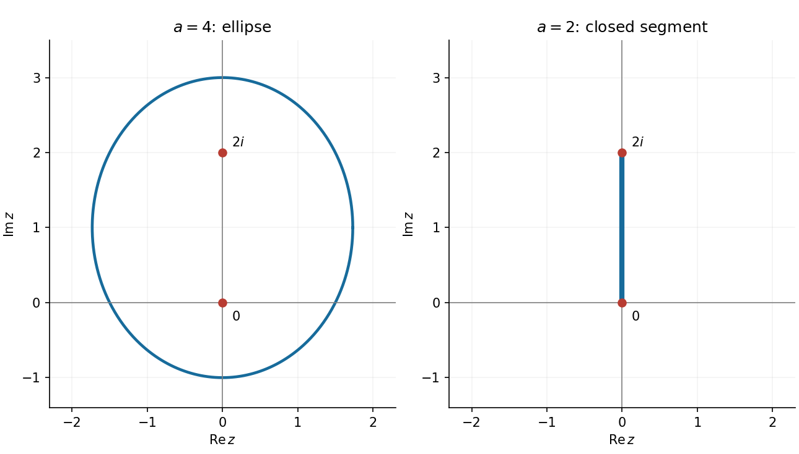

<h1 id="11/b/i/solution">Solution</h1>

↑ **Parent:** [I](../i.md)

Write $z=x+iy$. Then $|z^*+2i|=\sqrt{x^2+(y-2)^2}$ and $|z|=\sqrt{x^2+y^2}$, so the condition fixes the sum of distances from $(0,2)$ and $(0,0)$. It is an [ellipse](../../../../../../ellipse.md) with centre $(0,1)$, vertical semimajor axis $A=2$, and focal distance $c=1$. Its horizontal semiminor axis obeys $B^2=A^2-c^2=3$. Thus the [locus](../../../../../../locus-mathematics.md) is

$$
\boxed{\frac{x^2}{3}+\frac{(y-1)^2}{4}=1.}
$$

The vertices are $(0,-1)$ and $(0,3)$; the horizontal extremities are $(\pm\sqrt3,1)$. The [complex conjugation](../../../../../../complex-conjugation.md) places the second focus above the origin.

**[Figure 2](#11/b/i/image-distance-sum-loci-in-the-complex-plane-an-ellipse-and-its-limiting-segment). Distance-sum loci in the complex plane: an ellipse and its limiting segment**.

## ↑ Ancestors (14)

1. [I](../i.md)
2. [B](../../b.md)
3. [11](../../../11.md)
4. [Paper 1](../../../../paper-1-split.md)
5. [2020](../../../../split.md)
6. [Past exam of the mathematics course of the year 1 of the natural sciences course of the University of Cambridge](../../../../../split.md)
7. [Mathematics course of the year 1 of the natural sciences course of the University of Cambridge](../../../../../../mathematics-course-of-the-year-1-of-the-natural-sciences-course-of-the-university-of-cambridge.md)
8. [Year 1 of the natural sciences course of the University of Cambridge](../../../../../../year-1-of-the-natural-sciences-course-of-the-university-of-cambridge.md)
9. [Year of the natural sciences course of the University of Cambridge](../../../../../../year-of-the-natural-sciences-course-of-the-university-of-cambridge.md)
10. [Natural sciences course of the University of Cambridge](../../../../../../natural-sciences-course-of-the-university-of-cambridge.md)
11. [Course of the University of Cambridge](../../../../../../course-of-the-university-of-cambridge.md)
12. [University of Cambridge](../../../../../../university-of-cambridge-split.md)
13. [List of universities](../../../../../../list-of-universities.md)
14. [Codex Wiki](../../../../../../split.md)
