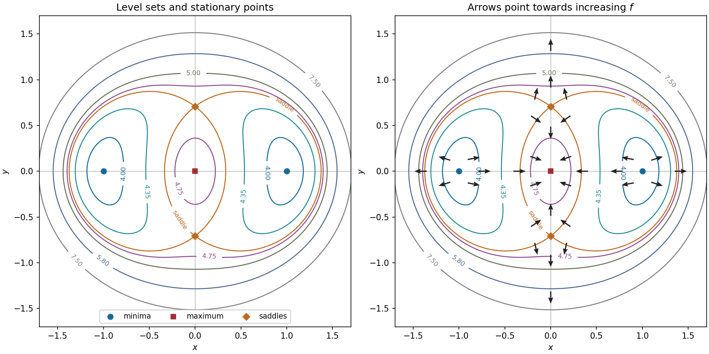

<h1 id="14/c/solution">Solution</h1>

↑ **Parent:** [C](../c.md)

The [contour plot](../../../../../contour-plot.md) is symmetric under either $x\mapsto-x$ or $y\mapsto-y$, because $f$ depends only on their squares. Denote the three critical heights by $m=\tfrac72\ln3$, $h=\tfrac14+\tfrac72\ln(7/2)$ and $M=1+\tfrac72\ln3$, where $m<h<M$.

For $m<c<h$, the [level set](../../../../../level-set.md) $f=c$ consists of separate closed curves around the two [minima](../../../../../minimum-of-a-subset-of-a-total-order.md). At $c=h$ the branches meet at the two [saddle points](../../../../../saddle-point.md). For $h<c<M$, there is an inner closed curve surrounding the [local maximum](../../../../../local-maximum.md) and an outer closed curve surrounding all five [stationary points](../../../../../stationary-point.md). At $c=M$ the inner curve shrinks to the origin; for $c>M$ only the outer closed curve remains. At each [saddle point](../../../../../saddle-point.md) the critical [level set](../../../../../level-set.md) crosses in the two directions determined by

$$
-\delta x^2+\frac{12}{7}\delta y^2=0,
\qquad\delta y=\pm\sqrt{\frac7{12}}\,\delta x.
$$

The figure plots representative [level sets](../../../../../level-set.md), including the critical saddle height; its second panel adds the [gradient](../../../../../gradient.md) directions requested below.

**[Figure 3](#14/c/image-contour-topology-and-gradient-directions-around-two-minima-a-maximum-and-two-saddles). Contour topology and gradient directions around two minima, a maximum and two saddles**.

## ↑ Ancestors (13)

1. [C](../c.md)
2. [14](../../14.md)
3. [Paper 1](../../../paper-1-split.md)
4. [2020](../../../split.md)
5. [Past exam of the mathematics course of the year 1 of the natural sciences course of the University of Cambridge](../../../../split.md)
6. [Mathematics course of the year 1 of the natural sciences course of the University of Cambridge](../../../../../mathematics-course-of-the-year-1-of-the-natural-sciences-course-of-the-university-of-cambridge.md)
7. [Year 1 of the natural sciences course of the University of Cambridge](../../../../../year-1-of-the-natural-sciences-course-of-the-university-of-cambridge.md)
8. [Year of the natural sciences course of the University of Cambridge](../../../../../year-of-the-natural-sciences-course-of-the-university-of-cambridge.md)
9. [Natural sciences course of the University of Cambridge](../../../../../natural-sciences-course-of-the-university-of-cambridge.md)
10. [Course of the University of Cambridge](../../../../../course-of-the-university-of-cambridge.md)
11. [University of Cambridge](../../../../../university-of-cambridge-split.md)
12. [List of universities](../../../../../list-of-universities.md)
13. [Codex Wiki](../../../../../split.md)
