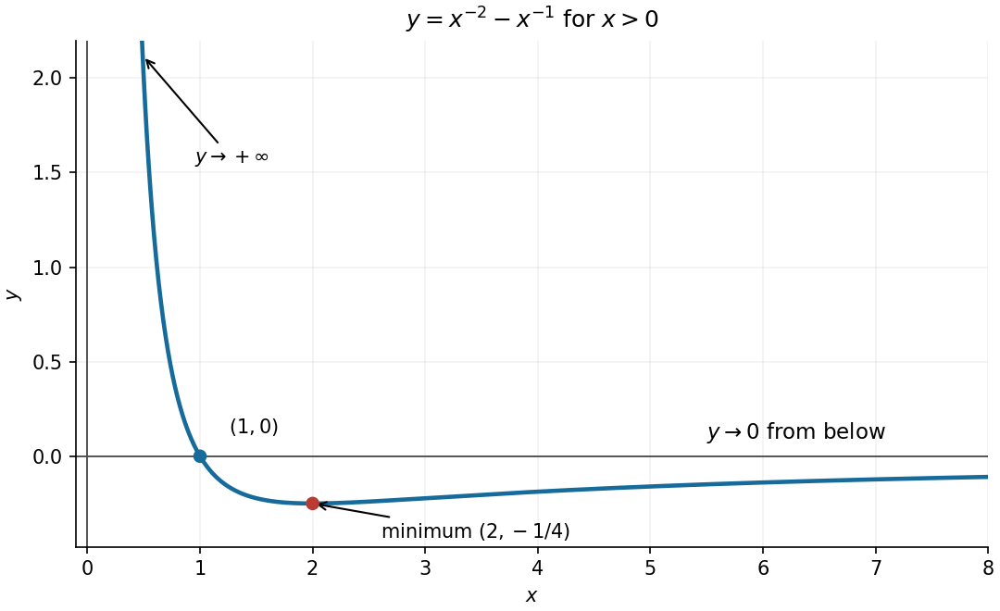

<h1 id="8/solution">Solution</h1>

↑ **Parent:** [8](../8.md)

Differentiate the two powers to locate the [stationary point](../../../../stationary-point.md):

$$
y'=\frac{x-2}{x^3}.
$$

For $x>0$, this is negative before $2$ and positive afterwards, so the [global minimum](../../../../global-minimum.md) is

$$
\boxed{x=2,\qquad y=-\frac14.}
$$

The curve crosses the horizontal axis at $x=1$. Its [limits](../../../../limit-of-a-function.md) are $+\infty$ as $x\to0^+$ and $0$ from below as $x\to\infty$, giving the vertical [asymptote](../../../../asymptote.md) $x=0$ and horizontal [asymptote](../../../../asymptote.md) $y=0$. These features determine the required sketch.

**[Figure 1](#8/image-positive-branch-of-the-reciprocal-curve-with-its-minimum-and-axis-crossing). Positive branch of the reciprocal curve, with its minimum and axis crossing**.

## ↑ Ancestors (12)

1. [8](../8.md)
2. [Paper 1](../../paper-1-split.md)
3. [2020](../../split.md)
4. [Past exam of the mathematics course of the year 1 of the natural sciences course of the University of Cambridge](../../../split.md)
5. [Mathematics course of the year 1 of the natural sciences course of the University of Cambridge](../../../../mathematics-course-of-the-year-1-of-the-natural-sciences-course-of-the-university-of-cambridge.md)
6. [Year 1 of the natural sciences course of the University of Cambridge](../../../../year-1-of-the-natural-sciences-course-of-the-university-of-cambridge.md)
7. [Year of the natural sciences course of the University of Cambridge](../../../../year-of-the-natural-sciences-course-of-the-university-of-cambridge.md)
8. [Natural sciences course of the University of Cambridge](../../../../natural-sciences-course-of-the-university-of-cambridge.md)
9. [Course of the University of Cambridge](../../../../course-of-the-university-of-cambridge.md)
10. [University of Cambridge](../../../../university-of-cambridge-split.md)
11. [List of universities](../../../../list-of-universities.md)
12. [Codex Wiki](../../../../split.md)
