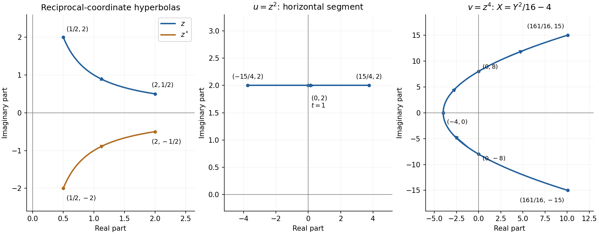
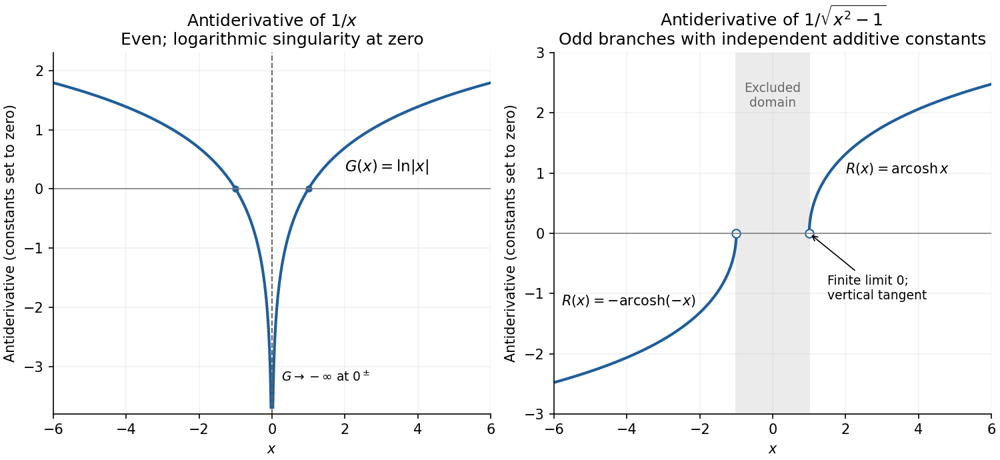

# Paper 1

↑ **Parent:** [2021](../2021.md)

[https://www.maths.cam.ac.uk/undergradnst/files/2021/papernst_ia_1_2021.pdf](https://www.maths.cam.ac.uk/undergradnst/files/2021/papernst_ia_1_2021.pdf)

**Table of contents**

- [1](#1)
  - [Solution](#1/solution)
- [2](#2)
  - [Solution](#2/solution)
- [3](#3)
  - [Solution](#3/solution)
- [4](#4)
  - [Solution](#4/solution)
- [5](#5)
  - [Solution](#5/solution)
- [6](#6)
  - [Solution](#6/solution)
- [7](#7)
  - [Solution](#7/solution)
- [8](#8)
  - [Solution](#8/solution)
- [9](#9)
  - [Solution](#9/solution)
- [10](#10)
  - [Solution](#10/solution)
- [11](#11)
  - [a](#11/a)
    - [i](#11/a/i)
      - [Solution](#11/a/i/solution)
    - [ii](#11/a/ii)
      - [Solution](#11/a/ii/solution)
  - [b](#11/b)
    - [i](#11/b/i)
      - [Solution](#11/b/i/solution)
    - [ii](#11/b/ii)
      - [Solution](#11/b/ii/solution)
    - [iii](#11/b/iii)
      - [Solution](#11/b/iii/solution)
  - [c](#11/c)
    - [Solution](#11/c/solution)
- [12](#12)
  - [a](#12/a)
    - [i](#12/a/i)
      - [Solution](#12/a/i/solution)
    - [ii](#12/a/ii)
      - [Solution](#12/a/ii/solution)
    - [iii](#12/a/iii)
      - [Solution](#12/a/iii/solution)
  - [b](#12/b)
    - [Solution](#12/b/solution)
- [13](#13)
  - [a](#13/a)
    - [i](#13/a/i)
      - [Solution](#13/a/i/solution)
    - [ii](#13/a/ii)
      - [Solution](#13/a/ii/solution)
    - [iii](#13/a/iii)
      - [Solution](#13/a/iii/solution)
  - [b](#13/b)
    - [Solution](#13/b/solution)
- [14](#14)
  - [a](#14/a)
    - [i](#14/a/i)
      - [Solution](#14/a/i/solution)
    - [ii](#14/a/ii)
      - [Solution](#14/a/ii/solution)
  - [b](#14/b)
    - [Solution](#14/b/solution)
  - [c](#14/c)
    - [Solution](#14/c/solution)
  - [d](#14/d)
    - [Solution](#14/d/solution)
- [15](#15)
  - [a](#15/a)
    - [Solution](#15/a/solution)
  - [b](#15/b)
    - [Solution](#15/b/solution)
  - [c](#15/c)
    - [Solution](#15/c/solution)
  - [d](#15/d)
    - [Solution](#15/d/solution)
- [16](#16)
  - [a](#16/a)
    - [Solution](#16/a/solution)
  - [b](#16/b)
    - [i](#16/b/i)
      - [Solution](#16/b/i/solution)
    - [ii](#16/b/ii)
      - [Solution](#16/b/ii/solution)
    - [iii](#16/b/iii)
      - [Solution](#16/b/iii/solution)
    - [iv](#16/b/iv)
      - [Solution](#16/b/iv/solution)
  - [c](#16/c)
    - [Solution](#16/c/solution)
- [17](#17)
  - [a](#17/a)
    - [Solution](#17/a/solution)
  - [b](#17/b)
    - [i](#17/b/i)
      - [Solution](#17/b/i/solution)
    - [ii](#17/b/ii)
      - [Solution](#17/b/ii/solution)
  - [c](#17/c)
    - [i](#17/c/i)
      - [Solution](#17/c/i/solution)
    - [ii](#17/c/ii)
      - [Solution](#17/c/ii/solution)
  - [d](#17/d)
    - [Solution](#17/d/solution)
- [18](#18)
  - [a](#18/a)
    - [i](#18/a/i)
      - [Solution](#18/a/i/solution)
    - [ii](#18/a/ii)
      - [Solution](#18/a/ii/solution)
  - [b](#18/b)
    - [i](#18/b/i)
      - [Solution](#18/b/i/solution)
    - [ii](#18/b/ii)
      - [Solution](#18/b/ii/solution)
  - [c](#18/c)
    - [Solution](#18/c/solution)
  - [d](#18/d)
    - [i](#18/d/i)
      - [Solution](#18/d/i/solution)
    - [ii](#18/d/ii)
      - [Solution](#18/d/ii/solution)
  - [e](#18/e)
    - [Solution](#18/e/solution)
- [19](#19)
  - [a](#19/a)
    - [i](#19/a/i)
      - [Solution](#19/a/i/solution)
    - [ii](#19/a/ii)
      - [Solution](#19/a/ii/solution)
    - [iii](#19/a/iii)
      - [Solution](#19/a/iii/solution)
  - [b](#19/b)
    - [Solution](#19/b/solution)
- [20](#20)
  - [a](#20/a)
    - [Solution](#20/a/solution)
  - [b](#20/b)
    - [Solution](#20/b/solution)
  - [c](#20/c)
    - [Solution](#20/c/solution)

## 1

↑ **Parent:** [Paper 1](paper-1.md)

<h3 id="1/solution">Solution</h3>

↑ **Parent:** [1](#1)

Apply the [chain rule](../../calculus.md#chain-rule) twice: once to the square and once to the argument $x^3$ of the [sine](../../geometry-and-topology.md#sine). The inner [derivative](../../calculus.md#derivative) is $y'=3x^2\cos(x^3)-2\sin(2x)$. Therefore

$$
\boxed{\frac{d(y^2)}{dx}=2\bigl[\sin(x^3)+\cos(2x)\bigr]\bigl[3x^2\cos(x^3)-2\sin(2x)\bigr].}
$$

The original PDF has $\sin(x^3)$, rather than the cube of $\sin x$.

## 2

↑ **Parent:** [Paper 1](paper-1.md)

<h3 id="2/solution">Solution</h3>

↑ **Parent:** [2](#2)

Find two numbers with sum $-1$ and product $-2$: they are $-2$ and $1$. Thus the [quadratic polynomial](../../polynomial.md#quadratic-polynomial) factorizes as

$$
\boxed{x^2-x-2=(x-2)(x+1).}
$$

The product is negative precisely when its two factors have opposite signs. This occurs between its two [polynomial roots](../../polynomial.md#root-of-a-polynomial), so

$$
\boxed{-1<x<2.}
$$

The endpoints give zero and are excluded by the strict inequality.

## 3

↑ **Parent:** [Paper 1](paper-1.md)

<h3 id="3/solution">Solution</h3>

↑ **Parent:** [3](#3)

Using the [Pythagorean trigonometric identity](../../geometry-and-topology.md#pythagorean-trigonometric-identity) and the [double-angle formula](../../geometry-and-topology.md#double-angle-formula),

$$
\sin^4\theta+\cos^4\theta=(\sin^2\theta+\cos^2\theta)^2-2\sin^2\theta\cos^2\theta=1-\frac12\sin^2(2\theta).
$$

The required value $1/2$ therefore occurs when $\sin^2(2\theta)=1$. Within $0\le\theta\le\pi$, the only possibilities are $2\theta=\pi/2$ and $3\pi/2$. Hence

$$
\boxed{\theta=\frac\pi4\quad\text{or}\quad\frac{3\pi}4.}
$$

Equivalently equality requires $\sin^2\theta=\cos^2\theta=1/2$.

## 4

↑ **Parent:** [Paper 1](paper-1.md)

<h3 id="4/solution">Solution</h3>

↑ **Parent:** [4](#4)

Both sums are [geometric series](../../sequence-and-series.md#geometric-series). For first term $a$ and common ratio $r$ with $|r|<1$, the sum is $a/(1-r)$. Taking the initial term to be $2$ gives

$$
\boxed{2+1+\frac12+\frac14+\cdots=\frac2{1-1/2}=4,}
$$

and

$$
\boxed{2-1+\frac12-\frac14+\cdots=\frac2{1+1/2}=\frac43.}
$$

Both have [absolute convergence](../../sequence-and-series.md#absolute-convergence) because the series of absolute values has ratio $1/2$.

## 5

↑ **Parent:** [Paper 1](paper-1.md)

<h3 id="5/solution">Solution</h3>

↑ **Parent:** [5](#5)

For $f(x)=xe^{-2x^2}$, the [product rule](../../calculus.md#product-rule) and [chain rule](../../calculus.md#chain-rule) give

$$
f'(x)=e^{-2x^2}(1-4x^2).
$$

The positive exponential factor makes $f$ increasing for $0<x<1/2$ and decreasing for $1/2<x<1$. Its only interior [stationary point](../../calculus-of-variations.md#stationary-point) is therefore a maximum at $x=1/2$. Checking it together with both endpoints,

$$
f(0)=0,\qquad f(1/2)=\frac12e^{-1/2},\qquad f(1)=e^{-2}.
$$

Consequently

$$
\boxed{\min_{[0,1]}f=0\text{ at }x=0,\qquad\max_{[0,1]}f=\frac1{2\sqrt e}\text{ at }x=\frac12.}
$$

Checking the endpoints is necessary for extrema on a [closed interval](../../real-analysis.md#closed-real-interval).

## 6

↑ **Parent:** [Paper 1](paper-1.md)

<h3 id="6/solution">Solution</h3>

↑ **Parent:** [6](#6)

Both segments start at $(1,1,1)$, so their direction [vectors](../../vector-space.md#vector) are $\mathbf a=(-1,-1,-1)$ and $\mathbf b=(1,1,0)$. Their [dot product](../../inner-product.md#dot-product) is $-2$, and their [norms](../../normed-vector-space.md#norm) are $\sqrt3$ and $\sqrt2$. Thus

$$
\boxed{\cos\theta=\frac{\mathbf a\cdot\mathbf b}{|\mathbf a||\mathbf b|}=-\frac2{\sqrt6}=-\sqrt{\frac23}.}
$$

The angle between the rays lies in $[0,\pi]$, so its [sine](../../geometry-and-topology.md#sine) is nonnegative:

$$
\boxed{\sin\theta=\sqrt{1-\cos^2\theta}=\frac1{\sqrt3}.}
$$

The negative [cosine](../../geometry-and-topology.md#cosine) correctly identifies an obtuse angle. One also obtains the [sine](../../geometry-and-topology.md#sine) from $|\mathbf a\times\mathbf b|/(|\mathbf a||\mathbf b|)=\sqrt2/\sqrt6$, using the [cross product](../../vector-space.md#cross-product).

## 7

↑ **Parent:** [Paper 1](paper-1.md)

<h3 id="7/solution">Solution</h3>

↑ **Parent:** [7](#7)

Let $p(x)=x^3-5x-1$. Its values at useful points are

$$
p(-3)=-13,\quad p(-2)=1,\quad p(-1)=3,\quad p(0)=-1,\quad p(2)=-3,\quad p(3)=11.
$$

Since a [polynomial](../../polynomial.md) is a [continuous function](../../calculus.md#continuous-function), the [intermediate value theorem](../../calculus.md#intermediate-value-theorem) gives one [polynomial root](../../polynomial.md#root-of-a-polynomial) in each of the disjoint intervals $(-3,-2)$, $(-1,0)$ and $(2,3)$. A nonzero [cubic polynomial](../../polynomial.md#cubic-polynomial) has at most three distinct [polynomial roots](../../polynomial.md#root-of-a-polynomial). Hence it has

$$
\boxed{\text{exactly three distinct real roots}.}
$$

These three distinct [polynomial roots](../../polynomial.md#root-of-a-polynomial) already exhaust its [degree of a polynomial](../../polynomial.md#degree-of-a-polynomial), so each has [multiplicity of a root](../../polynomial.md#multiplicity-of-a-root) one.

## 8

↑ **Parent:** [Paper 1](paper-1.md)

<h3 id="8/solution">Solution</h3>

↑ **Parent:** [8](#8)

Use [integration by substitution](../../integral.md#integration-by-substitution) with $u=x^4$, so $du=4x^3\,dx$. Then

$$
\boxed{\int x^3e^{-x^4}\,dx=\frac14\int e^{-u}\,du=-\frac14e^{-x^4}+C.}
$$

Differentiating the answer by the [chain rule](../../calculus.md#chain-rule) gives $x^3e^{-x^4}$, confirming the [antiderivative](../../integral.md#antiderivative). The real [constant of integration](../../integral.md#constant-of-integration) $C$ is arbitrary.

## 9

↑ **Parent:** [Paper 1](paper-1.md)

<h3 id="9/solution">Solution</h3>

↑ **Parent:** [9](#9)

The [tangent half-angle substitution](../../geometry-and-topology.md#tangent-half-angle-substitution) gives $\sin\theta=2t/(1+t^2)$ and $\cos\theta=(1-t^2)/(1+t^2)$. Dividing and then taking the reciprocal square of the [cosine](../../geometry-and-topology.md#cosine) gives

$$
\boxed{\tan\theta=\frac{2t}{1-t^2},\qquad\sec^2\theta=\frac{(1+t^2)^2}{(1-t^2)^2}.}
$$

These formulas apply where $t$ is defined and $t\ne\pm1$; at $t=\pm1$ the original [tangent](../../geometry-and-topology.md#tangent) and [secant function](../../geometry-and-topology.md#secant-trigonometry) are undefined because $\cos\theta=0$.

## 10

↑ **Parent:** [Paper 1](paper-1.md)

<h3 id="10/solution">Solution</h3>

↑ **Parent:** [10](#10)

By [implicit differentiation](../../multivariable-calculus.md#implicit-differentiation) of the [ellipse](../../euclidean-geometry.md#ellipse) equation,

$$
18x+32y\frac{dy}{dx}=0\quad\Longrightarrow\quad\left.\frac{dy}{dx}\right|_{(1,1)}=-\frac9{16}.
$$

The [tangent line](../../calculus.md#tangent-line) through $(1,1)$ is therefore

$$
\boxed{y-1=-\frac9{16}(x-1),\qquad\text{equivalently }9x+16y=25.}
$$

Its [normal vector](../../differential-geometry.md#normal-vector) is $(9,16)$, parallel to the [gradient](../../multivariable-calculus.md#gradient) $(18,32)$ of $9x^2+16y^2$ at that point.

## 11

↑ **Parent:** [Paper 1](paper-1.md)

<h3 id="11/a">a</h3>

↑ **Parent:** [11](#11)

<h4 id="11/a/i">i</h4>

↑ **Parent:** [A](#11/a)

<h5 id="11/a/i/solution">Solution</h5>

↑ **Parent:** [I](#11/a/i)

Expand the square using $i^2=-1$:

$$
\left(\frac12+2i\right)^2=\frac14+2i-4=-\frac{15}4+2i.
$$

Thus the [real part](../../complex-analysis.md#real-part) and [imaginary part](../../complex-analysis.md#imaginary-part) are

$$
\boxed{\operatorname{Re}=-\frac{15}4,\qquad\operatorname{Im}=2.}
$$

<h4 id="11/a/ii">ii</h4>

↑ **Parent:** [A](#11/a)

<h5 id="11/a/ii/solution">Solution</h5>

↑ **Parent:** [Ii](#11/a/ii)

Square the result of part (a)(i), keeping the cross term:

$$
\left(\frac12+2i\right)^4=\left(-\frac{15}4+2i\right)^2=\frac{225}{16}-4-15i=\frac{161}{16}-15i.
$$

Hence

$$
\boxed{\operatorname{Re}=\frac{161}{16},\qquad\operatorname{Im}=-15.}
$$

<h3 id="11/b">b</h3>

↑ **Parent:** [11](#11)

<h4 id="11/b/i">i</h4>

↑ **Parent:** [B](#11/b)

<h5 id="11/b/i/solution">Solution</h5>

↑ **Parent:** [I](#11/b/i)

Write $z=X+iY$. Its coordinates are $X=t$, $Y=1/t$, so $XY=1$. For the given positive range of $t$, this traces a segment of the first-quadrant [hyperbola](../../euclidean-geometry.md#hyperbola), moving rightward and downward:

$$
\boxed{z:\ (1/2,2)\longrightarrow(2,1/2).}
$$

The [complex conjugate](../../complex-analysis.md#complex-conjugate) is $z^*=t-i/t$. It is the reflection in the [real axis](../../complex-analysis.md#real-axis), tracing $XY=-1$ in the fourth quadrant, rightward and upward:

$$
\boxed{z^*:\ (1/2,-2)\longrightarrow(2,-1/2).}
$$

Neither trajectory crosses either axis, because $t$ and $1/t$ remain nonzero. The left panel of the figure marks the endpoints and directions.

**[Figure 1](#11/b/i/image-trajectories-under-complex-conjugation-squaring-and-fourth-powers-with-endpoints-and-axis-crossings). Trajectories under complex conjugation, squaring and fourth powers, with endpoints and axis crossings**.

<h4 id="11/b/ii">ii</h4>

↑ **Parent:** [B](#11/b)

<h5 id="11/b/ii/solution">Solution</h5>

↑ **Parent:** [Ii](#11/b/ii)

Squaring gives

$$
u=z^2=t^2-t^{-2}+2i.
$$

Thus $\operatorname{Im}u=2$ is constant, while $d(\operatorname{Re}u)/dt=2t+2t^{-3}>0$. The trajectory is the horizontal line segment

$$
\boxed{u:\ (-15/4,2)\longrightarrow(15/4,2),\qquad\operatorname{Im}u=2.}
$$

It crosses the [imaginary axis](../../complex-analysis.md#imaginary-axis) at $\boxed{(0,2)}$, when $t=1$, and never crosses the [real axis](../../complex-analysis.md#real-axis). The middle panel shows the rightward direction.

<h4 id="11/b/iii">iii</h4>

↑ **Parent:** [B](#11/b)

<h5 id="11/b/iii/solution">Solution</h5>

↑ **Parent:** [Iii](#11/b/iii)

Put $s=t^2-t^{-2}$. Part (b)(ii) gives $u=s+2i$, so

$$
v=u^2=(s^2-4)+4si.
$$

The parameter $s$ increases strictly from $-15/4$ to $15/4$. Therefore the [imaginary part](../../complex-analysis.md#imaginary-part) $Y=4s$ increases from $-15$ to $15$, while the [real part](../../complex-analysis.md#real-part) is $X=s^2-4$. The endpoints are

$$
\boxed{v:\ (161/16,-15)\longrightarrow(161/16,15).}
$$

The [real axis](../../complex-analysis.md#real-axis) crossing is at $s=0$, giving $\boxed{(-4,0)}$ at $t=1$. The two [imaginary axis](../../complex-analysis.md#imaginary-axis) crossings satisfy $s^2=4$, giving

$$
\boxed{(0,-8)\text{ at }t=\sqrt{\sqrt2-1},\qquad(0,8)\text{ at }t=\sqrt{\sqrt2+1}.}
$$

In order, the trajectory passes from its lower endpoint through $(0,-8)$, then the leftmost point $(-4,0)$, then $(0,8)$, to its upper endpoint. It is a right-opening [parabola](../../euclidean-geometry.md#parabola) segment, traversed continuously upward as shown in the right panel.

<h3 id="11/c">c</h3>

↑ **Parent:** [11](#11)

<h4 id="11/c/solution">Solution</h4>

↑ **Parent:** [C](#11/c)

From $X=s^2-4$ and $Y=4s$, elimination of $s$ gives

$$
\boxed{\operatorname{Re}v=\frac{(\operatorname{Im}v)^2}{16}-4,\qquad-15\le\operatorname{Im}v\le15.}
$$

This makes the [real part](../../complex-analysis.md#real-part) a [quadratic function](../../polynomial.md#quadratic-function) of the [imaginary part](../../complex-analysis.md#imaginary-part). There is no sign ambiguity because $Y$ determines $s=Y/4$ uniquely. The calculation illustrates [power maps of a reciprocal-coordinate hyperbola](../../complex-analysis.md#power-maps-of-a-reciprocal-coordinate-hyperbola).

## 12

↑ **Parent:** [Paper 1](paper-1.md)

<h3 id="12/a">a</h3>

↑ **Parent:** [12](#12)

<h4 id="12/a/i">i</h4>

↑ **Parent:** [A](#12/a)

<h5 id="12/a/i/solution">Solution</h5>

↑ **Parent:** [I](#12/a/i)

In [spherical coordinates](../../multivariable-calculus.md#spherical-coordinate-system), with polar angle $0\le\theta\le\pi$ and azimuth $0\le\varphi<2\pi$, the [volume element](../../integral.md#volume-element) is

$$
\boxed{dV=r^2\sin\theta\,dr\,d\theta\,d\varphi.}
$$

The [mass density](../../fluid-mechanics.md#density) is radial, so integrating over both angles gives

$$
\begin{aligned}
M&=4\pi A\int_0^R(1-e^{-r/r_0})\,dr\\
&=4\pi A\left[R-r_0(1-e^{-R/r_0})\right].
\end{aligned}
$$

Writing $q=r_0/R>0$, this becomes

$$
\boxed{M=4\pi ARf(q),\qquad f(q)=1-q+qe^{-1/q}.}
$$

Although the [mass density](../../fluid-mechanics.md#density) diverges like $A/(r_0r)$ near the origin, multiplication by the spherical [volume element](../../integral.md#volume-element) gives an integrable expression. Thus the central singularity does not produce infinite [mass](../../classical-mechanics.md#mass).

<h4 id="12/a/ii">ii</h4>

↑ **Parent:** [A](#12/a)

<h5 id="12/a/ii/solution">Solution</h5>

↑ **Parent:** [Ii](#12/a/ii)

For $q=r_0/R\to\infty$, expand the [exponential function](../../calculus.md#exponential-function) in powers of $1/q$:

$$
e^{-1/q}=1-\frac1q+\frac1{2q^2}-\frac1{6q^3}+\frac1{24q^4}+O(q^{-5}).
$$

The constant and linear terms cancel in $1-q+qe^{-1/q}$, giving

$$
\boxed{f(q)=\frac1{2q}-\frac1{6q^2}+\frac1{24q^3}+O(q^{-4})\sim\frac1{2q}.}
$$

For $q\to0^+$, $e^{-1/q}$ is exponentially small:

$$
\boxed{f(q)=1-q+O(qe^{-1/q})\sim1-q,\qquad f(q)\to1.}
$$

The small-$q$ correction $qe^{-1/q}$ is smaller than every positive power of $q$ beyond the displayed linear term. In dimensional terms, the large-$q$ leading [mass](../../classical-mechanics.md#mass) is $2\pi AR^2/r_0$, while the small-$q$ limit is $4\pi AR$.

<h4 id="12/a/iii">iii</h4>

↑ **Parent:** [A](#12/a)

<h5 id="12/a/iii/solution">Solution</h5>

↑ **Parent:** [Iii](#12/a/iii)

The positive-domain graph starts with limiting value $f(0^+)=1$ and limiting slope $-1$, then decreases towards the horizontal asymptote $f=0$, with $f(q)\sim1/(2q)$ for large $q$. In fact direct [differentiation](../../calculus.md#differentiation) gives

$$
f'(q)=-1+\left(1+\frac1q\right)e^{-1/q}<0,\qquad f''(q)=\frac{e^{-1/q}}{q^3}>0.
$$

The first inequality follows from $e^s>1+s$ for $s>0$. Thus the graph is strictly decreasing and convex upward, with $0<f(q)<1$ and no [stationary points](../../calculus-of-variations.md#stationary-point). The integral representation $f(q)=\int_0^1(1-e^{-s/q})\,ds$ also shows its positivity.

**[Figure 2](#12/a/iii/image-the-spherical-mass-factor-f-q-1-q-plus-qe-1-q-and-its-two-limiting-approximations). The spherical mass factor $f(q)=1-q+qe^{-1/q}$ and its two limiting approximations**.

These properties belong to the reusable [exponential spherical mass factor](../../multivariable-calculus.md#exponential-spherical-mass-factor).

<h3 id="12/b">b</h3>

↑ **Parent:** [12](#12)

<h4 id="12/b/solution">Solution</h4>

↑ **Parent:** [B](#12/b)

Use [cylindrical coordinates](../../multivariable-calculus.md#cylindrical-coordinate-system) $x=r\cos\theta$, $y=r\sin\theta$. The [Jacobian determinant](../../multivariable-calculus.md#jacobian-determinant) gives

$$
\boxed{dV=r\,dr\,d\theta\,dz.}
$$

The inequalities imply $-d<z<0$ and $0\le r<a\sqrt{1+z/d}$. Thus the [volume](../../geometry-and-topology.md#volume) is

$$
\begin{aligned}
V&=\int_{-d}^0\int_0^{2\pi}\int_0^{a\sqrt{1+z/d}}r\,dr\,d\theta\,dz\\
&=\pi a^2\int_{-d}^0\left(1+\frac zd\right)dz\\
&=\boxed{\frac12\pi a^2d.}
\end{aligned}
$$

Equivalently, integrating vertically first gives $V=\int_0^{2\pi}\int_0^a\int_{d(r^2/a^2-1)}^0r\,dz\,dr\,d\theta$. The region is bounded by an [elliptic paraboloid](../../euclidean-geometry.md#elliptic-paraboloid) and its top disc; its [volume](../../geometry-and-topology.md#volume) is half that of the cylinder with base radius $a$ and height $d$. Including or excluding the boundary surfaces does not change the [volume](../../geometry-and-topology.md#volume).

## 13

↑ **Parent:** [Paper 1](paper-1.md)

<h3 id="13/a">a</h3>

↑ **Parent:** [13](#13)

<h4 id="13/a/i">i</h4>

↑ **Parent:** [A](#13/a)

<h5 id="13/a/i/solution">Solution</h5>

↑ **Parent:** [I](#13/a/i)

The [homogeneous linear differential equation](../../differential-equation.md#homogeneous-linear-differential-equation) is $y''+y=0$. Its [characteristic equation](../../linear-ordinary-differential-equation.md#characteristic-equation-of-a-constant-coefficient-differential-equation) is $\lambda^2+1=0$, with roots $\pm i$. The general real [complementary function](../../linear-ordinary-differential-equation.md#homogeneous-solution) is therefore

$$
\boxed{y_h(x)=C_1\cos x+C_2\sin x.}
$$

The two trigonometric solutions are linearly independent, supplying the two arbitrary constants required for this second-order [linear ordinary differential equation](../../linear-ordinary-differential-equation.md).

<h4 id="13/a/ii">ii</h4>

↑ **Parent:** [A](#13/a)

<h5 id="13/a/ii/solution">Solution</h5>

↑ **Parent:** [Ii](#13/a/ii)

Use the [method of undetermined coefficients](../../linear-ordinary-differential-equation.md#method-of-undetermined-coefficients), choosing a [particular solution](../../linear-ordinary-differential-equation.md#particular-solution) $y_p=A+B\cos2x$. Substitution gives

$$
y_p''+y_p=A-3B\cos2x.
$$

Matching the constant and [cosine](../../geometry-and-topology.md#cosine) coefficients to $\tfrac12-\tfrac12\cos2x$ gives $A=1/2$, $B=1/6$. Thus

$$
\boxed{y_p(x)=\frac12+\frac16\cos2x.}
$$

Neither forcing term is resonant with the homogeneous [angular frequency](../../lagrangian-mechanics.md#angular-frequency) one.

<h4 id="13/a/iii">iii</h4>

↑ **Parent:** [A](#13/a)

<h5 id="13/a/iii/solution">Solution</h5>

↑ **Parent:** [Iii](#13/a/iii)

Combine the [complementary function](../../linear-ordinary-differential-equation.md#homogeneous-solution) and [particular solution](../../linear-ordinary-differential-equation.md#particular-solution):

$$
y=C_1\cos x+C_2\sin x+\frac12+\frac16\cos2x.
$$

The [boundary condition](../../differential-equation.md#boundary-condition) at zero gives $C_1+2/3=0$, while that at $\pi/2$ gives $C_2+1/3=0$. Hence

$$
\boxed{y(x)=-\frac23\cos x-\frac13\sin x+\frac12+\frac16\cos2x.}
$$

The two [boundary conditions](../../differential-equation.md#boundary-condition) determine both constants uniquely; substitution at each endpoint gives zero.

<h3 id="13/b">b</h3>

↑ **Parent:** [13](#13)

<h4 id="13/b/solution">Solution</h4>

↑ **Parent:** [B](#13/b)

First retain the equilibrium solution $\boxed{y\equiv0}$. Any nonzero real solution has constant sign on its interval of existence, since the polynomial right-hand side is [locally Lipschitz](../../real-analysis.md#locally-lipschitz-function) and [Picard-Lindelöf theorem](../../differential-equation.md#picard-lindelof-theorem) prevents crossing the zero solution.

For a nonzero solution, the [Bernoulli differential equation](../../differential-equation.md#bernoulli-differential-equation) substitution $u=y^{-4}$ gives

$$
u'=-4y^{-5}y'=-8u-16.
$$

This [linear ordinary differential equation](../../linear-ordinary-differential-equation.md) has solution $u+2=Ce^{-8x}$. Therefore every nonzero real solution is

$$
\boxed{y(x)=\pm\bigl(Ce^{-8x}-2\bigr)^{-1/4},\qquad C>0,\quad x<\frac18\ln\frac C2.}
$$

Either sign may be chosen and remains fixed. The restriction ensures $y^{-4}>0$; nonpositive $C$ gives no nonzero real solution. These are maximal real intervals, and their restrictions are also solutions. As the right endpoint is approached, $|y|$ diverges in [finite-time blowup](../../differential-equation.md#finite-time-blowup). The substitution would have lost $y=0$ if it had not been checked separately.

## 14

↑ **Parent:** [Paper 1](paper-1.md)

<h3 id="14/a">a</h3>

↑ **Parent:** [14](#14)

<h4 id="14/a/i">i</h4>

↑ **Parent:** [A](#14/a)

<h5 id="14/a/i/solution">Solution</h5>

↑ **Parent:** [I](#14/a/i)

For the [force](../../force.md) magnitude in [Newton's law of universal gravitation](../../newton-s-law-of-universal-gravitation.md), the [total differential](../../multivariable-calculus.md#total-differential) is

$$
\boxed{dF=\frac{Gm_2}{r^2}\,dm_1+\frac{Gm_1}{r^2}\,dm_2-\frac{2Gm_1m_2}{r^3}\,dr.}
$$

Dividing by the positive value $F$ gives the particularly useful relative form

$$
\boxed{\frac{dF}{F}=\frac{dm_1}{m_1}+\frac{dm_2}{m_2}-2\frac{dr}{r}.}
$$

For finite small changes this gives the first-order approximation to the fractional change; higher-order products of increments are omitted.

<h4 id="14/a/ii">ii</h4>

↑ **Parent:** [A](#14/a)

<h5 id="14/a/ii/solution">Solution</h5>

↑ **Parent:** [Ii](#14/a/ii)

Set $dF=0$ in the relative [total differential](../../multivariable-calculus.md#total-differential) and use the two equal $1\%$ mass increases:

$$
0=0.01+0.01-2\frac{dr}{r}\quad\Longrightarrow\quad\boxed{\frac{dr}{r}=0.01.}
$$

Thus the separation must **increase by $1\%$**. In this special case the result is also exact: the [mass](../../classical-mechanics.md#mass) product increases by $1.01^2$, and preserving the inverse-square [force](../../force.md) requires $r_{\rm new}^2=1.01^2r^2$, hence $r_{\rm new}=1.01r$.

<h3 id="14/b">b</h3>

↑ **Parent:** [14](#14)

<h4 id="14/b/solution">Solution</h4>

↑ **Parent:** [B](#14/b)

The original PDF specifies evaluation at $(1,1,1)$; the local TeX incorrectly gives $(1,1,0)$. Write the scalar field explicitly as $f=c/(x^2+y^2+z^2)$. Its [gradient](../../multivariable-calculus.md#gradient) is

$$
\nabla f=-\frac{2c(x,y,z)}{(x^2+y^2+z^2)^2},\qquad\nabla f(1,1,1)=-\frac{2c}{9}(1,1,1).
$$

A [directional derivative](../../multivariable-calculus.md#directional-derivative) measures rate per unit distance, so normalize the direction to the [unit vector](../../vector-space.md#unit-vector) $\mathbf n=(1,1,0)/\sqrt2$. Then

$$
\boxed{D_{\mathbf n}f(1,1,1)=\nabla f(1,1,1)\cdot\mathbf n=-\frac{2\sqrt2\,c}{9}.}
$$

Using the unnormalized direction vector would instead differentiate with respect to a path parameter, not distance, and would give a different scale.

<h3 id="14/c">c</h3>

↑ **Parent:** [14](#14)

<h4 id="14/c/solution">Solution</h4>

↑ **Parent:** [C](#14/c)

The polar-coordinate [Jacobian matrix](../../multivariable-calculus.md#jacobian-matrix) and its [Jacobian determinant](../../multivariable-calculus.md#jacobian-determinant) are

$$
\frac{\partial(x,y)}{\partial(r,\theta)}=\begin{pmatrix}\cos\theta&-r\sin\theta\\\sin\theta&r\cos\theta\end{pmatrix},\qquad\boxed{J=r\cos^2\theta+r\sin^2\theta=r.}
$$

For $r>0$, the corresponding [area element](../../differential-geometry.md#area-element-of-a-surface) is $dx\,dy=r\,dr\,d\theta$. The determinant vanishes at $r=0$, where the polar angle does not give a unique coordinate representation.

<h3 id="14/d">d</h3>

↑ **Parent:** [14](#14)

<h4 id="14/d/solution">Solution</h4>

↑ **Parent:** [D](#14/d)

Put $D=\sigma^2>0$ and $\xi=x-x_0$. Logarithmic [differentiation](../../calculus.md#differentiation) of the positive [Gaussian function](../../calculus.md#gaussian-function) gives

$$
\phi_t=\left(-\frac1{2t}+\frac{\xi^2}{4Dt^2}\right)\phi,\qquad\phi_x=-\frac{\xi}{2Dt}\phi.
$$

Differentiating once more in space gives

$$
\phi_{xx}=\left(-\frac1{2Dt}+\frac{\xi^2}{4D^2t^2}\right)\phi.
$$

Multiplying by $D$ proves

$$
\boxed{\phi_t=D\phi_{xx}=\sigma^2\phi_{xx}\qquad(t>0).}
$$

The assumption $\sigma\ne0$ ensures both the normalization and exponential denominator are defined. This is the [heat kernel](../../diffusion-equation.md#heat-kernel), with [diffusion coefficient](../../brownian-motion.md#diffusion-coefficient) $D$ and centre $x_0$.

## 15

↑ **Parent:** [Paper 1](paper-1.md)

<h3 id="15/a">a</h3>

↑ **Parent:** [15](#15)

<h4 id="15/a/solution">Solution</h4>

↑ **Parent:** [A](#15/a)

For $f$ sufficiently differentiable on the interval between $a$ and $x$, [Taylor's theorem](../../calculus.md#taylor-s-theorem) with its first $n$ terms reads

$$
\boxed{f(x)=\sum_{k=0}^{n-1}\frac{f^{(k)}(a)}{k!}(x-a)^k+R_n(x),\qquad R_n(x)=\frac{f^{(n)}(\xi)}{n!}(x-a)^n,}
$$

where $\xi$ lies between $a$ and $x$. This is the [Taylor theorem with Lagrange remainder](../../calculus.md#taylor-theorem-with-lagrange-remainder). For example, $|f^{(n)}|\le M$ on that interval gives $|R_n(x)|\le M|x-a|^n/n!$. The finite formula does not assume that an infinite [Taylor series](../../calculus.md#taylor-series) converges to the function; that further conclusion requires the remainders to tend to zero.

<h3 id="15/b">b</h3>

↑ **Parent:** [15](#15)

<h4 id="15/b/solution">Solution</h4>

↑ **Parent:** [B](#15/b)

The [Maclaurin series](../../calculus.md#maclaurin-series) of the [hyperbolic cosine](../../calculus.md#hyperbolic-cosine) and [cosine](../../geometry-and-topology.md#cosine) are

$$
\cosh x=1+\frac{x^2}{2}+\frac{x^4}{24}+O(x^6),\qquad\cos x=1-\frac{x^2}{2}+\frac{x^4}{24}+O(x^6).
$$

Both are even, so write their quotient as $1+ax^2+bx^4+O(x^6)$. Multiplication by the denominator gives coefficients $a-1/2$ and $b-a/2+1/24$. Matching the numerator yields $a=1$ and $b=1/2$. Thus

$$
\boxed{\frac{\cosh x}{\cos x}=1+x^2+\frac{x^4}{2}+O(x^6).}
$$

The denominator is nonzero near the expansion point, so division of the [power series](../../sequence-and-series.md#power-series) is valid there.

<h3 id="15/c">c</h3>

↑ **Parent:** [15](#15)

<h4 id="15/c/solution">Solution</h4>

↑ **Parent:** [C](#15/c)

For $x>0$, the definition of [hyperbolic cosine](../../calculus.md#hyperbolic-cosine) simplifies the composite function exactly:

$$
\cosh(\ln x)=\frac{e^{\ln x}+e^{-\ln x}}2=\frac12\left(x+\frac1x\right).
$$

Let $h=x-2$. The [geometric series](../../sequence-and-series.md#geometric-series) gives

$$
\frac1{2+h}=\frac12\left(1-\frac h2+\frac{h^2}4-\frac{h^3}8+O(h^4)\right).
$$

Adding $2+h$ and dividing by two gives the requested [Taylor expansion](../../calculus.md#taylor-expansion):

$$
\boxed{\cosh(\ln x)=\frac54+\frac38(x-2)+\frac1{16}(x-2)^2-\frac1{32}(x-2)^3+O((x-2)^4).}
$$

The underlying infinite geometric expansion has $|x-2|<2$.

<h3 id="15/d">d</h3>

↑ **Parent:** [15](#15)

<h4 id="15/d/solution">Solution</h4>

↑ **Parent:** [D](#15/d)

Put $w=e^x-1=x+x^2/2+x^3/6+O(x^4)$. The local [logarithmic series](../../calculus.md#mercator-series) $\ln(1-w)=-w-w^2/2-w^3/3+O(w^4)$ gives

$$
\boxed{\ln(2-e^x)=-x-x^2-x^3+O(x^4).}
$$

For the infinite [Taylor series](../../calculus.md#taylor-series), it is necessary to distinguish the real domain of the logarithm, $x<\ln2$, from its convergence interval about zero. Write $a=\ln2$. The complex zeros of $2-e^z$ are $a+2\pi i k$ for integers $k$, so the nearest [logarithmic singularity](../../analysis.md#logarithmic-singularity) to zero is at $a$. The [radius of convergence](../../sequence-and-series.md#radius-of-convergence) is therefore $a$, giving convergence for $|x|<a$ and divergence for $|x|>a$.

The two endpoints need separate checking. Factor off the nearest singularity:

$$
h(z)=\ln(1-z/a)+H(z),\qquad H(z)=\ln\left(\frac{2-e^z}{1-z/a}\right),\qquad H(0)=0.
$$

The quotient has a nonzero removable value $2a$ at $z=a$; its other zeros are at $a+2\pi i k$ with $k\ne0$. Consequently it has a [holomorphic logarithm](../../complex-analysis.md#holomorphic-logarithm) on a zero-free disk larger than $|z|\le a$, which is a [simply connected domain](../../complex-analysis.md#simply-connected-domain), and the [Taylor series](../../calculus.md#taylor-series) of $H$ converges absolutely at both real endpoints. At $x=-a$, the remaining series $-\sum_{n\ge1}(-1)^n/n$ converges by the [alternating series test](../../sequence-and-series.md#alternating-series-test). At $x=a$, it is $-\sum_{n\ge1}1/n$ and diverges. Thus the full real convergence set is

$$
\boxed{-\ln2\le x<\ln2.}
$$

Convergence is absolute in the open interval and conditional at the left endpoint, where the sum equals $\ln(3/2)$. This endpoint distinction is an instance of [isolating a logarithmic singularity to test a power-series endpoint](../../sequence-and-series.md#isolating-a-logarithmic-singularity-to-test-a-power-series-endpoint).

## 16

↑ **Parent:** [Paper 1](paper-1.md)

<h3 id="16/a">a</h3>

↑ **Parent:** [16](#16)

<h4 id="16/a/solution">Solution</h4>

↑ **Parent:** [A](#16/a)

Assume the three standard dice are fair and [independent](../../random-variable.md#independent-random-variables). For one die $X$, a [discrete uniform distribution](../../discrete-probability-distribution.md#discrete-uniform-distribution) on $1,\ldots,6$ gives

$$
\mathbb EX=\frac{1+2+3+4+5+6}{6}=\frac72,\qquad\mathbb EX^2=\frac{1+4+9+16+25+36}{6}=\frac{91}6.
$$

The [variance](../../variance.md) is $\operatorname{Var}X=\mathbb EX^2-(\mathbb EX)^2=35/12$. For the sum $Q=X_1+X_2+X_3$, [linearity of expectation](../../expected-value.md#linearity-of-expectation) and addition of [variances](../../variance.md) for [independent random variables](../../random-variable.md#independent-random-variables) give

$$
\boxed{\mathbb EQ=\frac{21}2,\qquad\operatorname{Var}Q=3\frac{35}{12}=\frac{35}4.}
$$

<h3 id="16/b">b</h3>

↑ **Parent:** [16](#16)

<h4 id="16/b/i">i</h4>

↑ **Parent:** [B](#16/b)

<h5 id="16/b/i/solution">Solution</h5>

↑ **Parent:** [I](#16/b/i)

The [sample space](../../probability-space.md#sample-space) has $6^3=216$ equally likely ordered outcomes. The repeated value can be any of the six faces, giving six outcomes $(j,j,j)$. Therefore

$$
\boxed{P(S)=\frac6{216}=\frac1{36}.}
$$

<h4 id="16/b/ii">ii</h4>

↑ **Parent:** [B](#16/b)

<h5 id="16/b/ii/solution">Solution</h5>

↑ **Parent:** [Ii](#16/b/ii)

Choose the first face in six ways, the second in five ways avoiding the first, and the third in four ways avoiding both. Thus

$$
\boxed{P(D)=\frac{6\cdot5\cdot4}{216}=\frac59.}
$$

Each ordered outcome is equally likely in this [sample space](../../probability-space.md#sample-space), so dividing the count by $216$ gives the [probability](../../probability-theory.md#probability).

<h4 id="16/b/iii">iii</h4>

↑ **Parent:** [B](#16/b)

<h5 id="16/b/iii/solution">Solution</h5>

↑ **Parent:** [Iii](#16/b/iii)

To find the [probability](../../probability-theory.md#probability) of exactly one pair, choose its repeated face in six ways, the distinct face in five ways, and which of the three dice has that distinct face in three ways. Hence

$$
\boxed{P(T)=\frac{6\cdot5\cdot3}{216}=\frac5{12}.}
$$

As a check, the disjoint events $S,D,T$ exhaust the sample space, and $1/36+5/9+5/12=1$.

<h4 id="16/b/iv">iv</h4>

↑ **Parent:** [B](#16/b)

<h5 id="16/b/iv/solution">Solution</h5>

↑ **Parent:** [Iv](#16/b/iv)

The [sample space](../../probability-space.md#sample-space) outcomes with qualifying sums have totals three, four and five. Their ordered patterns are $(1,1,1)$, the three permutations of $(1,1,2)$, and the three permutations each of $(1,1,3)$ and $(1,2,2)$. Thus there are $1+3+3+3=10$ qualifying outcomes:

$$
\boxed{P(F)=\frac{10}{216}=\frac5{108}.}
$$

<h3 id="16/c">c</h3>

↑ **Parent:** [16](#16)

<h4 id="16/c/solution">Solution</h4>

↑ **Parent:** [C](#16/c)

Of the ten outcomes in $F$, all except $(1,1,1)$ have exactly one repeated pair. Hence $P(T\mid F)=9/10$. Applying [Bayes' theorem](../../probability-theory.md#bayes-theorem) in the requested direction,

$$
\boxed{P(F\mid T)=\frac{P(T\mid F)P(F)}{P(T)}=\frac{(9/10)(10/216)}{90/216}=\frac1{10}.}
$$

Equivalently there are nine favorable outcomes among the ninety outcomes in $T$. This direct count confirms the [conditional probability](../../probability-theory.md#conditional-probability) calculation.

## 17

↑ **Parent:** [Paper 1](paper-1.md)

<h3 id="17/a">a</h3>

↑ **Parent:** [17](#17)

<h4 id="17/a/solution">Solution</h4>

↑ **Parent:** [A](#17/a)

The [fundamental theorem of calculus](../../calculus.md#fundamental-theorem-of-calculus), using continuity of $f$ near $x$, gives

$$
\boxed{\frac{dF}{dx}=f(x).}
$$

The lower endpoint $a$ is constant, so it contributes no additional term.

<h3 id="17/b">b</h3>

↑ **Parent:** [17](#17)

<h4 id="17/b/i">i</h4>

↑ **Parent:** [B](#17/b)

<h5 id="17/b/i/solution">Solution</h5>

↑ **Parent:** [I](#17/b/i)

On the negative half-line, [differentiation](../../calculus.md#differentiation) gives $d\ln(-u)/du=1/u$. The integration path from $-1$ to $x<0$ stays away from the singularity at zero. Therefore

$$
\boxed{F(x)=\int_{-1}^{x}\frac{du}{u}=\ln(-x)-\ln1=\ln(-x),\qquad x<0.}
$$

This choice satisfies $F(-1)=0$.

<h4 id="17/b/ii">ii</h4>

↑ **Parent:** [B](#17/b)

<h5 id="17/b/ii/solution">Solution</h5>

↑ **Parent:** [Ii](#17/b/ii)

A suitable real [antiderivative](../../integral.md#antiderivative) on the disconnected domain is

$$
\boxed{G(x)=\ln|x|,\qquad x\ne0.}
$$

For $x>0$, $G'=1/x$ directly; for $x<0$, $G=\ln(-x)$ and the [chain rule](../../calculus.md#chain-rule) again gives $G'=1/x$. The graph is even, crosses zero at $x=\pm1$, tends to $-\infty$ on either side of zero, and tends to $+\infty$ as $|x|\to\infty$. Independent additive constants may be chosen on the two disconnected half-lines; both are set to zero here.

**[Figure 3](#17/b/ii/image-real-antiderivative-branches-for-1-x-and-1-sqrt-x-2-1-with-their-domains-and-limiting-behavior). Real antiderivative branches for $1/x$ and $1/\sqrt{x^2-1}$, with their domains and limiting behavior**.

<h3 id="17/c">c</h3>

↑ **Parent:** [17](#17)

<h4 id="17/c/i">i</h4>

↑ **Parent:** [C](#17/c)

<h5 id="17/c/i/solution">Solution</h5>

↑ **Parent:** [I](#17/c/i)

At $u=1$, the integrand is unbounded but integrable: $1/\sqrt{u^2-1}\sim[2(u-1)]^{-1/2}$. Thus the lower-limit integral is understood as an [improper integral](../../real-analysis.md#improper-integral). With $z=u+\sqrt{u^2-1}$,

$$
\frac{dz}{du}=1+\frac{u}{\sqrt{u^2-1}}=\frac z{\sqrt{u^2-1}},\qquad\frac{du}{\sqrt{u^2-1}}=\frac{dz}{z}.
$$

The lower endpoint corresponds to $z=1$, giving

$$
\boxed{F(x)=\ln\left(x+\sqrt{x^2-1}\right)=\operatorname{arcosh}x,\qquad x>1.}
$$

The limiting value at $x\downarrow1$ is zero. Here $\operatorname{arcosh}$ is the [inverse hyperbolic cosine](../../calculus.md#inverse-hyperbolic-cosine).

<h4 id="17/c/ii">ii</h4>

↑ **Parent:** [C](#17/c)

<h5 id="17/c/ii/solution">Solution</h5>

↑ **Parent:** [Ii](#17/c/ii)

A single formula valid on both real components is

$$
\boxed{R(x)=\ln\left|x+\sqrt{x^2-1}\right|,\qquad |x|>1.}
$$

Let $s=\sqrt{x^2-1}>0$. Since $x+s\ne0$,

$$
R'(x)=\frac{1+x/s}{x+s}=\frac1s=\frac1{\sqrt{x^2-1}}.
$$

Equivalently, $R(x)=\operatorname{arcosh}x$ for $x>1$ and $R(x)=-\operatorname{arcosh}(-x)$ for $x<-1$. The graph is odd for this choice of constants, increases on both components, and approaches zero with vertical tangent as $x\to1^+$ or $x\to-1^-$. Its far-field behaviors are $R(x)\sim\ln(2x)$ on the right and $R(x)\sim-\ln(-2x)$ on the left. The interval $[-1,1]$ is excluded. Independent additive constants could again be assigned to the two components. The right panel sketches these [real inverse-hyperbolic antiderivative branches](../../calculus.md#real-inverse-hyperbolic-antiderivative-branches).

<h3 id="17/d">d</h3>

↑ **Parent:** [17](#17)

<h4 id="17/d/solution">Solution</h4>

↑ **Parent:** [D](#17/d)

Let $H(u)=\sin^2u+\ln u$. The [chain rule](../../calculus.md#chain-rule) gives $H'(u)=\sin2u+1/u$, so the two given summands combine into its [logarithmic derivative](../../analytic-number-theory.md#logarithmic-derivative), $f(u)=H'(u)/H(u)$. For $u>1$, $H(u)>0$, so the real logarithm is defined throughout the integration path. Since $H(\pi)=\ln\pi$,

$$
\boxed{F(x)=\ln\left(\frac{\sin^2x+\ln x}{\ln\pi}\right),\qquad x>1.}
$$

This satisfies $F(\pi)=0$, and [differentiation](../../calculus.md#differentiation) recovers both terms of the integrand.

## 18

↑ **Parent:** [Paper 1](paper-1.md)

<h3 id="18/a">a</h3>

↑ **Parent:** [18](#18)

<h4 id="18/a/i">i</h4>

↑ **Parent:** [A](#18/a)

<h5 id="18/a/i/solution">Solution</h5>

↑ **Parent:** [I](#18/a/i)

The [matrix trace](../../linear-algebra.md#matrix-trace) is the sum of diagonal entries:

$$
\operatorname{Tr}M=a^2+1-1=a^2.
$$

Consequently

$$
\boxed{a=\pm\sqrt3,\qquad b\in\mathbb R\text{ arbitrary}.}
$$

The first diagonal entry is $a^2$ in the original PDF.

<h4 id="18/a/ii">ii</h4>

↑ **Parent:** [A](#18/a)

<h5 id="18/a/ii/solution">Solution</h5>

↑ **Parent:** [Ii](#18/a/ii)

Expanding the [determinant](../../multilinear-algebra.md#determinant) along the first row gives

$$
\det M=-a^2-b^2+3b+3.
$$

Under the [matrix trace](../../linear-algebra.md#matrix-trace) condition $a^2=3$, this simplifies to $\det M=b(3-b)$. A square [matrix](../../vector-space.md#matrix) is invertible exactly when its [determinant](../../multilinear-algebra.md#determinant) is nonzero. Thus

$$
\boxed{a=\pm\sqrt3,\qquad b\in\mathbb R\setminus\{0,3\}.}
$$

<h3 id="18/b">b</h3>

↑ **Parent:** [18](#18)

<h4 id="18/b/i">i</h4>

↑ **Parent:** [B](#18/b)

<h5 id="18/b/i/solution">Solution</h5>

↑ **Parent:** [I](#18/b/i)

The [characteristic polynomial](../../linear-operator-theory.md#characteristic-polynomial) of $A$ is

$$
\det(A-\lambda I)=(-5-\lambda)(5-\lambda)+16=\lambda^2-9.
$$

Its distinct [eigenvalues](../../linear-operator-theory.md#eigenvalue) are $3$ and $-3$. For $3$, the [eigenvector](../../linear-operator-theory.md#eigenvector) relation gives $y=-2x$, so choose $(1,-2)^T$. For $-3$, it gives $x=-2y$, so choose $(2,-1)^T$. Put these independent [eigenvectors](../../linear-operator-theory.md#eigenvector) into columns:

$$
\boxed{B=\begin{pmatrix}1&2\\-2&-1\end{pmatrix},\qquad C=\begin{pmatrix}3&0\\0&-3\end{pmatrix}.}
$$

Then $AB=BC$ column by column. Also $\det B=3\ne0$, so this choice supplies the [diagonalization of a matrix](../../linear-operator-theory.md#diagonalization-of-a-matrix) $B^{-1}AB=C$. Scaling columns or interchanging their order gives other valid choices, with the matching order in $C$.

<h4 id="18/b/ii">ii</h4>

↑ **Parent:** [B](#18/b)

<h5 id="18/b/ii/solution">Solution</h5>

↑ **Parent:** [Ii](#18/b/ii)

For the choice of $B$ in part (b)(i), the two-by-two [matrix inverse](../../matrix-inverse.md) formula gives

$$
\boxed{B^{-1}=\frac13\begin{pmatrix}-1&-2\\2&1\end{pmatrix}.}
$$

Multiplication gives $BB^{-1}=B^{-1}B=I$, providing a direct check.

<h3 id="18/c">c</h3>

↑ **Parent:** [18](#18)

<h4 id="18/c/solution">Solution</h4>

↑ **Parent:** [C](#18/c)

The expression assumes $Y$ is invertible. By the [cyclic property of the trace](../../linear-algebra.md#cyclic-property-of-the-trace),

$$
\operatorname{Tr}(YXY^{-1})=\operatorname{Tr}(XY^{-1}Y)=\operatorname{Tr}X.
$$

For a real or complex [antisymmetric matrix](../../linear-algebra.md#skew-symmetric-matrix), $X^T=-X$ forces every diagonal entry to satisfy $x_{ii}=-x_{ii}$, hence $x_{ii}=0$. Therefore

$$
\boxed{\operatorname{Tr}Z=\operatorname{Tr}X=0.}
$$

This also demonstrates invariance of the [matrix trace](../../linear-algebra.md#matrix-trace) under [matrix similarity](../../linear-algebra.md#matrix-similarity). Antisymmetry of $Z$ itself is not needed.

<h3 id="18/d">d</h3>

↑ **Parent:** [18](#18)

<h4 id="18/d/i">i</h4>

↑ **Parent:** [D](#18/d)

<h5 id="18/d/i/solution">Solution</h5>

↑ **Parent:** [I](#18/d/i)

An [orthogonal matrix](../../linear-algebra.md#orthogonal-matrix) has orthonormal columns. The first column of $L$ has squared [norm](../../normed-vector-space.md#norm) $1+c^2$, so $c=0$. Orthogonality of the two columns then gives $-b+cd=-b=0$, hence $b=0$. The second column must have squared [norm](../../normed-vector-space.md#norm) $d^2=1$. Therefore

$$
\boxed{b=c=0,\qquad d=\pm1.}
$$

Both resulting matrices satisfy $L^TL=I$ directly.

<h4 id="18/d/ii">ii</h4>

↑ **Parent:** [D](#18/d)

<h5 id="18/d/ii/solution">Solution</h5>

↑ **Parent:** [Ii](#18/d/ii)

Among the two [orthogonal matrices](../../linear-algebra.md#orthogonal-matrix) from part (d)(i), $d=-1$ gives $L=-I$, a [rotation matrix](../../linear-algebra.md#rotation-matrix) through angle $\pi$. For $d=1$, the [determinant](../../multilinear-algebra.md#determinant) is $-1$, so the matrix reverses orientation and is a reflection rather than a rotation:

$$
\boxed{b=c=0,\qquad d=1,\qquad L=\begin{pmatrix}-1&0\\0&1\end{pmatrix}.}
$$

It is the [reflection matrix](../../linear-algebra.md#reflection-matrix) across the $y$ axis.

<h3 id="18/e">e</h3>

↑ **Parent:** [18](#18)

<h4 id="18/e/solution">Solution</h4>

↑ **Parent:** [E](#18/e)

For any real [square matrix](../../vector-space.md#square-matrix) $N$, the [symmetric and antisymmetric parts of a matrix](../../linear-algebra.md#symmetric-and-antisymmetric-parts-of-a-matrix) give $N=(N+N^T)/2+(N-N^T)/2$, whose summands are respectively a [symmetric matrix](../../linear-algebra.md#symmetric-matrix) and an [antisymmetric matrix](../../linear-algebra.md#skew-symmetric-matrix). Here it gives

$$
\boxed{\begin{pmatrix}a&b\\c&3\end{pmatrix}=\begin{pmatrix}a&(b+c)/2\\(b+c)/2&3\end{pmatrix}+\begin{pmatrix}0&(b-c)/2\\(c-b)/2&0\end{pmatrix}.}
$$

Transposing the first summand leaves it unchanged; transposing the second changes its sign. Entrywise addition recovers the original [matrix](../../vector-space.md#matrix). The decomposition is unique because a matrix that is both symmetric and antisymmetric must be zero.

## 19

↑ **Parent:** [Paper 1](paper-1.md)

<h3 id="19/a">a</h3>

↑ **Parent:** [19](#19)

<h4 id="19/a/i">i</h4>

↑ **Parent:** [A](#19/a)

<h5 id="19/a/i/solution">Solution</h5>

↑ **Parent:** [I](#19/a/i)

Since $A>0$ and $\omega>0$ are fixed, the standard [sine](../../geometry-and-topology.md#sine) limit gives

$$
f(x)=A\omega\,\operatorname{sgn}(x)|x|^{p+1}\frac{\sin(\omega x)}{\omega x}\sim A\omega\,\operatorname{sgn}(x)|x|^{p+1}\qquad(x\to0).
$$

If $p>-1$, this tends to the assigned value zero. At $p=-1$, the right and left limits are $+A\omega$ and $-A\omega$; if $p<-1$, they diverge with opposite signs. Hence

$$
\boxed{f\text{ is continuous at }0\iff p>-1,\quad\text{for every allowed }A,\omega>0.}
$$

The cancellation comes from the simple zero of $\sin(\omega x)$ at the origin, not rapid oscillation there.

<h4 id="19/a/ii">ii</h4>

↑ **Parent:** [A](#19/a)

<h5 id="19/a/ii/solution">Solution</h5>

↑ **Parent:** [Ii](#19/a/ii)

Use the [derivative](../../calculus.md#derivative) definition and the specified value $f(0)=0$:

$$
\frac{f(h)-f(0)}h=A\omega|h|^p\frac{\sin(\omega h)}{\omega h}.
$$

The last factor tends to one. Therefore the limit is zero when $p>0$, equals $A\omega$ when $p=0$, and diverges to $+\infty$ when $p<0$. A finite [derivative](../../calculus.md#derivative) exists exactly when

$$
\boxed{p\ge0,\qquad f'(0)=\begin{cases}0,&p>0,\\A\omega,&p=0.\end{cases}}
$$

In particular $-1<p<0$ gives continuity without differentiability. The threshold is an example of [regularity of a power times a function with a simple zero](../../calculus.md#regularity-of-a-power-times-a-function-with-a-simple-zero).

<h4 id="19/a/iii">iii</h4>

↑ **Parent:** [A](#19/a)

<h5 id="19/a/iii/solution">Solution</h5>

↑ **Parent:** [Iii](#19/a/iii)

For every positive integer $n$, the bound $|\sin(\omega n)|\le1$ gives

$$
|f(n)|=A n^p|\sin(\omega n)|\le A n^p.
$$

For $p<-1$, the positive [p-series](../../sequence-and-series.md#p-series) $\sum n^p$ converges. The [comparison test](../../sequence-and-series.md#direct-comparison-test) therefore proves

$$
\boxed{\sum_{n=1}^\infty f(n)\text{ converges absolutely, and hence converges}.}
$$

No special arithmetic condition on $\omega$ is required for this sufficient condition.

<h3 id="19/b">b</h3>

↑ **Parent:** [19](#19)

<h4 id="19/b/solution">Solution</h4>

↑ **Parent:** [B](#19/b)

Factor out the dominant cubic term and use a [geometric series](../../sequence-and-series.md#geometric-series) in $1/(3x^2)$:

$$
\frac1{x+3x^3}=\frac1{3x^3}\left(1+\frac1{3x^2}\right)^{-1}=\frac1{3x^3}-\frac1{9x^5}+O(x^{-7}).
$$

Thus the requested leading term and absolute error order are

$$
\boxed{g(x)=\frac1{3x^3}+O(x^{-5})\qquad(x\to+\infty).}
$$

The relative error of retaining only the leading term is $O(x^{-2})$; it differs from the absolute error order $O(x^{-5})$.

## 20

↑ **Parent:** [Paper 1](paper-1.md)

<h3 id="20/a">a</h3>

↑ **Parent:** [20](#20)

<h4 id="20/a/solution">Solution</h4>

↑ **Parent:** [A](#20/a)

Let $a=\pi/3$, $b=2\pi/3$ and take $n$ equal subintervals of width $h=(b-a)/n=\pi/(3n)$. Since [sine](../../geometry-and-topology.md#sine) is continuous, its integral is the limit of the left-endpoint [Riemann sums](../../real-analysis.md#riemann-sum)

$$
J=\lim_{n\to\infty}h\sum_{j=0}^{n-1}\sin(a+jh).
$$

Using [Euler's formula](../../complex-analysis.md#euler-s-formula), the corresponding complex sum is a finite [geometric series](../../sequence-and-series.md#geometric-series):

$$
S_n=h\sum_{j=0}^{n-1}e^{i(a+jh)}=he^{ia}\frac{1-e^{inh}}{1-e^{ih}},\qquad nh=b-a=\frac\pi3.
$$

Since $(e^{ih}-1)/h\to i$,

$$
\lim S_n=\frac{e^{ib}-e^{ia}}i=\frac{(-1/2+i\sqrt3/2)-(1/2+i\sqrt3/2)}i=i.
$$

Taking [imaginary parts](../../complex-analysis.md#imaginary-part) gives

$$
\boxed{J=1.}
$$

One can see the same limit entirely within the real sums: the finite trigonometric-sum identity obtained from this geometric sum gives

$$
h\sum_{j=0}^{n-1}\sin(a+jh)=h\frac{\sin(nh/2)}{\sin(h/2)}\sin\left(a+\frac{n-1}{2}h\right)=\frac h2\cot\frac h2\longrightarrow1.
$$

Thus the evaluation is explicitly by a [Riemann sum](../../real-analysis.md#riemann-sum), as required.

<h3 id="20/b">b</h3>

↑ **Parent:** [20](#20)

<h4 id="20/b/solution">Solution</h4>

↑ **Parent:** [B](#20/b)

Apply the [Leibniz integral rule](../../analysis.md#leibniz-integral-rule): differentiate both moving endpoints and the integrand's explicit $x$ dependence. The [partial derivative](../../multivariable-calculus.md#partial-derivative) is $\partial_x\sin(xt^2)=t^2\cos(xt^2)$. Hence

$$
\boxed{\begin{aligned}
f'(x)={}&\beta e^{\beta x}\sin\left(xe^{2\beta x}\right)-\alpha e^{\alpha x}\sin\left(xe^{2\alpha x}\right)\\
&+\int_{e^{\alpha x}}^{e^{\beta x}}t^2\cos(xt^2)\,dt.
\end{aligned}}
$$

The signs distinguish upper and lower endpoint contributions. The formula also holds when the limits occur in reversed order, by the oriented-integral convention. If $\alpha=\beta$, the integral defining $f$ is identically zero and all displayed terms cancel, so

$$
\boxed{f'(x)=0\quad\text{when }\alpha=\beta.}
$$

<h3 id="20/c">c</h3>

↑ **Parent:** [20](#20)

<h4 id="20/c/solution">Solution</h4>

↑ **Parent:** [C](#20/c)

First check the [improper integral](../../real-analysis.md#improper-integral) exists: near zero its numerator is $(\beta-\alpha)x^2+O(x^4)$, so the quotient is $O(x)$; at infinity both exponentials decay. For positive parameters in compact neighborhoods, the differentiated integrands have integrable bounds, justifying [differentiation under the integral sign](../../analysis.md#differentiation-under-the-integral-sign). It gives

$$
\frac{\partial I}{\partial\alpha}=-\int_0^\infty xe^{-\alpha x^2}\,dx=-\frac1{2\alpha},\qquad\frac{\partial I}{\partial\beta}=\int_0^\infty xe^{-\beta x^2}\,dx=\frac1{2\beta}.
$$

Thus $I=-\tfrac12\ln\alpha+\tfrac12\ln\beta+C$, with $C$ independent of both parameters. Since $I(\alpha,\alpha)=0$, $C=0$, and

$$
\boxed{I(\alpha,\beta)=\frac12\ln\frac\beta\alpha.}
$$

The sign is consistent with the integrand: $\beta>\alpha$ makes it positive. Neither separate integral $\int_0^\infty e^{-\alpha x^2}\,dx/x$ converges at zero; it is the difference that is meaningful. The substitution $u=x^2$ identifies the result as a [Frullani integral](../../measure-theory.md#frullani-integral) with an extra factor $1/2$.

## ↑ Ancestors (10)

1. [2021](../2021.md)
2. [Past exam of the mathematics course of the year 1 of the natural sciences course of the University of Cambridge](../../past-exam-of-the-mathematics-course-of-the-year-1-of-the-natural-sciences-course-of-the-university-of-cambridge.md)
3. [Mathematics course of the year 1 of the natural sciences course of the University of Cambridge](../../university-of-cambridge.md#mathematics-course-of-the-year-1-of-the-natural-sciences-course-of-the-university-of-cambridge)
4. [Year 1 of the natural sciences course of the University of Cambridge](../../university-of-cambridge.md#year-1-of-the-natural-sciences-course-of-the-university-of-cambridge)
5. [Year of the natural sciences course of the University of Cambridge](../../university-of-cambridge.md#year-of-the-natural-sciences-course-of-the-university-of-cambridge)
6. [Natural sciences course of the University of Cambridge](../../university-of-cambridge.md#natural-sciences-course-of-the-university-of-cambridge)
7. [Course of the University of Cambridge](../../university-of-cambridge.md#course-of-the-university-of-cambridge)
8. [University of Cambridge](../../university-of-cambridge.md)
9. [List of universities](../../README.md#list-of-universities)
10. [Codex Wiki](../../README.md)
