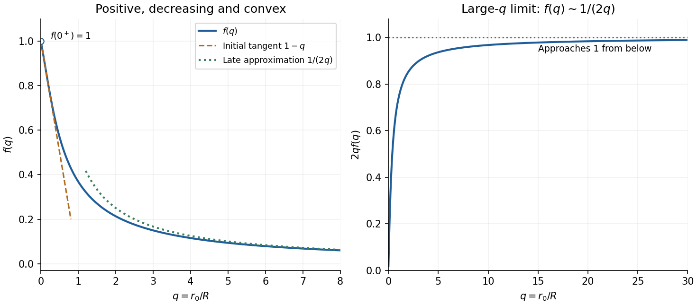

<h1 id="12/a/iii/solution">Solution</h1>

↑ **Parent:** [Iii](../iii.md)

The positive-domain graph starts with limiting value $f(0^+)=1$ and limiting slope $-1$, then decreases towards the horizontal asymptote $f=0$, with $f(q)\sim1/(2q)$ for large $q$. In fact direct [differentiation](../../../../../../differentiation.md) gives

$$
f'(q)=-1+\left(1+\frac1q\right)e^{-1/q}<0,\qquad f''(q)=\frac{e^{-1/q}}{q^3}>0.
$$

The first inequality follows from $e^s>1+s$ for $s>0$. Thus the graph is strictly decreasing and convex upward, with $0<f(q)<1$ and no [stationary points](../../../../../../stationary-point.md). The integral representation $f(q)=\int_0^1(1-e^{-s/q})\,ds$ also shows its positivity.

**[Figure 2](#12/a/iii/image-the-spherical-mass-factor-f-q-1-q-plus-qe-1-q-and-its-two-limiting-approximations). The spherical mass factor $f(q)=1-q+qe^{-1/q}$ and its two limiting approximations**.

These properties belong to the reusable [exponential spherical mass factor](../../../../../../exponential-spherical-mass-factor.md).

## ↑ Ancestors (14)

1. [Iii](../iii.md)
2. [A](../../a.md)
3. [12](../../../12.md)
4. [Paper 1](../../../../paper-1-split.md)
5. [2021](../../../../split.md)
6. [Past exam of the mathematics course of the year 1 of the natural sciences course of the University of Cambridge](../../../../../split.md)
7. [Mathematics course of the year 1 of the natural sciences course of the University of Cambridge](../../../../../../mathematics-course-of-the-year-1-of-the-natural-sciences-course-of-the-university-of-cambridge.md)
8. [Year 1 of the natural sciences course of the University of Cambridge](../../../../../../year-1-of-the-natural-sciences-course-of-the-university-of-cambridge.md)
9. [Year of the natural sciences course of the University of Cambridge](../../../../../../year-of-the-natural-sciences-course-of-the-university-of-cambridge.md)
10. [Natural sciences course of the University of Cambridge](../../../../../../natural-sciences-course-of-the-university-of-cambridge.md)
11. [Course of the University of Cambridge](../../../../../../course-of-the-university-of-cambridge.md)
12. [University of Cambridge](../../../../../../university-of-cambridge-split.md)
13. [List of universities](../../../../../../list-of-universities.md)
14. [Codex Wiki](../../../../../../split.md)
