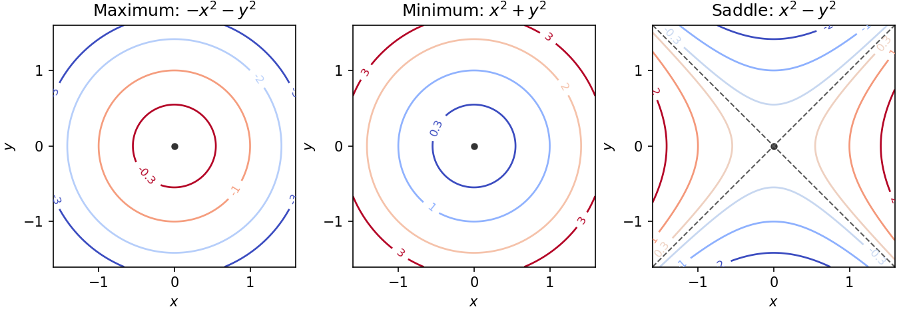
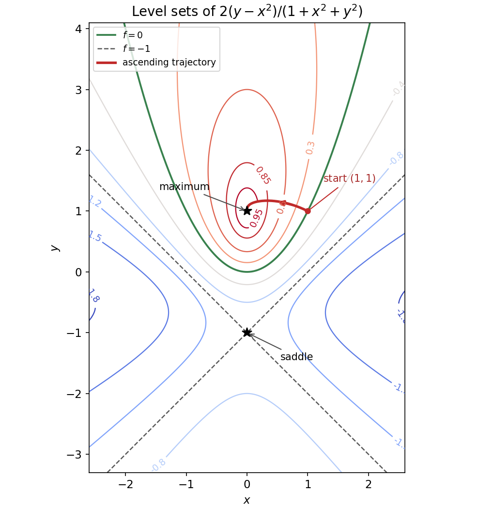
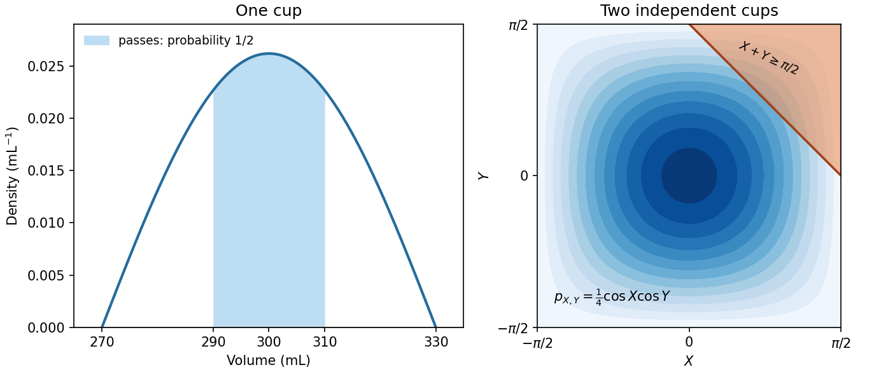

# Paper 2

↑ **Parent:** [2021](../2021.md)

[https://www.maths.cam.ac.uk/undergradnst/files/2021/papernst_ia_2_2021.pdf](https://www.maths.cam.ac.uk/undergradnst/files/2021/papernst_ia_2_2021.pdf)

**Table of contents**

- [1](#1)
  - [Solution](#1/solution)
- [2](#2)
  - [Solution](#2/solution)
- [3](#3)
  - [Solution](#3/solution)
- [4](#4)
  - [Solution](#4/solution)
- [5](#5)
  - [Solution](#5/solution)
- [6](#6)
  - [Solution](#6/solution)
- [7](#7)
  - [Solution](#7/solution)
- [8](#8)
  - [Solution](#8/solution)
- [9](#9)
  - [Solution](#9/solution)
- [10](#10)
  - [Solution](#10/solution)
- [11](#11)
  - [a](#11/a)
    - [Solution](#11/a/solution)
  - [b](#11/b)
    - [Solution](#11/b/solution)
  - [c](#11/c)
    - [i](#11/c/i)
      - [Solution](#11/c/i/solution)
    - [ii](#11/c/ii)
      - [Solution](#11/c/ii/solution)
  - [d](#11/d)
    - [i](#11/d/i)
      - [Solution](#11/d/i/solution)
    - [ii](#11/d/ii)
      - [Solution](#11/d/ii/solution)
    - [iii](#11/d/iii)
      - [Solution](#11/d/iii/solution)
- [12](#12)
  - [a](#12/a)
    - [Solution](#12/a/solution)
  - [b](#12/b)
    - [Solution](#12/b/solution)
  - [c](#12/c)
    - [Solution](#12/c/solution)
  - [d](#12/d)
    - [Solution](#12/d/solution)
  - [e](#12/e)
    - [Solution](#12/e/solution)
- [13](#13)
  - [a](#13/a)
    - [Solution](#13/a/solution)
  - [b](#13/b)
    - [Solution](#13/b/solution)
  - [c](#13/c)
    - [Solution](#13/c/solution)
  - [d](#13/d)
    - [Solution](#13/d/solution)
  - [e](#13/e)
    - [Solution](#13/e/solution)
  - [f](#13/f)
    - [Solution](#13/f/solution)
- [14](#14)
  - [a](#14/a)
    - [i](#14/a/i)
      - [Solution](#14/a/i/solution)
    - [ii](#14/a/ii)
      - [Solution](#14/a/ii/solution)
    - [iii](#14/a/iii)
      - [Solution](#14/a/iii/solution)
    - [iv](#14/a/iv)
      - [Solution](#14/a/iv/solution)
  - [b](#14/b)
    - [Solution](#14/b/solution)
- [15](#15)
  - [a](#15/a)
    - [Solution](#15/a/solution)
  - [b](#15/b)
    - [i](#15/b/i)
      - [Solution](#15/b/i/solution)
    - [ii](#15/b/ii)
      - [Solution](#15/b/ii/solution)
    - [iii](#15/b/iii)
      - [Solution](#15/b/iii/solution)
  - [c](#15/c)
    - [i](#15/c/i)
      - [Solution](#15/c/i/solution)
    - [ii](#15/c/ii)
      - [Solution](#15/c/ii/solution)
- [16](#16)
  - [a](#16/a)
    - [i](#16/a/i)
      - [Solution](#16/a/i/solution)
    - [ii](#16/a/ii)
      - [Solution](#16/a/ii/solution)
    - [iii](#16/a/iii)
      - [Solution](#16/a/iii/solution)
  - [b](#16/b)
    - [Solution](#16/b/solution)
- [17](#17)
  - [a](#17/a)
    - [i](#17/a/i)
      - [Solution](#17/a/i/solution)
    - [ii](#17/a/ii)
      - [Solution](#17/a/ii/solution)
  - [b](#17/b)
    - [i](#17/b/i)
      - [Solution](#17/b/i/solution)
    - [ii](#17/b/ii)
      - [Solution](#17/b/ii/solution)
    - [iii](#17/b/iii)
      - [Solution](#17/b/iii/solution)
  - [c](#17/c)
    - [i](#17/c/i)
      - [Solution](#17/c/i/solution)
    - [ii](#17/c/ii)
      - [Solution](#17/c/ii/solution)
- [18](#18)
  - [a](#18/a)
    - [Solution](#18/a/solution)
  - [b](#18/b)
    - [Solution](#18/b/solution)
  - [c](#18/c)
    - [Solution](#18/c/solution)
  - [d](#18/d)
    - [Solution](#18/d/solution)
  - [e](#18/e)
    - [Solution](#18/e/solution)
- [19](#19)
  - [a](#19/a)
    - [i](#19/a/i)
      - [Solution](#19/a/i/solution)
    - [ii](#19/a/ii)
      - [Solution](#19/a/ii/solution)
  - [b](#19/b)
    - [Solution](#19/b/solution)
- [20](#20)
  - [a](#20/a)
    - [Solution](#20/a/solution)
  - [b](#20/b)
    - [Solution](#20/b/solution)

## 1

↑ **Parent:** [Paper 2](paper-2.md)

<h3 id="1/solution">Solution</h3>

↑ **Parent:** [1](#1)

The two orthogonal directions $(1,1)^T$ and $(1,-1)^T$ are preserved by this [symmetric matrix](../../linear-algebra.md#symmetric-matrix). Direct multiplication, using the [hyperbolic function](../../calculus.md#hyperbolic-function) identities $\cosh u\pm\sinh u=e^{\pm u}$, gives the [eigenvalue](../../linear-operator-theory.md#eigenvalue)–[eigenvector](../../linear-operator-theory.md#eigenvector) pairs

$$
\boxed{\lambda_+=e^u,\quad \boldsymbol v_+=\binom11;
\qquad \lambda_-=e^{-u},\quad \boldsymbol v_-=\binom1{-1}.}
$$

Each [eigenvector](../../linear-operator-theory.md#eigenvector) can be multiplied by any nonzero scalar. For $u\ne0$ these give the two one-dimensional [eigenspaces](../../linear-operator-theory.md#eigenspace). When $u=0$, the [matrix](../../vector-space.md#matrix) is the identity: the only [eigenvalue](../../linear-operator-theory.md#eigenvalue) is $1$, with multiplicity two, and every nonzero [vector](../../vector-space.md#vector) is an [eigenvector](../../linear-operator-theory.md#eigenvector).

## 2

↑ **Parent:** [Paper 2](paper-2.md)

<h3 id="2/solution">Solution</h3>

↑ **Parent:** [2](#2)

The boundary order fixes the orientation. Two edges issuing from $A$ are $\overrightarrow{AB}=(0,0,1)$ and $\overrightarrow{AD}=(1,1,0)$. Their [cross product](../../vector-space.md#cross-product) gives the oriented [vector area](../../differential-geometry.md#vector-area):

$$
\boxed{\boldsymbol A=\overrightarrow{AB}\times\overrightarrow{AD}
=\begin{pmatrix}-1\\1\\0\end{pmatrix}.}
$$

Its [norm](../../normed-vector-space.md#norm) is $\sqrt2$, the ordinary rectangle area. The sign agrees with traversing $A\to B\to C\to D\to A$ by the right-hand orientation rule.

## 3

↑ **Parent:** [Paper 2](paper-2.md)

<h3 id="3/solution">Solution</h3>

↑ **Parent:** [3](#3)

For this [first-order linear differential equation](../../linear-ordinary-differential-equation.md#first-order-linear-differential-equation), the [integrating factor](../../linear-ordinary-differential-equation.md#integrating-factor) is $e^x$. Thus

$$
\frac d{dx}(e^xy)=e^{3x},\qquad e^xy=\frac13e^{3x}+C,
$$

and the [general solution](../../linear-ordinary-differential-equation.md#general-solution) is

$$
\boxed{y(x)=\frac13e^{2x}+Ce^{-x},\qquad C\in\mathbb R.}
$$

## 4

↑ **Parent:** [Paper 2](paper-2.md)

<h3 id="4/solution">Solution</h3>

↑ **Parent:** [4](#4)

For $n=0$, the [change of variables](../../multivariable-calculus.md#change-of-variables-formula) $s=\sqrt a\,x$ reduces the [integral](../../integral.md) to the given [Gaussian integral](../../integral.md#gaussian-integral):

$$
\boxed{\int_{-\infty}^{\infty}e^{-ax^2}dx
=\frac1{\sqrt a}\int_{-\infty}^{\infty}e^{-s^2}ds=\sqrt{\frac\pi a}.}
$$

For $n=1$, the integrand is an integrable [odd function](../../calculus.md#odd-function), so its contributions from the two half-lines cancel:

$$
\boxed{\int_{-\infty}^{\infty}x e^{-ax^2}dx=0.}
$$

The condition $a>0$ ensures convergence in both cases.

## 5

↑ **Parent:** [Paper 2](paper-2.md)

<h3 id="5/solution">Solution</h3>

↑ **Parent:** [5](#5)

Complete the square in the velocity variable:

$$
H=V(x)+pv-\frac12mv^2
=V(x)+\frac{p^2}{2m}-\frac m2\left(v-\frac pm\right)^2.
$$

Since $m>0$, the final term is nonpositive and vanishes at exactly one velocity. Therefore

$$
\boxed{v_*=\frac pm,\qquad H_{\max}(x,p)=\frac{p^2}{2m}+V(x).}
$$

This is the [Legendre transform in mechanics](../../classical-mechanics.md#legendre-transform-in-mechanics) that constructs the [Hamiltonian mechanics](../../hamiltonian-mechanics.md) energy from the kinetic-minus-potential Lagrangian.

## 6

↑ **Parent:** [Paper 2](paper-2.md)

<h3 id="6/solution">Solution</h3>

↑ **Parent:** [6](#6)

Expanding the [cross product](../../vector-space.md#cross-product) gives

$$
\boxed{\boldsymbol F\times\boldsymbol G
=\begin{pmatrix}-xz\\-yz\\x^2+y^2\end{pmatrix}.}
$$

Taking its [divergence](../../multivariable-calculus.md#divergence) component by component,

$$
\boxed{\nabla\cdot(\boldsymbol F\times\boldsymbol G)
=\partial_x(-xz)+\partial_y(-yz)+\partial_z(x^2+y^2)=-2z.}
$$

## 7

↑ **Parent:** [Paper 2](paper-2.md)

<h3 id="7/solution">Solution</h3>

↑ **Parent:** [7](#7)

Normalization of the [probability mass function](../../probability-distribution.md#probability-mass-function) and the [geometric series](../../sequence-and-series.md#geometric-series) give

$$
1=c\sum_{n=0}^{\infty}e^{-n}=\frac c{1-e^{-1}},
\qquad \boxed{c=1-e^{-1}.}
$$

The tail is another [geometric series](../../sequence-and-series.md#geometric-series):

$$
\boxed{\mathbb P(X\geq N)
=c\sum_{n=N}^{\infty}e^{-n}
=\frac{ce^{-N}}{1-e^{-1}}=e^{-N}.}
$$

## 8

↑ **Parent:** [Paper 2](paper-2.md)

<h3 id="8/solution">Solution</h3>

↑ **Parent:** [8](#8)

Substitute $r=-x^2$ into the [geometric series](../../sequence-and-series.md#geometric-series), without taking any [derivatives](../../calculus.md#derivative):

$$
\boxed{\frac1{1+x^2}=\sum_{k=0}^{\infty}(-1)^k x^{2k}
=1-x^2+x^4-\cdots,\qquad |x|<1.}
$$

Thus the coefficient of $x^n$ in the [Taylor series](../../calculus.md#taylor-series) is $(-1)^{n/2}$ when $n$ is even and zero when $n$ is odd. If nonzero terms are numbered from one, the $n$th term is $(-1)^{n-1}x^{2n-2}$.

## 9

↑ **Parent:** [Paper 2](paper-2.md)

<h3 id="9/solution">Solution</h3>

↑ **Parent:** [9](#9)

The [chain rule](../../calculus.md#chain-rule) gives

$$
u_t=a f'(x+at),\qquad u_x=f'(x+at),\qquad
u_t+u_x=(a+1)f'(x+at).
$$

For this to vanish for every differentiable $f$, its coefficient must be zero:

$$
\boxed{a=-1.}
$$

The resulting $f(x-t)$ is a profile transported to the right at unit speed by the [transport equation](../../transport-equation.md).

## 10

↑ **Parent:** [Paper 2](paper-2.md)

<h3 id="10/solution">Solution</h3>

↑ **Parent:** [10](#10)

On the disc $z=0$, the upward normal selects only the third component, which equals $e^0/(1+0)=1$. Hence the [surface integral](../../multivariable-calculus.md#surface-integral) is the area of the [unit disk](../../euclidean-geometry.md#unit-disk):

$$
\boxed{\int_D\boldsymbol F\cdot\boldsymbol n\,dS
=\int_D1\,dS=\pi.}
$$

## 11

↑ **Parent:** [Paper 2](paper-2.md)

<h3 id="11/a">a</h3>

↑ **Parent:** [11](#11)

<h4 id="11/a/solution">Solution</h4>

↑ **Parent:** [A](#11/a)

The evaluated position [vectors](../../vector-space.md#vector) are $\boldsymbol r_1(1)=(2,1,0)$ and $\boldsymbol r_2(-1)=(-1,-1,0)$. Their difference is $(3,2,0)$, so the [Euclidean distance](../../topological-analysis.md#euclidean-distance) is

$$
\boxed{\|\boldsymbol r_1(1)-\boldsymbol r_2(-1)\|=\sqrt{3^2+2^2}=\sqrt{13}.}
$$

<h3 id="11/b">b</h3>

↑ **Parent:** [11](#11)

<h4 id="11/b/solution">Solution</h4>

↑ **Parent:** [B](#11/b)

The [cross product](../../vector-space.md#cross-product) of the direction [vectors](../../vector-space.md#vector) is $\boldsymbol n_1\times\boldsymbol n_2=(1,-1,0)$. It is nonzero, so a common perpendicular direction exists. Projecting $\boldsymbol a_2-\boldsymbol a_1=(-1,0,1)$ onto its unit [vector](../../vector-space.md#vector) gives the [distance between skew lines](../../euclidean-geometry.md#distance-between-skew-lines):

$$
s=\frac{|(\boldsymbol a_2-\boldsymbol a_1)\cdot(\boldsymbol n_1\times\boldsymbol n_2)|}
{\|\boldsymbol n_1\times\boldsymbol n_2\|}
=\frac{|-1|}{\sqrt2}.
$$

Thus

$$
\boxed{s=\frac1{\sqrt2}.}
$$

The numerator is a [scalar triple product](../../multilinear-algebra.md#scalar-triple-product); movement along either line does not change this perpendicular projection.

<h3 id="11/c">c</h3>

↑ **Parent:** [11](#11)

<h4 id="11/c/i">i</h4>

↑ **Parent:** [C](#11/c)

<h5 id="11/c/i/solution">Solution</h5>

↑ **Parent:** [I](#11/c/i)

Use only the [dot product](../../inner-product.md#dot-product) to minimize the squared [Euclidean distance](../../topological-analysis.md#euclidean-distance) from the origin:

$$
D(t)^2=(\boldsymbol a_2+t\boldsymbol n_2)\cdot(\boldsymbol a_2+t\boldsymbol n_2)
=\|\boldsymbol a_2\|^2+2t(\boldsymbol a_2\cdot\boldsymbol n_2)+t^2\|\boldsymbol n_2\|^2.
$$

Completing the square gives

$$
D(t)^2=\|\boldsymbol n_2\|^2
\left(t+\frac{\boldsymbol a_2\cdot\boldsymbol n_2}{\|\boldsymbol n_2\|^2}\right)^2
+\|\boldsymbol a_2\|^2-
\frac{(\boldsymbol a_2\cdot\boldsymbol n_2)^2}{\|\boldsymbol n_2\|^2}.
$$

The square is minimized at $t_0=-(\boldsymbol a_2\cdot\boldsymbol n_2)/\|\boldsymbol n_2\|^2$, yielding

$$
\boxed{d_0=\sqrt{\boldsymbol a_2\cdot\boldsymbol a_2
-\frac{(\boldsymbol a_2\cdot\boldsymbol n_2)^2}{\boldsymbol n_2\cdot\boldsymbol n_2}}.}
$$

Geometrically this subtracts the squared length of the [orthogonal projection](../../hilbert-space.md#orthogonal-projection) parallel to the line. At the minimizing point, $(\boldsymbol a_2+t_0\boldsymbol n_2)\cdot\boldsymbol n_2=0$, as required for perpendicular distance.

<h4 id="11/c/ii">ii</h4>

↑ **Parent:** [C](#11/c)

<h5 id="11/c/ii/solution">Solution</h5>

↑ **Parent:** [Ii](#11/c/ii)

Here $\boldsymbol a_2\cdot\boldsymbol a_2=1$, $\boldsymbol a_2\cdot\boldsymbol n_2=1$ and $\boldsymbol n_2\cdot\boldsymbol n_2=3$. Therefore

$$
\boxed{d_0=\sqrt{1-\frac13}=\sqrt{\frac23}.}
$$

The closest point has parameter $t_0=-1/3$ and position $(-1/3,-1/3,2/3)$, whose [norm](../../normed-vector-space.md#norm) gives the same result.

<h3 id="11/d">d</h3>

↑ **Parent:** [11](#11)

<h4 id="11/d/i">i</h4>

↑ **Parent:** [D](#11/d)

<h5 id="11/d/i/solution">Solution</h5>

↑ **Parent:** [I](#11/d/i)

For a point $\boldsymbol p=\boldsymbol r_2(t)$, the magnitude of $(\boldsymbol p-\boldsymbol a_1)\times\boldsymbol n_1$ is the area of a parallelogram. Dividing by its base length $\|\boldsymbol n_1\|$ gives the perpendicular [Euclidean distance](../../topological-analysis.md#euclidean-distance) to the first line. Explicitly,

$$
\boldsymbol p-\boldsymbol a_1=(t-1,t,t+1),\qquad
(\boldsymbol p-\boldsymbol a_1)\times\boldsymbol n_1=(-(t+1),t+1,-1).
$$

Hence

$$
\boxed{d(t)=\frac{\sqrt{2(t+1)^2+1}}{\sqrt2}
=\sqrt{(t+1)^2+\frac12}.}
$$

This use of the [cross product](../../vector-space.md#cross-product) removes any component parallel to the first line automatically.

<h4 id="11/d/ii">ii</h4>

↑ **Parent:** [D](#11/d)

<h5 id="11/d/ii/solution">Solution</h5>

↑ **Parent:** [Ii](#11/d/ii)

The graph is the upper branch of the [hyperbola](../../euclidean-geometry.md#hyperbola) $d^2-(t+1)^2=1/2$. It is symmetric about $t=-1$, positive everywhere, and has its lowest point at $(-1,1/\sqrt2)$. Its [derivatives](../../calculus.md#derivative) are

$$
d'(t)=\frac{t+1}{d(t)},\qquad d''(t)=\frac1{2d(t)^3}>0,
$$

so it is strictly convex. Since

$$
d(t)-|t+1|=\frac{1/2}{\sqrt{(t+1)^2+1/2}+|t+1|}\longrightarrow0,
$$

its two oblique [asymptotes](../../topology.md#asymptote) are

$$
\boxed{d=t+1\quad(t\to+\infty),\qquad d=-t-1\quad(t\to-\infty).}
$$

**[Figure 1](#11/d/ii/image-distance-from-a-moving-point-to-a-skew-line). Distance from a moving point to a skew line**. Original plot of $d(t)=\sqrt{(t+1)^2+1/2}$, its minimum and its two asymptotes.

<h4 id="11/d/iii">iii</h4>

↑ **Parent:** [D](#11/d)

<h5 id="11/d/iii/solution">Solution</h5>

↑ **Parent:** [Iii](#11/d/iii)

The square $d(t)^2=(t+1)^2+1/2$ is minimized when its first term vanishes. Therefore

$$
\boxed{t_{\min}=-1,\qquad d_{\min}=\frac1{\sqrt2}=s.}
$$

This agrees with the [distance between skew lines](../../euclidean-geometry.md#distance-between-skew-lines) found in part (b). The corresponding parameter on the first line is its [orthogonal projection](../../hilbert-space.md#orthogonal-projection) value

$$
\lambda_{\min}=\frac{(\boldsymbol r_2(-1)-\boldsymbol a_1)\cdot\boldsymbol n_1}{\|\boldsymbol n_1\|^2}=-\frac32.
$$

The closest pair is $(-1/2,-3/2,0)$ and $(-1,-1,0)$; their connecting [vector](../../vector-space.md#vector) $(-1/2,1/2,0)$ is perpendicular to both direction [vectors](../../vector-space.md#vector).

## 12

↑ **Parent:** [Paper 2](paper-2.md)

<h3 id="12/a">a</h3>

↑ **Parent:** [12](#12)

<h4 id="12/a/solution">Solution</h4>

↑ **Parent:** [A](#12/a)

At a differentiable interior [stationary point](../../calculus-of-variations.md#stationary-point), all first-order changes of the scalar field vanish. In particular, the [directional derivative](../../multivariable-calculus.md#directional-derivative) along each coordinate axis vanishes, so $f_x=f_y=0$ and hence $\nabla f=\boldsymbol0$. Equivalently, the first-order differential $df=\nabla f\cdot d\boldsymbol r$ vanishes for every displacement. A differentiable interior maximum or minimum must satisfy this condition; a stationary point need not be an extremum.

The standard nondegenerate local [contour plot](../../topology.md#contour-plot) models are $-x^2-y^2$ for a maximum, $x^2+y^2$ for a minimum, and $x^2-y^2$ for a [saddle point of a scalar function](../../analysis.md#saddle-point-of-a-scalar-function). Near a maximum, nested contours have lower values farther from the centre; near a minimum they have higher values. Near a saddle, [hyperbolas](../../euclidean-geometry.md#hyperbola) occur on opposite sides of the critical level, whose contour has two intersecting tangent directions. More general nondegenerate quadratic forms deform these circles into [ellipses](../../euclidean-geometry.md#ellipse); degenerate stationary points can have more complicated contours.

**[Figure 2](#12/a/image-local-contours-near-a-maximum-a-minimum-and-a-saddle). Local contours near a maximum, a minimum and a saddle**. Original quadratic models, with signed contour labels showing how the field changes away from each stationary point.

<h3 id="12/b">b</h3>

↑ **Parent:** [12](#12)

<h4 id="12/b/solution">Solution</h4>

↑ **Parent:** [B](#12/b)

Set $D=1+x^2+y^2>0$. The [quotient rule](../../calculus.md#quotient-rule) gives the [partial derivatives](../../multivariable-calculus.md#partial-derivative)

$$
f_x=-\frac{4x(1+y+y^2)}{D^2},\qquad
f_y=\frac{2(1+x^2-y^2+2x^2y)}{D^2}.
$$

Since $1+y+y^2=(y+1/2)^2+3/4>0$, the first equation $f_x=0$ forces $x=0$. The second then reduces to $1-y^2=0$. Thus the only [stationary points](../../calculus-of-variations.md#stationary-point) and their field values are

$$
\boxed{(x,y)=(0,1),\ f=1;\qquad (x,y)=(0,-1),\ f=-1.}
$$

No division by a potentially vanishing factor of $y$ was used, so no stationary points have been discarded.

<h3 id="12/c">c</h3>

↑ **Parent:** [12](#12)

<h4 id="12/c/solution">Solution</h4>

↑ **Parent:** [C](#12/c)

The [level set](../../topology.md#level-set) $f=c$ can be rearranged, without changing its domain, as

$$
(c+2)x^2+cy^2-2y+c=0.
$$

The requested special contours are therefore

$$
\boxed{f=0:\ y=x^2;\qquad
f=1:\ (x,y)=(0,1);\qquad
f=-1:\ y+1=\pm x.}
$$

The first is a [parabola](../../euclidean-geometry.md#parabola), the second a single point, and the last two intersecting straight lines. Moreover

$$
1-f=\frac{3x^2+(y-1)^2}{D}\geq0,
$$

with equality only at $(0,1)$. Hence $(0,1)$ is a strict global maximum. At $(0,-1)$ the crossing critical contour separates sectors with values above and below $-1$, so it is a [saddle point of a scalar function](../../analysis.md#saddle-point-of-a-scalar-function).

As a [Hessian matrix](../../multivariable-calculus.md#hessian-matrix) check, $H_f(0,1)=\operatorname{diag}(-3,-1)$ is negative definite, while $H_f(0,-1)=\operatorname{diag}(-1,1)$ is indefinite. There is no stationary minimum.

<h3 id="12/d">d</h3>

↑ **Parent:** [12](#12)

<h4 id="12/d/solution">Solution</h4>

↑ **Parent:** [D](#12/d)

For $c\ne0$, [completing the square](../../polynomial.md#completing-the-square) gives the [conic section](../../euclidean-geometry.md#conic-section)

$$
(c+2)x^2+c\left(y-\frac1c\right)^2=\frac{1-c^2}{c}.
$$

The possible levels follow from

$$
f+2=\frac{2(y^2+y+1)}{D}>0,\qquad f\leq1:
\qquad \boxed{-2<f\leq1.}
$$

For $0<c<1$, the contours are [ellipses](../../euclidean-geometry.md#ellipse) centred at $(0,1/c)$, shrinking to the maximum as $c\uparrow1$. The zero contour is the [parabola](../../euclidean-geometry.md#parabola) from part (c). For $-1<c<0$, the contours are vertical-opening [hyperbolas](../../euclidean-geometry.md#hyperbola). At $c=-1$ they degenerate into the intersecting straight lines, and for $-2<c<-1$ they are horizontal-opening [hyperbolas](../../euclidean-geometry.md#hyperbola). These descriptions specify the remaining contour families and their symmetry about the $y$ axis. The lower bound $-2$ is approached as $|x|\to\infty$ at fixed $y$ but is never attained.

**[Figure 3](#12/d/image-contours-and-an-ascending-gradient-trajectory). Contours and an ascending gradient trajectory**. Original contours of the rational scalar field. The critical points are marked; the green parabola is the zero contour and the crossing dashed lines have level $-1$. The red trajectory starts at $(1,1)$ and follows the positive [gradient](../../multivariable-calculus.md#gradient) towards the maximum, as discussed in part (e).

<h3 id="12/e">e</h3>

↑ **Parent:** [12](#12)

<h4 id="12/e/solution">Solution</h4>

↑ **Parent:** [E](#12/e)

Use the [gradient flow](../../analysis.md#gradient-flow) of $-f$, namely $\dot{\boldsymbol r}=\nabla f$; any positive change of speed leaves the same trajectory. At the starting point,

$$
\nabla f(1,1)=\left(-\frac43,\frac23\right),
$$

so the path initially points up and left, with slope $dy/dx=-1/2$. At every regular point it crosses the [level sets](../../topology.md#level-set) orthogonally, because the [gradient](../../multivariable-calculus.md#gradient) is normal to the contours. Along it,

$$
\frac{df}{ds}=\nabla f\cdot\dot{\boldsymbol r}=|\nabla f|^2>0
$$

until a stationary point is approached.

The red curve in the plot first rises above $y=1$, then bends down towards the maximum $(0,1)$. It stays on the side $x>0$ and approaches the maximum without crossing it in finite gradient-flow time. Indeed $\dot x=-4x(1+y+y^2)/D^2$ preserves the sign of $x$, and the critical level increases from its starting value $0$ towards $1$. The requested curve is an ascending trajectory, not a contour or a straight segment joining the initial and final points.

## 13

↑ **Parent:** [Paper 2](paper-2.md)

<h3 id="13/a">a</h3>

↑ **Parent:** [13](#13)

<h4 id="13/a/solution">Solution</h4>

↑ **Parent:** [A](#13/a)

Split the [vector field](../../multivariable-calculus.md#vector-field) into $a(-y,x,0)$ and $e^{-r^2}(x,y,z)$. The second part is the [gradient](../../multivariable-calculus.md#gradient) of $-\tfrac12e^{-r^2}$, so its [curl](../../multivariable-calculus.md#curl) vanishes. The first part has only a vertical [curl](../../multivariable-calculus.md#curl) component, $\partial_x(ax)-\partial_y(-ay)=2a$. Hence

$$
\boxed{\nabla\times\boldsymbol F=(0,0,2a).}
$$

<h3 id="13/b">b</h3>

↑ **Parent:** [13](#13)

<h4 id="13/b/solution">Solution</h4>

↑ **Parent:** [B](#13/b)

The [curl](../../multivariable-calculus.md#curl) found in part (a) is constant, so its [divergence](../../multivariable-calculus.md#divergence) is

$$
\boxed{\nabla\cdot(\nabla\times\boldsymbol F)=0.}
$$

This also follows from the identity [divergence of a curl is zero](../../multivariable-calculus.md#divergence-of-a-curl-is-zero), applicable here because the field is smooth everywhere.

<h3 id="13/c">c</h3>

↑ **Parent:** [13](#13)

<h4 id="13/c/solution">Solution</h4>

↑ **Parent:** [C](#13/c)

By part (a), the [vector field](../../multivariable-calculus.md#vector-field) is [irrotational](../../multivariable-calculus.md#irrotational-vector-field) exactly when $2a=0$. Thus

$$
\boxed{a=0.}
$$

<h3 id="13/d">d</h3>

↑ **Parent:** [13](#13)

<h4 id="13/d/solution">Solution</h4>

↑ **Parent:** [D](#13/d)

The original PDF has angle $\theta(t)=2\pi t^n$, with $n$ an exponent on $t$. It is not $2\pi nt$: each permitted value of $n$ changes the speed but traverses the same circle once counterclockwise. Along the path, $r^2=2$ and

$$
\boldsymbol r'(t)=\theta'(t)(-\sin\theta,\cos\theta,0),\qquad
\theta'=2\pi n t^{n-1}.
$$

The radial contribution to the [line integral](../../multivariable-calculus.md#line-integral) vanishes, since $(\cos\theta,\sin\theta,1)\cdot(-\sin\theta,\cos\theta,0)=0$. The rotational contribution gives

$$
\boldsymbol F(\boldsymbol r(t))\cdot\boldsymbol r'(t)=a\theta'(t).
$$

Therefore

$$
\boxed{\int_\Gamma\boldsymbol F\cdot d\boldsymbol r
=a[\theta(1)-\theta(0)]=2\pi a,\qquad n=1,2,\ldots.}
$$

The answer is independent of the monotone parametrization, as an oriented [line integral](../../multivariable-calculus.md#line-integral) should be.

<h3 id="13/e">e</h3>

↑ **Parent:** [13](#13)

<h4 id="13/e/solution">Solution</h4>

↑ **Parent:** [E](#13/e)

The upward unit [vector](../../vector-space.md#vector) extracts the vertical [curl](../../multivariable-calculus.md#curl) component:

$$
(\nabla\times\boldsymbol F)\cdot\boldsymbol k=2a.
$$

It is constant over the unit disc, so

$$
\boxed{I=\int_D2a\,dS=2\pi a.}
$$

This agrees with part (d) by [Stokes theorem](../../multivariable-calculus.md#stokes-theorem): the boundary circle has counterclockwise orientation when viewed from the upward normal, including for the parametrizations $2\pi t^n$.

<h3 id="13/f">f</h3>

↑ **Parent:** [13](#13)

<h4 id="13/f/solution">Solution</h4>

↑ **Parent:** [F](#13/f)

For $a=0$, differentiate the proposed [scalar potential](../../classical-field-theory.md#scalar-potential) directly:

$$
\nabla\left(-\frac12e^{-(x^2+y^2+z^2)}\right)
=e^{-r^2}(x,y,z).
$$

Thus

$$
\boxed{\Phi(\boldsymbol r)=-\frac12e^{-r^2}+C\quad\text{when }a=0.}
$$

For $a\ne0$, the [curl](../../multivariable-calculus.md#curl) is the nonzero [vector](../../vector-space.md#vector) $(0,0,2a)$. A [gradient](../../multivariable-calculus.md#gradient) of a twice differentiable scalar field has zero [curl](../../multivariable-calculus.md#curl), so no such scalar field exists. Equivalently the closed [line integral](../../multivariable-calculus.md#line-integral) in part (d) is nonzero, contradicting the path independence of a [conservative vector field](../../multivariable-calculus.md#conservative-vector-field). The field is smooth on all of $\mathbb R^3$, so no excluded singular set complicates this conclusion.

## 14

↑ **Parent:** [Paper 2](paper-2.md)

<h3 id="14/a">a</h3>

↑ **Parent:** [14](#14)

<h4 id="14/a/i">i</h4>

↑ **Parent:** [A](#14/a)

<h5 id="14/a/i/solution">Solution</h5>

↑ **Parent:** [I](#14/a/i)

The [probability density](../../wave-function.md#probability-density) is symmetric about $300\,\mathrm{mL}$, vanishes at $270$ and $330\,\mathrm{mL}$, and has its single maximum $\pi/(120\,\mathrm{mL})$ at $300\,\mathrm{mL}$. It is zero outside that interval. Its area is one: with the dimensionless [change of variables](../../multivariable-calculus.md#change-of-variables-formula)

$$
X=\frac{\pi(v-300\,\mathrm{mL})}{60\,\mathrm{mL}},
\qquad p_X(x)=\frac12\cos x,\quad -\frac\pi2\leq x\leq\frac\pi2,
$$

normalization is $\tfrac12\int_{-\pi/2}^{\pi/2}\cos x\,dx=1$.

**[Figure 4](#14/a/i/image-coffee-volume-density-and-the-two-cup-tail-region). Coffee-volume density and the two-cup tail region**. Original graphs. Left: the density with the passing interval shaded. Right: transformed independent cup volumes $X,Y$ and the triangular region $X+Y\geq\pi/2$ used for the [probability](../../probability-theory.md#probability) in part (b).

<h4 id="14/a/ii">ii</h4>

↑ **Parent:** [A](#14/a)

<h5 id="14/a/ii/solution">Solution</h5>

↑ **Parent:** [Ii](#14/a/ii)

Passing corresponds to $-\pi/6\leq X\leq\pi/6$ in the normalized variable from part (i). Integrating its [probability density](../../wave-function.md#probability-density),

$$
\boxed{p_{\mathrm{pass}}=\frac12\int_{-\pi/6}^{\pi/6}\cos x\,dx
=\sin\frac\pi6=\frac12.}
$$

The complementary [probability](../../probability-theory.md#probability) of detecting the fault in one test is also $1/2$.

<h4 id="14/a/iii">iii</h4>

↑ **Parent:** [A](#14/a)

<h5 id="14/a/iii/solution">Solution</h5>

↑ **Parent:** [Iii](#14/a/iii)

The absolutely convergent [geometric series](../../sequence-and-series.md#geometric-series) has sum $\sum_{k=0}^{\infty}r^k=(1-r)^{-1}$ for $0<r<1$. Its [Cauchy product](../../sequence-and-series.md#cauchy-product) with itself is

$$
\left(\sum_{k=0}^{\infty}r^k\right)^2
=\sum_{m=0}^{\infty}\left(\sum_{k=0}^{m}1\right)r^m
=\sum_{m=0}^{\infty}(m+1)r^m.
$$

There are exactly $m+1$ pairs of nonnegative integers whose sum is $m$. Relabeling $j=m+1$ proves

$$
\boxed{\sum_{j=1}^{\infty}j r^{j-1}=\frac1{(1-r)^2}.}
$$

Absolute convergence justifies the multiplication and regrouping; no differentiation of an infinite series is needed.

<h4 id="14/a/iv">iv</h4>

↑ **Parent:** [A](#14/a)

<h5 id="14/a/iv/solution">Solution</h5>

↑ **Parent:** [Iv](#14/a/iv)

Let $T$ count tests up to and including the first failure. By [independence of random variables](../../random-variable.md#independent-random-variables), the event $T=j$ requires $j-1$ passes and then a failure. With pass [probability](../../probability-theory.md#probability) $p=1/2$ and failure [probability](../../probability-theory.md#probability) $q=1/2$, this is the [geometric distribution](../../discrete-probability-distribution.md#geometric-distribution)

$$
\mathbb P(T=j)=q p^{j-1},\qquad j=1,2,\ldots.
$$

Using part (iii), its [expected value](../../expected-value.md) is

$$
\boxed{\mathbb E[T]=q\sum_{j=1}^{\infty}jp^{j-1}
=\frac{q}{(1-p)^2}=\frac1q=2.}
$$

This counts the test that discovers the fault. The expected number of earlier passing tests alone would be one.

<h3 id="14/b">b</h3>

↑ **Parent:** [14](#14)

<h4 id="14/b/solution">Solution</h4>

↑ **Parent:** [B](#14/b)

Apply the same dimensionless transformation independently to the two cups, giving $X,Y\in[-\pi/2,\pi/2]$. The total-volume condition becomes $X+Y\geq\pi/2$. Since neither variable can exceed $\pi/2$, this region has $0\leq X\leq\pi/2$ and $\pi/2-X\leq Y\leq\pi/2$, the triangle shown above.

By [independence of random variables](../../random-variable.md#independent-random-variables), the [joint probability density](../../continuous-probability-distribution.md#joint-probability-density) is $\tfrac14\cos x\cos y$. The desired [double integral](../../integral.md#double-integral) is

$$
\begin{aligned}
P&=\frac14\int_0^{\pi/2}\cos x\int_{\pi/2-x}^{\pi/2}\cos y\,dy\,dx\\
&=\frac14\int_0^{\pi/2}\cos x(1-\cos x)\,dx\\
&=\frac14\left[1-\int_0^{\pi/2}\frac{1+\cos2x}{2}\,dx\right]
=\frac14-\frac\pi{16}.
\end{aligned}
$$

Thus

$$
\boxed{\mathbb P(v_1+v_2\geq630\,\mathrm{mL})=\frac{4-\pi}{16}.}
$$

Boundary equality has [probability](../../probability-theory.md#probability) zero for these continuous random variables.

## 15

↑ **Parent:** [Paper 2](paper-2.md)

<h3 id="15/a">a</h3>

↑ **Parent:** [15](#15)

<h4 id="15/a/solution">Solution</h4>

↑ **Parent:** [A](#15/a)

Because the equation depends on the ratio $y/x$, set $u=y/x$, so $y'=u+xu'$. Dividing by $x^2$ and substituting gives

$$
u+xu'+u=1+u^2,\qquad x\frac{du}{dx}=(u-1)^2.
$$

This reduces the [homogeneous first-order differential equation](../../differential-equation.md#homogeneous-first-order-differential-equation) to a [separable differential equation](../../differential-equation.md#separable-differential-equation). For $u\ne1$,

$$
\int\frac{du}{(u-1)^2}=\int\frac{dx}{x},\qquad
-\frac1{u-1}=\ln x+C.
$$

At $x=e$, the condition $y=0$ gives $u=0$, so $1=1+C$ and $C=0$. Hence

$$
\boxed{y(x)=x\left(1-\frac1{\ln x}\right),\qquad 1<x<\infty.}
$$

The interval displayed is the maximal solution interval containing $x=e$: there is a pole at $x=1$. Separating variables omitted the solution $u=1$, or $y=x$, but that solution does not satisfy the given condition.

<h3 id="15/b">b</h3>

↑ **Parent:** [15](#15)

<h4 id="15/b/i">i</h4>

↑ **Parent:** [B](#15/b)

<h5 id="15/b/i/solution">Solution</h5>

↑ **Parent:** [I](#15/b/i)

Differentiate $v'=u$ once, then substitute the other equation. The required [second-order linear differential equation](../../linear-ordinary-differential-equation.md#second-order-linear-differential-equation) is

$$
\boxed{v''=u'=4v+2,\qquad v''-4v=2.}
$$

<h4 id="15/b/ii">ii</h4>

↑ **Parent:** [B](#15/b)

<h5 id="15/b/ii/solution">Solution</h5>

↑ **Parent:** [Ii](#15/b/ii)

The [characteristic equation](../../linear-ordinary-differential-equation.md#characteristic-equation-of-a-constant-coefficient-differential-equation) of the homogeneous equation is $\lambda^2-4=0$, giving exponential solutions $e^{2t}$ and $e^{-2t}$. A constant particular solution is $v_p=-1/2$. Thus the [general solution](../../linear-ordinary-differential-equation.md#general-solution) is

$$
\boxed{v(t)=Ae^{2t}+Be^{-2t}-\frac12,\qquad A,B\in\mathbb R.}
$$

<h4 id="15/b/iii">iii</h4>

↑ **Parent:** [B](#15/b)

<h5 id="15/b/iii/solution">Solution</h5>

↑ **Parent:** [Iii](#15/b/iii)

The equation $u=v'$ fixes $u$ from the same two constants:

$$
\boxed{u(t)=2Ae^{2t}-2Be^{-2t}.}
$$

Indeed $u'=4Ae^{2t}+4Be^{-2t}=4v+2$, so both original equations hold. No further independent integration constant is available in this two-dimensional [linear system of ordinary differential equations](../../linear-ordinary-differential-equation.md#linear-system-of-differential-equations).

<h3 id="15/c">c</h3>

↑ **Parent:** [15](#15)

<h4 id="15/c/i">i</h4>

↑ **Parent:** [C](#15/c)

<h5 id="15/c/i/solution">Solution</h5>

↑ **Parent:** [I](#15/c/i)

The dependent variable itself does not occur, so reduce order by putting $p=y'$. Then $p'+2p=3x$, a [first-order linear differential equation](../../linear-ordinary-differential-equation.md#first-order-linear-differential-equation). Its [integrating factor](../../linear-ordinary-differential-equation.md#integrating-factor) is $e^{2x}$:

$$
(e^{2x}p)'=3xe^{2x},\qquad
p=\frac32x-\frac34+Ce^{-2x}.
$$

Integrating once more and renaming the constants gives

$$
\boxed{y(x)=\frac34x^2-\frac34x+A+Be^{-2x}.}
$$

The two homogeneous terms are the constant solution and the exponential associated with the roots $0,-2$ of the [characteristic equation](../../linear-ordinary-differential-equation.md#characteristic-equation-of-a-constant-coefficient-differential-equation).

<h4 id="15/c/ii">ii</h4>

↑ **Parent:** [C](#15/c)

<h5 id="15/c/ii/solution">Solution</h5>

↑ **Parent:** [Ii](#15/c/ii)

For the [general solution](../../linear-ordinary-differential-equation.md#general-solution) in part (i),

$$
y(0)=A+B=1,\qquad y'(0)=-\frac34-2B=0.
$$

Thus $B=-3/8$ and $A=11/8$, giving the solution of the [initial value problem](../../differential-equation.md#initial-value-problem)

$$
\boxed{y(x)=\frac34x^2-\frac34x+\frac{11}{8}-\frac38e^{-2x}.}
$$

Direct substitution checks both the differential equation and the two initial conditions.

## 16

↑ **Parent:** [Paper 2](paper-2.md)

<h3 id="16/a">a</h3>

↑ **Parent:** [16](#16)

<h4 id="16/a/i">i</h4>

↑ **Parent:** [A](#16/a)

<h5 id="16/a/i/solution">Solution</h5>

↑ **Parent:** [I](#16/a/i)

The logarithm is defined away from the $z$ axis, where $x^2+y^2>0$. For the [vector](../../vector-space.md#vector) potential $\psi\widehat{\boldsymbol e}_z=(0,0,\psi)$, its [curl](../../multivariable-calculus.md#curl) is $(\psi_y,-\psi_x,0)$. Since

$$
\psi_x=\frac{ax}{x^2+y^2},\qquad \psi_y=\frac{ay}{x^2+y^2},
$$

we obtain

$$
\boxed{\boldsymbol u=\left(\frac{ay}{x^2+y^2},-\frac{ax}{x^2+y^2},0\right),\qquad x^2+y^2>0.}
$$

For $a>0$ this is clockwise circulation about the axis, the velocity structure of a [point vortex](../../vorticity.md#line-vortex) in each transverse plane.

<h4 id="16/a/ii">ii</h4>

↑ **Parent:** [A](#16/a)

<h5 id="16/a/ii/solution">Solution</h5>

↑ **Parent:** [Ii](#16/a/ii)

On the same domain, differentiate the Cartesian components:

$$
\nabla\cdot\boldsymbol u
=-\frac{2axy}{(x^2+y^2)^2}
+\frac{2axy}{(x^2+y^2)^2}+0.
$$

Thus

$$
\boxed{\nabla\cdot\boldsymbol u=0\qquad(x^2+y^2>0).}
$$

This is also an instance of [divergence of a curl is zero](../../multivariable-calculus.md#divergence-of-a-curl-is-zero), since the potential is smooth off the axis. The classical field is undefined on the axis, so that identity must not be applied there without specifying an extension.

<h4 id="16/a/iii">iii</h4>

↑ **Parent:** [A](#16/a)

<h5 id="16/a/iii/solution">Solution</h5>

↑ **Parent:** [Iii](#16/a/iii)

In [cylindrical coordinates](../../multivariable-calculus.md#cylindrical-coordinate-system), $x^2+y^2=r^2$ and $r>0$, so

$$
\boxed{\psi=a\ln r.}
$$

The potential [vector](../../vector-space.md#vector) has components $(A_r,A_\theta,A_z)=(0,0,a\ln r)$. Expanding the prescribed cylindrical [curl](../../multivariable-calculus.md#curl) formula gives

$$
u_r=\frac1r\partial_\theta A_z-\partial_zA_\theta=0,
\qquad u_\theta=\partial_zA_r-\partial_rA_z=-\frac ar,
\qquad u_z=\frac1r[\partial_r(rA_\theta)-\partial_\theta A_r]=0.
$$

Therefore

$$
\boxed{(u_r,u_\theta,u_z)=(0,-a/r,0),\qquad r>0.}
$$

Since $\widehat{\boldsymbol e}_\theta=(-\sin\theta,\cos\theta,0)$, this agrees with the Cartesian result and its clockwise orientation.

<h3 id="16/b">b</h3>

↑ **Parent:** [16](#16)

<h4 id="16/b/solution">Solution</h4>

↑ **Parent:** [B](#16/b)

The [divergence](../../multivariable-calculus.md#divergence) is

$$
\nabla\cdot\boldsymbol F=2(y+3)+2z=2y+2z+6.
$$

For the tetrahedral domain, convenient integration bounds are

$$
0\leq x\leq1,\qquad 0\leq y\leq1-x,\qquad
0\leq z\leq2(1-x-y).
$$

Consequently its [volume integral](../../multivariable-calculus.md#volume-integral) is

$$
I=\int_0^1\int_0^{1-x}\int_0^{2(1-x-y)}(2y+2z+6)\,dz\,dy\,dx.
$$

Putting $h=2(1-x-y)$, the inner [integral](../../integral.md) is $(2y+6)h+h^2=(16-4x)(1-x-y)$. Therefore

$$
\begin{aligned}
I&=\int_0^1(16-4x)\frac{(1-x)^2}{2}\,dx\\
&=\int_0^1(8-18x+12x^2-2x^3)\,dx
=8-9+4-\frac12.
\end{aligned}
$$

Thus

$$
\boxed{I=\frac52.}
$$

There is an independent [centroid](../../euclidean-geometry.md#centroid) check. The vertices are $(0,0,0),(1,0,0),(0,1,0),(0,0,2)$, giving volume $1/3$ and centroid $(1/4,1/4,1/2)$. An [affine function](../../vector-space.md#affine-function) averages to its value at the centroid, so $I=(1/3)(6+2/4+2/2)=5/2$. This is the [integral of an affine function over a simplex](../../euclidean-geometry.md#integral-of-an-affine-function-over-a-simplex).

## 17

↑ **Parent:** [Paper 2](paper-2.md)

<h3 id="17/a">a</h3>

↑ **Parent:** [17](#17)

<h4 id="17/a/i">i</h4>

↑ **Parent:** [A](#17/a)

<h5 id="17/a/i/solution">Solution</h5>

↑ **Parent:** [I](#17/a/i)

The transpose reverses the product order, so the definition is

$$
C=A(AB)^T=AB^TA^T.
$$

If $A$ and $B$ are [orthogonal matrices](../../linear-algebra.md#orthogonal-matrix), then $A^TA=AA^T=I$ and $B^TB=BB^T=I$. Hence

$$
C^TC=(ABA^T)(AB^TA^T)
=AB(A^TA)B^TA^T=ABB^TA^T=I.
$$

Thus **$C$ is orthogonal**. The original PDF includes the transpose of the entire product $AB$, which is essential to the expression used here.

<h4 id="17/a/ii">ii</h4>

↑ **Parent:** [A](#17/a)

<h5 id="17/a/ii/solution">Solution</h5>

↑ **Parent:** [Ii](#17/a/ii)

Use [Einstein notation](../../multilinear-algebra.md#einstein-notation), with repeated suffixes summed. The [matrix multiplication](../../vector-space.md#matrix-multiplication) and transpose give

$$
C_{ij}=A_{ik}(AB)_{jk}=A_{ik}A_{j\ell}B_{\ell k}.
$$

Interchange the free indices, then relabel the dummy indices $k,\ell$:

$$
C_{ji}=A_{jk}A_{i\ell}B_{\ell k}
=A_{j\ell}A_{ik}B_{k\ell}
=-A_{ik}A_{j\ell}B_{\ell k}=-C_{ij}.
$$

The negative sign uses $B_{k\ell}=-B_{\ell k}$. Therefore **$C$ is skew-symmetric**. No orthogonality of $A$ is needed for this part: [matrix congruence](../../quadratic-form.md#matrix-congruence) preserves skew-symmetry.

<h3 id="17/b">b</h3>

↑ **Parent:** [17](#17)

<h4 id="17/b/i">i</h4>

↑ **Parent:** [B](#17/b)

<h5 id="17/b/i/solution">Solution</h5>

↑ **Parent:** [I](#17/b/i)

Collecting the coefficients in the given equation order yields the [system of linear equations](../../linear-algebra.md#system-of-linear-equations) in [matrix](../../vector-space.md#matrix) form

$$
\boxed{L\boldsymbol r=\boldsymbol b,\qquad
L=\begin{pmatrix}1&\lambda&0\\\lambda&0&-1\\0&4&1\end{pmatrix},\quad
\boldsymbol r=\begin{pmatrix}x\\y\\z\end{pmatrix},\quad
\boldsymbol b=\begin{pmatrix}1\\2\\1\end{pmatrix}.}
$$

<h4 id="17/b/ii">ii</h4>

↑ **Parent:** [B](#17/b)

<h5 id="17/b/ii/solution">Solution</h5>

↑ **Parent:** [Ii](#17/b/ii)

The [determinant](../../multilinear-algebra.md#determinant) is $\det L=4-\lambda^2$, so there is exactly one solution whenever $\lambda\ne\pm2$. A zero [determinant](../../multilinear-algebra.md#determinant) does not alone distinguish inconsistency from infinitely many solutions, so check those values separately.

Eliminate $x$ and $z$ using $x=1-\lambda y$ and $z=1-4y$. The remaining equation is

$$
(4-\lambda^2)y=3-\lambda.
$$

For $\lambda=2$ this reads $0=1$, and for $\lambda=-2$ it reads $0=5$. Both are inconsistent. Consequently

$$
\boxed{\text{Solutions exist exactly for }\lambda\in\mathbb R\setminus\{-2,2\},}
$$

and each permitted value has a unique solution.

<h4 id="17/b/iii">iii</h4>

↑ **Parent:** [B](#17/b)

<h5 id="17/b/iii/solution">Solution</h5>

↑ **Parent:** [Iii](#17/b/iii)

For $\lambda\ne\pm2$, the reduced equation gives $y=(3-\lambda)/(4-\lambda^2)$. Back substitution into $x=1-\lambda y$ and $z=1-4y$ gives all solutions:

$$
\boxed{\boldsymbol r=
\frac1{4-\lambda^2}\begin{pmatrix}
4-3\lambda\\3-\lambda\\-\lambda^2+4\lambda-8
\end{pmatrix},\qquad \lambda\ne\pm2.}
$$

The nonzero [determinant](../../multilinear-algebra.md#determinant) proves that there are no other solutions at these parameter values.

<h3 id="17/c">c</h3>

↑ **Parent:** [17](#17)

<h4 id="17/c/i">i</h4>

↑ **Parent:** [C](#17/c)

<h5 id="17/c/i/solution">Solution</h5>

↑ **Parent:** [I](#17/c/i)

Let $Y=\begin{pmatrix}p&q\\r&s\end{pmatrix}$. The [commutativity](../../algebraic-operation.md#commutativity) condition gives

$$
XY=\begin{pmatrix}2r&2s\\-p&-q\end{pmatrix},\qquad
YX=\begin{pmatrix}-q&2p\\-s&2r\end{pmatrix}.
$$

Equality is equivalent to $s=p$ and $q=-2r$. Therefore

$$
\boxed{Y=\begin{pmatrix}\alpha&2\beta\\-\beta&\alpha\end{pmatrix}
=\alpha I+\beta X,\qquad \alpha,\beta\in\mathbb R.}
$$

Each displayed [matrix](../../vector-space.md#matrix) commutes with $X$, since it is a polynomial in $X$. The [centralizer of a nonscalar two by two matrix](../../vector-space.md#centralizer-of-a-nonscalar-two-by-two-matrix) explains why this two-parameter form is typical.

<h4 id="17/c/ii">ii</h4>

↑ **Parent:** [C](#17/c)

<h5 id="17/c/ii/solution">Solution</h5>

↑ **Parent:** [Ii](#17/c/ii)

The [matrix trace](../../linear-algebra.md#matrix-trace) and [determinant](../../multilinear-algebra.md#determinant) of the [matrices](../../vector-space.md#matrix) in part (i) are

$$
\operatorname{Tr}Y=2\alpha,\qquad \det Y=\alpha^2+2\beta^2.
$$

Since $\operatorname{Tr}X=0$ and $\det X=2$, the extra conditions force $\alpha=0$ and $\beta^2=1$. Hence

$$
\boxed{Y=X\quad\text{or}\quad Y=-X.}
$$

Both choices are real, commute with $X$, and satisfy the required trace and [determinant](../../multilinear-algebra.md#determinant) conditions.

## 18

↑ **Parent:** [Paper 2](paper-2.md)

<h3 id="18/a">a</h3>

↑ **Parent:** [18](#18)

<h4 id="18/a/solution">Solution</h4>

↑ **Parent:** [A](#18/a)

Assume $f\in L^2[-L,L]$, so the squared-error [integral](../../integral.md) is finite. Write

$$
r_N(x)=f(x)-\frac{a_0}{2}-\sum_{n=1}^Na_n\cos\frac{n\pi x}{L}.
$$

At a minimum, differentiating with respect to each coefficient gives

$$
0=\frac{\partial F}{\partial a_0}=-\int_{-L}^Lr_N(x)dx,
\qquad
0=\frac{\partial F}{\partial a_m}=-2\int_{-L}^Lr_N(x)\cos\frac{m\pi x}{L}dx.
$$

By [Fourier orthogonality](../../fourier-series.md#fourier-orthogonality), the constant has squared norm $2L$, each nonconstant cosine has squared norm $L$, and all distinct modes are orthogonal. Thus

$$
\boxed{a_0=\frac1L\int_{-L}^Lf(x)dx,\qquad
 a_n=\frac1L\int_{-L}^Lf(x)\cos\frac{n\pi x}{L}dx\quad(1\leq n\leq N).}
$$

These are exactly the [Fourier coefficients](../../fourier-series.md#fourier-coefficient) of the [Fourier cosine series](../../fourier-series.md#fourier-cosine-series) of the [even function](../../calculus.md#even-function). To check that the stationary choice is a unique global minimum, perturb the coefficients by $\delta a_n$. The residual is orthogonal to every fitted mode, so the cross terms vanish and

$$
F(\boldsymbol a+\delta\boldsymbol a)-F(\boldsymbol a)
=\frac L2(\delta a_0)^2+L\sum_{n=1}^N(\delta a_n)^2\geq0,
$$

with equality only when every perturbation is zero. The truncated series is the [orthogonal projection onto a finite-dimensional subspace](../../inner-product.md#orthogonal-projection-onto-a-finite-dimensional-subspace) spanned by the constant and the first $N$ cosine modes.

<h3 id="18/b">b</h3>

↑ **Parent:** [18](#18)

<h4 id="18/b/solution">Solution</h4>

↑ **Parent:** [B](#18/b)

Evenness makes every sine coefficient zero. For the constant coefficient,

$$
a_0=\frac2L\int_0^Lx\,dx=L.
$$

An [integration by parts](../../calculus.md#integration-by-parts) gives, for $n\geq1$,

$$
a_n=\frac2L\int_0^Lx\cos\frac{n\pi x}{L}dx
=\frac{2L}{n^2\pi^2}[(-1)^n-1].
$$

The even coefficients vanish and the odd coefficients are $-4L/(n^2\pi^2)$. Therefore

$$
\boxed{f(x)=\frac L2-\frac{4L}{\pi^2}
\sum_{k=0}^{\infty}\frac{\cos((2k+1)\pi x/L)}{(2k+1)^2}.}
$$

The [periodic function](../../function.md#periodic-function) is continuous and piecewise smooth, so the [Dirichlet-Jordan convergence theorem](../../fourier-series.md#dirichlet-jordan-convergence-theorem) identifies the [Fourier series](../../fourier-series.md) with $f$ at every point, including the endpoints. The absolute summability of the coefficients also gives uniform convergence.

<h3 id="18/c">c</h3>

↑ **Parent:** [18](#18)

<h4 id="18/c/solution">Solution</h4>

↑ **Parent:** [C](#18/c)

Set $x=0$ in the convergent [Fourier series](../../fourier-series.md) from part (b). Since $f(0)=0$ and every cosine equals one,

$$
0=\frac L2-\frac{4L}{\pi^2}\sum_{k=0}^{\infty}\frac1{(2k+1)^2}.
$$

Rearranging gives

$$
\boxed{\sum_{k=0}^{\infty}\frac1{(2k+1)^2}=\frac{\pi^2}{8}.}
$$

Convergence at the evaluation point is essential when extracting a numerical series identity from a [Fourier series](../../fourier-series.md). Here the function is continuous there and the coefficients are absolutely summable.

<h3 id="18/d">d</h3>

↑ **Parent:** [18](#18)

<h4 id="18/d/solution">Solution</h4>

↑ **Parent:** [D](#18/d)

For a real $2L$-periodic square-integrable function with the convention $f\sim a_0/2+\sum_{n\geq1}(a_n\cos(n\pi x/L)+b_n\sin(n\pi x/L))$, [Parseval's identity](../../fourier-analysis.md#parseval-identity) is

$$
\boxed{\frac1L\int_{-L}^L|f(x)|^2dx
=\frac{a_0^2}{2}+\sum_{n=1}^{\infty}(a_n^2+b_n^2).}
$$

It states that the squared [L2 norm](../../real-analysis.md#l2-norm) equals the sum of the squared components in the orthogonal [Fourier basis](../../fourier-series.md#fourier-basis), with the normalization factors shown. In the present even-function case every $b_n$ vanishes.

<h3 id="18/e">e</h3>

↑ **Parent:** [18](#18)

<h4 id="18/e/solution">Solution</h4>

↑ **Parent:** [E](#18/e)

Here $f(x)^2=x^2$, so

$$
\frac1L\int_{-L}^Lf(x)^2dx=\frac{2L^2}{3}.
$$

Substituting the coefficients from part (b) into [Parseval's identity](../../fourier-analysis.md#parseval-identity) gives

$$
\frac{2L^2}{3}=\frac{L^2}{2}
+\frac{16L^2}{\pi^4}\sum_{k=0}^{\infty}\frac1{(2k+1)^4}.
$$

Hence the sum over _all_ positive odd integers is $\pi^4/96$. The requested series starts at $n=1$, whose first denominator is $3^4$, so it excludes the contribution $1^{-4}$:

$$
\boxed{\sum_{n=1}^{\infty}\frac1{(2n+1)^4}=\frac{\pi^4}{96}-1.}
$$

## 19

↑ **Parent:** [Paper 2](paper-2.md)

<h3 id="19/a">a</h3>

↑ **Parent:** [19](#19)

<h4 id="19/a/i">i</h4>

↑ **Parent:** [A](#19/a)

<h5 id="19/a/i/solution">Solution</h5>

↑ **Parent:** [I](#19/a/i)

The second [partial derivatives](../../multivariable-calculus.md#partial-derivative) are $f_{xx}=4$, $f_{xy}=f_{yx}=3+2y$ and $f_{yy}=2+2x+30y$. Evaluating at the origin gives the [Hessian matrix](../../multivariable-calculus.md#hessian-matrix)

$$
\boxed{H_f(0,0)=\begin{pmatrix}4&3\\3&2\end{pmatrix}.}
$$

<h4 id="19/a/ii">ii</h4>

↑ **Parent:** [A](#19/a)

<h5 id="19/a/ii/solution">Solution</h5>

↑ **Parent:** [Ii](#19/a/ii)

The [determinant](../../multilinear-algebra.md#determinant) of the [Hessian matrix](../../multivariable-calculus.md#hessian-matrix) is $4\cdot2-3^2=-1<0$. Hence it has one positive and one negative [eigenvalue](../../linear-operator-theory.md#eigenvalue) (explicitly $3\pm\sqrt{10}$), so its quadratic form is indefinite. The cubic terms are of higher order and cannot remove these opposite local directions of change. Therefore

$$
\boxed{(0,0)\text{ is a saddle point}.}
$$

For example the quadratic term is positive along $y=0$ but negative along $y=-3x/2$, confirming the [saddle point of a scalar function](../../analysis.md#saddle-point-of-a-scalar-function) classification.

<h3 id="19/b">b</h3>

↑ **Parent:** [19](#19)

<h4 id="19/b/solution">Solution</h4>

↑ **Parent:** [B](#19/b)

For a right prism with equilateral triangular ends, the triangle area is $\sqrt3\alpha^2/4$. Thus its volume and external area are

$$
V=\frac{\sqrt3}{4}\alpha^2\beta,\qquad
A=\frac{\sqrt3}{2}\alpha^2+3\alpha\beta.
$$

Apply the [Lagrange multiplier](../../mathematical-optimization.md#lagrange-multiplier) method to $V-\lambda(A-A_0)$ with positive lengths. The stationarity equations are

$$
\frac{\sqrt3}{2}\alpha\beta=\lambda(\sqrt3\alpha+3\beta),
\qquad
\frac{\sqrt3}{4}\alpha^2=3\lambda\alpha.
$$

The second gives $\lambda=\sqrt3\alpha/12$. Substitution in the first then gives $6\beta=\sqrt3\alpha+3\beta$, or $\beta=\alpha/\sqrt3$. The area constraint becomes

$$
\frac{3\sqrt3}{2}\alpha^2=A_0=\frac92\,\mathrm{m^2}.
$$

Consequently

$$
\boxed{\alpha=3^{1/4}\,\mathrm m,\qquad
\beta=3^{-1/4}\,\mathrm m.}
$$

The resulting volume is $V_{\max}=3^{3/4}/4\,\mathrm{m^3}$. As a check on the maximum, eliminating $\beta$ gives $V(\alpha)=\sqrt3A_0\alpha/12-\alpha^3/8$, whose second [derivative](../../calculus.md#derivative) is negative for every admissible positive $\alpha$; volume also tends to zero at both degenerate boundary shapes.

## 20

↑ **Parent:** [Paper 2](paper-2.md)

<h3 id="20/a">a</h3>

↑ **Parent:** [20](#20)

<h4 id="20/a/solution">Solution</h4>

↑ **Parent:** [A](#20/a)

For the [heat equation](../../diffusion-equation.md#heat-equation) $\Theta_t=\kappa\Theta_{xx}$, [separation of variables](../../partial-differential-equation.md#separation-of-variables) with homogeneous [Neumann boundary condition](../../differential-equation.md#neumann-boundary-condition) at both ends gives spatial modes $\cos(n\pi x/L)$ and decay factors $e^{-\kappa(n\pi/L)^2t}$. The $n=0$ mode is constant and does not decay.

The initial profile already contains only two such modes:

$$
T_0\sin^2\frac{\pi x}{L}=\frac{T_0}{2}-\frac{T_0}{2}\cos\frac{2\pi x}{L}.
$$

Evolving each mode therefore yields

$$
\boxed{\Theta(x,t)=\frac{T_0}{2}\left[1-e^{-4\kappa\pi^2t/L^2}\cos\frac{2\pi x}{L}\right].}
$$

The endpoint [derivatives](../../calculus.md#derivative) vanish, and substitution checks both the equation and the initial profile. The spatial [integral](../../integral.md) remains $LT_0/2$: no heat escapes through insulated ends, so the limiting uniform temperature is $T_0/2$.

**[Figure 5](#20/a/image-insulated-and-zero-temperature-endpoints-evolve-the-same-initial-heat-profile-differently). Insulated and zero-temperature endpoints evolve the same initial heat profile differently**. Original mode calculations. Both panels start from the same squared sine. Insulated endpoints conserve the mean temperature and approach $T_0/2$; zero-temperature endpoints remove heat and the profile decays to zero. Times are expressed as $\tau=\kappa\pi^2t/L^2$.

<h3 id="20/b">b</h3>

↑ **Parent:** [20](#20)

<h4 id="20/b/solution">Solution</h4>

↑ **Parent:** [B](#20/b)

With homogeneous [Dirichlet boundary condition](../../differential-equation.md#dirichlet-boundary-condition), the eigenfunctions are $\sin(n\pi x/L)$ and all modes decay. Write

$$
\Theta(x,t)=\sum_{n=1}^{\infty}b_n\sin\frac{n\pi x}{L}
\,e^{-\kappa(n\pi/L)^2t},\qquad
b_n=\frac{2T_0}{L}\int_0^L\sin^2\frac{\pi x}{L}\sin\frac{n\pi x}{L}\,dx.
$$

Reflection about the midpoint makes every even-$n$ coefficient zero. For odd $n$, putting $u=\pi x/L$ and using the product-to-sum identity gives

$$
\begin{aligned}
b_n&=\frac{2T_0}{\pi}\int_0^\pi\sin^2u\sin(nu)\,du\\
&=\frac{2T_0}{\pi}\left[\frac1n-\frac12\left(\frac1{n+2}+\frac1{n-2}\right)\right]
=\frac{8T_0}{\pi n(4-n^2)}.
\end{aligned}
$$

In particular $b_1=8T_0/(3\pi)$ and $b_3=-8T_0/(15\pi)$. Thus

$$
\boxed{\Theta(x,t)=\frac{8T_0}{\pi}
\sum_{m=0}^{\infty}
\frac{\sin((2m+1)\pi x/L)}{(2m+1)[4-(2m+1)^2]}
\,e^{-\kappa(2m+1)^2\pi^2t/L^2}.}
$$

This uses the [Fourier sine series of a squared sine](../../fourier-series.md#fourier-sine-series-of-a-squared-sine). The coefficients are $O(n^{-3})$, so the initial series converges uniformly; for $t>0$ the exponential factors also justify termwise differentiation to check the [heat equation](../../diffusion-equation.md#heat-equation). Every mode vanishes at both endpoints, and the initial series gives the specified profile. Unlike part (a), there is no constant mode: the temperature tends to zero, with leading long-time term

$$
\Theta(x,t)\sim\frac{8T_0}{3\pi}\sin\frac{\pi x}{L}\,e^{-\kappa\pi^2t/L^2}.
$$

## ↑ Ancestors (10)

1. [2021](../2021.md)
2. [Past exam of the mathematics course of the year 1 of the natural sciences course of the University of Cambridge](../../past-exam-of-the-mathematics-course-of-the-year-1-of-the-natural-sciences-course-of-the-university-of-cambridge.md)
3. [Mathematics course of the year 1 of the natural sciences course of the University of Cambridge](../../university-of-cambridge.md#mathematics-course-of-the-year-1-of-the-natural-sciences-course-of-the-university-of-cambridge)
4. [Year 1 of the natural sciences course of the University of Cambridge](../../university-of-cambridge.md#year-1-of-the-natural-sciences-course-of-the-university-of-cambridge)
5. [Year of the natural sciences course of the University of Cambridge](../../university-of-cambridge.md#year-of-the-natural-sciences-course-of-the-university-of-cambridge)
6. [Natural sciences course of the University of Cambridge](../../university-of-cambridge.md#natural-sciences-course-of-the-university-of-cambridge)
7. [Course of the University of Cambridge](../../university-of-cambridge.md#course-of-the-university-of-cambridge)
8. [University of Cambridge](../../university-of-cambridge.md)
9. [List of universities](../../README.md#list-of-universities)
10. [Codex Wiki](../../README.md)
