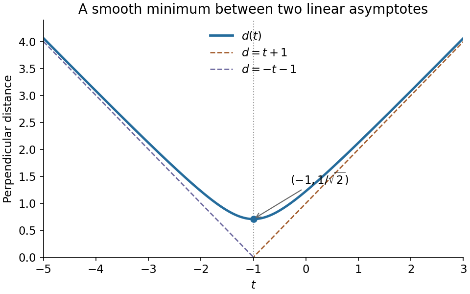

<h1 id="11/d/ii/solution">Solution</h1>

↑ **Parent:** [Ii](../ii.md)

The graph is the upper branch of the [hyperbola](../../../../../../hyperbola.md) $d^2-(t+1)^2=1/2$. It is symmetric about $t=-1$, positive everywhere, and has its lowest point at $(-1,1/\sqrt2)$. Its [derivatives](../../../../../../derivative.md) are

$$
d'(t)=\frac{t+1}{d(t)},\qquad d''(t)=\frac1{2d(t)^3}>0,
$$

so it is strictly convex. Since

$$
d(t)-|t+1|=\frac{1/2}{\sqrt{(t+1)^2+1/2}+|t+1|}\longrightarrow0,
$$

its two oblique [asymptotes](../../../../../../asymptote.md) are

$$
\boxed{d=t+1\quad(t\to+\infty),\qquad d=-t-1\quad(t\to-\infty).}
$$

**[Figure 1](#11/d/ii/image-distance-from-a-moving-point-to-a-skew-line). Distance from a moving point to a skew line**. Original plot of $d(t)=\sqrt{(t+1)^2+1/2}$, its minimum and its two asymptotes.

## ↑ Ancestors (14)

1. [Ii](../ii.md)
2. [D](../../d.md)
3. [11](../../../11.md)
4. [Paper 2](../../../../paper-2-split.md)
5. [2021](../../../../split.md)
6. [Past exam of the mathematics course of the year 1 of the natural sciences course of the University of Cambridge](../../../../../split.md)
7. [Mathematics course of the year 1 of the natural sciences course of the University of Cambridge](../../../../../../mathematics-course-of-the-year-1-of-the-natural-sciences-course-of-the-university-of-cambridge.md)
8. [Year 1 of the natural sciences course of the University of Cambridge](../../../../../../year-1-of-the-natural-sciences-course-of-the-university-of-cambridge.md)
9. [Year of the natural sciences course of the University of Cambridge](../../../../../../year-of-the-natural-sciences-course-of-the-university-of-cambridge.md)
10. [Natural sciences course of the University of Cambridge](../../../../../../natural-sciences-course-of-the-university-of-cambridge.md)
11. [Course of the University of Cambridge](../../../../../../course-of-the-university-of-cambridge.md)
12. [University of Cambridge](../../../../../../university-of-cambridge-split.md)
13. [List of universities](../../../../../../list-of-universities.md)
14. [Codex Wiki](../../../../../../split.md)
