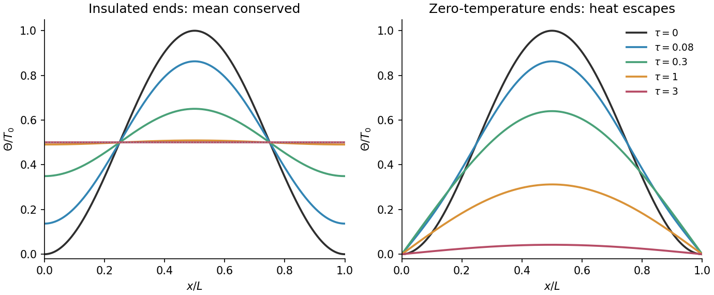

<h1 id="20/a/solution">Solution</h1>

↑ **Parent:** [A](../a.md)

For the [heat equation](../../../../../heat-equation.md) $\Theta_t=\kappa\Theta_{xx}$, [separation of variables](../../../../../separation-of-variables.md) with homogeneous [Neumann boundary condition](../../../../../neumann-boundary-condition.md) at both ends gives spatial modes $\cos(n\pi x/L)$ and decay factors $e^{-\kappa(n\pi/L)^2t}$. The $n=0$ mode is constant and does not decay.

The initial profile already contains only two such modes:

$$
T_0\sin^2\frac{\pi x}{L}=\frac{T_0}{2}-\frac{T_0}{2}\cos\frac{2\pi x}{L}.
$$

Evolving each mode therefore yields

$$
\boxed{\Theta(x,t)=\frac{T_0}{2}\left[1-e^{-4\kappa\pi^2t/L^2}\cos\frac{2\pi x}{L}\right].}
$$

The endpoint [derivatives](../../../../../derivative.md) vanish, and substitution checks both the equation and the initial profile. The spatial [integral](../../../../../integral-split.md) remains $LT_0/2$: no heat escapes through insulated ends, so the limiting uniform temperature is $T_0/2$.

**[Figure 5](#20/a/image-insulated-and-zero-temperature-endpoints-evolve-the-same-initial-heat-profile-differently). Insulated and zero-temperature endpoints evolve the same initial heat profile differently**. Original mode calculations. Both panels start from the same squared sine. Insulated endpoints conserve the mean temperature and approach $T_0/2$; zero-temperature endpoints remove heat and the profile decays to zero. Times are expressed as $\tau=\kappa\pi^2t/L^2$.

## ↑ Ancestors (13)

1. [A](../a.md)
2. [20](../../20.md)
3. [Paper 2](../../../paper-2-split.md)
4. [2021](../../../split.md)
5. [Past exam of the mathematics course of the year 1 of the natural sciences course of the University of Cambridge](../../../../split.md)
6. [Mathematics course of the year 1 of the natural sciences course of the University of Cambridge](../../../../../mathematics-course-of-the-year-1-of-the-natural-sciences-course-of-the-university-of-cambridge.md)
7. [Year 1 of the natural sciences course of the University of Cambridge](../../../../../year-1-of-the-natural-sciences-course-of-the-university-of-cambridge.md)
8. [Year of the natural sciences course of the University of Cambridge](../../../../../year-of-the-natural-sciences-course-of-the-university-of-cambridge.md)
9. [Natural sciences course of the University of Cambridge](../../../../../natural-sciences-course-of-the-university-of-cambridge.md)
10. [Course of the University of Cambridge](../../../../../course-of-the-university-of-cambridge.md)
11. [University of Cambridge](../../../../../university-of-cambridge-split.md)
12. [List of universities](../../../../../list-of-universities.md)
13. [Codex Wiki](../../../../../split.md)
