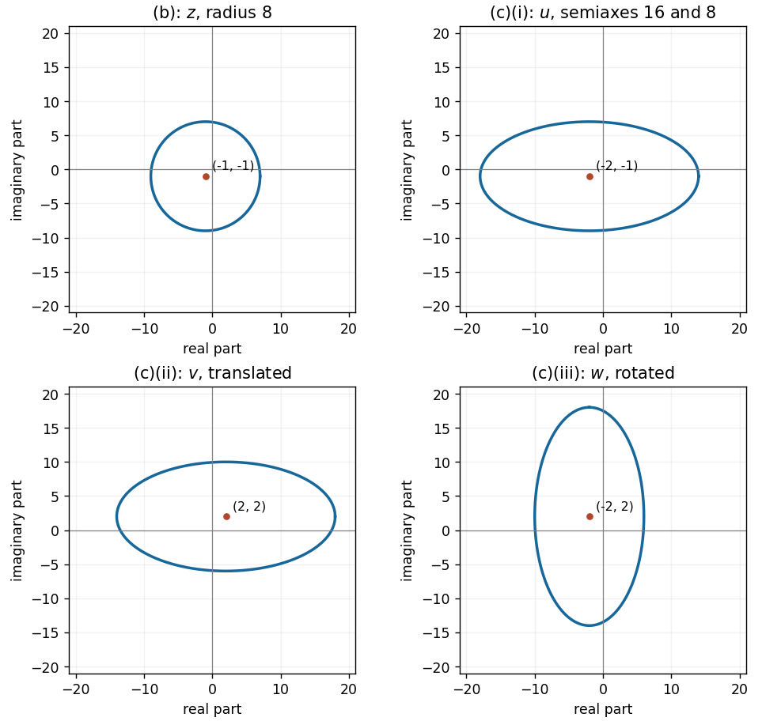
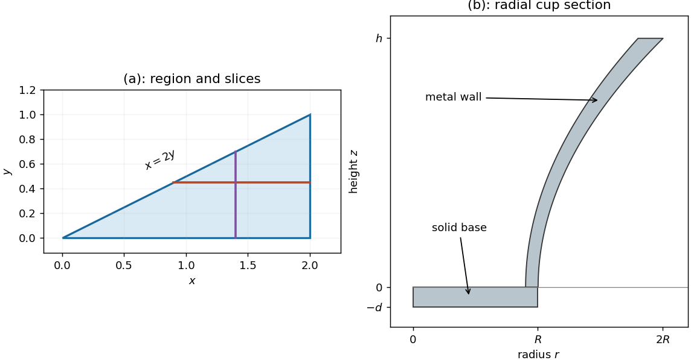
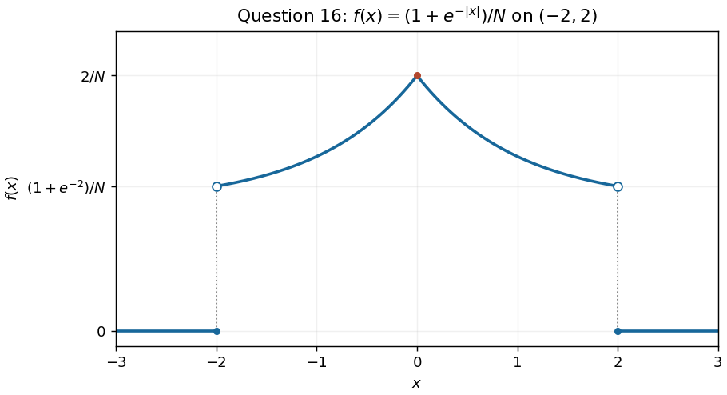

# Paper 1

↑ **Parent:** [2022](../2022.md)

[https://www.maths.cam.ac.uk/undergradnst/files/2022/papernst_ia_1_2022.pdf](https://www.maths.cam.ac.uk/undergradnst/files/2022/papernst_ia_1_2022.pdf)

**Table of contents**

- [1](#1)
  - [a](#1/a)
    - [Solution](#1/a/solution)
  - [b](#1/b)
    - [Solution](#1/b/solution)
- [2](#2)
  - [Solution](#2/solution)
- [3](#3)
  - [Solution](#3/solution)
- [4](#4)
  - [Solution](#4/solution)
- [5](#5)
  - [a](#5/a)
    - [Solution](#5/a/solution)
  - [b](#5/b)
    - [Solution](#5/b/solution)
- [6](#6)
  - [Solution](#6/solution)
- [7](#7)
  - [Solution](#7/solution)
- [8](#8)
  - [Solution](#8/solution)
- [9](#9)
  - [Solution](#9/solution)
- [10](#10)
  - [Solution](#10/solution)
- [11](#11)
  - [a](#11/a)
    - [i](#11/a/i)
      - [Solution](#11/a/i/solution)
    - [ii](#11/a/ii)
      - [Solution](#11/a/ii/solution)
  - [b](#11/b)
    - [Solution](#11/b/solution)
  - [c](#11/c)
    - [i](#11/c/i)
      - [Solution](#11/c/i/solution)
    - [ii](#11/c/ii)
      - [Solution](#11/c/ii/solution)
    - [iii](#11/c/iii)
      - [Solution](#11/c/iii/solution)
  - [d](#11/d)
    - [Solution](#11/d/solution)
- [12](#12)
  - [a](#12/a)
    - [i](#12/a/i)
      - [Solution](#12/a/i/solution)
    - [ii](#12/a/ii)
      - [Solution](#12/a/ii/solution)
    - [iii](#12/a/iii)
      - [Solution](#12/a/iii/solution)
    - [iv](#12/a/iv)
      - [Solution](#12/a/iv/solution)
  - [b](#12/b)
    - [Solution](#12/b/solution)
- [13](#13)
  - [a](#13/a)
    - [Solution](#13/a/solution)
  - [b](#13/b)
    - [Solution](#13/b/solution)
- [14](#14)
  - [a](#14/a)
    - [i](#14/a/i)
      - [Solution](#14/a/i/solution)
    - [ii](#14/a/ii)
      - [Solution](#14/a/ii/solution)
  - [b](#14/b)
    - [i](#14/b/i)
      - [Solution](#14/b/i/solution)
    - [ii](#14/b/ii)
      - [Solution](#14/b/ii/solution)
    - [iii](#14/b/iii)
      - [Solution](#14/b/iii/solution)
    - [iv](#14/b/iv)
      - [Solution](#14/b/iv/solution)
- [15](#15)
  - [a](#15/a)
    - [Solution](#15/a/solution)
  - [b](#15/b)
    - [i](#15/b/i)
      - [Solution](#15/b/i/solution)
    - [ii](#15/b/ii)
      - [Solution](#15/b/ii/solution)
    - [iii](#15/b/iii)
      - [Solution](#15/b/iii/solution)
- [16](#16)
  - [a](#16/a)
    - [Solution](#16/a/solution)
  - [b](#16/b)
    - [Solution](#16/b/solution)
  - [c](#16/c)
    - [Solution](#16/c/solution)
  - [d](#16/d)
    - [Solution](#16/d/solution)
  - [e](#16/e)
    - [Solution](#16/e/solution)
- [17](#17)
  - [a](#17/a)
    - [i](#17/a/i)
      - [Solution](#17/a/i/solution)
    - [ii](#17/a/ii)
      - [Solution](#17/a/ii/solution)
  - [b](#17/b)
    - [Solution](#17/b/solution)
  - [c](#17/c)
    - [i](#17/c/i)
      - [Solution](#17/c/i/solution)
    - [ii](#17/c/ii)
      - [Solution](#17/c/ii/solution)
    - [iii](#17/c/iii)
      - [Solution](#17/c/iii/solution)
- [18](#18)
  - [a](#18/a)
    - [Solution](#18/a/solution)
  - [b](#18/b)
    - [Solution](#18/b/solution)
  - [c](#18/c)
    - [Solution](#18/c/solution)
- [19](#19)
  - [a](#19/a)
    - [i](#19/a/i)
      - [Solution](#19/a/i/solution)
    - [ii](#19/a/ii)
      - [Solution](#19/a/ii/solution)
    - [iii](#19/a/iii)
      - [Solution](#19/a/iii/solution)
    - [iv](#19/a/iv)
      - [Solution](#19/a/iv/solution)
  - [b](#19/b)
    - [Solution](#19/b/solution)
- [20](#20)
  - [a](#20/a)
    - [Solution](#20/a/solution)
  - [b](#20/b)
    - [Solution](#20/b/solution)

## 1

↑ **Parent:** [Paper 1](paper-1.md)

<h3 id="1/a">a</h3>

↑ **Parent:** [1](#1)

<h4 id="1/a/solution">Solution</h4>

↑ **Parent:** [A](#1/a)

The [difference of two cubes](../../polynomial.md#difference-of-two-cubes) identity gives the real [polynomial factorization](../../polynomial.md#factorization-of-polynomials)

$$
\boxed{a^3-b^3=(a-b)(a^2+ab+b^2).}
$$

Expanding the right side cancels the two mixed terms of each degree. The quadratic factor satisfies $a^2+ab+b^2=(a+b/2)^2+3b^2/4$.

<h3 id="1/b">b</h3>

↑ **Parent:** [1](#1)

<h4 id="1/b/solution">Solution</h4>

↑ **Parent:** [B](#1/b)

For real cube roots, set $u=a^{1/3}$ and $v=b^{1/3}$, so $(ab)^{1/3}=uv$. The [sum of two cubes](../../polynomial.md#sum-of-two-cubes) identity gives

$$
(u+v)(u^2-uv+v^2)=u^3+v^3=\boxed{a+b}.
$$

## 2

↑ **Parent:** [Paper 1](paper-1.md)

<h3 id="2/solution">Solution</h3>

↑ **Parent:** [2](#2)

[Completing the square](../../polynomial.md#completing-the-square) under the square root gives $\sqrt{(x-1)^2}=|x-1|$. Thus the equation is $|x-1|=2$, and the definition of [absolute value](../../real-analysis.md#absolute-value) gives $x-1=\pm2$. Hence

$$
\boxed{x=-1\quad\text{or}\quad x=3.}
$$

## 3

↑ **Parent:** [Paper 1](paper-1.md)

<h3 id="3/solution">Solution</h3>

↑ **Parent:** [3](#3)

The domain excludes $x=0$. Rearranging the [inequality](../../arithmetic.md#inequality-mathematics) gives

$$
\frac{x+1}{x}\geq0.
$$

A sign check on the [intervals](../../real-analysis.md#interval-mathematics) separated by $-1$ and $0$ shows that the ratio is nonnegative when $x\leq-1$ or $x>0$. The point $-1$ is allowed because it makes the numerator zero. Therefore

$$
\boxed{x\in(-\infty,-1]\cup(0,\infty).}
$$

## 4

↑ **Parent:** [Paper 1](paper-1.md)

<h3 id="4/solution">Solution</h3>

↑ **Parent:** [4](#4)

The original PDF puts both $x+y$ in the exponent in the second equation. Since the [exponential function](../../calculus.md#exponential-function) $3^t$ is injective, $3^{x+y}=1$ gives $x+y=0$. Put $u=3^x>0$, so $3^y=1/u$. The first equation then gives

$$
u+\frac1u=2,\qquad (u-1)^2=0.
$$

Thus $u=1$, so $x=0$ and $y=-x=0$. The unique real solution of the [simultaneous equations](../../algebra.md#system-of-equations) is

$$
\boxed{(x,y)=(0,0).}
$$

## 5

↑ **Parent:** [Paper 1](paper-1.md)

<h3 id="5/a">a</h3>

↑ **Parent:** [5](#5)

<h4 id="5/a/solution">Solution</h4>

↑ **Parent:** [A](#5/a)

Pair adjacent terms in the finite [sum](../../arithmetic.md#sum):

$$
(-2+4)+(-6+8)+\cdots+(-98+100).
$$

There are $25$ pairs, each equal to $2$. The result is $\boxed{50}$.

<h3 id="5/b">b</h3>

↑ **Parent:** [5](#5)

<h4 id="5/b/solution">Solution</h4>

↑ **Parent:** [B](#5/b)

Put $r=\sin(\pi/4)=1/\sqrt2$. The [geometric series](../../sequence-and-series.md#geometric-series) has first term $r$ and common ratio $-r$, with [absolute value](../../real-analysis.md#absolute-value) less than one. Therefore its [sum](../../arithmetic.md#sum) is

$$
\boxed{\frac{r}{1+r}=\frac1{\sqrt2+1}=\sqrt2-1.}
$$

## 6

↑ **Parent:** [Paper 1](paper-1.md)

<h3 id="6/solution">Solution</h3>

↑ **Parent:** [6](#6)

The [product rule](../../calculus.md#product-rule) gives

$$
y'=e^{-x}(3x^2-x^3)=x^2e^{-x}(3-x).
$$

For $x>0$, the [derivative](../../calculus.md#derivative) is positive before $3$ and negative after $3$. Also $y(0)=0$ and $x^3e^{-x}\to0$ as $x\to\infty$. Thus the global maximum on the requested range is

$$
\boxed{x=3,\qquad y_{\max}=27e^{-3}.}
$$

## 7

↑ **Parent:** [Paper 1](paper-1.md)

<h3 id="7/solution">Solution</h3>

↑ **Parent:** [7](#7)

For $x>0$, the denominator is positive, so the [function graph](../../function.md#graph-of-a-function) has the same sign as $\sin x$. Its crossings of the horizontal axis are

$$
\boxed{x=n\pi,\qquad n=1,2,3,\ldots.}
$$

Each crossing is genuine because the [derivative](../../calculus.md#derivative) there is $(-1)^n/(n\pi)^2\ne0$. Near zero, $\sin x\sim x$, so $y\sim1/x\to+\infty$; the origin is excluded and is not a crossing. The oscillations alternate sign and decay towards zero as $x\to\infty$, with [absolute value](../../real-analysis.md#absolute-value) at most $1/x^2$.

**[Figure 1](#7/image-the-positive-axis-graph-in-question-7-with-its-crossings-at-positive-integer-multiples-of-pi). The positive-axis graph in Question 7, with its crossings at positive integer multiples of $\pi$**.

## 8

↑ **Parent:** [Paper 1](paper-1.md)

<h3 id="8/solution">Solution</h3>

↑ **Parent:** [8](#8)

Use the [substitution rule](../../integral.md#integration-by-substitution) with $u=\sqrt x$, for which $du=dx/(2\sqrt x)$ on $x>0$. The [integral](../../integral.md) becomes $\int e^u\,du$, giving the [antiderivative](../../integral.md#antiderivative)

$$
\boxed{e^{\sqrt x}+C.}
$$

## 9

↑ **Parent:** [Paper 1](paper-1.md)

<h3 id="9/solution">Solution</h3>

↑ **Parent:** [9](#9)

[Completing the square](../../polynomial.md#completing-the-square) gives

$$
(x-2)^2+y^2=1.
$$

Thus the [circle](../../topology.md#circle) has

$$
\boxed{\text{centre}=(2,0),\qquad\text{radius}=1.}
$$

## 10

↑ **Parent:** [Paper 1](paper-1.md)

<h3 id="10/solution">Solution</h3>

↑ **Parent:** [10](#10)

The [dot product](../../inner-product.md#dot-product) is

$$
\boxed{(a,a+1)\cdot(a+1,a)=2a(a+1)=2a^2+2a.}
$$

Both [vectors](../../vector-space.md#vector) have squared [Euclidean norm](../../normed-vector-space.md#euclidean-norm) $a^2+(a+1)^2=2a^2+2a+1$. Under the given condition $a^2+a=1/2$, their [dot product](../../inner-product.md#dot-product) is $1$ and each squared [Euclidean norm](../../normed-vector-space.md#euclidean-norm) is $2$. Hence

$$
\cos\theta=\frac1{\sqrt2\sqrt2}=\frac12,\qquad\boxed{\theta=\pi/3=60^\circ.}
$$

## 11

↑ **Parent:** [Paper 1](paper-1.md)

<h3 id="11/a">a</h3>

↑ **Parent:** [11](#11)

<h4 id="11/a/i">i</h4>

↑ **Parent:** [A](#11/a)

<h5 id="11/a/i/solution">Solution</h5>

↑ **Parent:** [I](#11/a/i)

Use the full set of [complex logarithm](../../analysis.md#complex-logarithm) values of $i$:

$$
\log i=i\left(\frac\pi2+2\pi k\right),\qquad k\in\mathbb Z.
$$

By the definition of [complex exponentiation](../../analysis.md#complex-exponentiation), the inner power can therefore take any value $i^i=\exp[-(\pi/2+2\pi k)]$, a positive real number. Its [complex logarithm](../../analysis.md#complex-logarithm) values are $-(\pi/2+2\pi k)+2\pi im$, where $m\in\mathbb Z$. Thus

$$
(i^i)^i=\exp\left[-i\left(\frac\pi2+2\pi k\right)-2\pi m\right]=-ie^{-2\pi m}.
$$

All possible [real parts](../../complex-analysis.md#real-part) and [imaginary parts](../../complex-analysis.md#imaginary-part) are consequently

$$
\boxed{\Re((i^i)^i)=0,\qquad\Im((i^i)^i)=-e^{-2\pi m},\quad m\in\mathbb Z.}
$$

Choosing the principal [complex logarithm](../../analysis.md#complex-logarithm) at both stages gives the particular value $-i$. The independent logarithm choices are needed because the question asks for all possible values.

<h4 id="11/a/ii">ii</h4>

↑ **Parent:** [A](#11/a)

<h5 id="11/a/ii/solution">Solution</h5>

↑ **Parent:** [Ii](#11/a/ii)

The inner power takes the values $r_k=e^{-(\pi/2+2\pi k)}$. For each such real exponent, all values of the outer [complex exponentiation](../../analysis.md#complex-exponentiation) are obtained from all [complex logarithm](../../analysis.md#complex-logarithm) values of its base $i$:

$$
i^{(i^i)}=\exp\left[i\left(\frac\pi2+2\pi m\right)e^{-(\pi/2+2\pi k)}\right],\qquad k,m\in\mathbb Z.
$$

Writing $\Theta_{k,m}=(\pi/2+2\pi m)e^{-(\pi/2+2\pi k)}$, the answer is

$$
\boxed{\Re(i^{(i^i)})=\cos\Theta_{k,m},\qquad\Im(i^{(i^i)})=\sin\Theta_{k,m},\qquad k,m\in\mathbb Z.}
$$

All values lie on the [unit circle](../../complex-analysis.md#complex-unit-circle). The principal choice is $k=m=0$, giving $\cos[(\pi/2)e^{-\pi/2}]+i\sin[(\pi/2)e^{-\pi/2}]$. In particular the two nestings in parts (i) and (ii) are different: [complex exponentiation is not associative](../../analysis.md#complex-exponentiation-is-not-associative).

<h3 id="11/b">b</h3>

↑ **Parent:** [11](#11)

<h4 id="11/b/solution">Solution</h4>

↑ **Parent:** [B](#11/b)

The [complex modulus](../../complex-analysis.md#complex-modulus) $|z-(-1-i)|$ is the [Euclidean distance](../../topological-analysis.md#euclidean-distance) from $z$ to $-1-i$. Thus the locus is

$$
\boxed{(x+1)^2+(y+1)^2=64,}
$$

a [circle](../../topology.md#circle) with centre $(-1,-1)$ and [radius](../../topology.md#radius) $8$. Its extreme horizontal coordinates are $-9$ and $7$, and its extreme vertical coordinates are also $-9$ and $7$.

**[Figure 2](#11/b/image-the-circle-and-its-three-transformed-loci-in-question-11-drawn-with-equal-horizontal-and-vertical-scales). The circle and its three transformed loci in Question 11, drawn with equal horizontal and vertical scales**.

<h3 id="11/c">c</h3>

↑ **Parent:** [11](#11)

<h4 id="11/c/i">i</h4>

↑ **Parent:** [C](#11/c)

<h5 id="11/c/i/solution">Solution</h5>

↑ **Parent:** [I](#11/c/i)

Write $z=x+iy$ and use the [complex conjugate](../../complex-analysis.md#complex-conjugate) $z^*=x-iy$. Then

$$
u=\frac32(x+iy)+\frac12(x-iy)=2x+iy.
$$

Thus the [real part](../../complex-analysis.md#real-part) is stretched by a factor of two while the [imaginary part](../../complex-analysis.md#imaginary-part) is unchanged. If $u=X+iY$, substitution into the [circle](../../topology.md#circle) equation gives

$$
\boxed{\frac{(X+2)^2}{16^2}+\frac{(Y+1)^2}{8^2}=1.}
$$

This is an [ellipse](../../euclidean-geometry.md#ellipse) with centre $(-2,-1)$, horizontal semiaxis $16$ and vertical semiaxis $8$. It is the second panel in the figure in part (b).

<h4 id="11/c/ii">ii</h4>

↑ **Parent:** [C](#11/c)

<h5 id="11/c/ii/solution">Solution</h5>

↑ **Parent:** [Ii](#11/c/ii)

Adding $4+3i$ is a [translation](../../geometry-and-topology.md#translation-geometry) by $(4,3)$ in the [complex plane](../../complex-analysis.md#complex-plane). The [ellipse](../../euclidean-geometry.md#ellipse) of part (i) therefore keeps its semiaxes and axis directions, with new centre $(2,2)$. Writing $v=X+iY$, its equation is

$$
\boxed{\frac{(X-2)^2}{16^2}+\frac{(Y-2)^2}{8^2}=1.}
$$

The third panel in the figure in part (b) shows the translated [ellipse](../../euclidean-geometry.md#ellipse).

<h4 id="11/c/iii">iii</h4>

↑ **Parent:** [C](#11/c)

<h5 id="11/c/iii/solution">Solution</h5>

↑ **Parent:** [Iii](#11/c/iii)

Multiplication by $i$ is a counterclockwise [rotation](../../riemannian-geometry.md#rotation-mathematics) through $\pi/2$: it maps coordinates $(X,Y)$ to $(-Y,X)$. The centre $(2,2)$ therefore becomes $(-2,2)$, and the long axis becomes vertical. For $w=X+iY$, the resulting [ellipse](../../euclidean-geometry.md#ellipse) is

$$
\boxed{\frac{(X+2)^2}{8^2}+\frac{(Y-2)^2}{16^2}=1.}
$$

Its horizontal semiaxis is $8$ and its vertical semiaxis is $16$, as shown in the final panel of the figure in part (b).

<h3 id="11/d">d</h3>

↑ **Parent:** [11](#11)

<h4 id="11/d/solution">Solution</h4>

↑ **Parent:** [D](#11/d)

By [De Moivre's theorem](../../analysis.md#de-moivre-s-theorem), $\sin5\theta$ is the [imaginary part](../../complex-analysis.md#imaginary-part) of $(\cos\theta+i\sin\theta)^5$. The [binomial theorem](../../binomial-coefficient.md#binomial-theorem) gives, with $s=\sin\theta$,

$$
\sin5\theta=5\cos^4\theta\,s-10\cos^2\theta\,s^3+s^5.
$$

Use $\cos^2\theta=1-s^2$ and simplify:

$$
\boxed{\sin5\theta=16s^5-20s^3+5s.}
$$

The requested equation cancels the $16s^5$ term, leaving $5s(1-4s^2)=0$. Thus $s=0$ or $s=\pm1/2$. The complete list in $0\leq\theta<2\pi$ is

$$
\boxed{\theta=0,\ \frac\pi6,\ \frac{5\pi}6,\ \pi,\ \frac{7\pi}6,\ \frac{11\pi}6.}
$$

## 12

↑ **Parent:** [Paper 1](paper-1.md)

<h3 id="12/a">a</h3>

↑ **Parent:** [12](#12)

<h4 id="12/a/i">i</h4>

↑ **Parent:** [A](#12/a)

<h5 id="12/a/i/solution">Solution</h5>

↑ **Parent:** [I](#12/a/i)

The stated $x$ bounds depend on $y$, so $y$ must be held fixed while the [integral](../../integral.md) over $x$ is performed. The intended [iterated integral](../../integral.md#iterated-integral) is

$$
\boxed{\int_0^1\left(\int_{2y}^2x^2y^2\,dx\right)dy.}
$$

The original PDF places the two sets of bounds beside the opposite integral signs relative to the printed $dx\,dy$. That placement cannot be read literally as a conventional nested [integral](../../integral.md); the dependence of the lower $x$ bound on $y$, and the explicit instruction to integrate over $x$ first, specify the intended region unambiguously.

<h4 id="12/a/ii">ii</h4>

↑ **Parent:** [A](#12/a)

<h5 id="12/a/ii/solution">Solution</h5>

↑ **Parent:** [Ii](#12/a/ii)

The inequalities describing the region are $0\leq y\leq1$ and $2y\leq x\leq2$. It is the closed [triangle](../../euclidean-geometry.md#triangle) bounded by $y=0$, $x=2$ and $x=2y$, with vertices

$$
\boxed{(0,0),\qquad(2,0),\qquad(2,1).}
$$

A horizontal slice runs from the sloping edge $x=2y$ to the vertical edge $x=2$.

**[Figure 3](#12/a/ii/image-the-triangular-integration-region-and-the-cup-cross-section-including-its-solid-base-in-question-12). The triangular integration region and the cup cross-section, including its solid base, in Question 12**.

<h4 id="12/a/iii">iii</h4>

↑ **Parent:** [A](#12/a)

<h5 id="12/a/iii/solution">Solution</h5>

↑ **Parent:** [Iii](#12/a/iii)

With $y$ held fixed, the inner [antiderivative](../../integral.md#antiderivative) gives

$$
\int_{2y}^2x^2y^2\,dx=\frac{y^2}{3}[x^3]_{2y}^2=\frac83(y^2-y^5).
$$

The remaining [integral](../../integral.md) is therefore

$$
\boxed{\frac83\int_0^1(y^2-y^5)\,dy=\frac83\left(\frac13-\frac16\right)=\frac49.}
$$

<h4 id="12/a/iv">iv</h4>

↑ **Parent:** [A](#12/a)

<h5 id="12/a/iv/solution">Solution</h5>

↑ **Parent:** [Iv](#12/a/iv)

For a vertical slice through the [triangle](../../euclidean-geometry.md#triangle), $0\leq x\leq2$ and $0\leq y\leq x/2$. Reversing the order by [Fubini's theorem](../../measure-theory.md#fubini-s-theorem) gives

$$
\int_0^2\left(\int_0^{x/2}x^2y^2\,dy\right)dx=\int_0^2\frac{x^5}{24}\,dx=\boxed{\frac49}.
$$

The agreement checks that both orders describe the same region.

<h3 id="12/b">b</h3>

↑ **Parent:** [12](#12)

<h4 id="12/b/solution">Solution</h4>

↑ **Parent:** [B](#12/b)

The PDF diagram includes a solid base of thickness $d$, occupying $-d\leq z\leq0$ and $0\leq r\leq R$. Above it, $0\leq z\leq h$, the metal lies between the two specified curved surfaces. In [cylindrical coordinates](../../multivariable-calculus.md#cylindrical-coordinate-system), the [Jacobian determinant](../../multivariable-calculus.md#jacobian-determinant) contributes a factor $r$, so the [mass](../../classical-mechanics.md#mass) is

$$
\begin{aligned}
M={}&\rho\int_{-d}^0\int_0^{2\pi}\int_0^Rr\,dr\,d\phi\,dz\\
&+\rho\int_0^h\int_0^{2\pi}\int_{(9/10)R(1+z^2/h^2)}^{R(1+z^2/h^2)}r\,dr\,d\phi\,dz.
\end{aligned}
$$

The base contributes $\pi\rho R^2d$. The wall contributes

$$
\pi\rho R^2\left(1-\frac{81}{100}\right)\int_0^h\left(1+\frac{z^2}{h^2}\right)^2dz=\pi\rho R^2\frac{19}{100}h\left(1+\frac23+\frac15\right)=\frac{133}{375}\pi\rho R^2h.
$$

Consequently

$$
\boxed{M=\pi\rho R^2\left(d+\frac{133h}{375}\right).}
$$

The base thickness $d$ comes from the diagram; omitting it would omit part of the cup's [volume](../../geometry-and-topology.md#volume).

## 13

↑ **Parent:** [Paper 1](paper-1.md)

<h3 id="13/a">a</h3>

↑ **Parent:** [13](#13)

<h4 id="13/a/solution">Solution</h4>

↑ **Parent:** [A](#13/a)

Because the original [differential equation](../../differential-equation.md) divides by $xy$, its domain requires $x\ne0$ and $y\ne0$. Set $u=y^2$, so $u'=2yy'$. The equation becomes the [first-order linear differential equation](../../linear-ordinary-differential-equation.md#first-order-linear-differential-equation)

$$
u'+\frac2x u=-4x-2.
$$

An [integrating factor](../../linear-ordinary-differential-equation.md#integrating-factor) is $x^2$, since $(x^2u)'=x^2u'+2xu$. Thus

$$
(x^2u)'=-4x^3-2x^2,\qquad x^2u=-x^4-\frac23x^3+C.
$$

Returning to $y$ gives the explicit general real solutions

$$
\boxed{y(x)=\pm\sqrt{\frac C{x^2}-x^2-\frac23x},\qquad C\in\mathbb R.}
$$

Each sign is fixed on a connected [interval](../../real-analysis.md#interval-mathematics) where $x\ne0$ and the radicand is strictly positive. The strict condition excludes $y=0$, where the original [differential equation](../../differential-equation.md) is undefined. There is no additional zero solution.

<h3 id="13/b">b</h3>

↑ **Parent:** [13](#13)

<h4 id="13/b/solution">Solution</h4>

↑ **Parent:** [B](#13/b)

Where $\sin x\ne0$, divide by it to obtain $y'+2\cot x\,y=\csc x$. The [integrating factor](../../linear-ordinary-differential-equation.md#integrating-factor) is $\sin^2x$, and the [product rule](../../calculus.md#product-rule) gives

$$
(y\sin^2x)'=\sin x,\qquad y\sin^2x=-\cos x+C.
$$

The [initial condition](../../differential-equation.md#initial-condition) gives $C=1$. Hence

$$
y=\frac{1-\cos x}{\sin^2x}=\boxed{\frac1{1+\cos x}}.
$$

The simplified expression has a differentiable extension through $x=0$, with $y(0)=1/2$. Direct substitution verifies the original undivided [differential equation](../../differential-equation.md) there as well: its left side is $2y(0)=1$. Thus the maximal [interval](../../real-analysis.md#interval-mathematics) containing $\pi/2$ on which this solution is finite is $\boxed{-\pi<x<\pi}$; the apparent exclusion of $0$ arose only from division by $\sin x$. This is [continuation through a zero of the leading ODE coefficient](../../differential-equation.md#continuation-through-a-zero-of-the-leading-ode-coefficient).

## 14

↑ **Parent:** [Paper 1](paper-1.md)

<h3 id="14/a">a</h3>

↑ **Parent:** [14](#14)

<h4 id="14/a/i">i</h4>

↑ **Parent:** [A](#14/a)

<h5 id="14/a/i/solution">Solution</h5>

↑ **Parent:** [I](#14/a/i)

An [exact differential form](../../differential-form.md#exact-differential-form) must have $P_y=Q_x$. Direct [partial differentiation](../../multivariable-calculus.md#partial-derivative) gives

$$
P_y=2y\sin(ax)+2xy\cos(ax),\qquad Q_x=2y\sin(ax)+2axy\cos(ax).
$$

Thus $(1-a)xy\cos(ax)=0$ must hold identically. Since $xy\cos(ax)$ is not identically zero for a fixed nonzero $a$, the only possibility is

$$
\boxed{a=1.}
$$

The explicit potential in part (ii) verifies sufficiency.

<h4 id="14/a/ii">ii</h4>

↑ **Parent:** [A](#14/a)

<h5 id="14/a/ii/solution">Solution</h5>

↑ **Parent:** [Ii](#14/a/ii)

For $a=1$, integrate $Q=2xy\sin x$ with respect to $y$ to obtain

$$
f(x,y)=xy^2\sin x+C(x).
$$

Its other [partial derivative](../../multivariable-calculus.md#partial-derivative) is $f_x=y^2\sin x+xy^2\cos x+C'(x)$. Comparing with $P$ gives $C'(x)=0$. Thus the most general potential on the plane is

$$
\boxed{f(x,y)=xy^2\sin x+C,\qquad C\in\mathbb R.}
$$

<h3 id="14/b">b</h3>

↑ **Parent:** [14](#14)

<h4 id="14/b/i">i</h4>

↑ **Parent:** [B](#14/b)

<h5 id="14/b/i/solution">Solution</h5>

↑ **Parent:** [I](#14/b/i)

The [chain rule](../../calculus.md#chain-rule) gives $f_x=f_u u_x+f_v v_x$ and $f_y=f_u u_y+f_v v_y$. Since $u_x=2x$, $u_y=2y$, $v_x=2xy^2$ and $v_y=2x^2y$, the answer is

$$
\boxed{f_x=2xf_u+2xy^2f_v,\qquad f_y=2yf_u+2x^2yf_v.}
$$

Every [partial derivative](../../multivariable-calculus.md#partial-derivative) of $f$ on the right is evaluated at $u=1+x^2+y^2$, $v=1+x^2y^2$.

<h4 id="14/b/ii">ii</h4>

↑ **Parent:** [B](#14/b)

<h5 id="14/b/ii/solution">Solution</h5>

↑ **Parent:** [Ii](#14/b/ii)

Apply the [product rule](../../calculus.md#product-rule) and the [chain rule](../../calculus.md#chain-rule) once more to each expression in part (i). The [second derivative chain rule](../../calculus.md#second-derivative-chain-rule) gives

$$
\boxed{f_{xx}=2f_u+2y^2f_v+4x^2f_{uu}+8x^2y^2f_{uv}+4x^2y^4f_{vv},}
$$

$$
\boxed{f_{yy}=2f_u+2x^2f_v+4y^2f_{uu}+8x^2y^2f_{uv}+4x^4y^2f_{vv},}
$$

and

$$
\boxed{f_{xy}=4xyf_{uu}+4xy(x^2+y^2)f_{uv}+4x^3y^3f_{vv}+4xyf_v.}
$$

For example, the coefficient of $f_{uv}$ in the mixed [partial derivative](../../multivariable-calculus.md#partial-derivative) is $u_xv_y+v_xu_y=4x^3y+4xy^3$, while the final term is $v_{xy}f_v=4xyf_v$. The symmetry $f_{uv}=f_{vu}$ is used in combining the mixed terms under the usual twice-continuously-differentiable interpretation.

<h4 id="14/b/iii">iii</h4>

↑ **Parent:** [B](#14/b)

<h5 id="14/b/iii/solution">Solution</h5>

↑ **Parent:** [Iii](#14/b/iii)

For $f(u,v)=\ln u+\ln v$, the needed [partial derivatives](../../multivariable-calculus.md#partial-derivative) are

$$
f_v=\frac1v,\qquad f_{uu}=-\frac1{u^2},\qquad f_{uv}=0,\qquad f_{vv}=-\frac1{v^2}.
$$

Substituting these into part (ii) gives

$$
f_{xy}=-\frac{4xy}{u^2}-\frac{4x^3y^3}{v^2}+\frac{4xy}{v}.
$$

Since $v-x^2y^2=1$, the last two terms combine. Thus

$$
\boxed{f_{xy}=4xy\left[\frac1{(1+x^2y^2)^2}-\frac1{(1+x^2+y^2)^2}\right].}
$$

<h4 id="14/b/iv">iv</h4>

↑ **Parent:** [B](#14/b)

<h5 id="14/b/iv/solution">Solution</h5>

↑ **Parent:** [Iv](#14/b/iv)

First express the [function](../../function.md) in the original variables:

$$
f(x,y)=\ln(1+x^2+y^2)+\ln(1+x^2y^2).
$$

The [chain rule](../../calculus.md#chain-rule) gives

$$
f_x=\frac{2x}{1+x^2+y^2}+\frac{2xy^2}{1+x^2y^2}.
$$

Taking its [partial derivative](../../multivariable-calculus.md#partial-derivative) with respect to $y$ yields

$$
f_{xy}=-\frac{4xy}{(1+x^2+y^2)^2}+\frac{4xy(1+x^2y^2)-4x^3y^3}{(1+x^2y^2)^2}.
$$

The numerator in the second fraction reduces to $4xy$, reproducing

$$
\boxed{f_{xy}=4xy\left[\frac1{(1+x^2y^2)^2}-\frac1{(1+x^2+y^2)^2}\right].}
$$

Both [logarithms](../../calculus.md#logarithm) are defined for every real $x,y$ because their arguments are at least one.

## 15

↑ **Parent:** [Paper 1](paper-1.md)

<h3 id="15/a">a</h3>

↑ **Parent:** [15](#15)

<h4 id="15/a/solution">Solution</h4>

↑ **Parent:** [A](#15/a)

For $a\ne0$, factor out $|a|$, not $a$, and apply the [binomial series](../../sequence-and-series.md#binomial-series) with exponent $1/2$:

$$
\sqrt{a^2+x^2}=|a|\left(1+\frac{x^2}{a^2}\right)^{1/2}=\boxed{|a|+\frac{x^2}{2|a|}-\frac{x^4}{8|a|^3}+O(x^6).}
$$

For each fixed nonzero $a$, these are the first three nonzero terms of the [Taylor series](../../calculus.md#taylor-series) about zero; the full [binomial series](../../sequence-and-series.md#binomial-series) converges when $|x|<|a|$.

For $a=0$, the [function](../../function.md) is $|x|$. Its right [derivative](../../calculus.md#derivative) at zero is $1$ and its left [derivative](../../calculus.md#derivative) is $-1$, so **no Taylor series about zero exists when $a=0$**. The one-sided formulas are exactly $x$ for $x\geq0$ and $-x$ for $x\leq0$; they do not form a single two-sided [Taylor expansion](../../calculus.md#taylor-expansion), nor can they supply three nonzero terms. The parameter case explicitly included in the question must therefore be treated as this exception.

<h3 id="15/b">b</h3>

↑ **Parent:** [15](#15)

<h4 id="15/b/i">i</h4>

↑ **Parent:** [B](#15/b)

<h5 id="15/b/i/solution">Solution</h5>

↑ **Parent:** [I](#15/b/i)

Write $t_j=t^{(j)}(0)$ and $s=1+t_0>0$. The [chain rule](../../calculus.md#chain-rule) gives

$$
f(0)=\ln s,\qquad f'(0)=\frac{t_1}{s}.
$$

The condition $t_3t_1<0$ ensures $t_1\ne0$. Since $t_0\ne0$, also $s\ne1$ and $\ln s\ne0$. Hence the first two nonzero terms are the constant and linear terms:

$$
\boxed{f(x)=\ln(1+t_0)+\frac{t_1}{1+t_0}x+O(x^2).}
$$

The inequality $s>0$, together with [continuity](../../calculus.md#continuous-function) of $t$, makes the [logarithm](../../calculus.md#logarithm) defined on a neighbourhood of zero. The remainder is written in [Big O notation](../../real-analysis.md#big-o-notation).

<h4 id="15/b/ii">ii</h4>

↑ **Parent:** [B](#15/b)

<h5 id="15/b/ii/solution">Solution</h5>

↑ **Parent:** [Ii](#15/b/ii)

The [second derivative chain rule](../../calculus.md#second-derivative-chain-rule) gives

$$
f''(x)=\frac{t''(x)}{1+t(x)}-\frac{t'(x)^2}{(1+t(x))^2}.
$$

With $t_0=0$, the constant term vanishes, $f'(0)=t_1\ne0$, and $f''(0)=t_2-t_1^2\ne0$ by the specified case. Thus the first two nonzero terms in the [Taylor expansion](../../calculus.md#taylor-expansion) are

$$
\boxed{f(x)=t_1x+\frac{t_2-t_1^2}{2}x^2+O(x^3).}
$$

<h4 id="15/b/iii">iii</h4>

↑ **Parent:** [B](#15/b)

<h5 id="15/b/iii/solution">Solution</h5>

↑ **Parent:** [Iii](#15/b/iii)

Here $t_0=0$ and $t_2=t_1^2$, so the constant and quadratic terms vanish, while the linear coefficient remains $t_1\ne0$. A further [derivative](../../calculus.md#derivative) gives

$$
f^{(3)}(x)=\frac{t^{(3)}(x)}{1+t(x)}-\frac{3t'(x)t''(x)}{(1+t(x))^2}+\frac{2t'(x)^3}{(1+t(x))^3}.
$$

Consequently $f^{(3)}(0)=t_3-3t_1t_2+2t_1^3=t_3-t_1^3$. Since $t_3$ and $t_1$ have opposite signs, $t_3$ and $t_1^3$ also have opposite signs, and their difference is nonzero. The first two nonzero terms are therefore

$$
\boxed{f(x)=t_1x+\frac{t_3-t_1^3}{6}x^3+O(x^4).}
$$

This is where the full sign condition $t_3t_1<0$ rules out a further cancellation in the [Taylor expansion](../../calculus.md#taylor-expansion).

## 16

↑ **Parent:** [Paper 1](paper-1.md)

<h3 id="16/a">a</h3>

↑ **Parent:** [16](#16)

<h4 id="16/a/solution">Solution</h4>

↑ **Parent:** [A](#16/a)

A [probability density function](../../continuous-probability-distribution.md#probability-density-function) must have total [integral](../../integral.md) one. The numerator is an [even function](../../calculus.md#even-function), so

$$
N=2\int_0^2(1+e^{-x})\,dx=2[\,x-e^{-x}\,]_0^2=\boxed{6-2e^{-2}}.
$$

This is positive, ensuring nonnegativity of the [probability density function](../../continuous-probability-distribution.md#probability-density-function).

<h3 id="16/b">b</h3>

↑ **Parent:** [16](#16)

<h4 id="16/b/solution">Solution</h4>

↑ **Parent:** [B](#16/b)

Put $N=6-2e^{-2}$. The [function graph](../../function.md#graph-of-a-function) is symmetric about the vertical axis, zero outside $[-2,2]$, and has its unique maximum at $x=0$ with height $2/N$. On $0<x<2$, it decreases as $(1+e^{-x})/N$; the negative side is its reflection. The one-sided interior endpoint values are $(1+e^{-2})/N$, so the [probability density function](../../continuous-probability-distribution.md#probability-density-function) jumps to zero at both ends of its support. It also has a corner at its central maximum because of the [absolute value](../../real-analysis.md#absolute-value) in the exponent.

**[Figure 4](#16/b/image-the-symmetric-density-in-question-16-including-its-central-corner-and-endpoint-jumps). The symmetric density in Question 16, including its central corner and endpoint jumps**.

Values assigned exactly at $x=\pm2$ do not affect any [probability](../../probability-theory.md#probability).

<h3 id="16/c">c</h3>

↑ **Parent:** [16](#16)

<h4 id="16/c/solution">Solution</h4>

↑ **Parent:** [C](#16/c)

Since the [probability density function](../../continuous-probability-distribution.md#probability-density-function) is an [even function](../../calculus.md#even-function), $xf(x)$ is an [odd function](../../calculus.md#odd-function). Its [integral](../../integral.md) over the symmetric support vanishes, so

$$
\boxed{\mathbb E[X]=0.}
$$

<h3 id="16/d">d</h3>

↑ **Parent:** [16](#16)

<h4 id="16/d/solution">Solution</h4>

↑ **Parent:** [D](#16/d)

The [expected value](../../expected-value.md) is zero, so the [variance](../../variance.md) is $\mathbb E[X^2]$. Symmetry gives

$$
\operatorname{Var}(X)=\frac2N\int_0^2x^2(1+e^{-x})\,dx.
$$

The polynomial term contributes $8/3$. Two applications of [integration by parts](../../calculus.md#integration-by-parts) give

$$
\int x^2e^{-x}\,dx=-(x^2+2x+2)e^{-x}+C,
$$

so its definite value on $[0,2]$ is $2-10e^{-2}$. Therefore

$$
\boxed{\operatorname{Var}(X)=\frac{28/3-20e^{-2}}{6-2e^{-2}}.}
$$

<h3 id="16/e">e</h3>

↑ **Parent:** [16](#16)

<h4 id="16/e/solution">Solution</h4>

↑ **Parent:** [E](#16/e)

Let $F$ be the [cumulative distribution function](../../probability-distribution.md#cumulative-distribution-function) of $X$. Normalisation of the proposed [probability density function](../../continuous-probability-distribution.md#probability-density-function) requires $M=\int_{-2}^2F(y)\,dy$. The [integrated cumulative distribution function on a bounded interval](../../probability-distribution.md#integrated-cumulative-distribution-function-on-a-bounded-interval) identity gives

$$
M=2-\mathbb E[X]=\boxed{2}.
$$

For a direct symmetry proof, the continuous symmetric [probability distribution](../../probability-distribution.md) satisfies $F(-y)=1-F(y)$. Hence

$$
\int_{-2}^2F(y)\,dy=\int_0^2[F(y)+F(-y)]\,dy=\int_0^2 1\,dy=2.
$$

In particular $g(y)=F(y)/2$ is nonnegative and has total [integral](../../integral.md) one over its stated support.

## 17

↑ **Parent:** [Paper 1](paper-1.md)

<h3 id="17/a">a</h3>

↑ **Parent:** [17](#17)

<h4 id="17/a/i">i</h4>

↑ **Parent:** [A](#17/a)

<h5 id="17/a/i/solution">Solution</h5>

↑ **Parent:** [I](#17/a/i)

Write $I=\int e^x\sin x\,dx$ and $J=\int e^x\cos x\,dx$. Two applications of [integration by parts](../../calculus.md#integration-by-parts), first taking the [sine](../../geometry-and-topology.md#sine) and then the [cosine](../../geometry-and-topology.md#cosine) as the differentiated factor, give

$$
\boxed{I=e^x\sin x-J+C_1,\qquad J=e^x\cos x+I+C_2.}
$$

Thus $I+J=e^x\sin x$ and $J-I=e^x\cos x$, in each case up to an arbitrary constant of [integration](../../integral.md). Keeping that freedom avoids identifying independently chosen [antiderivatives](../../integral.md#antiderivative) too rigidly.

<h4 id="17/a/ii">ii</h4>

↑ **Parent:** [A](#17/a)

<h5 id="17/a/ii/solution">Solution</h5>

↑ **Parent:** [Ii](#17/a/ii)

The difference and sum of the two [antiderivatives](../../integral.md#antiderivative) in part (i) give

$$
\boxed{\int e^x(\sin x-\cos x)\,dx=-e^x\cos x+C,}
$$

and

$$
\boxed{\int e^x(\sin x+\cos x)\,dx=e^x\sin x+C.}
$$

Their [derivatives](../../calculus.md#derivative) also verify the signs immediately.

<h3 id="17/b">b</h3>

↑ **Parent:** [17](#17)

<h4 id="17/b/solution">Solution</h4>

↑ **Parent:** [B](#17/b)

Let $I_n=\int e^{nx}\sin x\,dx$ and $J_n=\int e^{nx}\cos x\,dx$. Integrating the [trigonometric functions](../../geometry-and-topology.md#trigonometric-function) and differentiating $e^{nx}$ in [integration by parts](../../calculus.md#integration-by-parts) gives, modulo constants,

$$
I_n=-e^{nx}\cos x+nJ_n,\qquad J_n=e^{nx}\sin x-nI_n.
$$

Substitution yields $(1+n^2)I_n=e^{nx}(n\sin x-\cos x)$ and $(1+n^2)J_n=e^{nx}(n\cos x+\sin x)$. Therefore

$$
\begin{aligned}
\int e^{nx}(\sin x-\cos x)\,dx&=I_n-J_n\\
&=\boxed{-\frac{e^{nx}}{n^2+1}\left[(1+n)\cos x+(1-n)\sin x\right]+C.}
\end{aligned}
$$

No division by $n$ was used, so this formula also applies at $n=0$.

<h3 id="17/c">c</h3>

↑ **Parent:** [17](#17)

<h4 id="17/c/i">i</h4>

↑ **Parent:** [C](#17/c)

<h5 id="17/c/i/solution">Solution</h5>

↑ **Parent:** [I](#17/c/i)

Use the [substitution rule](../../integral.md#integration-by-substitution) $u=x^2$, $du=2x\,dx$. The convergent [improper integral](../../real-analysis.md#improper-integral) is

$$
\boxed{\int_0^\infty xe^{-x^2}\,dx=\frac12\int_0^\infty e^{-u}\,du=\frac12.}
$$

<h4 id="17/c/ii">ii</h4>

↑ **Parent:** [C](#17/c)

<h5 id="17/c/ii/solution">Solution</h5>

↑ **Parent:** [Ii](#17/c/ii)

For $n\geq2$, write $x^ne^{-x^2}=x^{n-1}(xe^{-x^2})$ and apply [integration by parts](../../calculus.md#integration-by-parts), using the [antiderivative](../../integral.md#antiderivative) $-e^{-x^2}/2$ for the second factor:

$$
I(n)=\left[-\frac12x^{n-1}e^{-x^2}\right]_0^\infty+\frac{n-1}{2}\int_0^\infty x^{n-2}e^{-x^2}\,dx.
$$

The boundary term is zero: at zero, $n-1>0$, and at infinity [Gaussian decay dominates every power](../../calculus.md#gaussian-decay-dominates-every-power). Consequently the [Gaussian moment recurrence](../../integral.md#gaussian-moment-recurrence) is

$$
\boxed{I(n)=\frac{n-1}{2}I(n-2),\qquad n\geq2.}
$$

<h4 id="17/c/iii">iii</h4>

↑ **Parent:** [C](#17/c)

<h5 id="17/c/iii/solution">Solution</h5>

↑ **Parent:** [Iii](#17/c/iii)

Start with the supplied [Gaussian integral](../../integral.md#gaussian-integral) $I(0)=\sqrt\pi/2$ and part (i)'s $I(1)=1/2$. Repeated use of the [Gaussian moment recurrence](../../integral.md#gaussian-moment-recurrence) gives

$$
\boxed{I(2)=\frac{\sqrt\pi}{4},\quad I(3)=\frac12,\quad I(4)=\frac{3\sqrt\pi}{8},\quad I(5)=1,\quad I(6)=\frac{15\sqrt\pi}{16}.}
$$

The even indices inherit the $\sqrt\pi$ factor from $I(0)$, while the odd indices inherit rational values from $I(1)$.

## 18

↑ **Parent:** [Paper 1](paper-1.md)

<h3 id="18/a">a</h3>

↑ **Parent:** [18](#18)

<h4 id="18/a/solution">Solution</h4>

↑ **Parent:** [A](#18/a)

Adding the diagonal entries gives $\operatorname{tr}A=4+4+2=10$. Expansion along the first row gives $\det A=4(8-4)+2(0-8)=0$. For the remaining [trace](../../linear-algebra.md#matrix-trace), direct [matrix multiplication](../../vector-space.md#matrix-multiplication) gives

$$
A^2=\begin{pmatrix}20&4&12\\4&20&12\\12&12&12\end{pmatrix}.
$$

Thus $\operatorname{tr}(A^2)=20+20+12=52$. By [multiplicativity of the determinant](../../multilinear-algebra.md#multiplicativity-of-the-determinant), $\det(A^2)=(\det A)^2=0$. Altogether,

$$
\boxed{\operatorname{tr}A=10,\qquad\det A=0,\qquad\operatorname{tr}(A^2)=52,\qquad\det(A^2)=0.}
$$

<h3 id="18/b">b</h3>

↑ **Parent:** [18](#18)

<h4 id="18/b/solution">Solution</h4>

↑ **Parent:** [B](#18/b)

The [vector](../../vector-space.md#vector) $(1,-1,0)^T$ is an [eigenvector](../../linear-operator-theory.md#eigenvector) with [eigenvalue](../../linear-operator-theory.md#eigenvalue) $4$. The complementary subspace of [vectors](../../vector-space.md#vector) with first two components equal is preserved by $A$: a vector $(s,s,t)^T$ maps to $(4s+2t,4s+2t,4s+2t)^T$. There, the [eigenvalue](../../linear-operator-theory.md#eigenvalue) equations reduce to the $2\times2$ [matrix](../../vector-space.md#matrix) $\begin{pmatrix}4&2\\4&2\end{pmatrix}$, whose [characteristic polynomial](../../linear-operator-theory.md#characteristic-polynomial) is $\lambda(\lambda-6)$. For $\lambda=6$, $t=s$; for $\lambda=0$, $t=-2s$.

Normalising by the [Euclidean norm](../../normed-vector-space.md#euclidean-norm), a complete [orthonormal basis](../../inner-product.md#orthonormal-basis) of [eigenvectors](../../linear-operator-theory.md#eigenvector) is

$$
\boxed{\begin{array}{c|c}
\lambda&\text{unit eigenvector}\\\hline
0&\mathbf e_0=(1,1,-2)^T/\sqrt6\\
4&\mathbf e_4=(1,-1,0)^T/\sqrt2\\
6&\mathbf e_6=(1,1,1)^T/\sqrt3
\end{array}}
$$

Sign changes of any of these [eigenvectors](../../linear-operator-theory.md#eigenvector) are equally valid. The [eigenvalues](../../linear-operator-theory.md#eigenvalue) also check part (a): their sum is $10$ and the sum of their squares is $52$.

<h3 id="18/c">c</h3>

↑ **Parent:** [18](#18)

<h4 id="18/c/solution">Solution</h4>

↑ **Parent:** [C](#18/c)

Expand the right-hand side in the [orthonormal basis](../../inner-product.md#orthonormal-basis) from part (b). Its coefficients are

$$
\mathbf b\cdot\mathbf e_0=0,\qquad\mathbf b\cdot\mathbf e_4=2\sqrt2,\qquad\mathbf b\cdot\mathbf e_6=\sqrt3.
$$

Thus $\mathbf b=2\sqrt2\mathbf e_4+\sqrt3\mathbf e_6$. If $\mathbf x=c_0\mathbf e_0+c_4\mathbf e_4+c_6\mathbf e_6$, then [matrix multiplication](../../vector-space.md#matrix-multiplication) gives $A\mathbf x=4c_4\mathbf e_4+6c_6\mathbf e_6$. Matching coefficients fixes $c_4=\sqrt2/2$ and $c_6=\sqrt3/6$, while $c_0$ is arbitrary. Consequently all solutions are

$$
\boxed{\mathbf x=\begin{pmatrix}2/3\\-1/3\\1/6\end{pmatrix}+t\begin{pmatrix}1\\1\\-2\end{pmatrix},\qquad t\in\mathbb R.}
$$

Geometrically, the solution set is an [affine line in a vector space](../../vector-space.md#affine-line-in-a-vector-space) parallel to the [kernel](../../kernel-of-a-linear-map.md) of $A$. The zero [eigenvalue](../../linear-operator-theory.md#eigenvalue) makes the component in that direction invisible to $A$; the other two components are uniquely determined. The displayed particular solution is perpendicular to the [kernel](../../kernel-of-a-linear-map.md), so it is also the point of this [line](../../euclidean-geometry.md#straight-line) closest to the origin.

## 19

↑ **Parent:** [Paper 1](paper-1.md)

<h3 id="19/a">a</h3>

↑ **Parent:** [19](#19)

<h4 id="19/a/i">i</h4>

↑ **Parent:** [A](#19/a)

<h5 id="19/a/i/solution">Solution</h5>

↑ **Parent:** [I](#19/a/i)

For every integer $n\geq1$, $\sin((2n-1)\pi)=0$ and $\cos((2n-3)\pi)=-1$. Thus the summand simplifies to $2/n$. The resulting [series](../../sequence-and-series.md#series-mathematics) is twice the [harmonic series](../../sequence-and-series.md#harmonic-series), so **it diverges to $+\infty$**.

<h4 id="19/a/ii">ii</h4>

↑ **Parent:** [A](#19/a)

<h5 id="19/a/ii/solution">Solution</h5>

↑ **Parent:** [Ii](#19/a/ii)

The inner [geometric series](../../sequence-and-series.md#geometric-series) has common ratio $2/3$, so

$$
\sum_{m=n}^{\infty}\frac{2^m}{3^m}=\frac{(2/3)^n}{1-2/3}=3(2/3)^n.
$$

The outer [geometric series](../../sequence-and-series.md#geometric-series) therefore converges as well, with value

$$
\boxed{\sum_{n=0}^{\infty}\sum_{m=n}^{\infty}(2/3)^m=3\sum_{n=0}^{\infty}(2/3)^n=9.}
$$

All summands are nonnegative, so there is no cancellation or conditional-convergence issue in evaluating the nested sums.

<h4 id="19/a/iii">iii</h4>

↑ **Parent:** [A](#19/a)

<h5 id="19/a/iii/solution">Solution</h5>

↑ **Parent:** [Iii](#19/a/iii)

The summands repeat the six-term pattern

$$
\frac{\sqrt3}{2},\quad\frac{\sqrt3}{2},\quad0,\quad-\frac{\sqrt3}{2},\quad-\frac{\sqrt3}{2},\quad0.
$$

In particular they do not tend to zero: the subsequence with $n=6k+1$ is always $\sqrt3/2$. The [term test for divergence](../../sequence-and-series.md#term-test-for-divergence) therefore shows that **the [series](../../sequence-and-series.md#series-mathematics) diverges**. Although each block of six sums to zero, that only makes a subsequence of [partial sums](../../sequence-and-series.md#partial-sum) zero; it does not make the full sequence of [partial sums](../../sequence-and-series.md#partial-sum) convergent.

<h4 id="19/a/iv">iv</h4>

↑ **Parent:** [A](#19/a)

<h5 id="19/a/iv/solution">Solution</h5>

↑ **Parent:** [Iv](#19/a/iv)

For the positive terms $u_n=2^n/n!$, the consecutive ratio is $u_{n+1}/u_n=2/(n+1)\to0$, so the [ratio test](../../sequence-and-series.md#ratio-test) proves convergence. The [exponential series](../../calculus.md#exponential-series) gives $e^2=\sum_{n=0}^{\infty}2^n/n!$. Removing the $n=0$ term yields

$$
\boxed{\sum_{n=1}^{\infty}\frac{2^n}{n!}=e^2-1.}
$$

<h3 id="19/b">b</h3>

↑ **Parent:** [19](#19)

<h4 id="19/b/solution">Solution</h4>

↑ **Parent:** [B](#19/b)

Let $S_N=\sum_{n=1}^N(-1)^{n+1}/n$. Integrate the finite [geometric series](../../sequence-and-series.md#geometric-series) identity $\sum_{k=0}^{N-1}(-t)^k=[1-(-t)^N]/(1+t)$ over $0\leq t\leq1$:

$$
S_N=\int_0^1\frac{1-(-t)^N}{1+t}\,dt=\ln2-(-1)^N\int_0^1\frac{t^N}{1+t}\,dt.
$$

The remainder has [absolute value](../../real-analysis.md#absolute-value) at most $\int_0^1t^Ndt=1/(N+1)\to0$. Hence the [partial sums](../../sequence-and-series.md#partial-sum) converge, with

$$
\boxed{\sum_{n=1}^{\infty}\frac{(-1)^{n+1}}n=\ln2.}
$$

This proves both convergence and the value of the [alternating harmonic series](../../sequence-and-series.md#alternating-harmonic-series) without substituting an endpoint into an unproved infinite [power series](../../sequence-and-series.md#power-series). Its convergence is conditional because the corresponding [harmonic series](../../sequence-and-series.md#harmonic-series) of [absolute values](../../real-analysis.md#absolute-value) diverges.

## 20

↑ **Parent:** [Paper 1](paper-1.md)

<h3 id="20/a">a</h3>

↑ **Parent:** [20](#20)

<h4 id="20/a/solution">Solution</h4>

↑ **Parent:** [A](#20/a)

Under the usual regularity assumptions, the [Leibniz integral rule](../../analysis.md#leibniz-integral-rule) is

$$
\boxed{\frac d{dx}\int_{g(x)}^{f(x)}h(x,t)\,dt=h(x,f(x))f'(x)-h(x,g(x))g'(x)+\int_{g(x)}^{f(x)}h_x(x,t)\,dt.}
$$

There is a genuine domain problem in the following integral as printed in the PDF. Put

$$
q(t)=\frac{2t^4+1}{(t-2)(t^2+3)}.
$$

The point $t=2$ is a simple pole, with

$$
\lim_{t\to2}(t-2)q(t)=\frac{33}{7}\ne0.
$$

For every $x>4$, the lower endpoint $\sin(1/x)$ is less than $2$ and the upper endpoint $\sqrt x$ is greater than $2$. The interval therefore crosses the pole. Since $q(t)=33/[7(t-2)]+O(1)$ near $2$, the two one-sided [improper integrals](../../real-analysis.md#improper-integral) diverge logarithmically, with opposite signs. Their divergences do not define an ordinary [integral](../../integral.md). Consequently **the ordinary limit in the question is undefined as written**: its underlying integral has no finite value for any $x\geq4$.

A separately specified [Cauchy principal value](../../complex-analysis.md#cauchy-principal-value) does exist for $x>4$. Under that interpretation, [differentiating a principal-value integral across a fixed simple pole](../../complex-analysis.md#differentiating-a-principal-value-integral-across-a-fixed-simple-pole) gives

$$
\frac d{dx}\operatorname{PV}\int_{\sin(1/x)}^{\sqrt x}q(t)\,dt=\frac{q(\sqrt x)}{2\sqrt x}+\frac{\cos(1/x)}{x^2}q(\sin(1/x)).
$$

The first term is

$$
\frac{2x^2+1}{2\sqrt x(\sqrt x-2)(x+3)}\longrightarrow1,
$$

and the second tends to zero because $q$ is bounded near $t=0$. Thus the principal-value version has limit $\boxed{1}$. The two conclusions are distinct: this regularised answer requires the additional principal-value convention, which the printed question does not state.

<h3 id="20/b">b</h3>

↑ **Parent:** [20](#20)

<h4 id="20/b/solution">Solution</h4>

↑ **Parent:** [B](#20/b)

First suppose $\alpha>0$. [Differentiation under the integral sign](../../analysis.md#differentiation-under-the-integral-sign), justified on compact positive parameter [intervals](../../real-analysis.md#interval-mathematics) by an integrable bound, gives

$$
f'(\alpha)=\int_0^\infty\frac{\ln(\alpha^2+x^2)}{1+x^2}\,dx+2\alpha^2\int_0^\infty\frac{dx}{(x^2+\alpha^2)(x^2+1)}.
$$

The first [integral](../../integral.md) is $f(\alpha)/\alpha$. For $\alpha\ne1$, use the [partial fraction decomposition](../../isolated-singularity.md#partial-fraction-decomposition)

$$
\frac1{(x^2+\alpha^2)(x^2+1)}=\frac1{1-\alpha^2}\left(\frac1{x^2+\alpha^2}-\frac1{x^2+1}\right).
$$

The standard [inverse tangent](../../geometry-and-topology.md#inverse-tangent) [antiderivatives](../../integral.md#antiderivative) then give

$$
\int_0^\infty\frac{dx}{(x^2+\alpha^2)(x^2+1)}=\frac1{1-\alpha^2}\left(\frac\pi{2\alpha}-\frac\pi2\right)=\frac\pi{2\alpha(1+\alpha)}.
$$

The same value holds at $\alpha=1$ by [continuity](../../calculus.md#continuous-function), or by direct [integration](../../integral.md). Hence the proposed [first-order linear differential equation](../../linear-ordinary-differential-equation.md#first-order-linear-differential-equation) is valid on the positive parameter range:

$$
\boxed{f'(\alpha)-\frac{f(\alpha)}\alpha=\frac{\pi\alpha}{1+\alpha},\qquad\alpha>0.}
$$

Divide by $\alpha$ to recognise a [quotient rule](../../calculus.md#quotient-rule) derivative:

$$
\left(\frac{f(\alpha)}\alpha\right)'=\frac\pi{1+\alpha},\qquad f(\alpha)=\alpha[\pi\ln(1+\alpha)+C].
$$

To fix $C$, the value $f(0)=0$ alone is insufficient, since every displayed solution tends to zero there. Instead consider

$$
\lim_{\alpha\to0^+}\frac{f(\alpha)}\alpha=\int_0^\infty\frac{\ln(x^2)}{1+x^2}\,dx.
$$

This limit follows from the [dominated convergence theorem](../../measure-theory.md#dominated-convergence-theorem): for $0<\alpha\leq1$ and $0<x<1$, the logarithm's [absolute value](../../real-analysis.md#absolute-value) is bounded by $2|\ln x|+\ln2$; for $x\geq1$, it is at most $\ln(1+x^2)$. After division by $1+x^2$, these are integrable. The limiting [improper integral](../../real-analysis.md#improper-integral) is absolutely convergent, and the [substitution rule](../../integral.md#integration-by-substitution) $x=1/t$ changes it into its own negative. Its value is therefore zero, giving $C=0$. Thus

$$
\boxed{\int_0^\infty\frac{\alpha\ln(\alpha^2+x^2)}{1+x^2}\,dx=\pi\alpha\ln(1+\alpha),\qquad\alpha>0.}
$$

The question calls $\alpha$ a real parameter, but this last formula and the proposed differential equation do not hold on the entire real axis. The defining [integral](../../integral.md) is odd in $\alpha$, because its logarithm depends on $\alpha^2$. Applying the positive-parameter result to $|\alpha|$ therefore gives the correct extension

$$
\boxed{f(\alpha)=\pi\alpha\ln(1+|\alpha|),\qquad\alpha\in\mathbb R,}
$$

with $f(0)=0$. In particular, for $\alpha<0$, the right-hand side of the differential equation must be $-\pi\alpha/(1-\alpha)$; for every $\alpha\ne0$ the unified expression is $\pi|\alpha|/(1+|\alpha|)$. The [logarithmic quadratic parameter integral](../../analysis.md#logarithmic-quadratic-parameter-integral) therefore provides the requested identity on its valid range and the corrected answer elsewhere.

## ↑ Ancestors (10)

1. [2022](../2022.md)
2. [Past exam of the mathematics course of the year 1 of the natural sciences course of the University of Cambridge](../../past-exam-of-the-mathematics-course-of-the-year-1-of-the-natural-sciences-course-of-the-university-of-cambridge.md)
3. [Mathematics course of the year 1 of the natural sciences course of the University of Cambridge](../../university-of-cambridge.md#mathematics-course-of-the-year-1-of-the-natural-sciences-course-of-the-university-of-cambridge)
4. [Year 1 of the natural sciences course of the University of Cambridge](../../university-of-cambridge.md#year-1-of-the-natural-sciences-course-of-the-university-of-cambridge)
5. [Year of the natural sciences course of the University of Cambridge](../../university-of-cambridge.md#year-of-the-natural-sciences-course-of-the-university-of-cambridge)
6. [Natural sciences course of the University of Cambridge](../../university-of-cambridge.md#natural-sciences-course-of-the-university-of-cambridge)
7. [Course of the University of Cambridge](../../university-of-cambridge.md#course-of-the-university-of-cambridge)
8. [University of Cambridge](../../university-of-cambridge.md)
9. [List of universities](../../README.md#list-of-universities)
10. [Codex Wiki](../../README.md)
