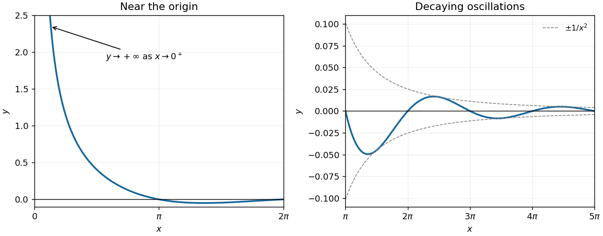

<h1 id="7/solution">Solution</h1>

↑ **Parent:** [7](../7.md)

For $x>0$, the denominator is positive, so the [function graph](../../../../graph-of-a-function.md) has the same sign as $\sin x$. Its crossings of the horizontal axis are

$$
\boxed{x=n\pi,\qquad n=1,2,3,\ldots.}
$$

Each crossing is genuine because the [derivative](../../../../derivative.md) there is $(-1)^n/(n\pi)^2\ne0$. Near zero, $\sin x\sim x$, so $y\sim1/x\to+\infty$; the origin is excluded and is not a crossing. The oscillations alternate sign and decay towards zero as $x\to\infty$, with [absolute value](../../../../absolute-value.md) at most $1/x^2$.

**[Figure 1](#7/image-the-positive-axis-graph-in-question-7-with-its-crossings-at-positive-integer-multiples-of-pi). The positive-axis graph in Question 7, with its crossings at positive integer multiples of $\pi$**.

## ↑ Ancestors (12)

1. [7](../7.md)
2. [Paper 1](../../paper-1-split.md)
3. [2022](../../split.md)
4. [Past exam of the mathematics course of the year 1 of the natural sciences course of the University of Cambridge](../../../split.md)
5. [Mathematics course of the year 1 of the natural sciences course of the University of Cambridge](../../../../mathematics-course-of-the-year-1-of-the-natural-sciences-course-of-the-university-of-cambridge.md)
6. [Year 1 of the natural sciences course of the University of Cambridge](../../../../year-1-of-the-natural-sciences-course-of-the-university-of-cambridge.md)
7. [Year of the natural sciences course of the University of Cambridge](../../../../year-of-the-natural-sciences-course-of-the-university-of-cambridge.md)
8. [Natural sciences course of the University of Cambridge](../../../../natural-sciences-course-of-the-university-of-cambridge.md)
9. [Course of the University of Cambridge](../../../../course-of-the-university-of-cambridge.md)
10. [University of Cambridge](../../../../university-of-cambridge-split.md)
11. [List of universities](../../../../list-of-universities.md)
12. [Codex Wiki](../../../../split.md)
