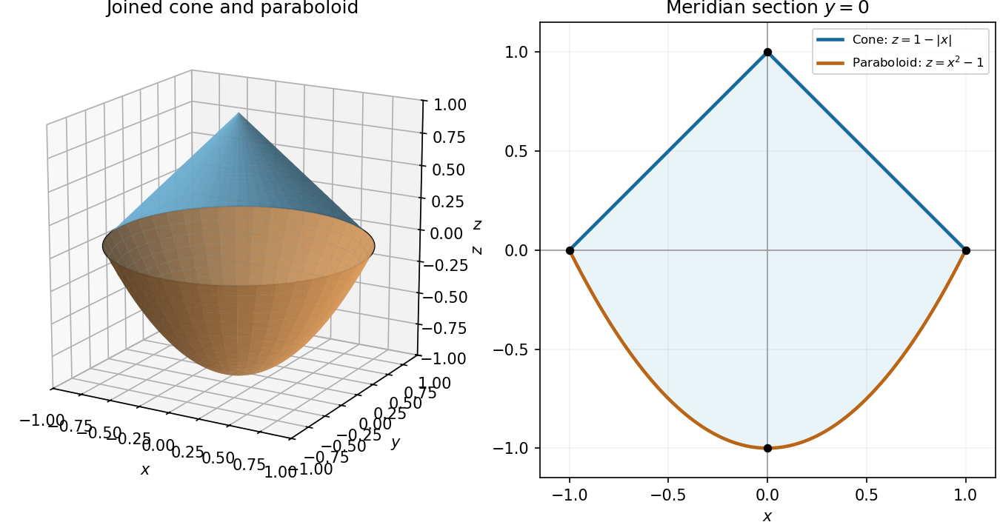

# Paper 2

↑ **Parent:** [2022](../2022.md)

[https://www.maths.cam.ac.uk/undergradnst/files/2022/papernst_ia_2_2022.pdf](https://www.maths.cam.ac.uk/undergradnst/files/2022/papernst_ia_2_2022.pdf)

**Table of contents**

- [1](#1)
  - [a](#1/a)
    - [Solution](#1/a/solution)
  - [b](#1/b)
    - [Solution](#1/b/solution)
- [2](#2)
  - [a](#2/a)
    - [Solution](#2/a/solution)
  - [b](#2/b)
    - [Solution](#2/b/solution)
- [3](#3)
  - [Solution](#3/solution)
- [4](#4)
  - [Solution](#4/solution)
- [5](#5)
  - [Solution](#5/solution)
- [6](#6)
  - [Solution](#6/solution)
- [7](#7)
  - [Solution](#7/solution)
- [8](#8)
  - [Solution](#8/solution)
- [9](#9)
  - [Solution](#9/solution)
- [10](#10)
  - [Solution](#10/solution)
- [11](#11)
  - [a](#11/a)
    - [Solution](#11/a/solution)
  - [b](#11/b)
    - [i](#11/b/i)
      - [Solution](#11/b/i/solution)
    - [ii](#11/b/ii)
      - [Solution](#11/b/ii/solution)
    - [iii](#11/b/iii)
      - [Solution](#11/b/iii/solution)
- [12](#12)
  - [a](#12/a)
    - [Solution](#12/a/solution)
  - [b](#12/b)
    - [Solution](#12/b/solution)
  - [c](#12/c)
    - [Solution](#12/c/solution)
  - [d](#12/d)
    - [Solution](#12/d/solution)
  - [e](#12/e)
    - [Solution](#12/e/solution)
- [13](#13)
  - [a](#13/a)
    - [i](#13/a/i)
      - [Solution](#13/a/i/solution)
    - [ii](#13/a/ii)
      - [Solution](#13/a/ii/solution)
    - [iii](#13/a/iii)
      - [Solution](#13/a/iii/solution)
  - [b](#13/b)
    - [Solution](#13/b/solution)
- [14](#14)
  - [a](#14/a)
    - [i](#14/a/i)
      - [Solution](#14/a/i/solution)
    - [ii](#14/a/ii)
      - [Solution](#14/a/ii/solution)
    - [iii](#14/a/iii)
      - [Solution](#14/a/iii/solution)
  - [b](#14/b)
    - [Solution](#14/b/solution)
  - [c](#14/c)
    - [Solution](#14/c/solution)
  - [d](#14/d)
    - [Solution](#14/d/solution)
- [15](#15)
  - [a](#15/a)
    - [Solution](#15/a/solution)
    - [i](#15/a/i)
      - [Solution](#15/a/i/solution)
    - [ii](#15/a/ii)
      - [Solution](#15/a/ii/solution)
    - [iii](#15/a/iii)
      - [Solution](#15/a/iii/solution)
  - [b](#15/b)
    - [Solution](#15/b/solution)
- [16](#16)
  - [a](#16/a)
    - [Solution](#16/a/solution)
  - [b](#16/b)
    - [i](#16/b/i)
      - [Solution](#16/b/i/solution)
    - [ii](#16/b/ii)
      - [Solution](#16/b/ii/solution)
- [17](#17)
  - [a](#17/a)
    - [Solution](#17/a/solution)
  - [b](#17/b)
    - [i](#17/b/i)
      - [Solution](#17/b/i/solution)
    - [ii](#17/b/ii)
      - [Solution](#17/b/ii/solution)
    - [iii](#17/b/iii)
      - [Solution](#17/b/iii/solution)
- [18](#18)
  - [a](#18/a)
    - [i](#18/a/i)
      - [Solution](#18/a/i/solution)
    - [ii](#18/a/ii)
      - [Solution](#18/a/ii/solution)
    - [iii](#18/a/iii)
      - [Solution](#18/a/iii/solution)
  - [b](#18/b)
    - [Solution](#18/b/solution)
  - [c](#18/c)
    - [Solution](#18/c/solution)
- [19](#19)
  - [a](#19/a)
    - [Solution](#19/a/solution)
  - [b](#19/b)
    - [Solution](#19/b/solution)
  - [c](#19/c)
    - [Solution](#19/c/solution)
- [20](#20)
  - [a](#20/a)
    - [Solution](#20/a/solution)
  - [b](#20/b)
    - [Solution](#20/b/solution)

## 1

↑ **Parent:** [Paper 2](paper-2.md)

<h3 id="1/a">a</h3>

↑ **Parent:** [1](#1)

<h4 id="1/a/solution">Solution</h4>

↑ **Parent:** [A](#1/a)

Expanding the [cross product](../../vector-space.md#cross-product) componentwise gives

$$
(1,2,3)^T\times(3,2,1)^T
=(2-6,\ 9-1,\ 2-6)^T
=\boxed{(-4,8,-4)^T}.
$$

Its [dot product](../../inner-product.md#dot-product) with each original [vector](../../vector-space.md#vector) is zero, as required.

<h3 id="1/b">b</h3>

↑ **Parent:** [1](#1)

<h4 id="1/b/solution">Solution</h4>

↑ **Parent:** [B](#1/b)

First $(1,-1,0)^T\times(0,0,1)^T=(-1,-1,0)^T$. Taking the remaining [cross product](../../vector-space.md#cross-product) gives

$$
(1,2,0)^T\times(-1,-1,0)^T=\boxed{(0,0,1)^T}.
$$

The order of the two [cross products](../../vector-space.md#cross-product) matters because the operation is not associative.

## 2

↑ **Parent:** [Paper 2](paper-2.md)

<h3 id="2/a">a</h3>

↑ **Parent:** [2](#2)

<h4 id="2/a/solution">Solution</h4>

↑ **Parent:** [A](#2/a)

Scalar entries commute, so $B_{jk}A_{ij}=A_{ij}B_{jk}$ is exactly the summed entry formula for [matrix multiplication](../../vector-space.md#matrix-multiplication). Hence

$$
\boxed{C=AB}.
$$

<h3 id="2/b">b</h3>

↑ **Parent:** [2](#2)

<h4 id="2/b/solution">Solution</h4>

↑ **Parent:** [B](#2/b)

The repeated index sums the diagonal entries of $A$. This is its [trace](../../linear-algebra.md#matrix-trace):

$$
\boxed{t=\operatorname{tr}A}.
$$

## 3

↑ **Parent:** [Paper 2](paper-2.md)

<h3 id="3/solution">Solution</h3>

↑ **Parent:** [3](#3)

The equation is **not separable**, because $x^2-xy=x(x-y)$ cannot be written as a product of a function of $x$ and a function of $y$ on an open region. For example, the ratio $(x^2-xy_1)/(x^2-xy_2)=(x-y_1)/(x-y_2)$ depends on $x$ for distinct fixed $y_1,y_2$, whereas a separated product would give a constant ratio.

It is **not homogeneous** in the sense of a [homogeneous first-order differential equation](../../differential-equation.md#homogeneous-first-order-differential-equation): the right-hand side is not a function of $y/x$ alone. It is also not a [homogeneous linear differential equation](../../differential-equation.md#homogeneous-linear-differential-equation), since moving the $xy$ term to the left leaves a nonzero forcing.

It is **linear**, since it has the standard [linear ordinary differential equation](../../linear-ordinary-differential-equation.md) form

$$
y'+xy=x^2.
$$

Thus the classifications are **(a) no, (b) no, (c) yes**.

## 4

↑ **Parent:** [Paper 2](paper-2.md)

<h3 id="4/solution">Solution</h3>

↑ **Parent:** [4](#4)

The coefficient [matrix](../../vector-space.md#matrix) has [determinant](../../multilinear-algebra.md#determinant) $-1$, so it is an [invertible matrix](../../linear-algebra.md#invertible-matrix). Its [homogeneous linear system](../../linear-algebra.md#homogeneous-linear-system) therefore has only the zero solution:

$$
\boxed{x=y=z=0}.
$$

One can also subtract the first equation from the second to get $z=0$, then subtract the first from the third to get $y+2z=0$, giving $y=0$ and finally $x=0$. Thus **there are no nonzero solutions**.

## 5

↑ **Parent:** [Paper 2](paper-2.md)

<h3 id="5/solution">Solution</h3>

↑ **Parent:** [5](#5)

The [chain rule](../../calculus.md#chain-rule) gives $u_{xx}=f''(x+\lambda y)$ and $u_{yy}=\lambda^2f''(x+\lambda y)$. The [partial differential equation](../../partial-differential-equation.md) becomes

$$
(4-\lambda^2)f''(x+\lambda y)=0.
$$

For this to hold for every twice [differentiable](../../analysis.md#differentiable-function) $f$, the coefficient must vanish:

$$
\boxed{\lambda=2\quad\text{or}\quad\lambda=-2}.
$$

For an affine $f$ alone any $\lambda$ would work, but the requirement is for arbitrary $f$.

## 6

↑ **Parent:** [Paper 2](paper-2.md)

<h3 id="6/solution">Solution</h3>

↑ **Parent:** [6](#6)

The [product-to-sum formula](../../geometry-and-topology.md#product-to-sum-formula) gives the finite [Fourier series](../../fourier-series.md)

$$
\boxed{f(x)=\frac12\sin4x+\frac12\sin2x}.
$$

Thus the only nonzero [Fourier coefficients](../../fourier-series.md#fourier-coefficient) are $b_2=b_4=1/2$.

## 7

↑ **Parent:** [Paper 2](paper-2.md)

<h3 id="7/solution">Solution</h3>

↑ **Parent:** [7](#7)

Let $V$ be the enclosed region with piecewise smooth closed boundary $S$, oriented by its outward [unit normal](../../differential-geometry.md#unit-normal) $\mathbf n$. For a continuously [differentiable](../../analysis.md#differentiable-function) [vector field](../../multivariable-calculus.md#vector-field) on a neighbourhood of $V$, the [divergence theorem](../../multivariable-calculus.md#divergence-theorem) states

$$
\boxed{\oiint_S\mathbf F\cdot\mathbf n\,dS
=\iiint_V\nabla\cdot\mathbf F\,dV}.
$$

The outward [flux integral](../../multivariable-calculus.md#flux-integral) equals the [volume integral](../../multivariable-calculus.md#volume-integral) of the [divergence](../../multivariable-calculus.md#divergence).

## 8

↑ **Parent:** [Paper 2](paper-2.md)

<h3 id="8/solution">Solution</h3>

↑ **Parent:** [8](#8)

Use the [Maclaurin series](../../calculus.md#maclaurin-series) $\sin3x=3x-\tfrac92x^3+O(x^5)$ and $\cos x=1-\tfrac12x^2+O(x^4)$. Multiplication gives

$$
\boxed{f(x)=3x-6x^3+O(x^5)}.
$$

The same terms follow from the two sine harmonics in the [Fourier series](../../fourier-series.md) found above.

## 9

↑ **Parent:** [Paper 2](paper-2.md)

<h3 id="9/solution">Solution</h3>

↑ **Parent:** [9](#9)

Apply [integration by parts](../../calculus.md#integration-by-parts) with $u=\log x$ and $dv=x\,dx$. Since $du=dx/x$ and $v=x^2/2$,

$$
\int x\log x\,dx=\frac{x^2}{2}\log x-\frac12\int x\,dx
=\boxed{\frac{x^2}{2}\log x-\frac{x^2}{4}+C},\qquad x>0.
$$

The original PDF specifies this [integral](../../integral.md); the local OCR replaces the entire question by unrelated text.

## 10

↑ **Parent:** [Paper 2](paper-2.md)

<h3 id="10/solution">Solution</h3>

↑ **Parent:** [10](#10)

First $f_x=2xy^3$ and $f_y=3x^2y^2$. Differentiating again gives the four second-order [partial derivatives](../../multivariable-calculus.md#partial-derivative):

$$
\boxed{f_{xx}=2y^3,\qquad f_{xy}=6xy^2,\qquad f_{yx}=6xy^2,\qquad f_{yy}=6x^2y}.
$$

The two [mixed partial derivatives](../../multivariable-calculus.md#mixed-partial-derivative) agree, as expected for this smooth [polynomial](../../polynomial.md).

## 11

↑ **Parent:** [Paper 2](paper-2.md)

<h3 id="11/a">a</h3>

↑ **Parent:** [11](#11)

<h4 id="11/a/solution">Solution</h4>

↑ **Parent:** [A](#11/a)

Three [vectors](../../vector-space.md#vector) form a [basis](../../vector-space.md#basis) of three-dimensional space exactly when their [scalar triple product](../../multilinear-algebra.md#scalar-triple-product) is nonzero:

$$
\boxed{\Delta=\mathbf u\cdot(\mathbf v\times\mathbf w)\ne0}.
$$

It is the [determinant](../../multilinear-algebra.md#determinant) of the [matrix](../../vector-space.md#matrix) with these columns, so this condition is equivalent to [linear independence](../../vector-space.md#linear-independence) and spanning the whole space.

Take the [dot product](../../inner-product.md#dot-product) of the expansion of $\mathbf y$ with $\mathbf v\times\mathbf w$. The terms containing $\mathbf v$ and $\mathbf w$ vanish, leaving $\mathbf y\cdot(\mathbf v\times\mathbf w)=\alpha\Delta$. Cycling the same argument yields

$$
\boxed{\alpha=\frac{\mathbf y\cdot(\mathbf v\times\mathbf w)}{\Delta},\qquad
\beta=\frac{\mathbf y\cdot(\mathbf w\times\mathbf u)}{\Delta},\qquad
\gamma=\frac{\mathbf y\cdot(\mathbf u\times\mathbf v)}{\Delta}}.
$$

The three cross-product numerators use the [reciprocal basis](../../multilinear-algebra.md#reciprocal-basis).

<h3 id="11/b">b</h3>

↑ **Parent:** [11](#11)

<h4 id="11/b/i">i</h4>

↑ **Parent:** [B](#11/b)

<h5 id="11/b/i/solution">Solution</h5>

↑ **Parent:** [I](#11/b/i)

Take the [cross product](../../vector-space.md#cross-product) with $\mathbf c$. Since $\mathbf c\times\mathbf c=0$, the equation implies

$$
\mathbf x\times\mathbf c=\mathbf a\times\mathbf c,
\qquad(\mathbf x-\mathbf a)\times\mathbf c=0.
$$

As $\mathbf c\ne0$, the displacement is parallel to $\mathbf c$. Therefore

$$
\boxed{\mathbf x=\mathbf a+\lambda\mathbf c,\qquad\lambda\in\mathbb R}.
$$

This is a necessary condition; substitution must still determine which points on this [straight line](../../euclidean-geometry.md#straight-line) satisfy the full equation.

<h4 id="11/b/ii">ii</h4>

↑ **Parent:** [B](#11/b)

<h5 id="11/b/ii/solution">Solution</h5>

↑ **Parent:** [Ii](#11/b/ii)

Substitute $\mathbf x=\mathbf a+\lambda\mathbf c$ into the original equation and cancel $\mathbf a$. Because $\mathbf c$ is nonzero, the scalar condition is

$$
\boxed{\lambda(1-\mathbf b\cdot\mathbf c)=\mathbf b\cdot\mathbf a}.
$$

If $\mathbf b\cdot\mathbf c\ne1$, there is one value, $\lambda=(\mathbf b\cdot\mathbf a)/(1-\mathbf b\cdot\mathbf c)$. If $\mathbf b\cdot\mathbf c=1$ and $\mathbf b\cdot\mathbf a=0$, every real $\lambda$ works. If $\mathbf b\cdot\mathbf c=1$ and $\mathbf b\cdot\mathbf a\ne0$, the scalar equation is inconsistent and there is no solution.

Thus “undefined” in the last case means that no parameter value solves the equation; it must not be used to conceal the distinct case with infinitely many solutions.

<h4 id="11/b/iii">iii</h4>

↑ **Parent:** [B](#11/b)

<h5 id="11/b/iii/solution">Solution</h5>

↑ **Parent:** [Iii](#11/b/iii)

In the nonsingular case the unique solution is

$$
\boxed{\mathbf x=\mathbf a+\frac{\mathbf b\cdot\mathbf a}{1-\mathbf b\cdot\mathbf c}\,\mathbf c,
\qquad \mathbf b\cdot\mathbf c\ne1}.
$$

Geometrically this is a single selected point of the [straight line](../../euclidean-geometry.md#straight-line) through $\mathbf a$ parallel to $\mathbf c$.

When $\mathbf b\cdot\mathbf c=1$ and $\mathbf b\cdot\mathbf a=0$, the solution set is that entire [straight line](../../euclidean-geometry.md#straight-line), $\mathbf a+\lambda\mathbf c$. The remaining case has empty solution set. In [matrix](../../vector-space.md#matrix) terms the equation is $(I-\mathbf c\mathbf b^T)\mathbf x=\mathbf a$, a [rank-one matrix update](../../linear-algebra.md#rank-one-matrix-update) of the [identity matrix](../../vector-space.md#identity-matrix).

## 12

↑ **Parent:** [Paper 2](paper-2.md)

<h3 id="12/a">a</h3>

↑ **Parent:** [12](#12)

<h4 id="12/a/solution">Solution</h4>

↑ **Parent:** [A](#12/a)

The [gradient](../../multivariable-calculus.md#gradient) is

$$
\boxed{\nabla f=\bigl(y(3x^2+y^2-1),\ x(x^2+3y^2-1)\bigr)^T}.
$$

<h3 id="12/b">b</h3>

↑ **Parent:** [12](#12)

<h4 id="12/b/solution">Solution</h4>

↑ **Parent:** [B](#12/b)

At $A=(1/2,1/4)$, the [gradient](../../multivariable-calculus.md#gradient) is $(-3/64,-9/32)^T$. The position [vector](../../vector-space.md#vector) has length $\sqrt5/4$, so its normalized direction is $(2,1)^T/\sqrt5$. Hence the [directional derivative](../../multivariable-calculus.md#directional-derivative) is

$$
\boxed{D_{\hat{\mathbf a}}f(A)
=\frac{(2,1)}{\sqrt5}\cdot\left(-\frac3{64},-\frac9{32}\right)
=-\frac{3\sqrt5}{40}}.
$$

<h3 id="12/c">c</h3>

↑ **Parent:** [12](#12)

<h4 id="12/c/solution">Solution</h4>

↑ **Parent:** [C](#12/c)

For a [stationary point](../../calculus-of-variations.md#stationary-point), the two factors from part (a) must vanish. If $y=0$, the second equation gives $x(x^2-1)=0$; if $x=0$, the first gives $y(y^2-1)=0$. Thus the axis points are $(0,0),(\pm1,0),(0,\pm1)$.

If both coordinates are nonzero, solve $3x^2+y^2=1$ and $x^2+3y^2=1$, giving $x^2=y^2=1/4$. These four points complete the list of nine [stationary points](../../calculus-of-variations.md#stationary-point).

For classification, the [Hessian matrix](../../multivariable-calculus.md#hessian-matrix) is

$$
H=\begin{pmatrix}6xy&3x^2+3y^2-1\\3x^2+3y^2-1&6xy\end{pmatrix}.
$$

At $(0,0)$ its [eigenvalues](../../linear-operator-theory.md#eigenvalue) are $1,-1$, and at the four unit-axis points they are $2,-2$. These five points are [saddle points of a scalar function](../../analysis.md#saddle-point-of-a-scalar-function), all with value zero.

At $(1/2,1/2)$ and $(-1/2,-1/2)$ the [eigenvalues](../../linear-operator-theory.md#eigenvalue) are one and two, so both are strict [local minima](../../analysis.md#local-minimum) of value $-1/8$. At $(1/2,-1/2)$ and $(-1/2,1/2)$ they are minus one and minus two, so both are strict [local maxima](../../analysis.md#local-maximum) of value $1/8$. This follows from the [second-derivative test](../../multivariable-calculus.md#second-derivative-test). These extrema are local: the [polynomial](../../polynomial.md) is unbounded above and below on the full [plane](../../geometry-and-topology.md#plane).

<h3 id="12/d">d</h3>

↑ **Parent:** [12](#12)

<h4 id="12/d/solution">Solution</h4>

↑ **Parent:** [D](#12/d)

The zero [level set](../../topology.md#level-set) is especially simple:

$$
\boxed{f=0\iff x=0\quad\text{or}\quad y=0\quad\text{or}\quad x^2+y^2=1}.
$$

The two axes and the unit [circle](../../topology.md#circle) divide the [plane](../../geometry-and-topology.md#plane) into regions where the signs alternate. Inside the [circle](../../topology.md#circle), $f$ has the opposite sign to $xy$; outside it has the same sign. Closed [level curves](../../topology.md#level-curve) surround the two interior [local minima](../../analysis.md#local-minimum) and two interior [local maxima](../../analysis.md#local-maximum); the zero curves cross at the five [saddle points of a scalar function](../../analysis.md#saddle-point-of-a-scalar-function). Farther out, the nonzero [level curves](../../topology.md#level-curve) are open within the displayed square.

**[Figure 1](#12/d/image-contours-stationary-points-and-gradient-directions-of-the-quartic-surface). Contours, stationary points and gradient directions of the quartic surface**. Left: signed [level curves](../../topology.md#level-curve) and the exact zero set consisting of both axes and the unit [circle](../../topology.md#circle). Right: normalized [gradient](../../multivariable-calculus.md#gradient) directions, including arrows on the zero curves. The nine [stationary points](../../calculus-of-variations.md#stationary-point) are marked in both panels.

<h3 id="12/e">e</h3>

↑ **Parent:** [12](#12)

<h4 id="12/e/solution">Solution</h4>

↑ **Parent:** [E](#12/e)

Near each [local minimum](../../analysis.md#local-minimum), the [gradient](../../multivariable-calculus.md#gradient) points outward; near each [local maximum](../../analysis.md#local-maximum), it points inward. The five remaining points have saddle directions, determined by their indefinite [Hessian matrices](../../multivariable-calculus.md#hessian-matrix).

On the $x$-axis the exact [gradient](../../multivariable-calculus.md#gradient) is $(0,x(x^2-1))^T$, and on the $y$-axis it is $(y(y^2-1),0)^T$. Thus arrows are perpendicular to the axes and reverse direction at the origin and the unit-axis [stationary points](../../calculus-of-variations.md#stationary-point).

On the unit [circle](../../topology.md#circle), substitute $x^2+y^2=1$ into the [gradient](../../multivariable-calculus.md#gradient) to obtain

$$
\boxed{\nabla f=2xy(x,y)^T}.
$$

It is radial outward in quadrants I and III, radial inward in quadrants II and IV, and zero at the four axis intersections. These arrows, together with the nearby saddle and extremum patterns, are shown in the right panel of the contour figure. The [gradient](../../multivariable-calculus.md#gradient) is normal to every regular [level curve](../../topology.md#level-curve) and points toward increasing values of $f$.

## 13

↑ **Parent:** [Paper 2](paper-2.md)

<h3 id="13/a">a</h3>

↑ **Parent:** [13](#13)

<h4 id="13/a/i">i</h4>

↑ **Parent:** [A](#13/a)

<h5 id="13/a/i/solution">Solution</h5>

↑ **Parent:** [I](#13/a/i)

With $\mathbf r(t)=(t,t^2)^T$, the [tangent vector](../../tangent-vector.md) is $(1,2t)^T$ and $\mathbf F(\mathbf r(t))=(t^3,2t^2)^T$. The [line integral](../../multivariable-calculus.md#line-integral) is

$$
\int_0^1(t^3+4t^3)\,dt=\boxed{\frac54}.
$$

<h4 id="13/a/ii">ii</h4>

↑ **Parent:** [A](#13/a)

<h5 id="13/a/ii/solution">Solution</h5>

↑ **Parent:** [Ii](#13/a/ii)

For $\mathbf r(t)=(t^2,t)^T$, the [tangent vector](../../tangent-vector.md) is $(2t,1)^T$ and $\mathbf F(\mathbf r(t))=(t^3,t^4+t)^T$. Thus

$$
\int_0^1(2t^4+t^4+t)\,dt=\frac35+\frac12=\boxed{\frac{11}{10}}.
$$

The unequal values for the same endpoints already rule out a [conservative vector field](../../multivariable-calculus.md#conservative-vector-field).

<h4 id="13/a/iii">iii</h4>

↑ **Parent:** [A](#13/a)

<h5 id="13/a/iii/solution">Solution</h5>

↑ **Parent:** [Iii](#13/a/iii)

Put $q=2t-t^2$. The second coordinate is exactly $q^2$, so this is the same parabola as in part (i), with a different increasing parametrization. Since $q$ runs from zero to one and $dq=(2-2t)dt$, the [line integral](../../multivariable-calculus.md#line-integral) is

$$
\int_0^1 5q^3\,dq=\boxed{\frac54}.
$$

Equivalently, substitute the original parameter to get $\int_0^15(2t-t^2)^3(2-2t)dt$. This demonstrates that a [line integral](../../multivariable-calculus.md#line-integral) depends on the oriented path, not on its speed of traversal.

<h3 id="13/b">b</h3>

↑ **Parent:** [13](#13)

<h4 id="13/b/solution">Solution</h4>

↑ **Parent:** [B](#13/b)

The [curl](../../multivariable-calculus.md#curl) of $\mathbf G=\mathbf a\times\mathbf r$ is $2\mathbf a$. Thus for $\mathbf a\ne0$ it cannot be a [gradient field](../../multivariable-calculus.md#gradient-field), while for $\mathbf a=0$ it is zero and all its [vector-field potentials](../../multivariable-calculus.md#potential-of-a-conservative-vector-field) are constants. This zero-vector case is allowed by the question.

For the radial [vector field](../../multivariable-calculus.md#vector-field) $\mathbf H$, write $\rho=|\mathbf r|$. Choose a radial primitive

$$
\Phi(\rho)=\int_{\rho_0}^{\rho}s f(s)\,ds+C.
$$

For $\rho>0$, the [chain rule](../../calculus.md#chain-rule) gives

$$
\nabla\Phi=\Phi'(\rho)\frac{\mathbf r}{\rho}=f(\rho)\mathbf r.
$$

Hence all [vector-field potentials](../../multivariable-calculus.md#potential-of-a-conservative-vector-field) on a connected domain where the field is defined are

$$
\boxed{\Phi(\mathbf r)=\int_{\rho_0}^{|\mathbf r|}s f(s)\,ds+C}.
$$

The assumed existence of the needed derivatives and integrals justifies this construction. If the domain includes the origin and the field is regular there, choose $\rho_0=0$ and extend the primitive there. Any two [vector-field potentials](../../multivariable-calculus.md#potential-of-a-conservative-vector-field) differ by a constant on each connected component.

## 14

↑ **Parent:** [Paper 2](paper-2.md)

<h3 id="14/a">a</h3>

↑ **Parent:** [14](#14)

<h4 id="14/a/i">i</h4>

↑ **Parent:** [A](#14/a)

<h5 id="14/a/i/solution">Solution</h5>

↑ **Parent:** [I](#14/a/i)

Let $N_L$ count successful lemon seeds. By [independence](../../random-variable.md#independent-random-variables) it has a [binomial distribution](../../discrete-probability-distribution.md#binomial-distribution) with five trials and success [probability](../../probability-theory.md#probability) $y$. Therefore

$$
\boxed{\mathbb P(N_L=2)=\binom52y^2(1-y)^3=10y^2(1-y)^3}.
$$

<h4 id="14/a/ii">ii</h4>

↑ **Parent:** [A](#14/a)

<h5 id="14/a/ii/solution">Solution</h5>

↑ **Parent:** [Ii](#14/a/ii)

Take the [complement of an event](../../probability-space.md#complement-of-an-event): fewer than two successes means zero or one. These [mutually exclusive events](../../probability-space.md#disjoint-events) have [probabilities](../../probability-theory.md#probability) $(1-y)^5$ and $5y(1-y)^4$. Hence

$$
\boxed{\mathbb P(N_L\geq2)=1-(1-y)^5-5y(1-y)^4}.
$$

<h4 id="14/a/iii">iii</h4>

↑ **Parent:** [A](#14/a)

<h5 id="14/a/iii/solution">Solution</h5>

↑ **Parent:** [Iii](#14/a/iii)

Let $N_A$ be the independent avocado count. There are three disjoint ways to have fewer than two total trees: no trees, only one avocado, or only one lemon. Their [probabilities](../../probability-theory.md#probability) give

$$
\boxed{\begin{aligned}
\mathbb P(N_A+N_L\geq2)=1
&-(1-x)^5(1-y)^5\\
&-5x(1-x)^4(1-y)^5\\
&-5y(1-y)^4(1-x)^5.
\end{aligned}}
$$

The sum is generally a [Poisson binomial distribution](../../discrete-probability-distribution.md#poisson-binomial-distribution), rather than a single [binomial distribution](../../discrete-probability-distribution.md#binomial-distribution), because the two success [probabilities](../../probability-theory.md#probability) may differ.

<h3 id="14/b">b</h3>

↑ **Parent:** [14](#14)

<h4 id="14/b/solution">Solution</h4>

↑ **Parent:** [B](#14/b)

There are three possible count pairs conditional on two trees. Their [probabilities](../../probability-theory.md#probability), from the two independent [binomial distributions](../../discrete-probability-distribution.md#binomial-distribution), are

$$
p_{20}=10x^2(1-x)^3(1-y)^5,\qquad
p_{02}=10y^2(1-y)^3(1-x)^5,
$$

$$
p_{11}=25xy(1-x)^4(1-y)^4.
$$

The first two correspond to matching kinds, so the [conditional probability](../../probability-theory.md#conditional-probability) is

$$
\boxed{\frac{p_{20}+p_{02}}{p_{20}+p_{02}+p_{11}}}.
$$

This form remains valid at endpoints whenever the conditioning event has positive [probability](../../probability-theory.md#probability); if the denominator vanishes, the [conditional probability](../../probability-theory.md#conditional-probability) is undefined. As a check, when $x=y\in(0,1)$ the result is $20/45=4/9$, the fraction of two-element subsets containing matching kinds.

<h3 id="14/c">c</h3>

↑ **Parent:** [14](#14)

<h4 id="14/c/solution">Solution</h4>

↑ **Parent:** [C](#14/c)

Each tree independently has ten equally likely integer yields. Of the $100$ ordered pairs, exactly $(30,32),(31,31),(32,30)$ sum to sixty-two. Thus

$$
\boxed{\mathbb P(62\text{ seeds})=\frac3{100}}.
$$

The [uniform distribution on a finite set](../../discrete-probability-distribution.md#discrete-uniform-distribution) applies to the individual yields, not to their sum.

<h3 id="14/d">d</h3>

↑ **Parent:** [14](#14)

<h4 id="14/d/solution">Solution</h4>

↑ **Parent:** [D](#14/d)

For $n$ independent seeds the [probability](../../probability-theory.md#probability) of at least one success is $1-(1-x)^n$. Requiring it to be at least $0.95$ gives $(1-x)^n\leq0.05$. For $0<x<1$, taking logarithms and dividing by the negative number $\log(1-x)$ reverses the inequality:

$$
n\geq\frac{\log0.05}{\log(1-x)}.
$$

The smallest permitted integer is therefore

$$
\boxed{n_{\min}=\left\lceil\frac{\log0.05}{\log(1-x)}\right\rceil}.
$$

The [ceiling function](../../calculus.md#ceiling-function) is necessary because seeds are counted discretely. If $x=0$, no finite number suffices; if $x=1$, one seed suffices. The target is interpreted as at least a ninety-five percent chance, since exact equality may not be attainable with an integer count.

## 15

↑ **Parent:** [Paper 2](paper-2.md)

<h3 id="15/a">a</h3>

↑ **Parent:** [15](#15)

<h4 id="15/a/solution">Solution</h4>

↑ **Parent:** [A](#15/a)

On a nonconstant branch with $\sin y\ne0$, regard $x$ as a function of $y$. The equation becomes the [linear ordinary differential equation](../../linear-ordinary-differential-equation.md)

$$
\frac{dx}{dy}+x\cot y=2\cos y.
$$

An [integrating factor](../../linear-ordinary-differential-equation.md#integrating-factor) is $\sin y$, giving

$$
\frac d{dy}(x\sin y)=2\sin y\cos y.
$$

Taking an [antiderivative](../../integral.md#antiderivative) yields the implicit family

$$
\boxed{x\sin y-\sin^2y=C}.
$$

On a regular branch this can also be written $x=\sin y+C/\sin y$. The latter form loses the constant solutions $y=n\pi$, which must be restored separately.

The implicit relation is a [first integral of an ordinary differential equation](../../differential-equation.md#first-integral-of-an-ordinary-differential-equation): along any differentiable solution of the original equation,

$$
\frac d{dx}(x\sin y-\sin^2y)
=\sin y-(2\sin y-x)\cos y\,y'=0.
$$

Conversely, a differentiable graph satisfying this relation solves the original equation wherever $\cos y\ne0$. The original equation is undefined when $\cos y=0$; points at which $2\sin y-x=0$ also need separate attention before solving explicitly for $y'$. This is why dividing immediately by $\tan y$ can lose valid solutions and obscure nonuniqueness.

<h4 id="15/a/i">i</h4>

↑ **Parent:** [A](#15/a)

<h5 id="15/a/i/solution">Solution</h5>

↑ **Parent:** [I](#15/a/i)

The initial data force $C=0$, so the implicit relation factors as $\sin y(x-\sin y)=0$. Near $(0,0)$ this permits either the constant branch or the sine branch:

$$
\boxed{y(x)=0\quad\text{or}\quad y(x)=\arcsin x\quad\text{locally at }x=0}.
$$

Both satisfy the original equation, including its degenerate value $0=0$ at the initial point. They have different slopes there, zero and one, so the [initial value problem](../../differential-equation.md#initial-value-problem) is not unique. There are no further differentiable local branches through that point: away from $x=0$ the two factors cannot switch, and joining the two different branches at zero would give unequal one-sided [derivatives](../../calculus.md#derivative).

The nonconstant branch is defined as a solution for $-1<x<1$; the constant branch exists for every real $x$.

<h4 id="15/a/ii">ii</h4>

↑ **Parent:** [A](#15/a)

<h5 id="15/a/ii/solution">Solution</h5>

↑ **Parent:** [Ii](#15/a/ii)

Again $C=0$. Since the initial sine is nonzero, the local branch must satisfy $\sin y=x$. Selecting the inverse-sine branch through $y=\pi/6$ gives

$$
\boxed{y(x)=\arcsin x,\qquad -1<x<1}.
$$

This passes through the specified point and has $y'=1/\sqrt{1-x^2}$, which verifies the original equation on this interval.

<h4 id="15/a/iii">iii</h4>

↑ **Parent:** [A](#15/a)

<h5 id="15/a/iii/solution">Solution</h5>

↑ **Parent:** [Iii](#15/a/iii)

Here $C=0$ as well, but the branch through $5\pi/6$ is the other inverse-sine branch:

$$
\boxed{y(x)=\pi-\arcsin x,\qquad -1<x<1}.
$$

Its [derivative](../../calculus.md#derivative) is $-1/\sqrt{1-x^2}$, and both the sign of $\tan y$ and the original equation agree with this choice.

<h3 id="15/b">b</h3>

↑ **Parent:** [15](#15)

<h4 id="15/b/solution">Solution</h4>

↑ **Parent:** [B](#15/b)

The [characteristic equation](../../linear-ordinary-differential-equation.md#characteristic-equation-of-a-constant-coefficient-differential-equation) of the associated [homogeneous linear differential equation](../../differential-equation.md#homogeneous-linear-differential-equation) is $m^2+7m+12=(m+3)(m+4)=0$. A constant [particular integral](../../linear-ordinary-differential-equation.md#particular-solution) is $1/2$, so

$$
y=\frac12+Ae^{-3x}+Be^{-4x}.
$$

The first [boundary condition](../../differential-equation.md#boundary-condition) gives $A+B=-1/2$. The second gives $Ae^{-1}+Be^{-4/3}=-e^{-1}/2$. Eliminating $A$ yields $B(e^{-4/3}-e^{-1})=0$, hence $B=0$ and $A=-1/2$. Therefore

$$
\boxed{y(x)=\frac{1-e^{-3x}}2,\qquad y(1)=\frac{1-e^{-3}}2}.
$$

## 16

↑ **Parent:** [Paper 2](paper-2.md)

<h3 id="16/a">a</h3>

↑ **Parent:** [16](#16)

<h4 id="16/a/solution">Solution</h4>

↑ **Parent:** [A](#16/a)

Use cylindrical radius $\rho=\sqrt{x^2+y^2}$. The upper [cone](../../euclidean-geometry.md#cone-geometry) is $z=1-\rho$ and the lower [elliptic paraboloid](../../euclidean-geometry.md#elliptic-paraboloid) is $z=\rho^2-1$, both with $0\leq\rho\leq1$. They meet along the unit [circle](../../topology.md#circle) in $z=0$. The enclosed solid is

$$
0\leq\rho\leq1,\qquad \rho^2-1\leq z\leq1-\rho.
$$

Thus the coordinate ranges on the complete surface are

$$
\boxed{-1\leq x\leq1,\qquad-1\leq y\leq1,\qquad-1\leq z\leq1}.
$$

These separate ranges do not mean every point of their Cartesian product lies on the surface. A vertical cross-section has a straight upper cone profile and a curved lower paraboloid profile.

**[Figure 2](#16/a/image-a-cone-and-a-paraboloid-joined-along-their-unit-circle-rim). A cone and a paraboloid joined along their unit-circle rim**. The upper [cone](../../euclidean-geometry.md#cone-geometry) has apex $(0,0,1)$; the lower [elliptic paraboloid](../../euclidean-geometry.md#elliptic-paraboloid) has vertex $(0,0,-1)$. Both meet at cylindrical radius one and height zero. The meridian cross-section shows the enclosed vertical range at each radius.

<h3 id="16/b">b</h3>

↑ **Parent:** [16](#16)

<h4 id="16/b/i">i</h4>

↑ **Parent:** [B](#16/b)

<h5 id="16/b/i/solution">Solution</h5>

↑ **Parent:** [I](#16/b/i)

Both patches project onto the unit [disk](../../topology.md#disk-mathematics) $D$ in the $xy$-[plane](../../geometry-and-topology.md#plane). Their outward [oriented surface elements](../../multivariable-calculus.md#oriented-surface-element) are

$$
d\mathbf S_+=\left(\frac{x}{\rho},\frac{y}{\rho},1\right)^Tdx\,dy,
\qquad d\mathbf S_-=(2x,2y,-1)^Tdx\,dy.
$$

The cone's apex has zero [area](../../differential-geometry.md#surface-area) and does not affect the [surface integral](../../multivariable-calculus.md#surface-integral). For $k=0$, the [vector field](../../multivariable-calculus.md#vector-field) is $(y,x,1)^T$, so

$$
\Phi_+=\iint_D\left(\frac{2xy}{\rho}+1\right)dx\,dy=\pi,
\qquad
\Phi_-=\iint_D(4xy-1)dx\,dy=-\pi.
$$

The terms involving $xy$ vanish by reflection symmetry of the [disk](../../topology.md#disk-mathematics). Thus the total outward [flux](../../mathematical-physics.md#flux) is

$$
\boxed{\Phi=0}.
$$

This calculation evaluates the two [surface integrals](../../multivariable-calculus.md#surface-integral) directly.

<h4 id="16/b/ii">ii</h4>

↑ **Parent:** [B](#16/b)

<h5 id="16/b/ii/solution">Solution</h5>

↑ **Parent:** [Ii](#16/b/ii)

For $k=1$, the [vector field](../../multivariable-calculus.md#vector-field) is $(x^2y,xy^2,z)^T$. On the cone,

$$
\mathbf F\cdot d\mathbf S_+
=\left(\frac{x^3y+xy^3}{\rho}+1-\rho\right)dx\,dy
=(xy\rho+1-\rho)dx\,dy.
$$

The first term has zero [integral](../../integral.md) by symmetry. Using [polar coordinates](../../multivariable-calculus.md#polar-coordinates) for the remaining [double integral](../../integral.md#double-integral) gives

$$
\Phi_+=2\pi\int_0^1(1-\rho)\rho\,d\rho=\frac\pi3.
$$

On the paraboloid $z=\rho^2-1$,

$$
\mathbf F\cdot d\mathbf S_-
=\bigl(2x^3y+2xy^3-(\rho^2-1)\bigr)dx\,dy
=(2xy\rho^2+1-\rho^2)dx\,dy.
$$

Again the $xy$ term cancels by symmetry, giving

$$
\Phi_-=2\pi\int_0^1(1-\rho^2)\rho\,d\rho=\frac\pi2.
$$

Therefore direct [surface integral](../../multivariable-calculus.md#surface-integral) yields

$$
\boxed{\Phi=\frac\pi3+\frac\pi2=\frac{5\pi}{6}}.
$$

No separate disk at $z=0$ is included: that rim joins the two surfaces and is not an additional face of the closed boundary.

## 17

↑ **Parent:** [Paper 2](paper-2.md)

<h3 id="17/a">a</h3>

↑ **Parent:** [17](#17)

<h4 id="17/a/solution">Solution</h4>

↑ **Parent:** [A](#17/a)

The displayed [matrix](../../vector-space.md#matrix) is **not orthogonal**: its first column has squared [Euclidean norm](../../normed-vector-space.md#euclidean-norm) three, whereas every column of an [orthogonal matrix](../../linear-algebra.md#orthogonal-matrix) must have squared length one.

For the general assertion, put $C=AB$. In the [Einstein summation convention](../../multilinear-algebra.md#einstein-notation), orthogonality gives $A_{ki}A_{kj}=\delta_{ij}$ and $B_{ki}B_{kj}=\delta_{ij}$. The entries of $C$ satisfy

$$
C_{ki}C_{kj}
=A_{k\ell}B_{\ell i}A_{km}B_{mj}
=(A_{k\ell}A_{km})B_{\ell i}B_{mj}
=\delta_{\ell m}B_{\ell i}B_{mj}
=B_{\ell i}B_{\ell j}=\delta_{ij}.
$$

This is exactly $C^TC=I$, proving that the [matrix product](../../vector-space.md#matrix-product) $AB$ is orthogonal. The [Kronecker delta](../../multilinear-algebra.md#kronecker-delta) contracts the two middle indices without changing the multiplication order of the [matrices](../../vector-space.md#matrix).

<h3 id="17/b">b</h3>

↑ **Parent:** [17](#17)

<h4 id="17/b/i">i</h4>

↑ **Parent:** [B](#17/b)

<h5 id="17/b/i/solution">Solution</h5>

↑ **Parent:** [I](#17/b/i)

The [matrix](../../vector-space.md#matrix) form is

$$
\boxed{\begin{pmatrix}1&2&3\\1&1&a-1\\a&2&3\end{pmatrix}
\begin{pmatrix}x\\y\\z\end{pmatrix}
=\begin{pmatrix}1\\2\\3\end{pmatrix}}.
$$

<h4 id="17/b/ii">ii</h4>

↑ **Parent:** [B](#17/b)

<h5 id="17/b/ii/solution">Solution</h5>

↑ **Parent:** [Ii](#17/b/ii)

Subtract the first row from the third. Expansion along the resulting row $(a-1,0,0)$ gives the [determinant](../../multilinear-algebra.md#determinant)

$$
\det A=(a-1)\det\begin{pmatrix}2&3\\1&a-1\end{pmatrix}
=\boxed{(a-1)(2a-5)}.
$$

Hence

$$
\boxed{\det A=0\iff a=1\text{ or }a=\frac52}.
$$

<h4 id="17/b/iii">iii</h4>

↑ **Parent:** [B](#17/b)

<h5 id="17/b/iii/solution">Solution</h5>

↑ **Parent:** [Iii](#17/b/iii)

For $a\ne1,5/2$, the [matrix](../../vector-space.md#matrix) is invertible, so there is exactly one solution. To exhibit it, subtract the first [linear equation](../../linear-algebra.md#linear-equation) from the third to obtain $(a-1)x=2$, then subtract twice the second from the first to obtain $-x+(5-2a)z=-3$. Back-substitution gives

$$
\boxed{x=\frac2{a-1},\qquad
z=\frac{3a-5}{(a-1)(2a-5)},\qquad
y=\frac{a^2-10a+15}{(a-1)(2a-5)}}.
$$

At $a=1$, the first and third [linear equations](../../linear-algebra.md#linear-equation) have identical left-hand sides but right-hand sides one and three, so there is no solution.

At $a=5/2$, subtracting the first from the third forces $x=4/3$, while the first minus twice the second forces $x=3$. These contradict each other, so there is again no solution. Thus there is **one solution for $a\ne1,5/2$, no solution for either exceptional value, and no parameter value with infinitely many solutions**.

## 18

↑ **Parent:** [Paper 2](paper-2.md)

<h3 id="18/a">a</h3>

↑ **Parent:** [18](#18)

<h4 id="18/a/i">i</h4>

↑ **Parent:** [A](#18/a)

<h5 id="18/a/i/solution">Solution</h5>

↑ **Parent:** [I](#18/a/i)

A standard complete orthogonal family is the real [Fourier basis](../../fourier-series.md#fourier-basis)

$$
\boxed{1,\ \cos x,\ \sin x,\ \cos2x,\ \sin2x,\ldots}.
$$

Completeness gives expansion in the [L2 space](../../measure-theory.md#l2-space-is-a-hilbert-space) for a square-integrable [function](../../function.md). Mere integrability alone does not guarantee pointwise convergence of a [Fourier series](../../fourier-series.md); the explicit function in part (b) is continuous and piecewise smooth, so this issue does not obstruct its expansion.

<h4 id="18/a/ii">ii</h4>

↑ **Parent:** [A](#18/a)

<h5 id="18/a/ii/solution">Solution</h5>

↑ **Parent:** [Ii](#18/a/ii)

With [inner product](../../inner-product.md) $\langle u,v\rangle=\int_{-\pi}^\pi u(x)v(x)dx$, [orthogonality](../../inner-product.md#orthogonal-vectors) means

$$
\boxed{\int_{-\pi}^\pi e_n(x)e_m(x)\,dx=0\quad(m\ne n)}.
$$

The constant function has squared [norm](../../normed-vector-space.md#norm) $2\pi$, and each sine or cosine has squared [norm](../../normed-vector-space.md#norm) $\pi$. Thus the displayed family is orthogonal but not normalized; these different lengths determine the coefficient factors.

<h4 id="18/a/iii">iii</h4>

↑ **Parent:** [A](#18/a)

<h5 id="18/a/iii/solution">Solution</h5>

↑ **Parent:** [Iii](#18/a/iii)

The standard [Fourier series](../../fourier-series.md) is

$$
f(x)\sim\frac{a_0}{2}+\sum_{n=1}^\infty(a_n\cos nx+b_n\sin nx),
$$

with [Fourier coefficients](../../fourier-series.md#fourier-coefficient)

$$
\boxed{a_n=\frac1\pi\int_{-\pi}^\pi f(x)\cos nx\,dx\quad(n\geq0),\qquad
b_n=\frac1\pi\int_{-\pi}^\pi f(x)\sin nx\,dx\quad(n\geq1)}.
$$

These follow by taking [inner products](../../inner-product.md) with the individual [basis vectors](../../vector-space.md#basis-vector) and using their [orthogonality](../../inner-product.md#orthogonal-vectors) and squared [norms](../../normed-vector-space.md#norm).

<h3 id="18/b">b</h3>

↑ **Parent:** [18](#18)

<h4 id="18/b/solution">Solution</h4>

↑ **Parent:** [B](#18/b)

Separate the already finite sine terms from the even part $g(x)=x^2-\pi|x|$. Since $g$ is an [even function](../../calculus.md#even-function), it has no sine coefficients. Its constant coefficient is

$$
a_0=\frac2\pi\int_0^\pi(x^2-\pi x)dx=-\frac{\pi^2}{3}.
$$

For $n\geq1$, [integration by parts](../../calculus.md#integration-by-parts) gives

$$
\int_0^\pi x\cos nx\,dx=\frac{(-1)^n-1}{n^2},\qquad
\int_0^\pi x^2\cos nx\,dx=\frac{2\pi(-1)^n}{n^2}.
$$

Therefore the cosine [Fourier coefficients](../../fourier-series.md#fourier-coefficient) are

$$
a_n=\frac2\pi\int_0^\pi(x^2-\pi x)\cos nx\,dx
=\frac{2(1+(-1)^n)}{n^2}.
$$

Only even frequencies survive: $a_{2m}=1/m^2$. The sine [Fourier coefficients](../../fourier-series.md#fourier-coefficient) are $b_1=1$, $b_2=-2$, with all others zero. Hence

$$
\boxed{f(x)=\sin x-2\sin2x-\frac{\pi^2}{6}
+\sum_{m=1}^\infty\frac{\cos2mx}{m^2}}.
$$

The periodic function is continuous at zero and at its endpoint joins, and its coefficients are absolutely summable. Thus this [Fourier series](../../fourier-series.md) represents it everywhere, including those joins.

<h3 id="18/c">c</h3>

↑ **Parent:** [18](#18)

<h4 id="18/c/solution">Solution</h4>

↑ **Parent:** [C](#18/c)

Evaluate at $x=\pi/2$, where the original expression gives $f(\pi/2)=1-\pi^2/4$. The [Fourier series](../../fourier-series.md) gives

$$
1-\frac{\pi^2}{4}=1-\frac{\pi^2}{6}
+\sum_{m=1}^\infty\frac{(-1)^m}{m^2}.
$$

Rearranging proves

$$
\boxed{\sum_{m=1}^\infty\frac{(-1)^m}{m^2}=-\frac{\pi^2}{12}}.
$$

The convergence at this point is justified by the continuity properties noted in part (b).

## 19

↑ **Parent:** [Paper 2](paper-2.md)

<h3 id="19/a">a</h3>

↑ **Parent:** [19](#19)

<h4 id="19/a/solution">Solution</h4>

↑ **Parent:** [A](#19/a)

At a regular constrained extremum, every [tangent vector](../../tangent-vector.md) to the [level set](../../topology.md#level-set) $g=A$ gives zero [directional derivative](../../multivariable-calculus.md#directional-derivative) of $f$. Thus $\nabla f$ is perpendicular to the tangent [plane](../../geometry-and-topology.md#plane), and must be a scalar multiple of its nonzero [normal vector](../../differential-geometry.md#normal-vector) $\nabla g$. The [Lagrange multiplier](../../mathematical-optimization.md#lagrange-multiplier) equations are

$$
\boxed{\nabla f=\lambda\nabla g,\qquad g=A}.
$$

One solves these four equations for $x,y,z,\lambda$, evaluates $f$ at the candidates, and classifies or compares the values as required. Points where $\nabla g=0$, and any boundary or limiting cases of the feasible domain, require separate checks because the regularity argument does not cover them.

<h3 id="19/b">b</h3>

↑ **Parent:** [19](#19)

<h4 id="19/b/solution">Solution</h4>

↑ **Parent:** [B](#19/b)

Use $g=x^2+y^2+z^2$. The [Lagrange multiplier](../../mathematical-optimization.md#lagrange-multiplier) equations are

$$
y=2\lambda x,\qquad x+z=2\lambda y,\qquad y=2\lambda z,
\qquad x^2+y^2+z^2=1.
$$

Taking the [dot product](../../inner-product.md#dot-product) with $(x,y,z)^T$ gives $2T=2\lambda$, so $\lambda=T$.

If $\lambda\ne0$, the first and third equations give $x=z$. The middle equation then gives $x=\lambda y$, so $2\lambda^2=1$. The norm constraint gives $x^2=z^2=1/4$ and $y^2=1/2$. Thus the hottest points and their temperature are

$$
\boxed{(x,y,z)=\left(\frac\varepsilon2,\frac\varepsilon{\sqrt2},\frac\varepsilon2\right),\quad
T_{\max}=\frac1{\sqrt2},\quad\varepsilon\in\{-1,1\}}.
$$

The coldest points are

$$
\boxed{(x,y,z)=\left(\frac\varepsilon2,-\frac\varepsilon{\sqrt2},\frac\varepsilon2\right),\quad
T_{\min}=-\frac1{\sqrt2},\quad\varepsilon\in\{-1,1\}}.
$$

For $\lambda=0$, the equations give $y=0$, $z=-x$, and hence the other two constrained [stationary points](../../calculus-of-variations.md#stationary-point) are

$$
\boxed{(x,y,z)=\left(\frac\varepsilon{\sqrt2},0,-\frac\varepsilon{\sqrt2}\right),\qquad T=0}.
$$

They are saddle points of the restriction to the [sphere](../../euclidean-geometry.md#sphere): with $u=(x+z)/\sqrt2$ and $v=y$ as local tangent coordinates there, $T=\sqrt2uv$ changes sign in every neighbourhood. The surface is compact and smooth, so the listed extreme temperatures are global. Here “zero gradient on the surface” means zero [surface gradient](../../riemannian-geometry.md#surface-gradient); the ambient [gradient](../../multivariable-calculus.md#gradient) at the hottest and coldest points is normal to the [sphere](../../euclidean-geometry.md#sphere), rather than zero.

<h3 id="19/c">c</h3>

↑ **Parent:** [19](#19)

<h4 id="19/c/solution">Solution</h4>

↑ **Parent:** [C](#19/c)

Introduce the second constraint $q(x,y,z)=y-h(x)=0$ and a second [Lagrange multiplier](../../mathematical-optimization.md#lagrange-multiplier) $\mu$. At points where the two constraint [gradients](../../multivariable-calculus.md#gradient) are [linearly independent](../../vector-space.md#linear-independence), solve

$$
\boxed{(y,x+z,y)^T
=\lambda(2x,2y,2z)^T+\mu(-h'(x),1,0)^T},
$$

$$
\boxed{x^2+y^2+z^2=1,\qquad y=h(x)}.
$$

These are five scalar equations for $x,y,z,\lambda,\mu$. The two constraint [normal vectors](../../differential-geometry.md#normal-vector) span the normal [plane](../../geometry-and-topology.md#plane) to the feasible curve. Points where those [gradients](../../multivariable-calculus.md#gradient) become dependent must be examined separately; the regular two-multiplier condition need not cover them.

## 20

↑ **Parent:** [Paper 2](paper-2.md)

<h3 id="20/a">a</h3>

↑ **Parent:** [20](#20)

<h4 id="20/a/solution">Solution</h4>

↑ **Parent:** [A](#20/a)

For a separated nonzero solution $T=f(x)g(y)$, substitution and division by $fg$ gives

$$
a\frac{f'}f=\frac{g''}g=-\lambda^2.
$$

The homogeneous [Dirichlet boundary conditions](../../differential-equation.md#dirichlet-boundary-condition) impose $g(0)=g(1)=0$. For a nonzero spatial factor, [integration by parts](../../calculus.md#integration-by-parts) gives $\lambda^2\int_0^1g^2dy=\int_0^1(g')^2dy$, so the separation value is nonnegative. The zero value gives only a trivial linear $g$ under these boundary conditions. The nontrivial separated factors, for $a\ne0$, are therefore

$$
\boxed{g_n(y)=B_n\sin(n\pi y),\qquad
f_n(x)=A_n e^{-n^2\pi^2x/a},\qquad n=1,2,\ldots}.
$$

For the intended forward [diffusion equation](../../diffusion-equation.md), assume $a>0$. The [superposition principle](../../vector-space.md#superposition-principle) gives a [Fourier sine series](../../fourier-series.md#fourier-sine-series), whose coefficients must expand the initial ramp in the interior:

$$
b_n=2\int_0^1y\sin(n\pi y)dy=\frac{2(-1)^{n+1}}{n\pi}.
$$

Consequently the standard heat-flow solution is

$$
\boxed{T(x,y)=\frac2\pi\sum_{n=1}^\infty
\frac{(-1)^{n+1}}n\,e^{-n^2\pi^2x/a}\sin(n\pi y),\qquad a>0,\ x>0}.
$$

It satisfies both lateral [boundary conditions](../../differential-equation.md#boundary-condition) for $x>0$, and tends to $y$ as $x\downarrow0$ for $0<y<1$, also converging to the ramp in the [L2 norm](../../real-analysis.md#l2-norm). The exponential coefficient decay justifies differentiating the series for positive $x$.

There is a genuine incompatibility in the printed data: at $(0,1)$ the lateral condition demands zero while the initial condition demands one. Thus **no function satisfies every stated value at that corner**. The displayed series solves the usual consistent interpretation with initial data on $0<y<1$ and lateral data for $x>0$; it cannot be continuous at the upper initial corner. This discrepancy is present in the original PDF.

The sign of $a$ is also unstated. If $a=0$, the spatial equation with two zero endpoints forces $T=0$, incompatible with the ramp. If $a<0$, the separated Fourier coefficients grow like $e^{n^2\pi^2x/|a|}/n$ and fail to be square summable for every $x>0$; these data therefore have no forward solution in the standard [L2 space](../../measure-theory.md#l2-space-is-a-hilbert-space) class. The positive-$a$ assumption is essential to the stated heat-flow interpretation.

<h3 id="20/b">b</h3>

↑ **Parent:** [20](#20)

<h4 id="20/b/solution">Solution</h4>

↑ **Parent:** [B](#20/b)

For $t>0$, differentiate the printed ansatz:

$$
h=a t^{-1/3}-\frac{ax^2}{t}-bt,\qquad
h_t=-\frac a3t^{-4/3}+\frac{ax^2}{t^2}-b,
$$

$$
h_x=-\frac{2ax}{t},\qquad
(hh_x)_x=6a^2\frac{x^2}{t^2}-2a^2t^{-4/3}+2ab.
$$

Matching the independent coefficients in $h_t=(hh_x)_x-1$ gives

$$
a=6a^2,\qquad \frac a3=2a^2,\qquad b(1+2a)=1.
$$

There are two parameter pairs, including the degenerate spatially constant case:

$$
\boxed{(a,b)=\left(\frac16,\frac34\right)\quad\text{or}\quad(a,b)=(0,1)}.
$$

Their corresponding solutions are

$$
\boxed{h(x,t)=\frac1{6t^{1/3}}-\frac{x^2}{6t}-\frac34t}
\qquad\text{and}\qquad
\boxed{h(x,t)=-t}.
$$

The request for “the general form” cannot mean the complete solution set of this nonlinear [partial differential equation](../../partial-differential-equation.md): substitution of one ansatz cannot provide arbitrary initial data, and the [superposition principle](../../vector-space.md#superposition-principle) does not apply.

A useful wider family follows by allowing an independent time-dependent constant term and quadratic coefficient, $h=A(t)+B(t)x^2$. Coefficient comparison gives $B'=6B^2$ and $A'=2AB-1$. For $B\ne0$, write $\tau=t-t_0>0$ to obtain $B=-1/(6\tau)$ and $A=C\tau^{-1/3}-3\tau/4$. Spatial translation, also a symmetry of the equation, therefore gives

$$
\boxed{h(x,t)=C\tau^{-1/3}-\frac{(x-x_0)^2}{6\tau}-\frac34\tau,
\qquad\tau=t-t_0>0}.
$$

Here $C,x_0,t_0$ are arbitrary constants; the displayed nontrivial ansatz corresponds to $C=1/6$ and $x_0=t_0=0$. There are also affine solutions $h=px+(p^2-1)t+q$, including the spatially constant branch. These are valid solution families, rather than a claim of a full general solution.

## ↑ Ancestors (10)

1. [2022](../2022.md)
2. [Past exam of the mathematics course of the year 1 of the natural sciences course of the University of Cambridge](../../past-exam-of-the-mathematics-course-of-the-year-1-of-the-natural-sciences-course-of-the-university-of-cambridge.md)
3. [Mathematics course of the year 1 of the natural sciences course of the University of Cambridge](../../university-of-cambridge.md#mathematics-course-of-the-year-1-of-the-natural-sciences-course-of-the-university-of-cambridge)
4. [Year 1 of the natural sciences course of the University of Cambridge](../../university-of-cambridge.md#year-1-of-the-natural-sciences-course-of-the-university-of-cambridge)
5. [Year of the natural sciences course of the University of Cambridge](../../university-of-cambridge.md#year-of-the-natural-sciences-course-of-the-university-of-cambridge)
6. [Natural sciences course of the University of Cambridge](../../university-of-cambridge.md#natural-sciences-course-of-the-university-of-cambridge)
7. [Course of the University of Cambridge](../../university-of-cambridge.md#course-of-the-university-of-cambridge)
8. [University of Cambridge](../../university-of-cambridge.md)
9. [List of universities](../../README.md#list-of-universities)
10. [Codex Wiki](../../README.md)
